# IBM数据工程专业证书课程4：《关系数据库导论（RDBMS）》｜introduction-to-relational-databases｜ - P8：7_分布式体系结构和集群数据库.zh_en - GPT中英字幕课程资源 - BV1Mj4116716

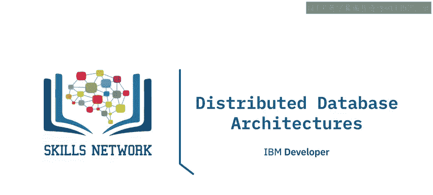

Welcome to distributed architectures After watching this video。

 you will be able to describe shared disk distributed database architectures and their benefits。

 Describe replication and its benefits De partitioning and sharding and list the benefits of partitioning and sharding so far we have looked at architectures where the database resides on a single server。

 however， for critical or large scale workloads where higha and or scalability is important。

 Major RDBMSss also provide distributed architectures that utilize a cluster of machines to house the database。

 the main types of distributed database architectures include shared disk architecture and shared nothing architectures which can employ either replication or partitioning In some cases。

 you also find architectures that combine one or more of these techniques or even specialized。

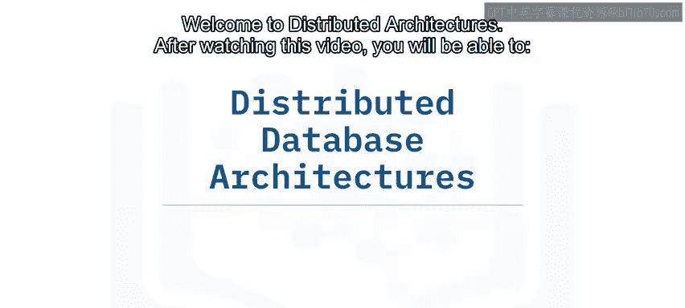

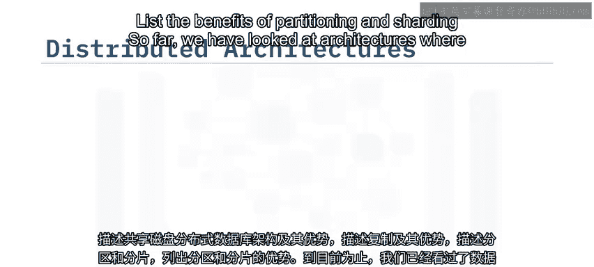

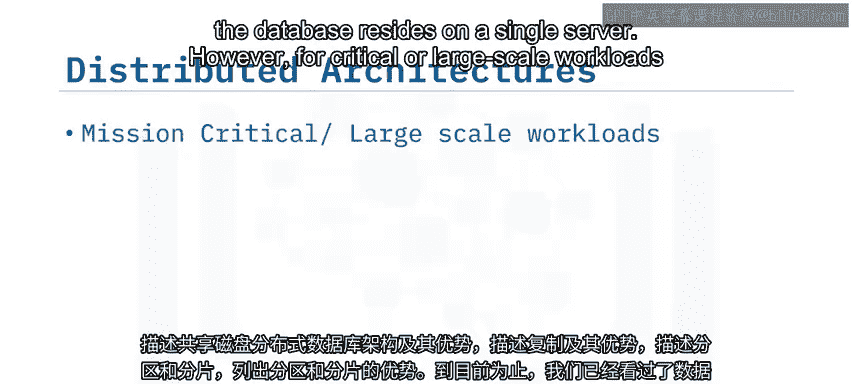

Hardware components to achieve availability and scalability。In shared disk database architectures。

 multiple database servers process the workload in parallel。

 allowing the workload to be processed faster。 Each database server is connected to shared storage infrastructure and to each other using highpe interconnects。

 This allows the client workloads to be distributed amongst different database servers。

 allowing for scalability in case of failure at one of the servers。

 the clients connected to it can be rerouted to other servers in the database cluster achieving for high availability。

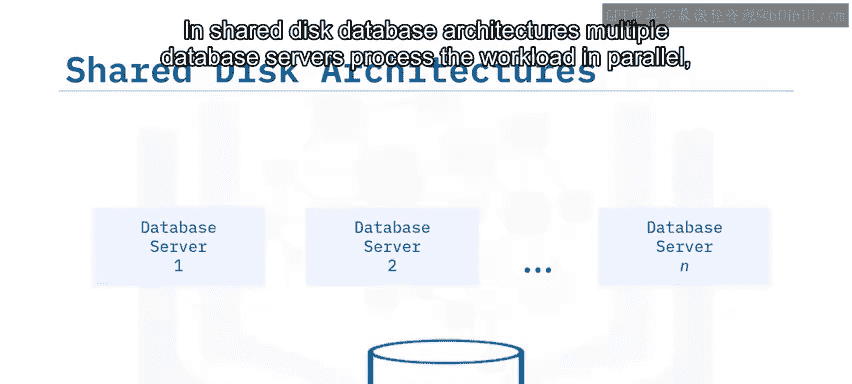

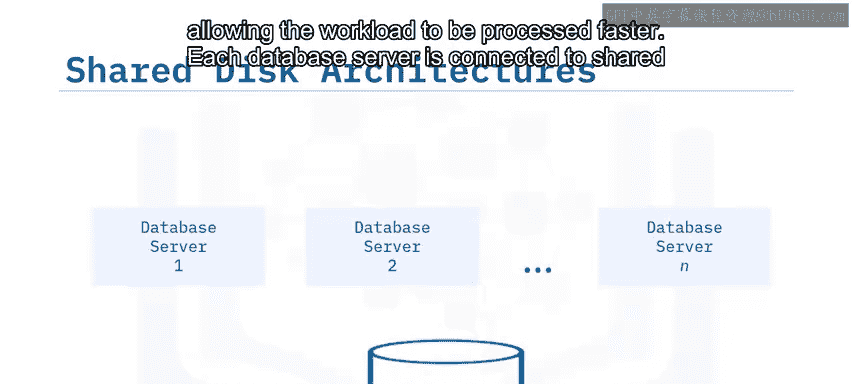

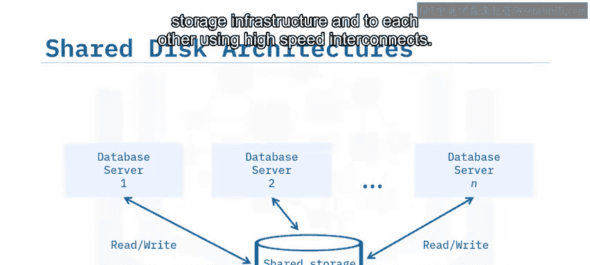

Datase replication is a technique whereby changes taking place on a database server are replicated to one or more database replicas。

 Client workload is distributed across servers for improved performance when the replica is within the same location。

 it is known as a high availability replica in case of a failure on the primary database server such as a software or hardware failure。

 the clients connected to it can be rerouted to the H replica but what happens if there is a sitewide disaster to mitigate against such scenarios。

 replicas can be set up in geographically distributed locations。

 so in case the entire data center or location has an outage such as a power outage， fire。

 earthquake or flood the clients can be routed to disaster recovery replicas。

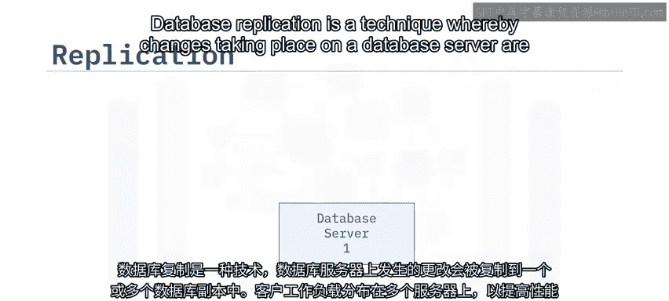

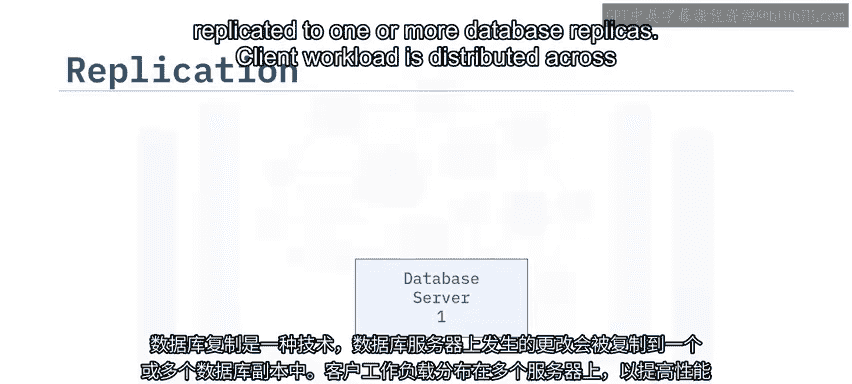

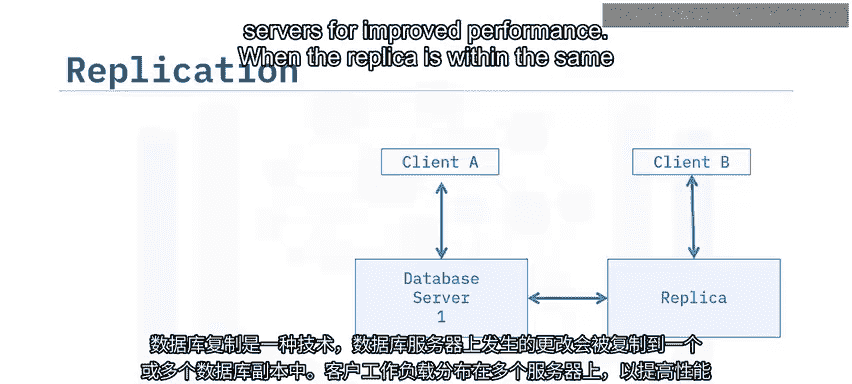

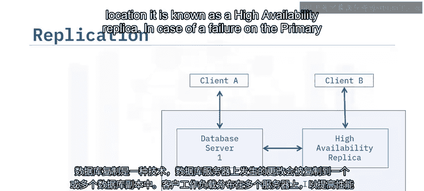

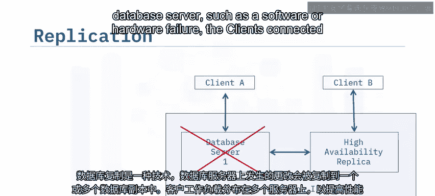

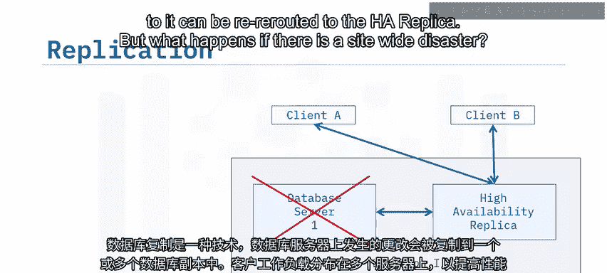

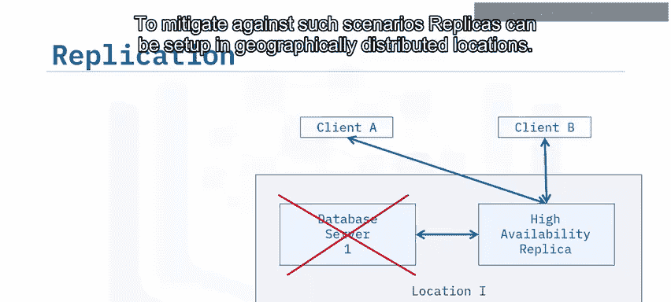

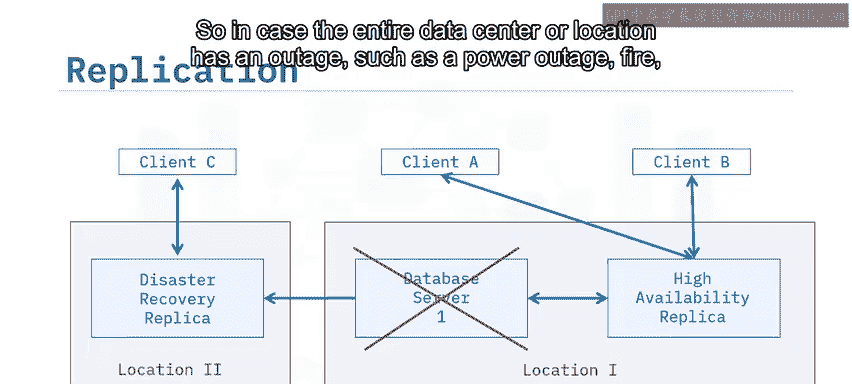

You can partition tables that need to contain very large quantities of data into multiple logical partitions with each partition containing a subset of the overall data For example。

 sales records for quarter1， Qua2 etc when these partitions are placed on separate nodes in a cluster it is called sharding Each shard contains its compute resources processing。

 memory and storage to act on its subset or partition of data when a client issues a query it is processed in parallel on multiple nodes or shards of the database and the query results from different nodes is synthesized and returned to the client as the data or query workloads increases additional shards and nodes can be added to the database cluster for increased parallel processing and improved performance database partitioning and sharding are more common for data warehousing and business intelligence。

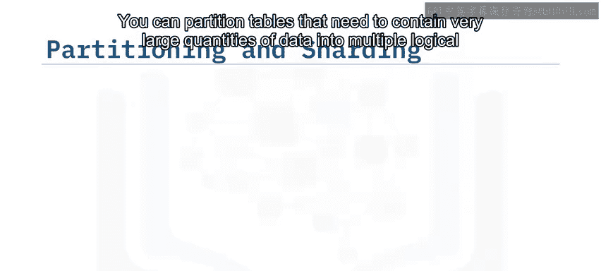

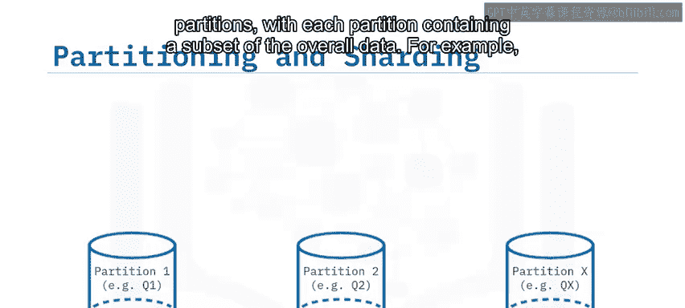

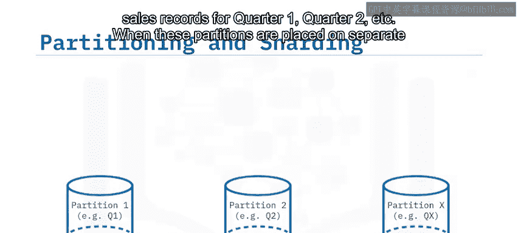

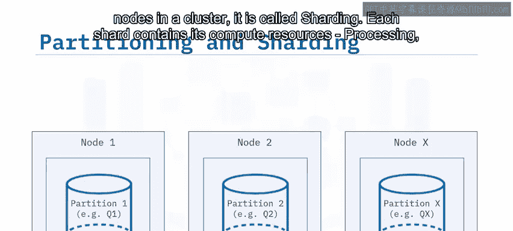

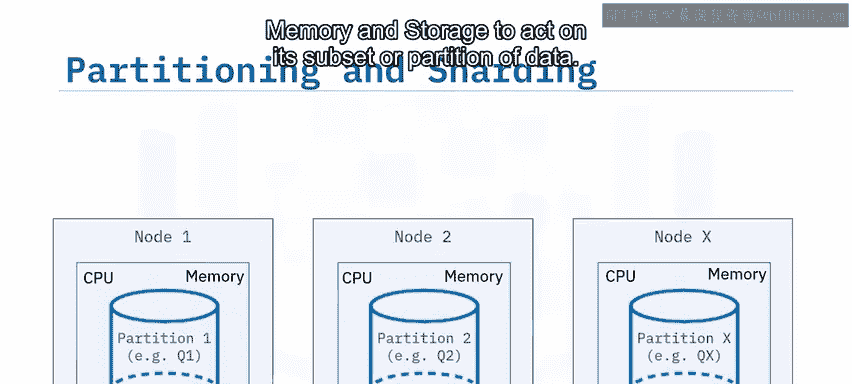

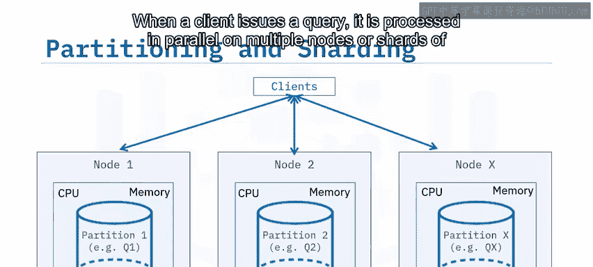

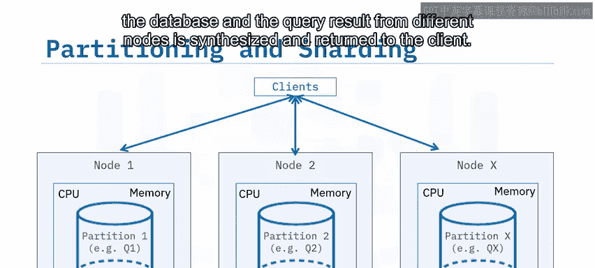

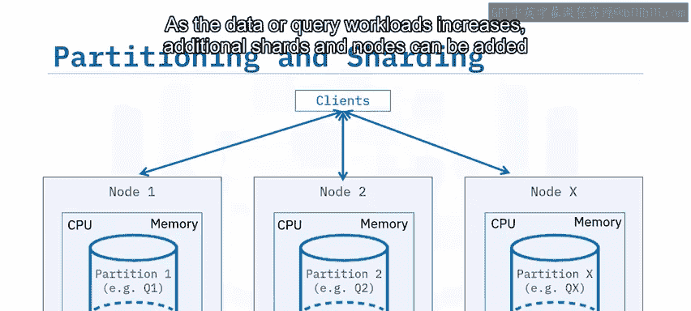

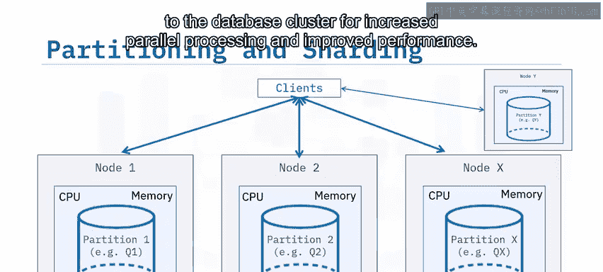

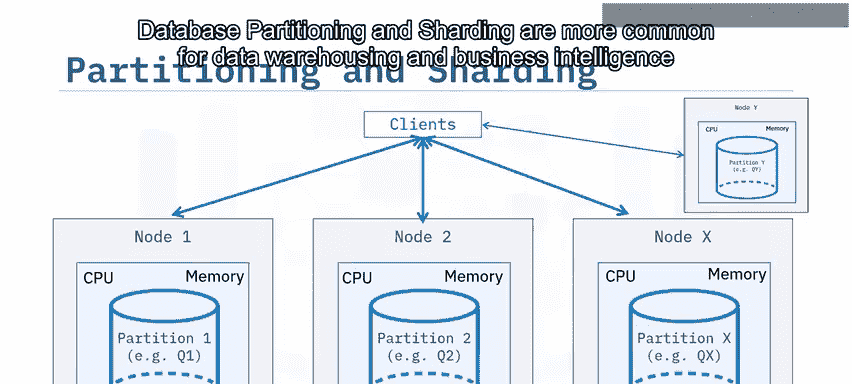

Workloads that involve very large volumes of data In this video。

 you learned that in shared disk database architectures。

 multiple database servers process the workload in parallel。

 allowing the workload to be processed faster in database replication changes taking place on a database server are replicated to one or more database replicas in a single location database replication provides high availability When a database replica is stored in a separate location it provides a copy of the data for disaster recovery。

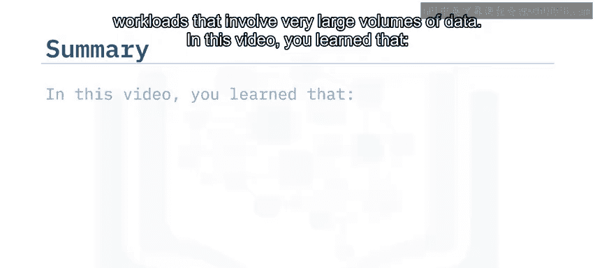

In partitioning， very large tables are split across multiple logical partitions。

 and in sharding each partition has its own compute resources。

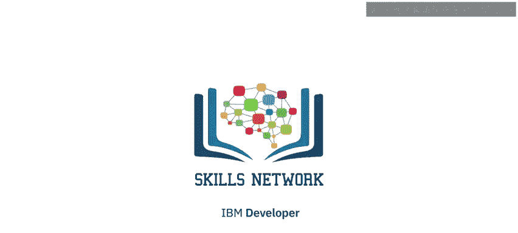