# IBM数据工程专业证书课程5：《数据科学SQL数据库和SQL课程（IBM）》｜sql-data-science｜ - P10：9_更改删除和截断表.zh_en - GPT中英字幕课程资源 - BV1Kz4y1W7h9

Hello and welcome to Alter Drop and Trunccate tables After watching this video you will be able to describe the Al table。

 D table and truncate statements， explain the syntax and use the statements and queries you use the Al table statement to add or remove columns from a table to modify the data type of columns to add or remove keys and add or remove constraints。

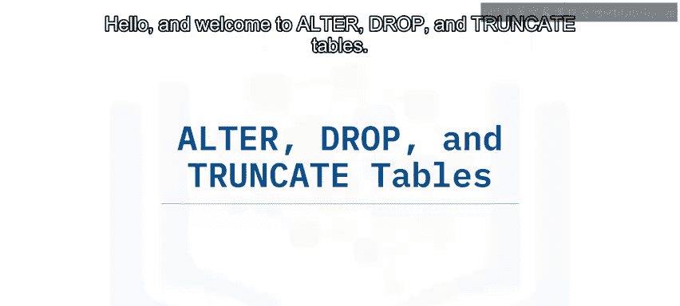

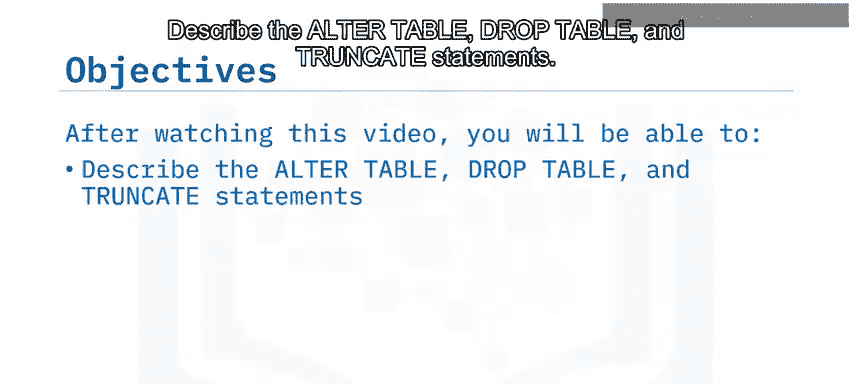

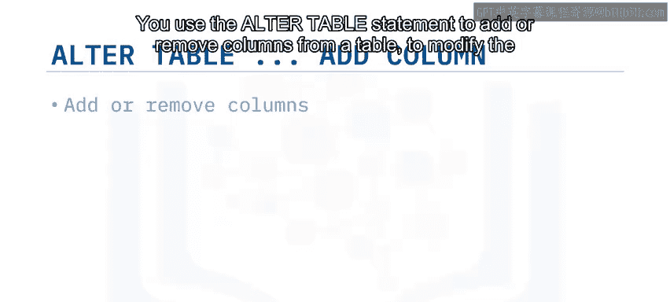

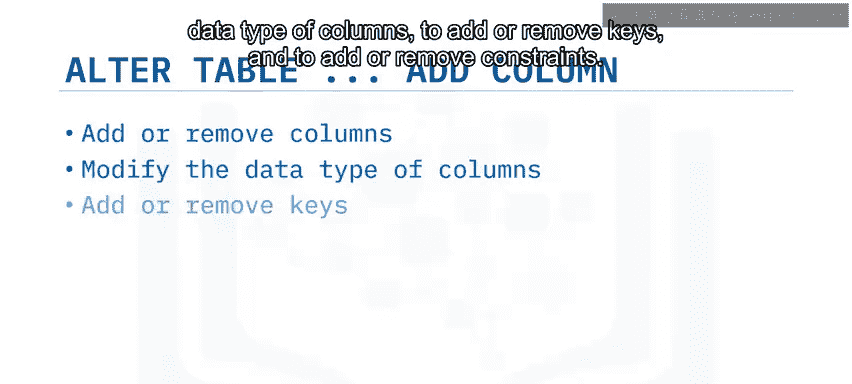

The syntax of the alter table statement is shown here。 You start with alter table。

 followed by the name of the table that you want to alter differently to the create table statement。

 though you do not use parentheses to enclose the parameters for the alter table statement each row in the alter table statement specifies one change that you want to make to the table。

 For example， to add a telephone number column to the author table in the library database to store the author's telephone number。

 use the following statement。 Al table author add column telephone underscore number。

 big int semicolon In this example the data type for the column is big int。

 which can hold a number up to 19 digits long。 You can also use the alter table statement to modify the data type of a column。

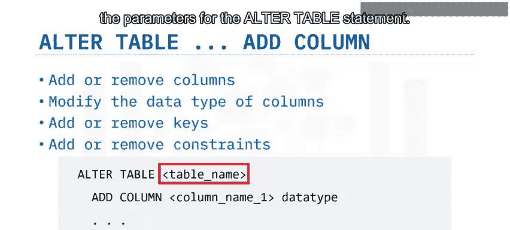

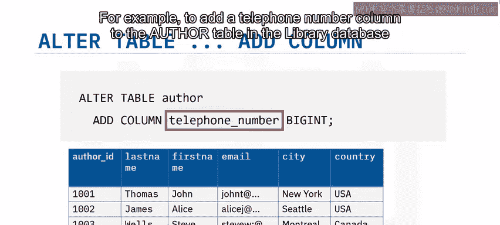

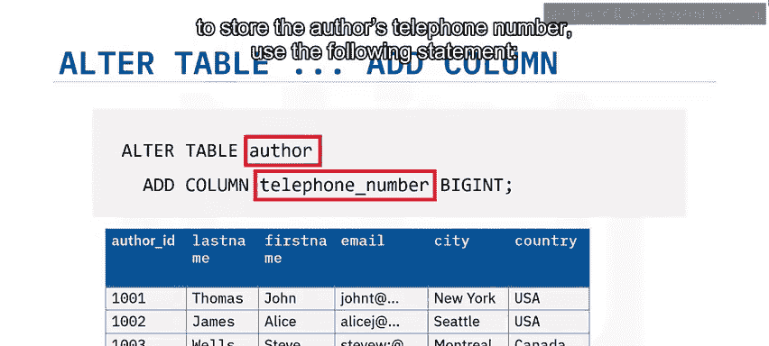

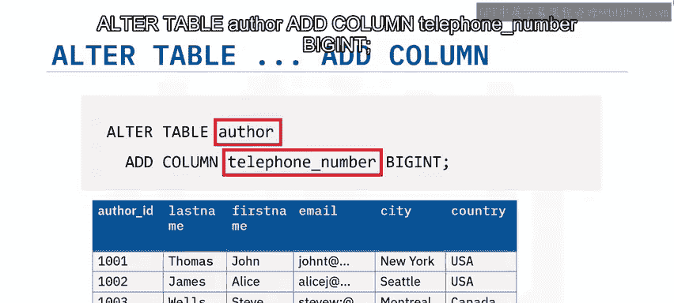

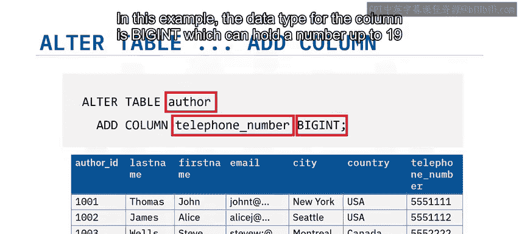

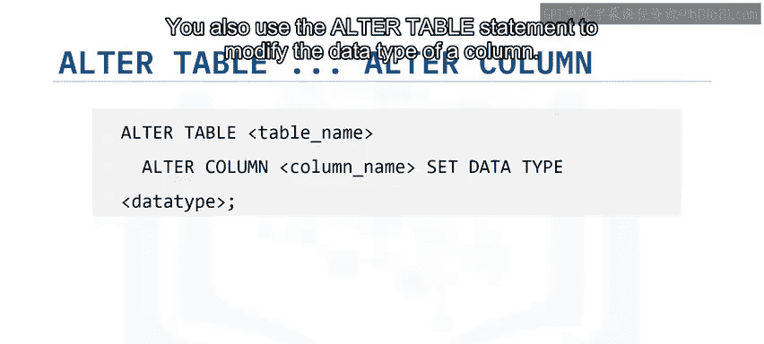

To do this， use the Al column clause specifying the new data type for the column For example。

 using a numeric data type for telephone number means that you cannot include parentheses。

 plus signs or dashes as part of the number you can change the column to use the car data type to overcome this This code shows how to alter the author table Al table。

 author， Al column telephone underscore number， set data type car， open parentheses 20。

 close parentheses semicolon altering the data type of a column containing existing data can cause problems though if the existing data is not compatible with a new data type。

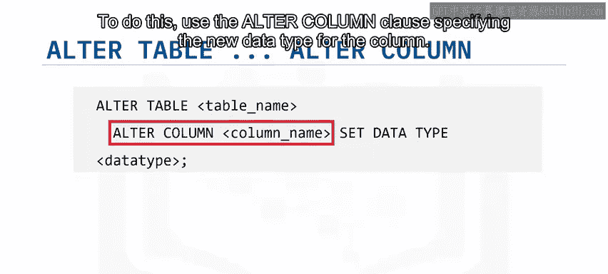

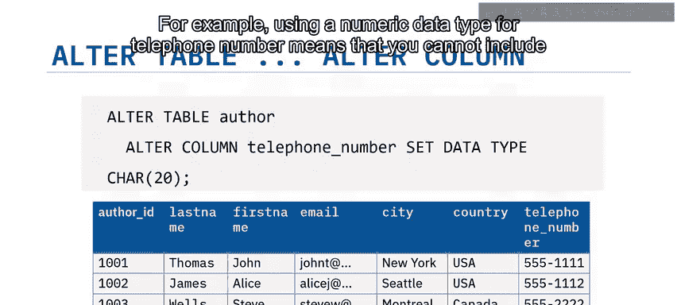

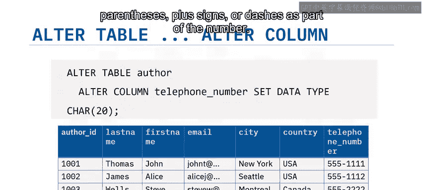

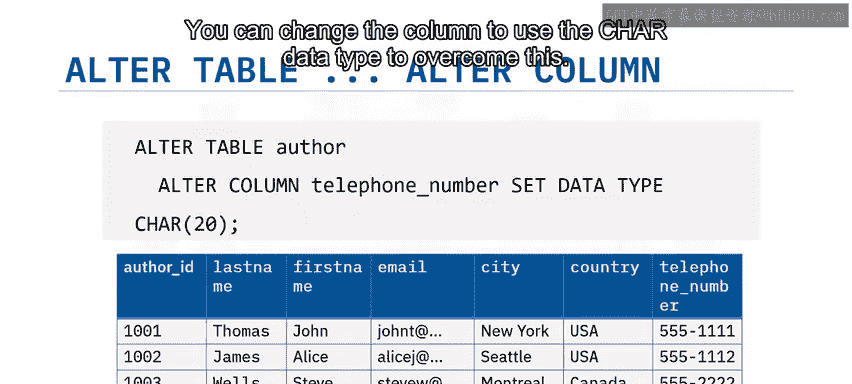

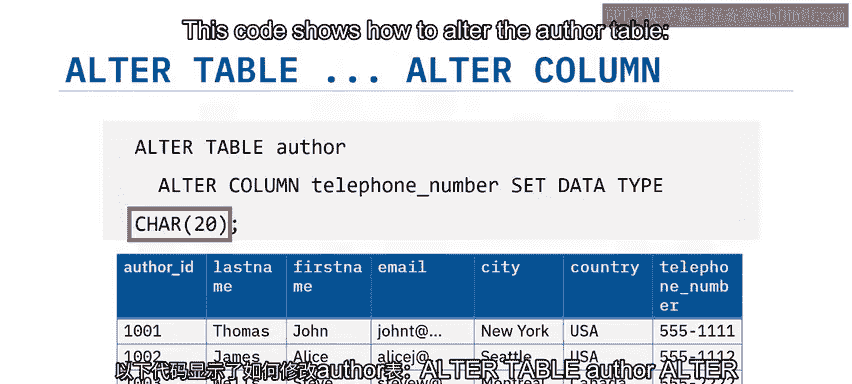

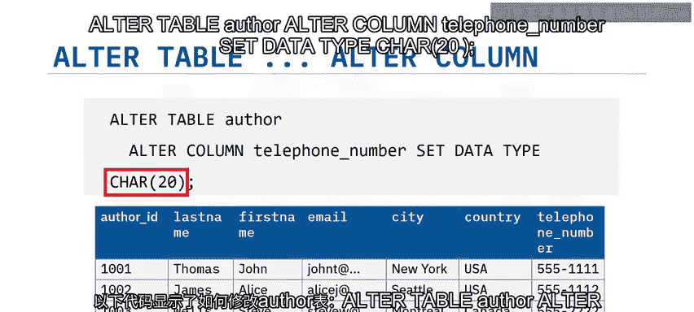

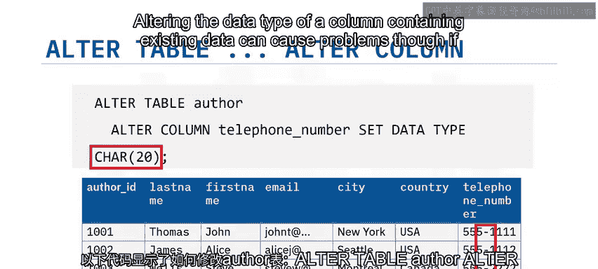

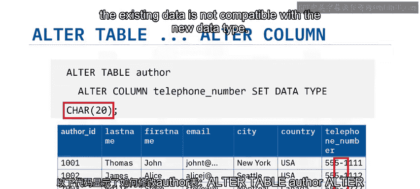

For example， changing a column from the car data type to a numeric data type will not work if the column already contains nonnumeric data If you try to do this。

 you will see an error message in the notification log and the statement will not run if your spec changes and you no longer need this extra column you can again use the Al table statement this time with the drop column clause to remove the column as shown Al table author drop column telephone underscore number semicolon similar to using drop column to delete a column from a table。

 you use the drop table statement to delete a table from a database If you delete a table that contains data by default。

 the data will be deleted alongside the table the syntax for the drop table statement is drop table table underscore name semicolon so you use this statement drop table author semicolon。

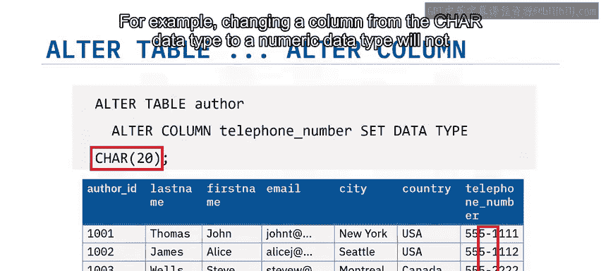

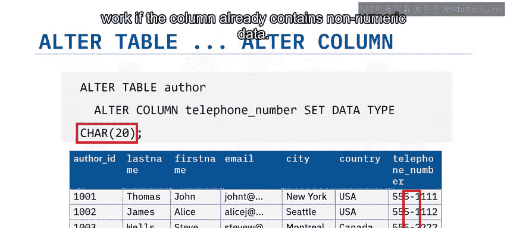

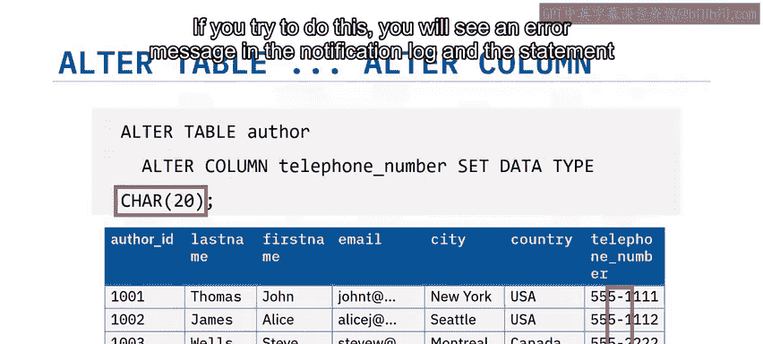

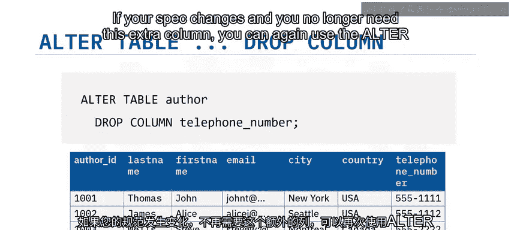

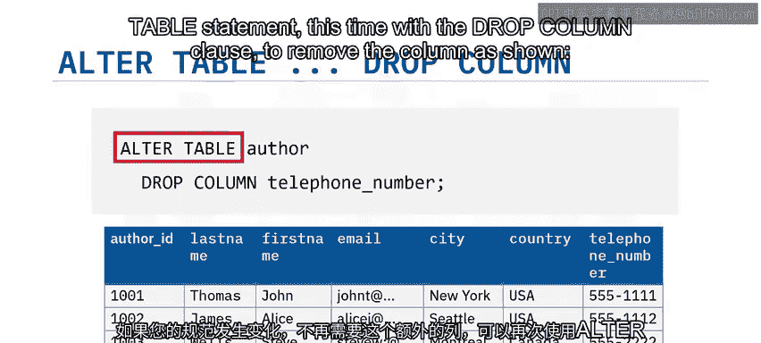

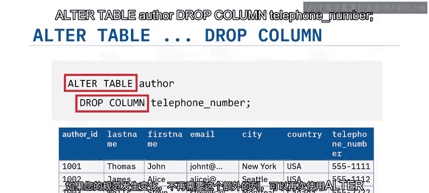

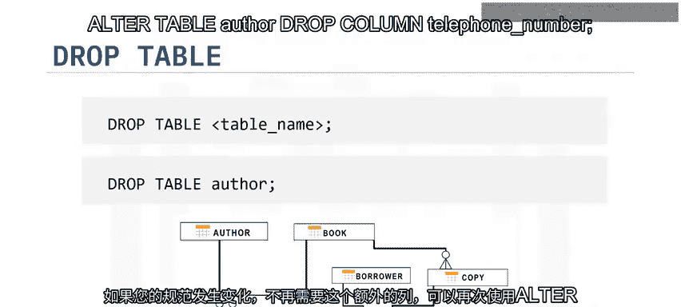

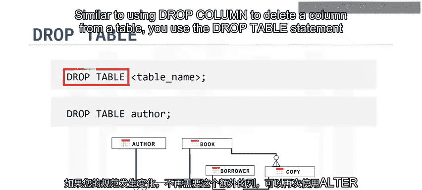

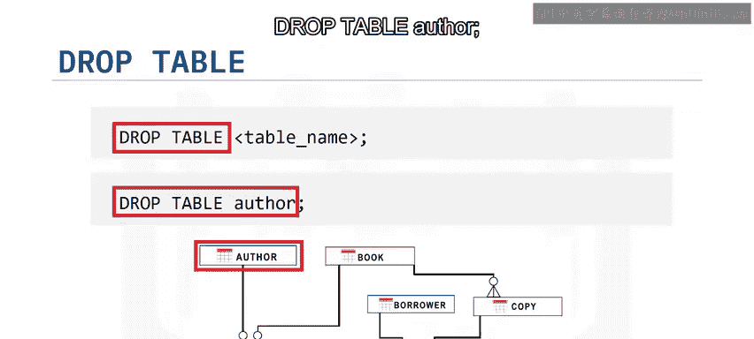

To remove the table from the database sometimes you might want to just delete the data in a table rather than deleting the table itself while you can use the delete statement without a aware clause to do this it is generally quicker and more efficient to truncate the table instead you use the trunccate table statement to delete all of the rows in a table the syntax of this statement is trunccate table table underscore name immediate semicolon the immediate specifies to process the statement immediately and that it cannot be undone so to truncate the author table。

 you use this statement trunccate table author immediately semicolon In this video you learned that the alter table statement changes the structure of an existing table for example to add modify or drop columns the drop table statement deletes an existing table and the trunccate table statement deletes all rows of data。

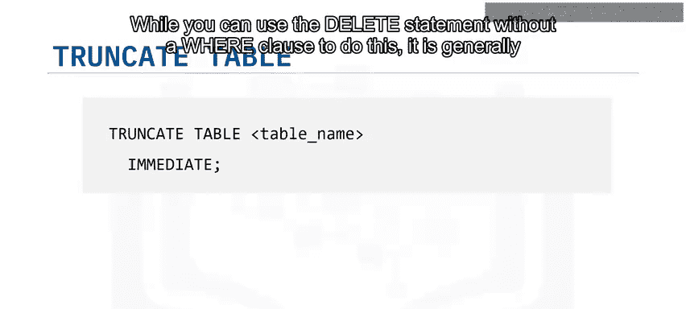

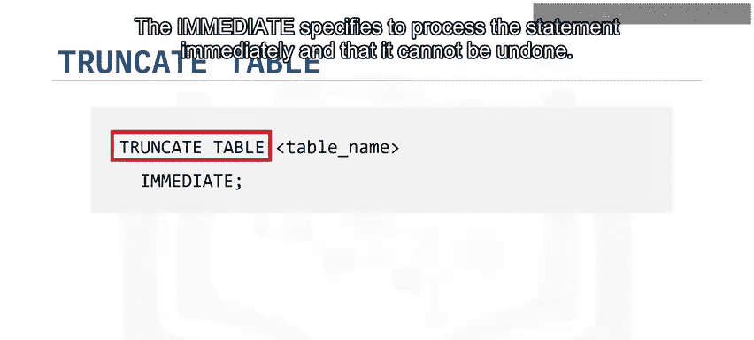

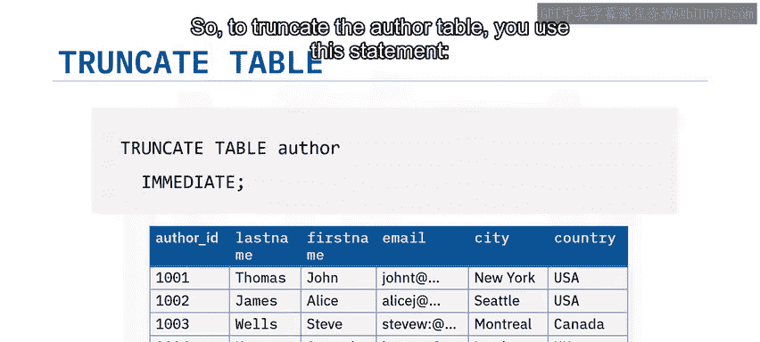

In a table。

