# IBM数据工程专业证书课程5：《数据科学SQL数据库和SQL课程（IBM）》｜sql-data-science｜ - P16：15_日期和时间内置函数.zh_en - GPT中英字幕课程资源 - BV1Kz4y1W7h9

🎼。Hello and welcome in this video we'll go over date and time SQL functions built into the database。

 so let's get started。

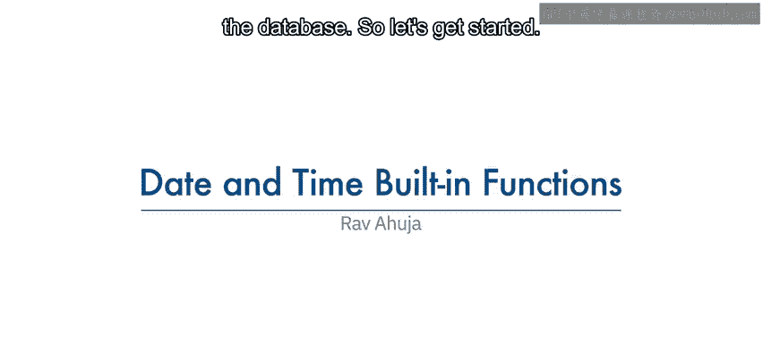

Most databases contain special data types for dates and times。

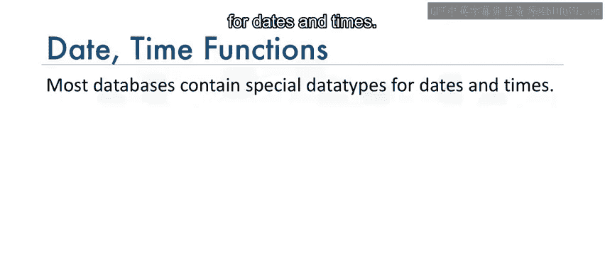

DB2 contains date， time， and timestamp types。

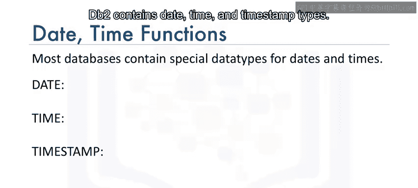

In DB2， date has eight digits for year， month and day。 time has six digits， hours。

 minutes and seconds。

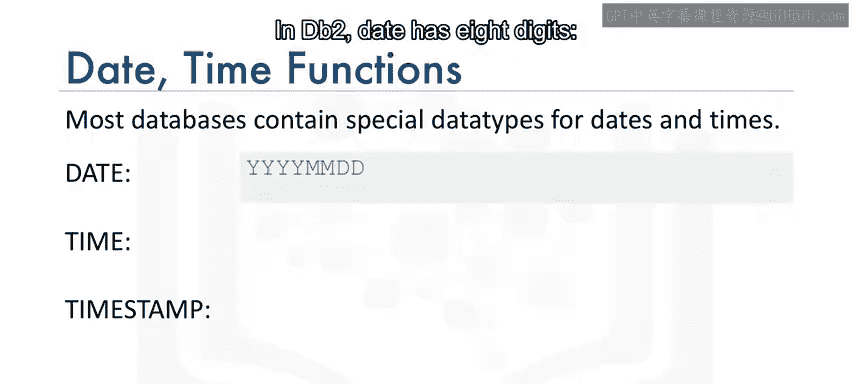

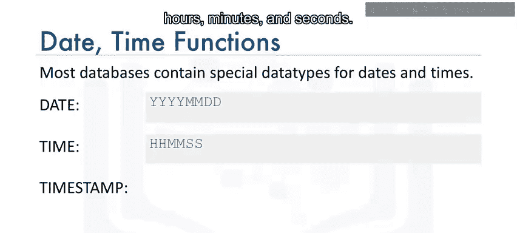

Timetamp has 20 digits， year， month， day， hour， minute， seconds and microseconds。

 where double x represents month and6 Z's or zs represents microseconds。

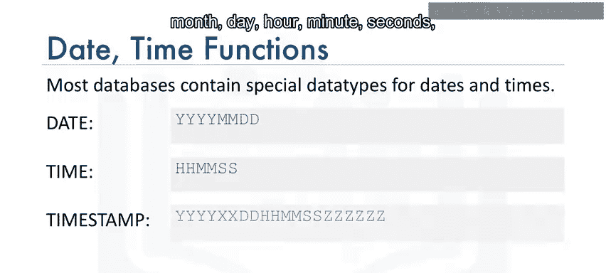

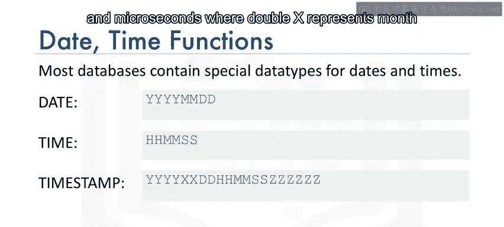

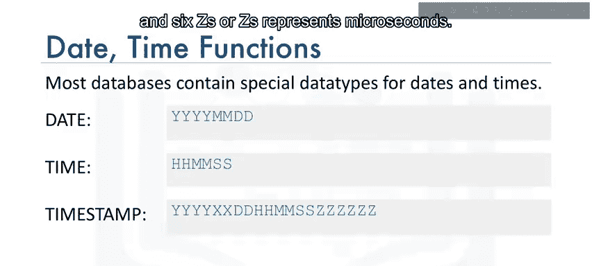

Functions exist to extract the day， month， day of month， day of week， day of year， week， hour。

 minute， and second。

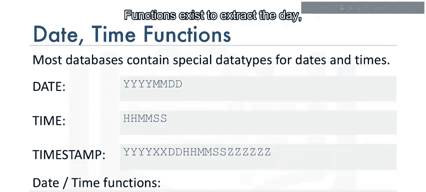

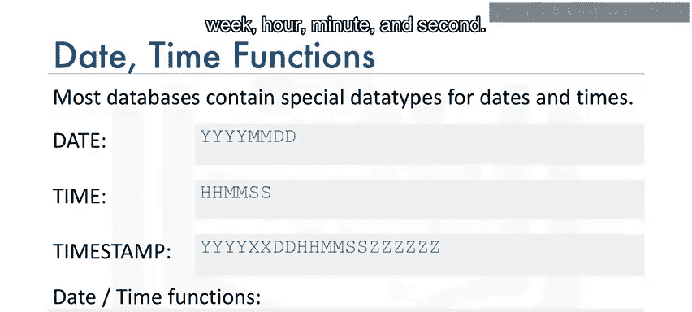

Let us look at some examples of queries for date and time functions。

 The day function can be used to extract the day portion from a date。 for example。

 to get the day portion for each rescue date involving cat。

 Select day rescue date from pet rescue where animal equals cat。

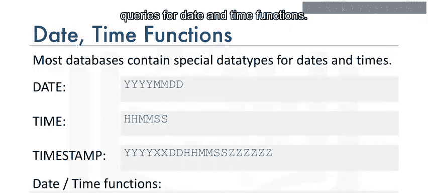

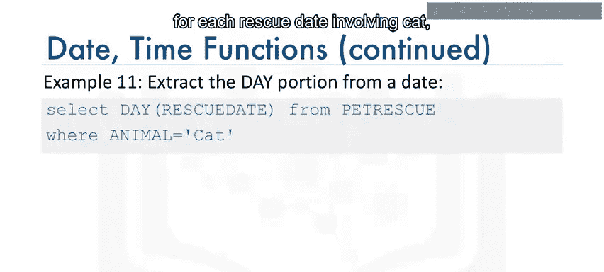

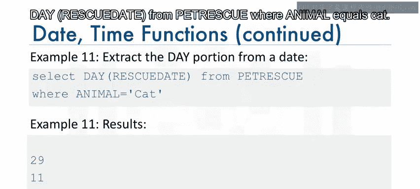

Date and time functions can be used in the wear clause， for example。

 to get the number of rescues during the month of May， that is for month5。

 select count star from pet rescue where month rescue date equals 05。

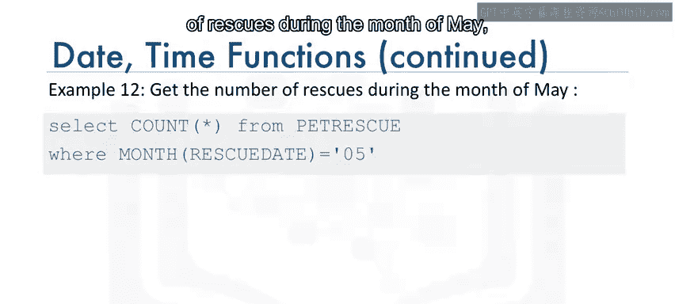

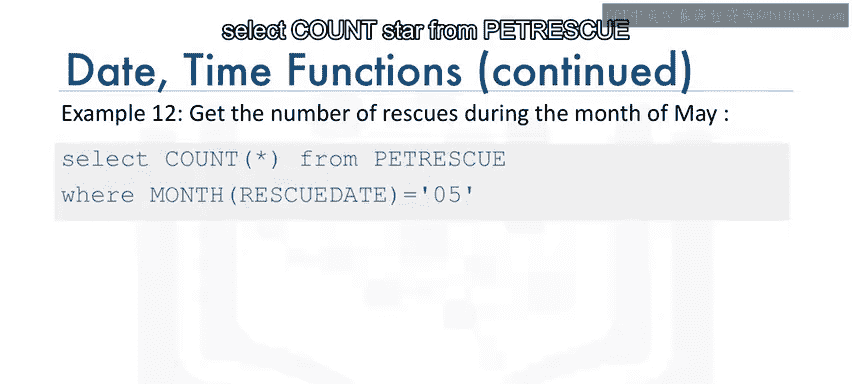

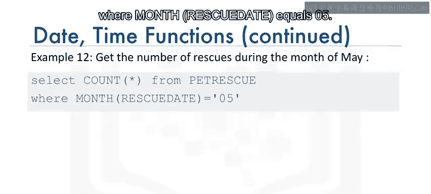

You can also perform date or time arithmetic。 for example。

 to find out what date it is three days after each rescue date。

 Maybe you want to know this because the rescue needs to be processed within three days。

 Select rescue date plus three days from pet rescue。

Special registers， current time and current date are also available， for example。

 to find out how many days have passed since each rescue date till now。

 select current date minus rescue date from pet rescue。 The result will be in years， months， days。

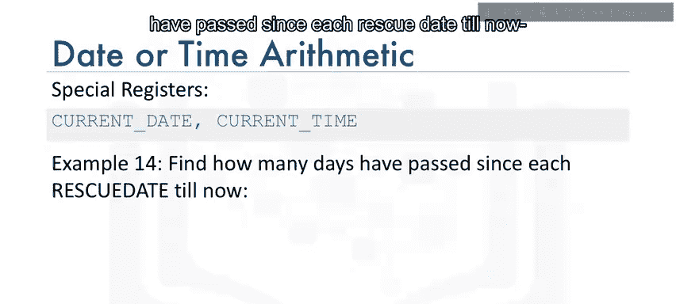

In this video， we looked at different types of built in SQL functions for working with dates and times。

 thank you for watching。