# IBM数据工程专业证书课程5：《数据科学SQL数据库和SQL课程（IBM）》｜sql-data-science｜ - P17：16_子查询和嵌套选择.zh_en - GPT中英字幕课程资源 - BV1Kz4y1W7h9

🎼。Hello and welcome In this video， you'll learn how to write subqueries or nested select statements。

😊。

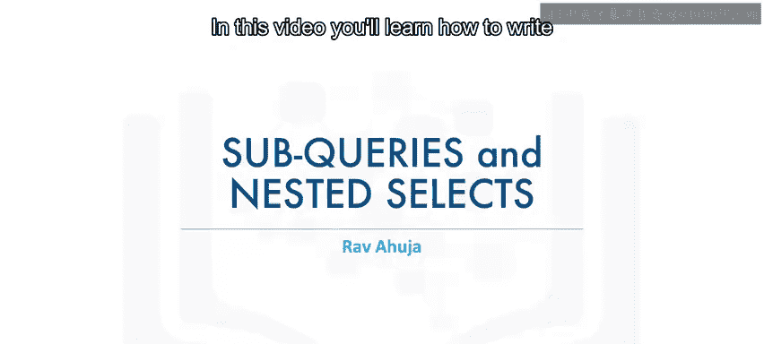

Subqueries or sub selects are like regular queries。

 but placed within parentheses and nested inside another query。

This allows you to form more powerful queries than would have been otherwise possible。

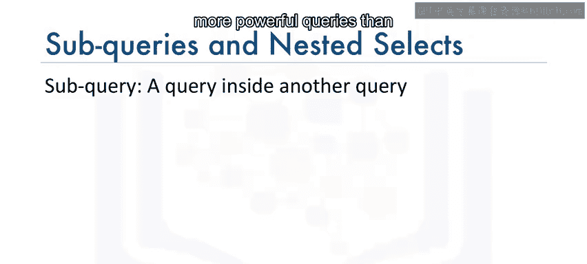

An example of a nested query is shown。

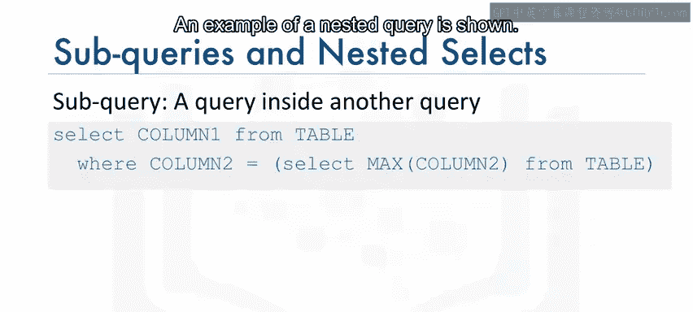

In this example， the subquery is inside the war clauses of another query。

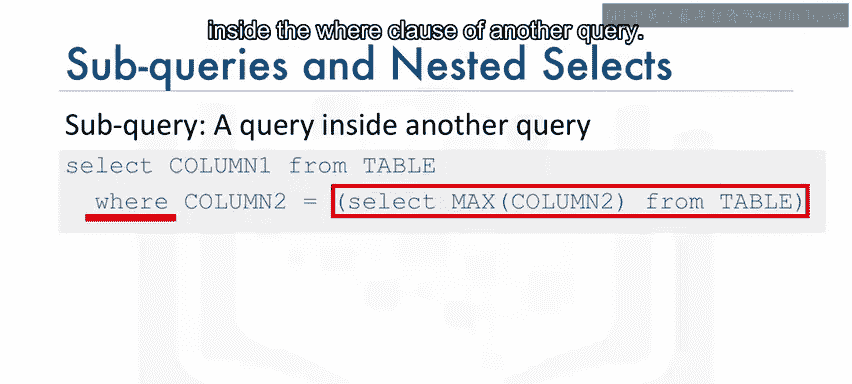

Consider the employeess table from the previous video。The first few rows of data are shown here。

The table contains several columns， including an employee ID D， first name， last name， salary， etc。

We will now go over some examples， involving this table。

Let's consider a scenario which may necessitate the use of subqueries。

Let's say we want to retrieve the list of employees who earn more than the average salary。

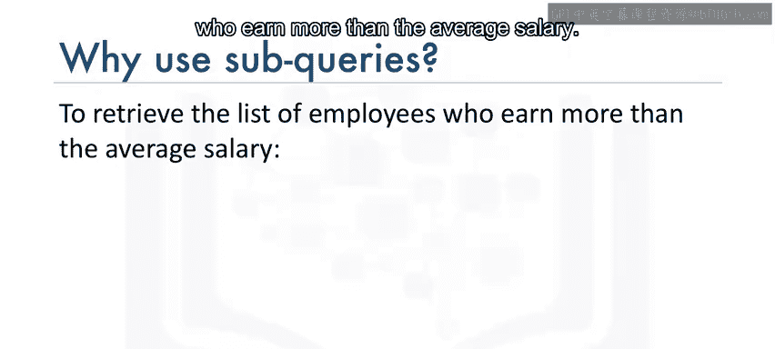

To do so， we could try this code。 select star from employees where salary is greater than average salary。

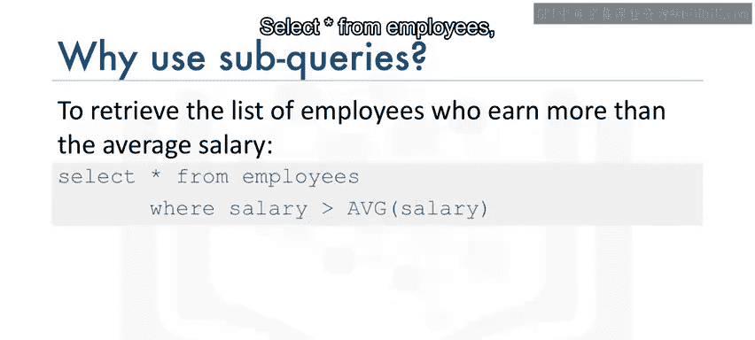

However， running this query will result in an error like the one shown。

 indicating an invalid use of the aggregate function。

One of the limitations of built in aggregate functions， like the average function。

 is that they cannot always be evaluated in the wear clauses。

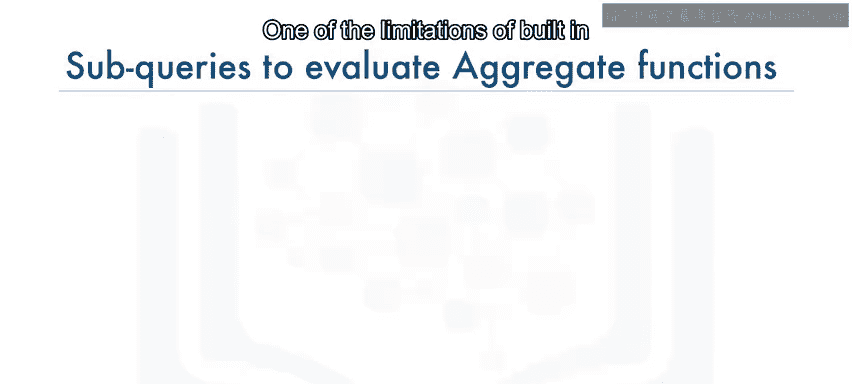

So to evaluate a function like average in the wear clause。

 we could make use of a sub select expression like the one shown here。 Select employee ID first name。

 last name， salary from employees where salary is less than open parenthesis。

 select average salary from employees， close parenthesis。

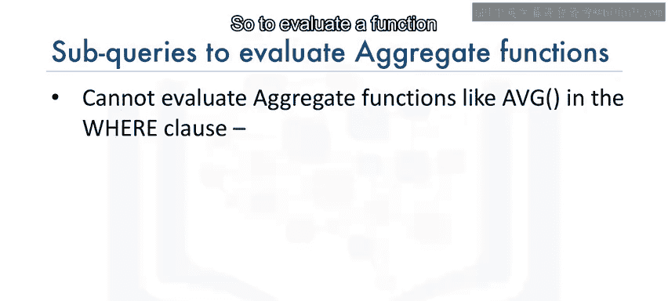

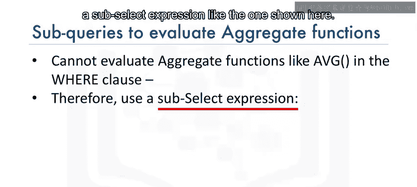

Notice that the average function is evaluated in the first part of the sub queryry。

 allowing us to circumvent the limitation of evaluating it directly in the where clause。

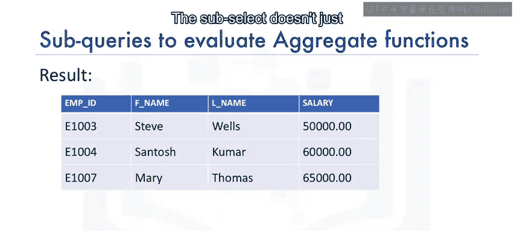

The subselect doesn't just have to go in the where clause。

 it can also go in other parts of the query， such as in the list of columns to be selected。

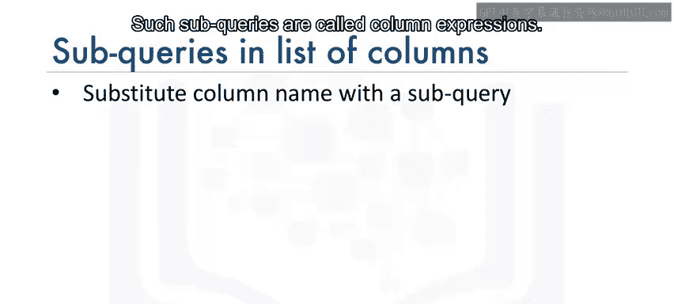

Such subqueries are called column expressions。Now， let's look at a scenario where we might want to use a column expression。

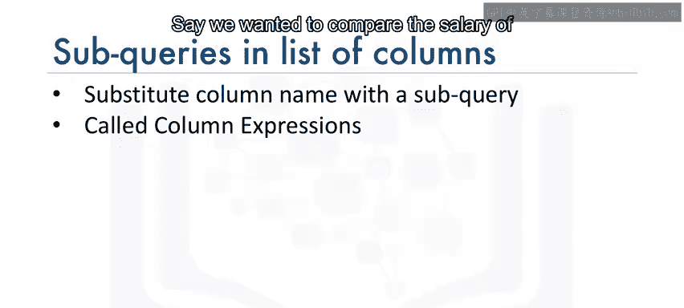

Say we wanted to compare the salary of each employee with the average salary。

 We could try a query like select employee I D， salary。

 average salary as average salary from employees。Running this query will result in an error indicating that no group by clause is specified。

We can circumvent this error by using the average function in a subquery placed in the list of the columns。

For example， select employee ID Sal， open left parenthsesis。

 select average salary from employees closed right parenthsesis as average salary from employees。

Another option is to make the subquery be part of the from clause。

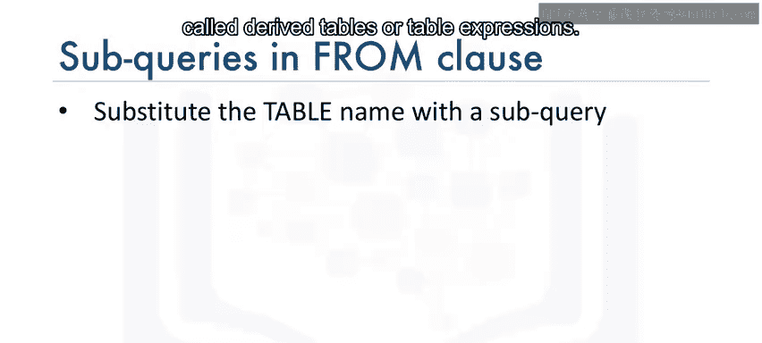

Subqueries like these are sometimes called derived tables or table expressions。

 because the outer query uses the results of the sub queryry as a data source。

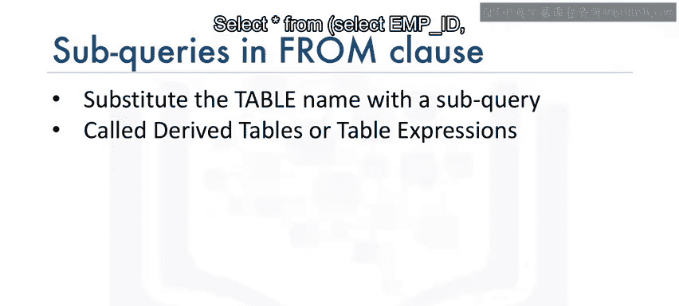

Let's look at an example to create a table expression that contains non sensitiveitive employee information。

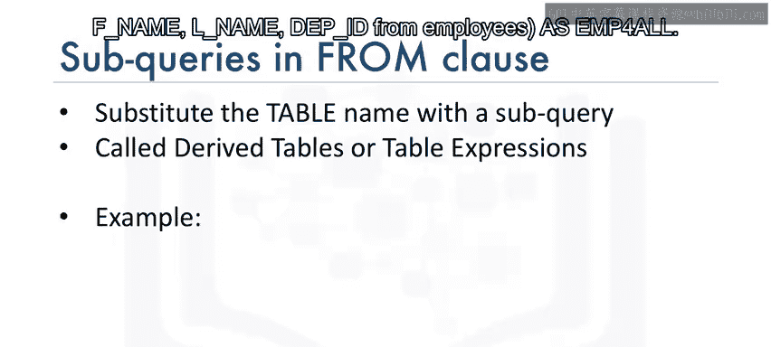

Select star from selectEmploy ID， first name， last name。

 department ID from employees as employee for all。The derived table in a subquery does not include sensitive fields like date of birth or salary。

This example is a trivial one， and we could just as easily have included the columns in the outer query。

 However， such derived tables can prove to be powerful in more complex situations。

 such as when working with multiple tables and doing joins。

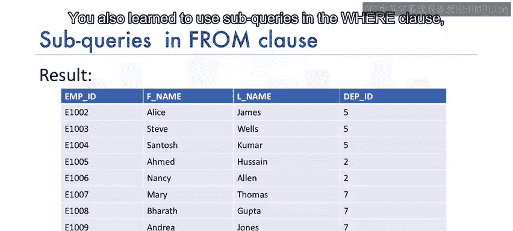

In this video， you have seen how subqueries and nested queries can be used to form richer queries and how they can overcome some of the limitations of aggregate functions。

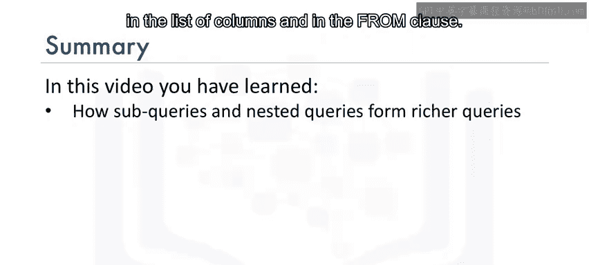

You also learn to use subqueries in the where clauses in the list of columns and in the from clauses。

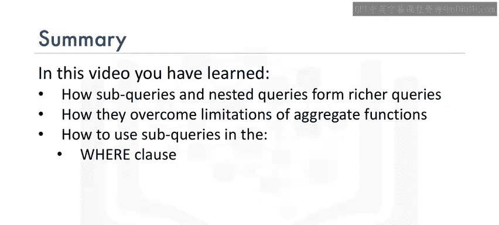

Thanks for watching this video。