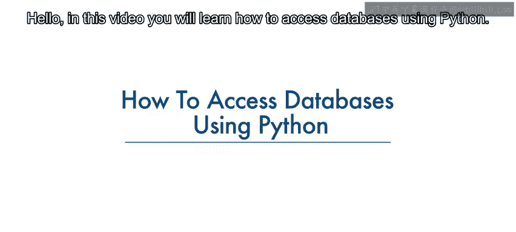
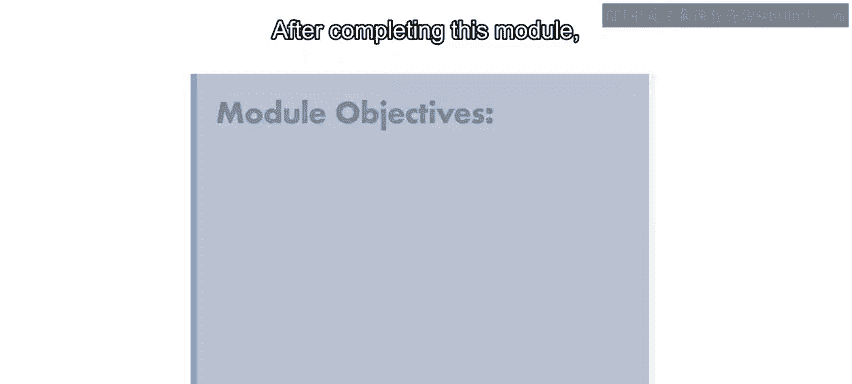
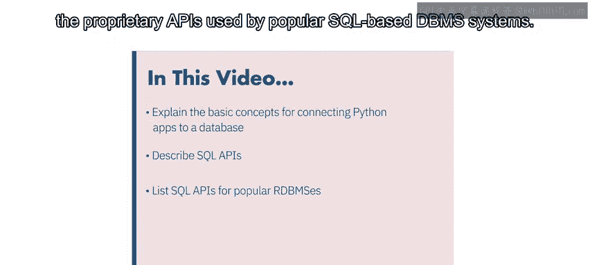
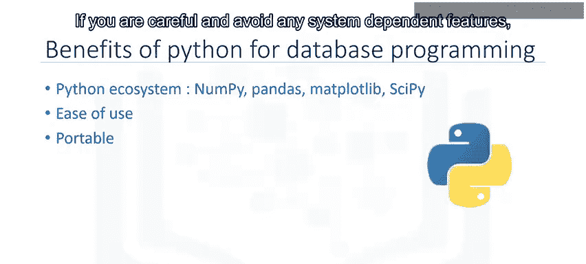
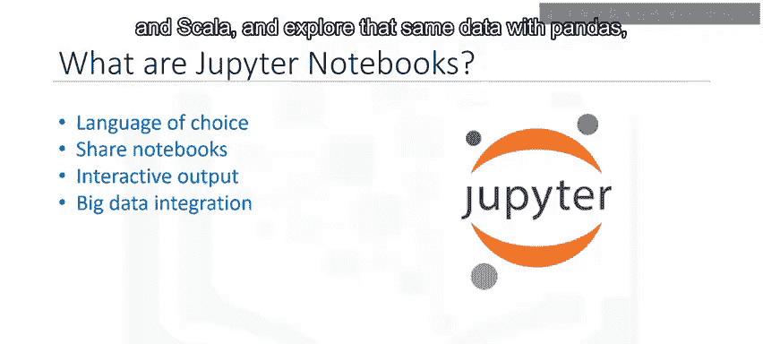
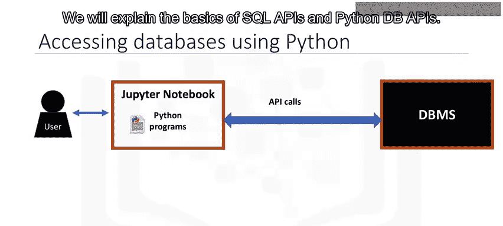
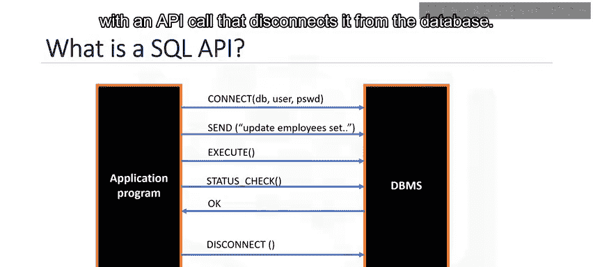
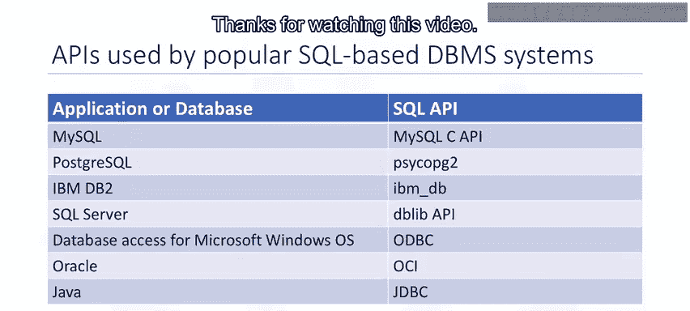

# IBM数据工程专业证书课程5：《数据科学SQL数据库和SQL课程（IBM）》｜sql-data-science｜ - P19：18_如何使用 python 访问数据库.zh_en - GPT中英字幕课程资源 - BV1Kz4y1W7h9

Hello， in this video， you will learn how to access databases using Python Dataases are powerful tools for data scientists。

 After completing this module， you will be able to explain the basic concepts related to using Python to connect to databases。

 Then you will create tables， load data and query data using SQL from Jupyter Notes。

 and finally analyze the data。😊。

In the lab assignments， you will learn how to create an instance in the cloud， connect to a database。

 query data from the database using SQL， and analyze the data using Python。

You will be able to explain the basic concepts related to connecting a Python application to a database。

 describe SQL APIs， as well as list some of the proprietary APIs used by popular SQL based DBMS systems。

Let's quickly review some of the benefits of using Python。

 a popular scripting language for connecting to databases。

The Python ecosystem is very rich and provides easy to use tools for data science。

 Some of the most popular packages are nup， pandas， mattepl Lib andsi P。

Python is easy to learn and has a simple syntax。 Due to its open source nature。

 Python has been ported to many platforms。All your Python programs can work on any of these platforms without requiring any changes at all。

 If you are careful and avoid any system dependent features。

Python supports relational database systems。Writing Python code to access databases is made easier by the presence of the Python database API。

 commonly referred to as the DB API。And detailed documentation related to Python is easily available。

Notebooks are also very popular in the field of data science because they run in an environment that allows creation and sharing of documents that contain live code。

 equations， visualizations， and explanatory text。A notebook interface is a virtual notebook environment used for programming。

😊，Examples of notebook interfaces include the Mathematica Note， Male Workheet， Mattelab notebook。

 I Python Jupiter， R Markdown， Apache Zeppellin， Apache Spark Note， and the Databricks Cloud。

In this module we will be using Jupiter Notes， the Jupiter Note is an open source web application that allows you to create and share documents that contain live code。

 equations， visualizations， and narrative text。Here are some of the advantages of using Jupiter notebooks。

Notebook support for over 40 programming languages， including Python， R， Julia and Scala。

 Notes can be shared with others by email， Dropbox， Gitthub and the Jupiter notebook viewer。

Your code can produce rich interactive output， HTML images， videos， latetex and custom mime types。

 You can leverage big data tools such as Apache Spark from Python R and Scala。

 and explore that same data with pandas， Pi KiLn， G G Pot 2 and Tensorflowlow。

This is how a typical user accesses databases using Python code written on a Jupiter notebook。

 a web based editor。There is a mechanism by which the Python program communicates with the DBMS。

 The Python code connects to the database using API calls。

 We will explain the basics of SQL APIs and Python DB APIs。

 An application programming interface is a set of functions that you can call to get access to some type of service。

 A SQL API consists of library function calls as an application programming interface API for the DBMS。

To pass SQL statements to the DBMS， an application program calls functions in the API。

 and it calls other functions to retrieve query results and status information from the DBMS。

The basic operation of a typical SQL API is illustrated in the figure。

The application program begins its database access with one or more API calls that connect the program to the DBMS to send the SQL statement to the DBMS。

 the program builds the statement as a text string in a buffer and then makes an API call to pass the buffer contents to the DBMS。

The application program makes API calls to check the status of its DBMS request and to handle errors。

The application program ends its database access with an API call that disconnects it from the database。

Now let's learn basic concepts about some of the proprietary APIs used by popular SQL based DBMS systems。

Each database system has its own library， As you can see。

 the table shows a list of a few applications and corresponding SQL APIs。

MySQL C API provides low level access to the MySQL clientient Ser protocol and enables C programs to access database contents。

The PsychoPG2 API connects Python applications in Postgres QL databases。

The IBM underscore DB API is used to connect Python applications to IBM DB2 databases。

The DBlibb API is used to connect to SQL server databases。

ODBC is used for database access for Microsoft Windows OS。OCI is used by Oracle databases。

 and finally， JDBC is used by Java applications。 Thanks for watching this video。

