# IBM数据工程专业证书课程5：《数据科学SQL数据库和SQL课程（IBM）》｜sql-data-science｜ - P21：20_使用 ibm db api 连接数据库.zh_en - GPT中英字幕课程资源 - BV1Kz4y1W7h9

Hello and welcome to connecting to a database using the IBM underscore DB API。

 After completing this lesson， you will be able to understand the IBM underscore DB API。

 as well as the credentials required to connect to a database using Python。

 We will also demonstrate how to connect to an IBM DB2 database using Python code written on a Jupiter notebook。

😊。

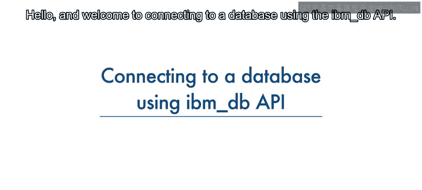

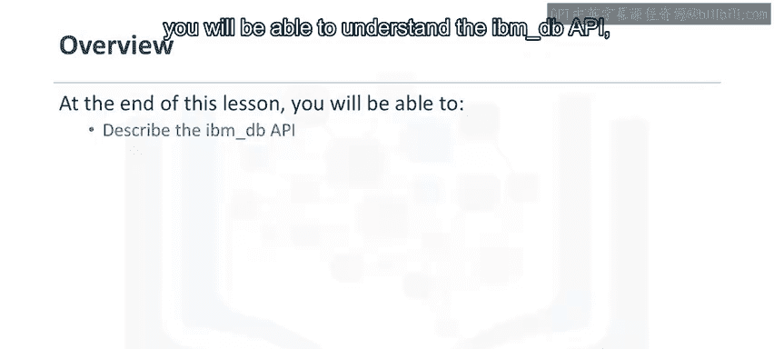

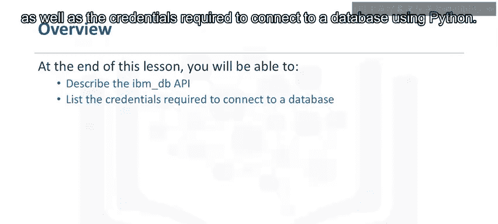

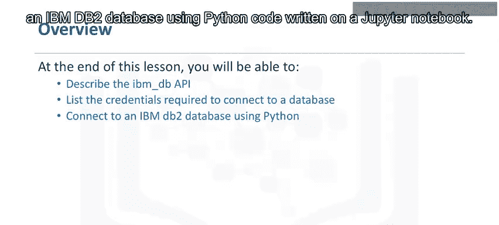

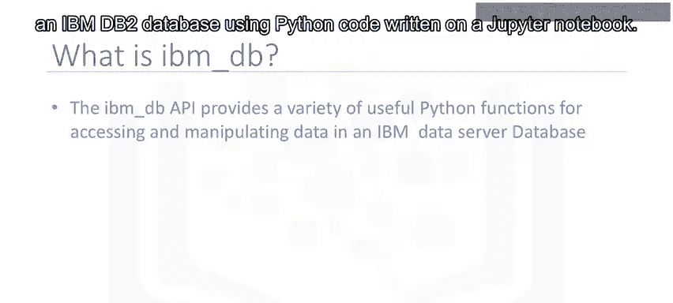

The IBM underscore DBAP provides a variety of useful Python functions for accessing and manipulating data in an IBM data server database。

 including functions for connecting to a database， preparing and issuing SQL statements。

 fetching rows from results sets， calling stored procedures。

 committing and rolling back transactions， handling errors and retrieving metadata。

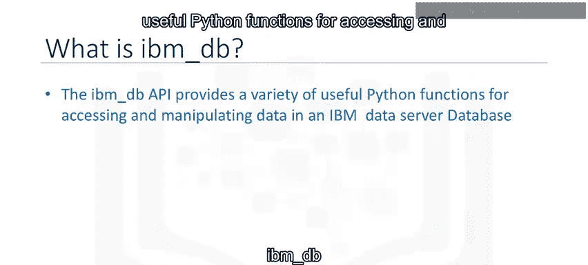

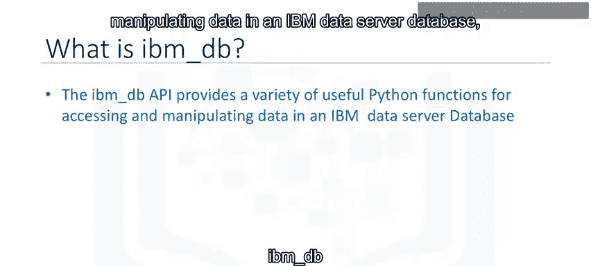

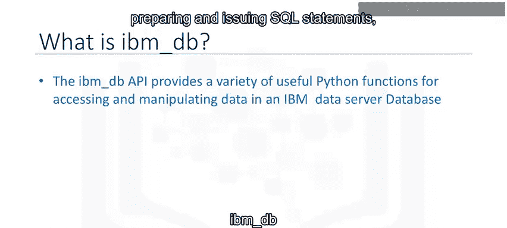

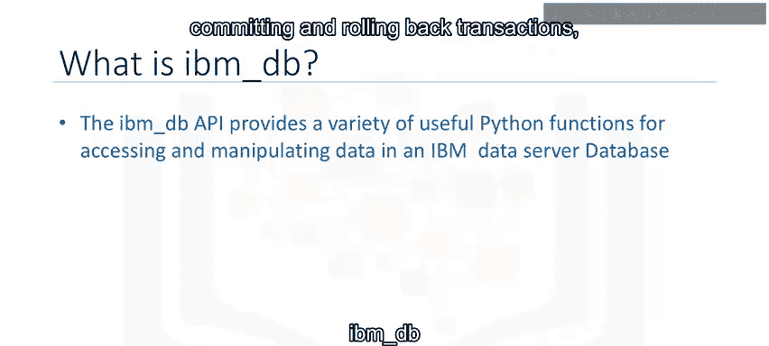

The IBM underscore DB API uses the IBM data server driver for ODBC and CI APIs to connect to IBM DB2 and inform mix。

 We import the IBM underscore DB library into our Python application。

Connecting to the DB2 requires the following information， a driver name， a database name。

 a host DNS name or IP address， a host port， a connection protocol， a user ID， and a user password。

Here is an example of creating a DB2 database connection in Python。

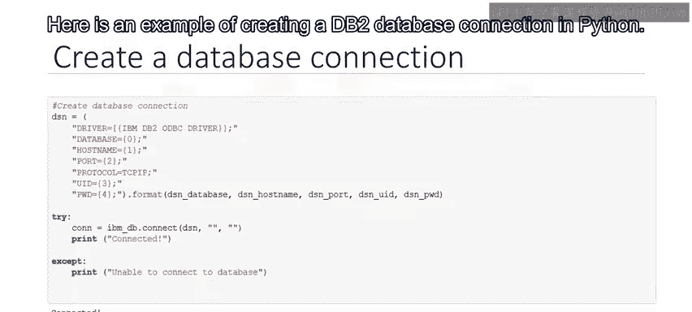

We create a connection object DS SN， which stores the connection credentials。

 The connect function of the IBM underscore DB API will be used to create a non persistent connection。

 The DSN object is passed as a parameter to the connection function。

 If a connection has been established with the database。 Then the code returns connected。

 As the output。 otherwise， the output will be unable to connect to database。

 Then we free all resources by closing the connection。

 Remember that it is always important to close connection so that we can avoid unused connections taking up resources。

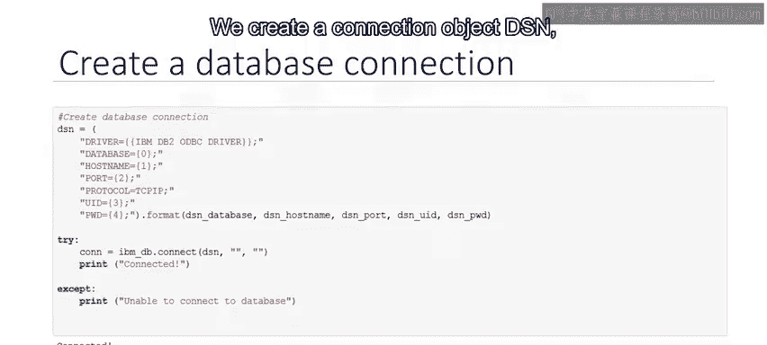

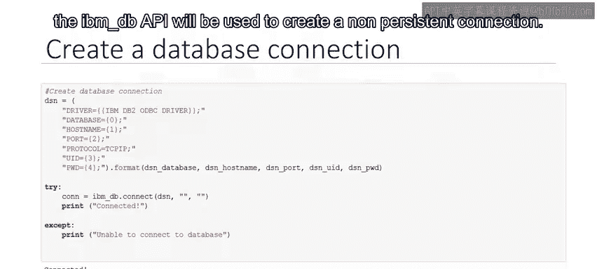

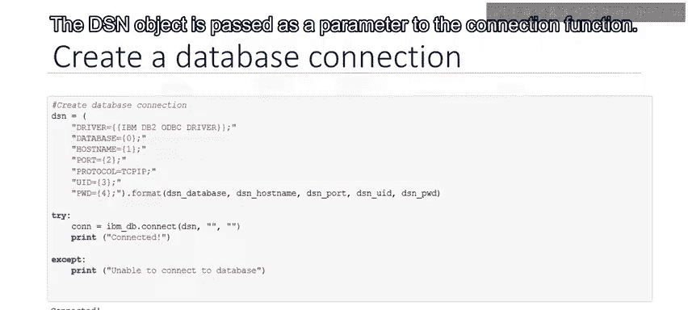

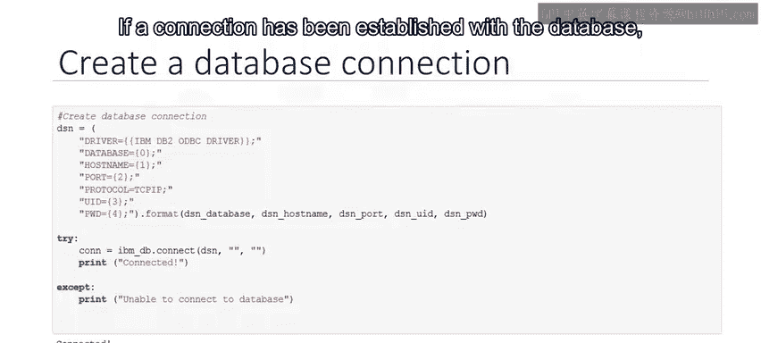

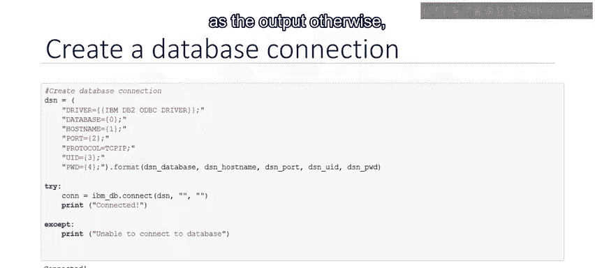

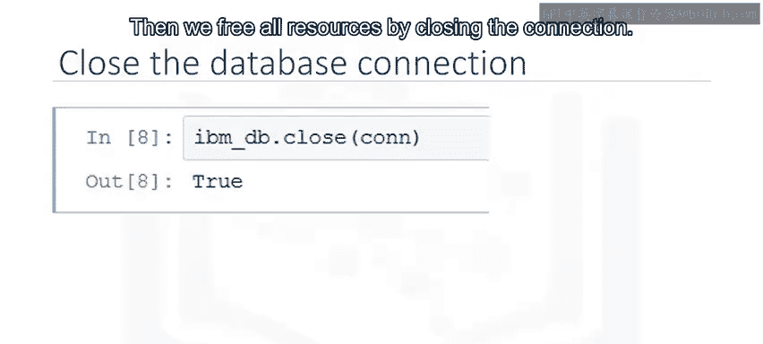

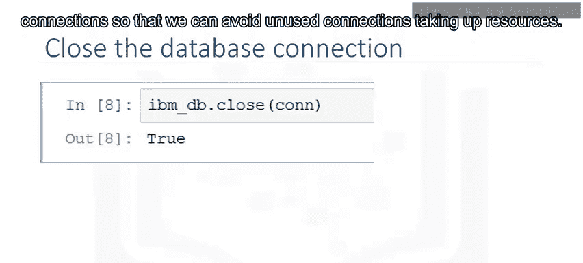

Thank you for watching this video。

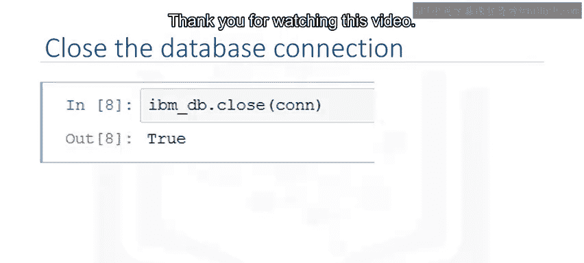