# IBM数据工程专业证书课程5：《数据科学SQL数据库和SQL课程（IBM）》｜sql-data-science｜ - P25：24_获取表和列的详细信息.zh_en - GPT中英字幕课程资源 - BV1Kz4y1W7h9

🎼。Hello and welcome。 In this video， we'll look at how to get information about tables and their columns in a database。

😊。

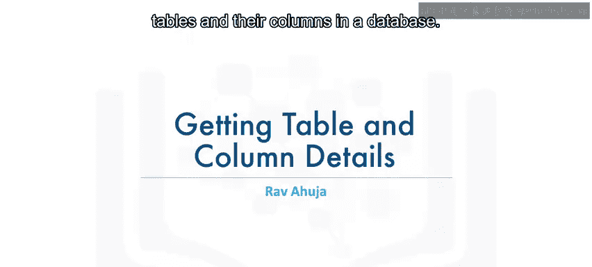

Now， how would you get a list of tables in the database？

Sometimes your database may contain several tables， and you may not remember the correct name。

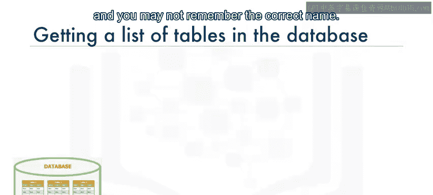

For example， you may wonder whether the table is called dog， dogs or four legged mammals。

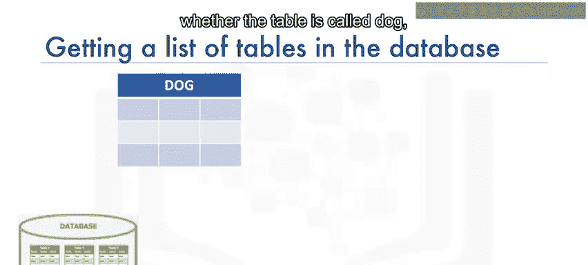

Database systems typically contain system or catalog tables from where you can query the list of tables and get their properties。

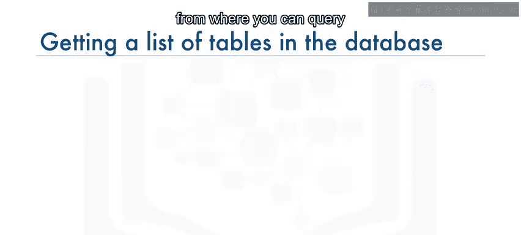

In DB2， this catalog is called CisCAT tables in SQL Server， it information schema tables。

 and in Oracle， it's all tables or user tables。

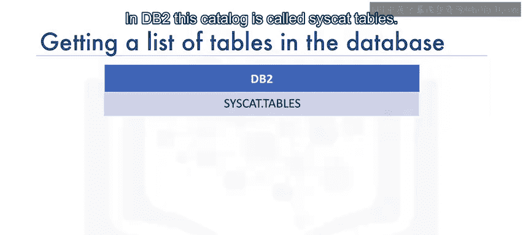

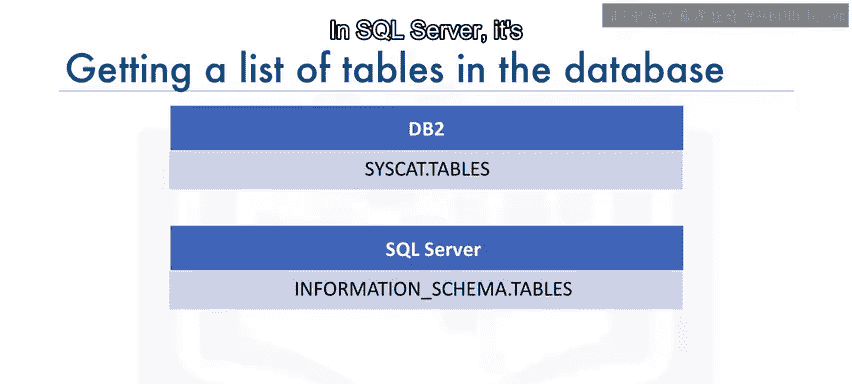

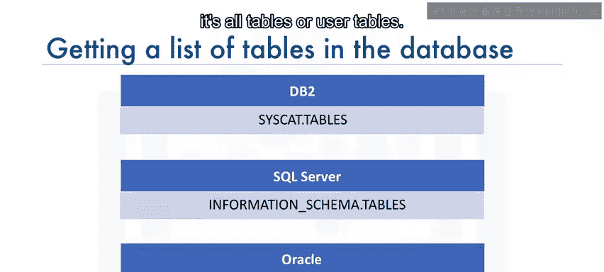

To get a list of tables in a DB2 database， you can run the following query。

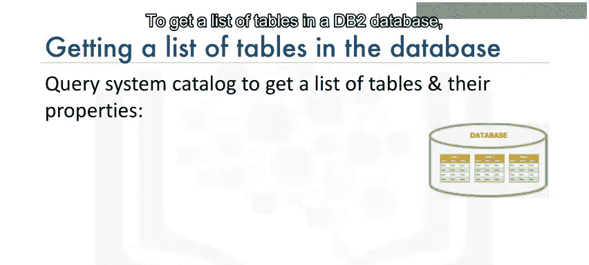

Select star from Cscat tables。This select statement will return to many tables。

 including system tables， so it's better to filter the result as shown here。 Select tab schema。

 tab name， create， underscore time from Ciscat tables， where tab schema equals ABC 1，2，3，4，5。

Please ensure that you replace ABC 12345 with your own DB2 username。

When you do a select star from ciscat tables， you get all the properties of the tables。

 Sometimes we're interested in specific properties such as creation time。

Let's say you've created several tables with similar names。 For example， dog 1， dog underscore test。

 dog test 1， and so on。

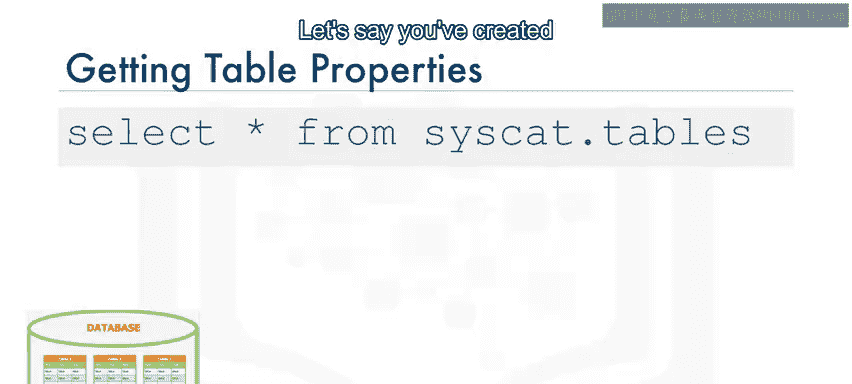

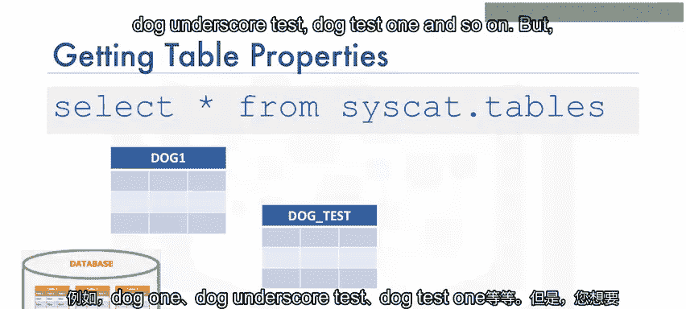

But you want to check which of these tables was the last one you created。To do so。

 you can issue a query like select T schema， Tab name， Cate underscore time from CisCAT tables。

 where tabab schema equals QCM 54853。

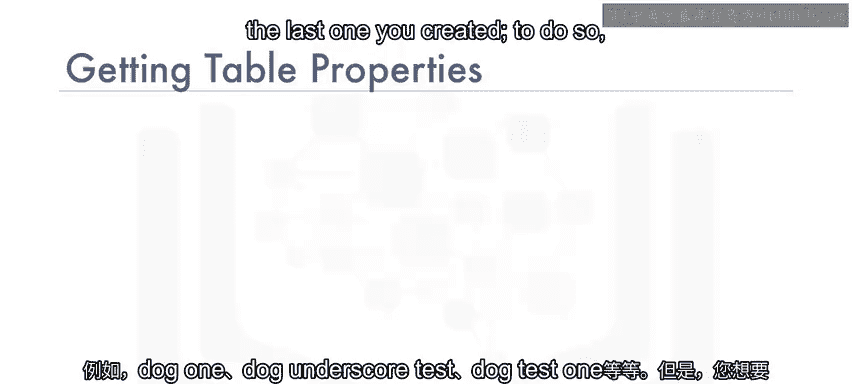

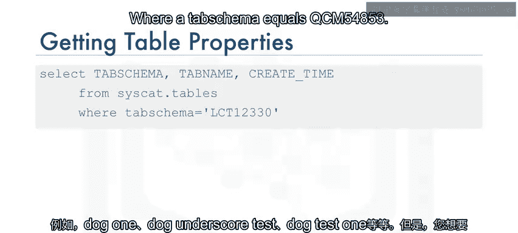

The output will contain the schema name， table name， and creation time for all tables in your schema。

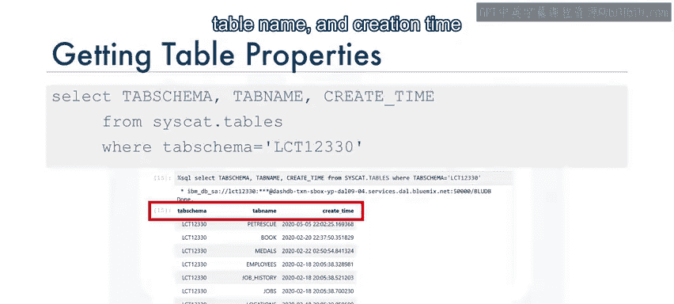

Next， let's talk about how to get a list of columns in a table。

If you can't recall the exact name of a column， for example。

 whether it had any lower case characters or an underscore in this name in D B2。

 you can issue a query like the one shown here。Select star from Ciscat columns where tabab name equals dogs。

For your information， in my sequel， you can simply run the command， show columns from dogs。

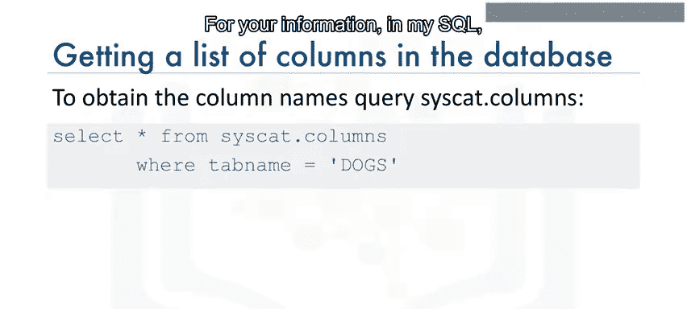

Or you may want to know specific properties like the data type and length of the data type in DB2。

 you can issue a statement like select distinct name。

 call type length from cis IBM cis columns where T B name equals dogs。

Here we look at the results of retrieving column properties for a real table called Chicago Cri data from a Jupiter notebook。

Notice in the output， you can tell certain column names show different cases。 For example。

 the column titled arrest has an upper case A， and the rest of the characters are lowercase。

 So keep in mind that when you refer to this column in your query。

 not only must you enclose the word arrest within double quotes。

 You must also preserve the correct case inside the quotes。In this video。

 we saw how to retrieve table and column information。 Thanks for watching。😊。

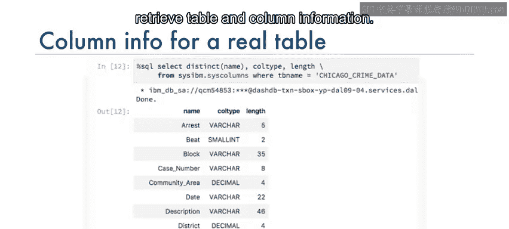