# IBM数据工程专业证书课程5：《数据科学SQL数据库和SQL课程（IBM）》｜sql-data-science｜ - P26：25_意见.zh_en - GPT中英字幕课程资源 - BV1Kz4y1W7h9

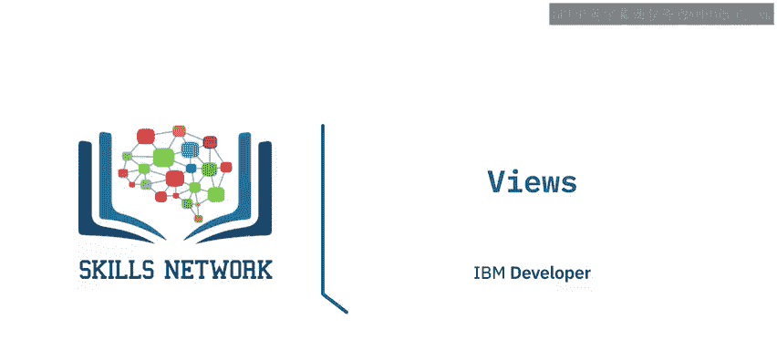

Welcome to View After watching this video， you will be able to define a view。

 describe when to use a view and explain the syntax for creating a view。

 A view is an alternative way of representing data that exists in one or more tables or views a view can include all or some of the columns from one or more base tables or existing views creating a view creates a named specification of a results table which can be queried in the same way as a table you can also change the data in the base table by running insert update and delete queries against the view。

 When you define a view， the definition of the view is stored。

 the data that the view represents is stored in the base tables not by the view itself。

 you can use view to show a selection of data for a given table so you can omit sensitive data like tax information birth dates or salaries combined two or more tables。

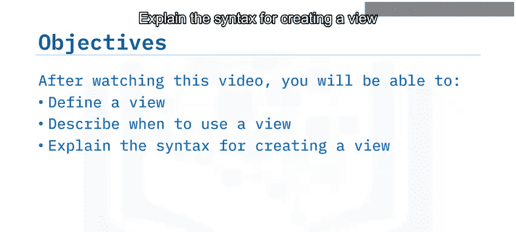

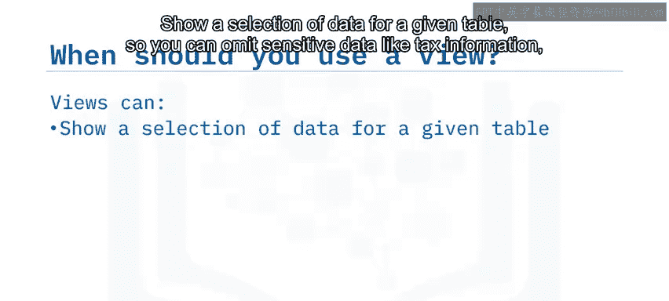

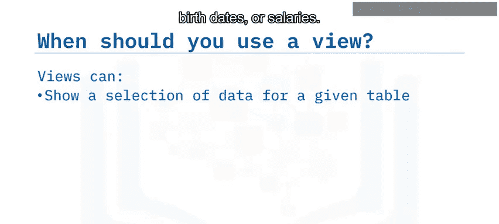

Meaningful ways simplify access to data by granting access to a view without granting access to the underlying tables and show only the portions of data relevant to the process that uses the view for example。

 you can create a view that displays only non-sensitive data from the employee table employee ID name。

 address， job ID manager ID and department ID The view does not show sensitive data like salary or birth date you can use the create view statement to create a view based on one or more tables or views to define a view use the create View statement and assign a name up to 128 characters in length to the view list the columns that you want to include you can use an alias to name the columns if you wish Use the as select clause to specify the columns in the view and the from clause to specify the base table name you can also add an optional where clause。

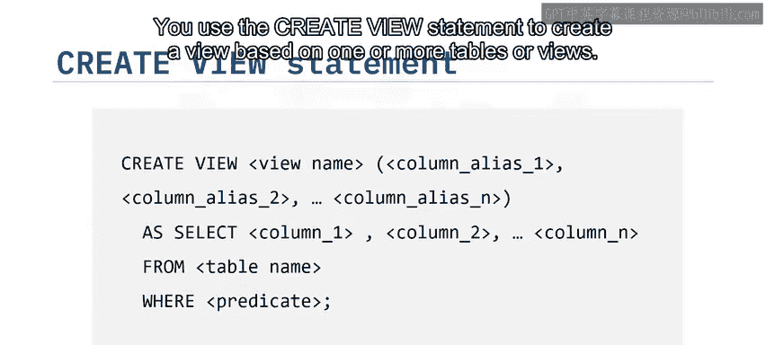

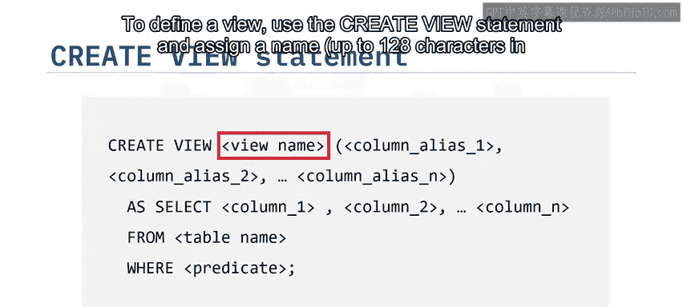

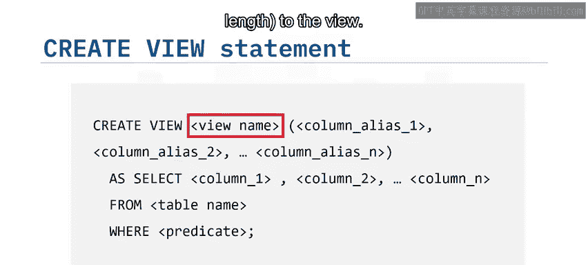

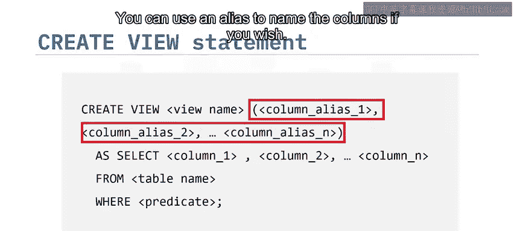

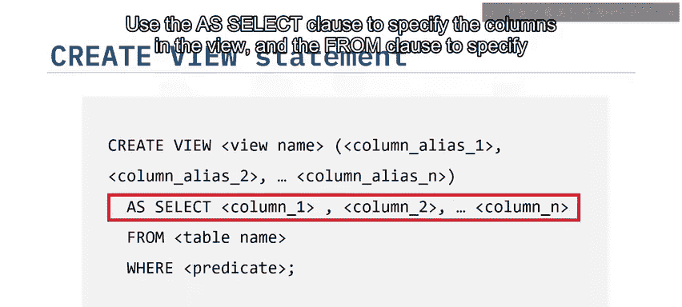

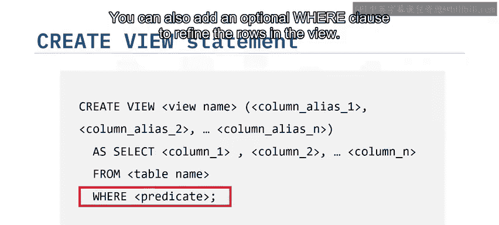

To refine the rows in the view this create view statement creates a view called FFin based on the employees table The select statement returns the data in the view as shown in the table below View are dynamic they consist of the data that would be returned from the select statement used to create them when you use a view in another SQL statement it behaves as though you have used a select statement that returns the content of the view the select statement that you used to create the view can name other views and tables and it can use the where group by and having clauses it cannot use the order by clause or name a host variable In this example。

 the finfo view is created with only the rows where the manager ID is 30002 you can use a select statement to show the information from the view and verify that only rows where the manager ID is 30002 are included。

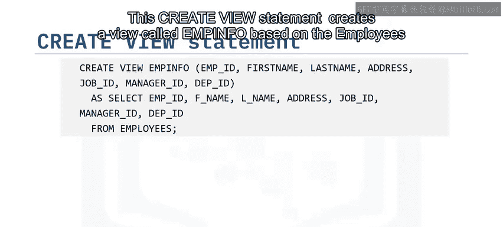

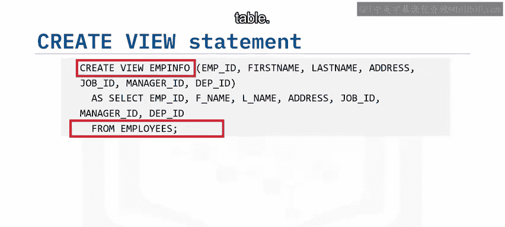

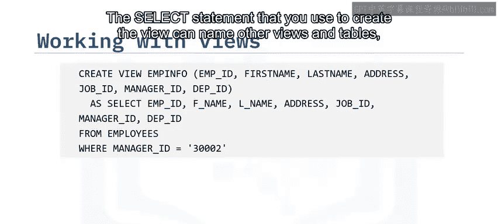

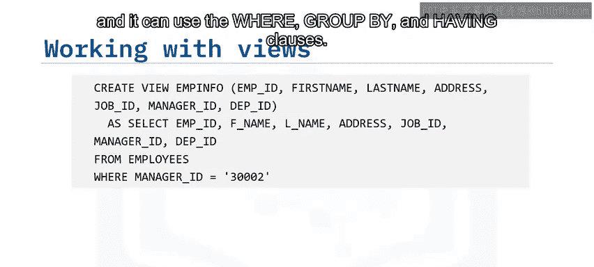

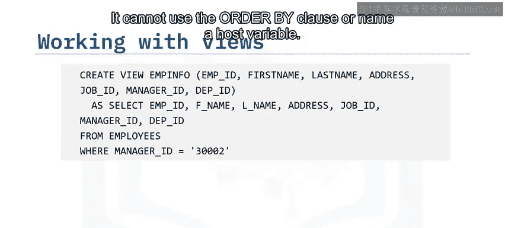

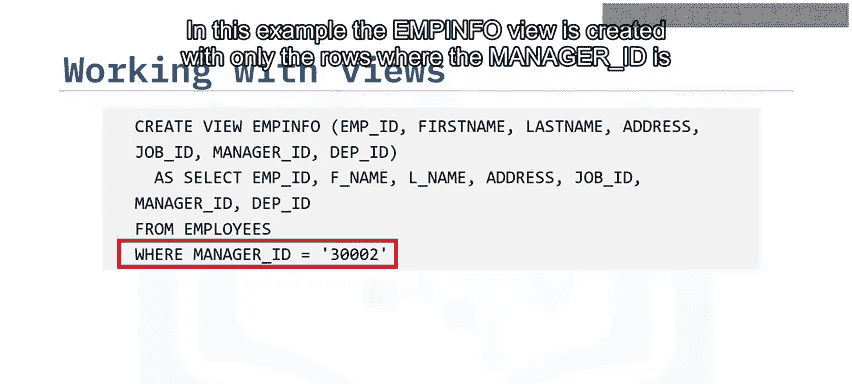

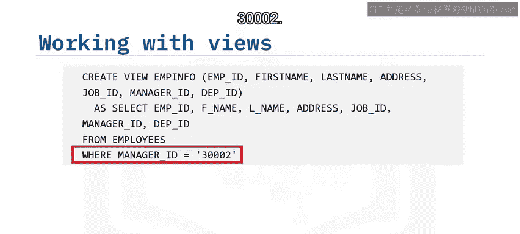

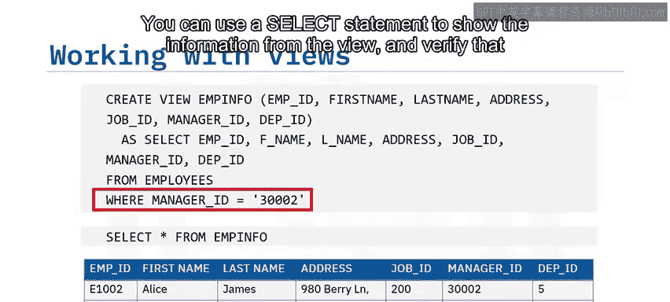

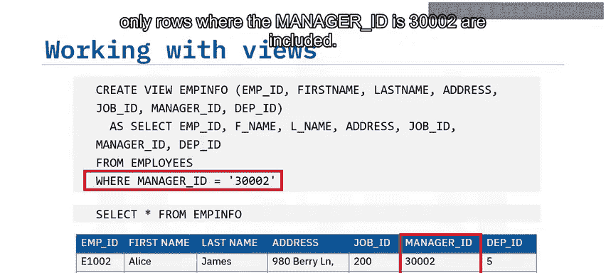

To remove a view completely you can use DropVi In this video you learned that views are an alternative way of accessing data in tables。

 they can include specified columns from multiple base tables and existing views once created views can be queried like a table and the data in the base table can be modified through the view View are dynamic only the definition of the view is stored not the data and you can use the Cre View statement to create a view based on one or more tables or existing views。

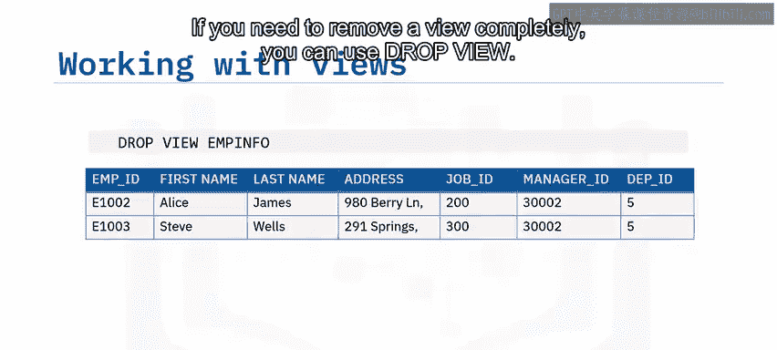

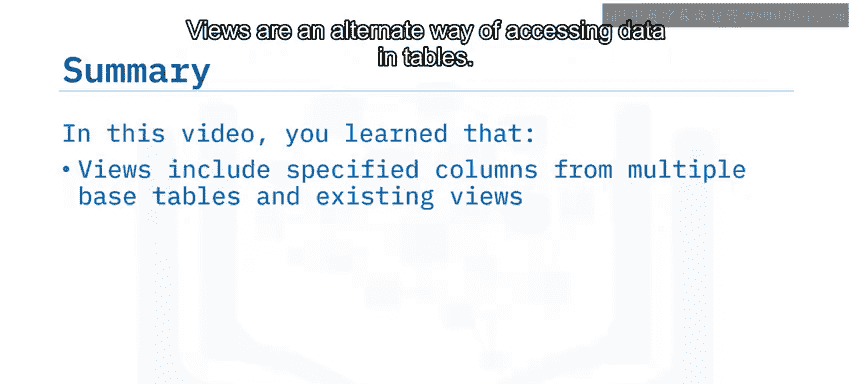

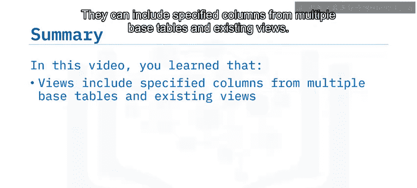