# IBM数据工程专业证书课程5：《数据科学SQL数据库和SQL课程（IBM）》｜sql-data-science｜ - P27：26_存储的过程.zh_en - GPT中英字幕课程资源 - BV1Kz4y1W7h9

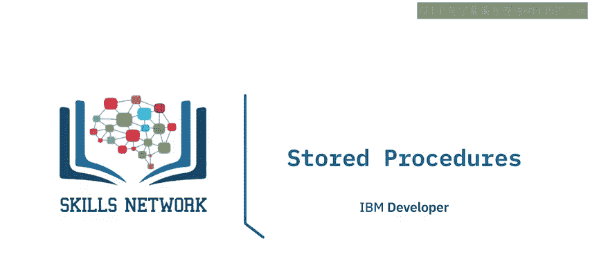

Welcome to stored procedures After watching this video。

 you will be able to explain what a stored procedure is list the benefits of using stored procedures and describe how to create and use a stored procedure a stored procedure is a set of SQL or SQL statements that are stored and executed on the database server so instead of sending multiple SQL statements from the client to the server。

 you encapsulate them in a stored procedure on the server and send one statement from the client to execute them you can write stored procedures in many different languages for example。

 for DB2 on cloud and DB2 you can write in SQL P PSQL。

 Java C or other languages they can accept information as parameters， perform， create， read。

 update and delete CRd operations and return results to the client application the benefits of stored procedures include reduction in network traffic because only one call is needed to。

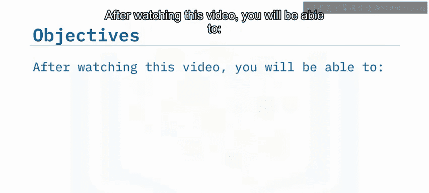

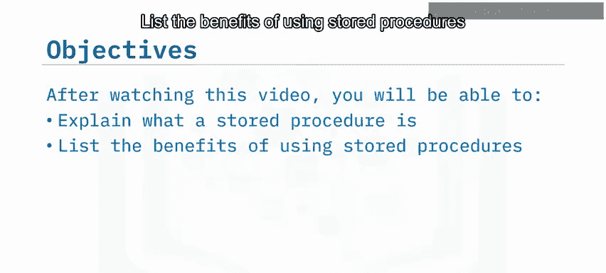

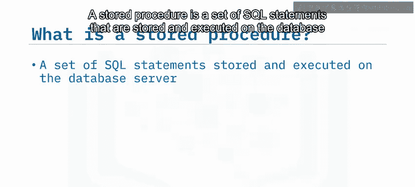

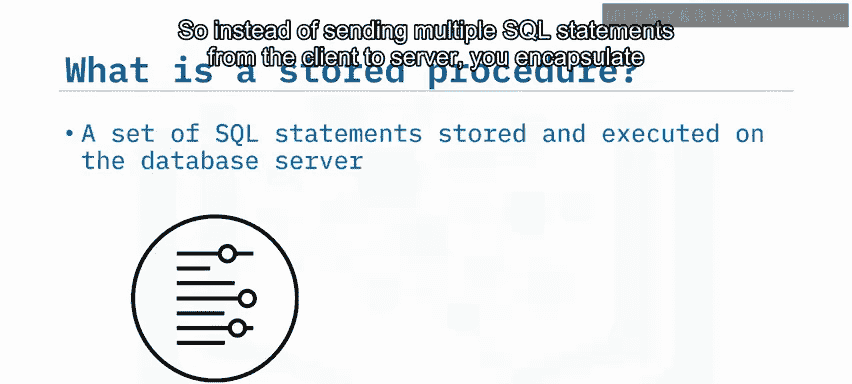

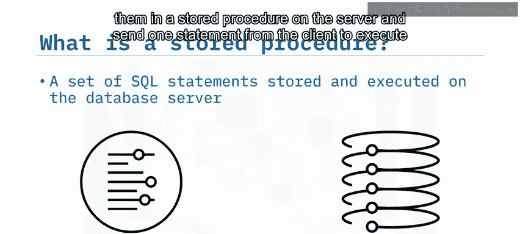

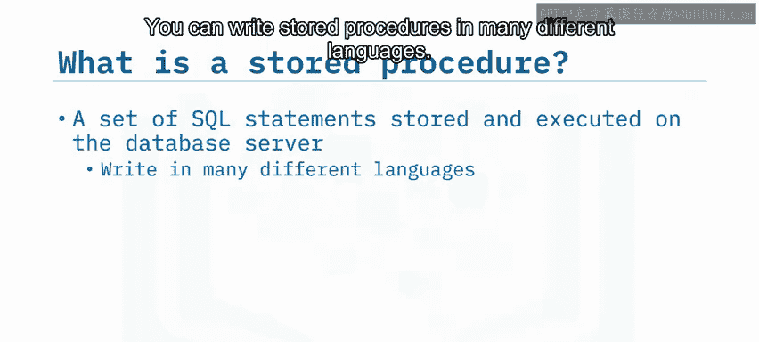

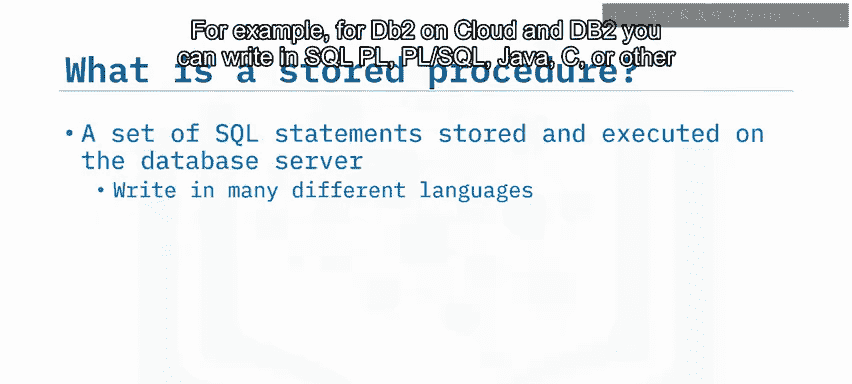

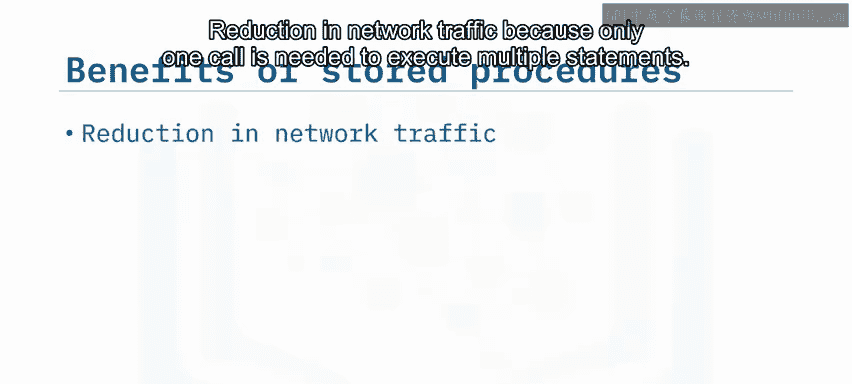

Exec multiple statements。 Imp in performance because the processing happens on the server where the data is stored with just the final result being passed back to the client reuse of code because multiple applications can use the same stored procedure for the same job and an increase in security because a you do not need to expose all of your table and column information to client side developers and B you can use serverside logic to validate data before accepting it into the system。

 remember that SQL is not a fully fledged programming language so you should not try to write all of your business logic in your stored procedures。

 So let us look at how to create a stored procedure on Db2 on cloud in SQL First。

 you use the create procedure statement specifying the name of the procedure and any parameters which it will take In this example。

 the update underscore cell procedure will take an employee number and a rating which it will use to。

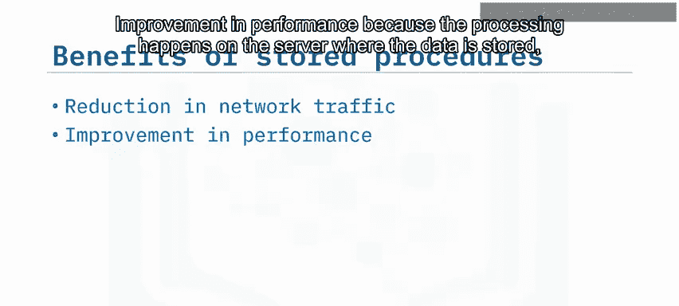

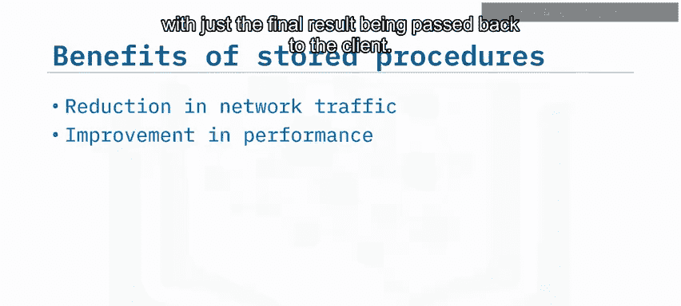

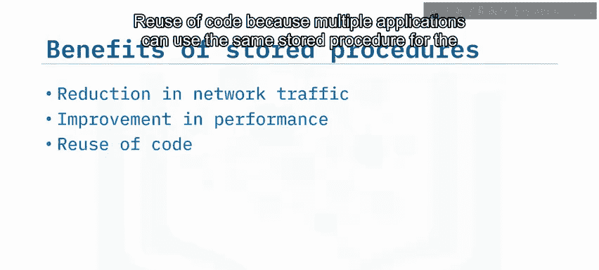

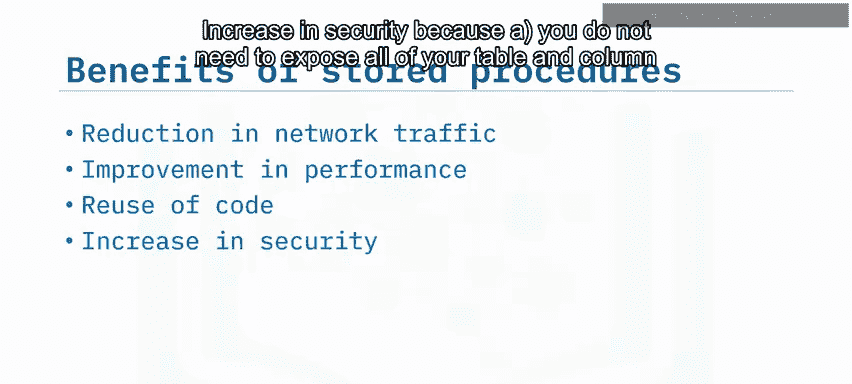

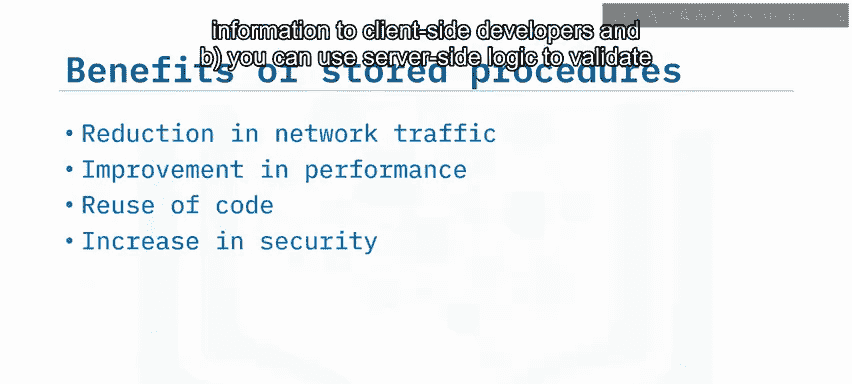

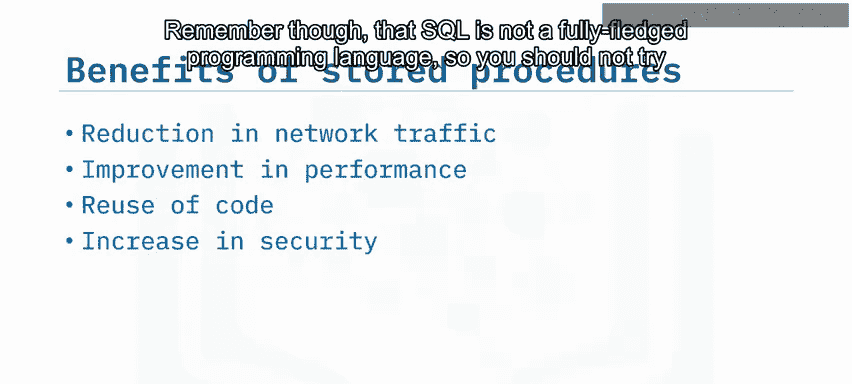

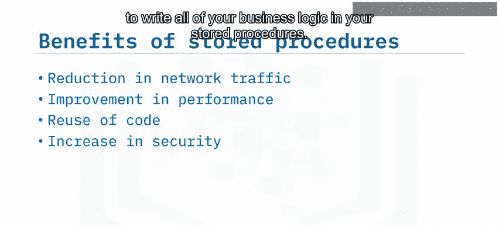

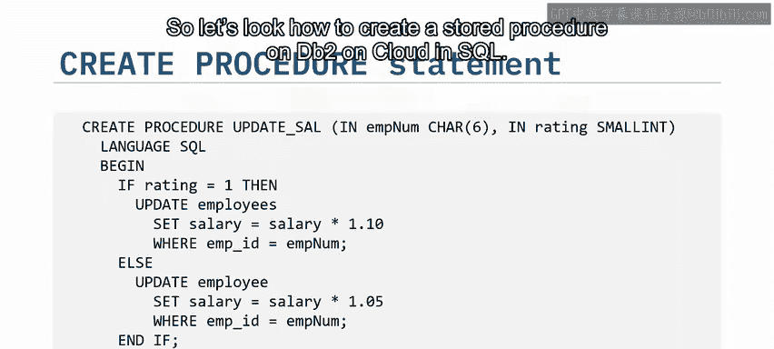

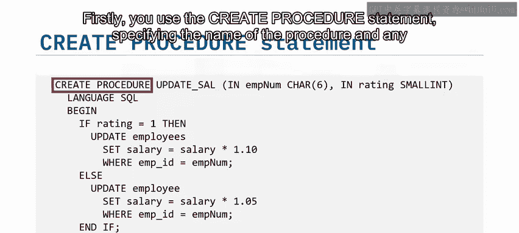

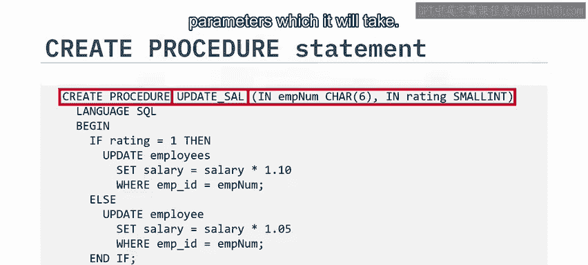

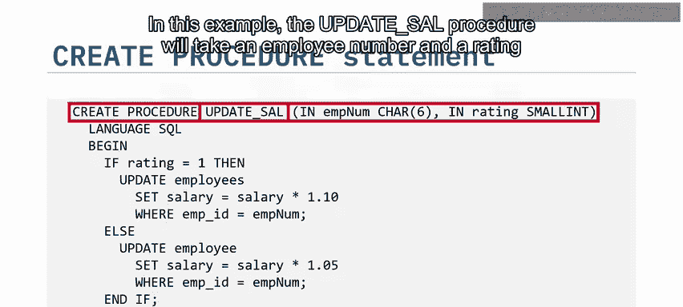

date an employee's salary by an amount depending on the rating。

 then you declare the language you are using。 you then enclose your procedural logic in the begin and statements In this case。

 giving employees who have a rating of one a 10% pay raise and all others of 5% pay raise Notice that you can use the information passed to the procedure。

 the parameters directly in your procedureedural logic you can call stored procedures from your external applications or from D SQL statements to call the update underscore sales stored procedure that we just created。

 you use the call statement with the name of the stored procedure and pass the required parameters In this case。

 the employee ID and the rating for that employee In this video you learned that stored procedures are a set of SQL statements that execute on the server stored procedures offer many benefits over sending SQL statements to the server and you can use stored procedures。

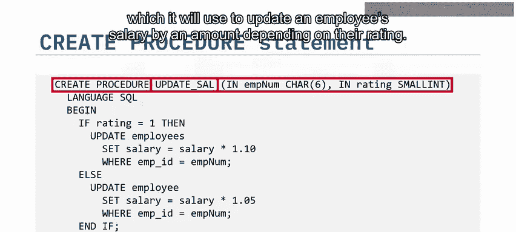

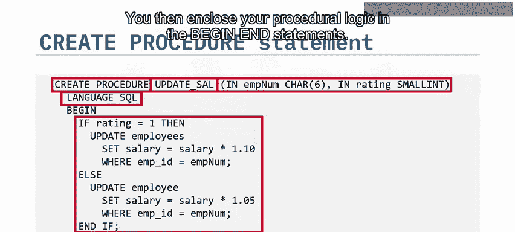

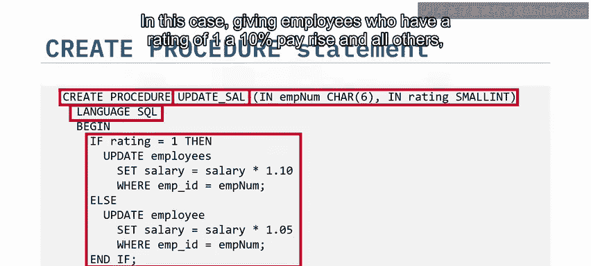

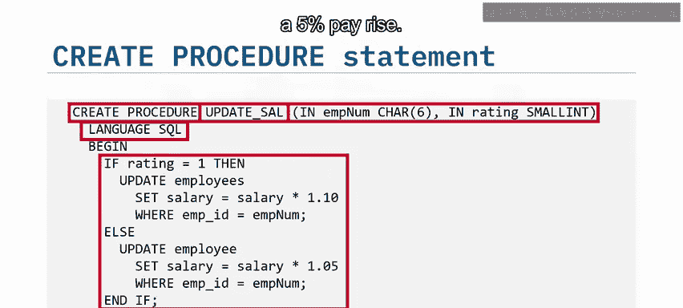

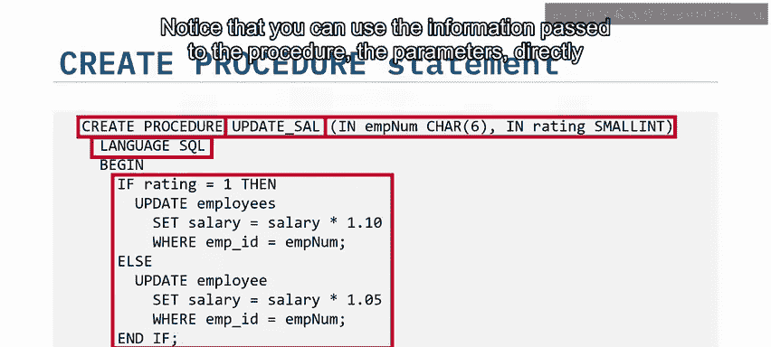

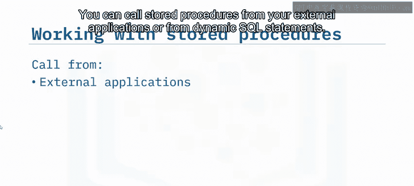

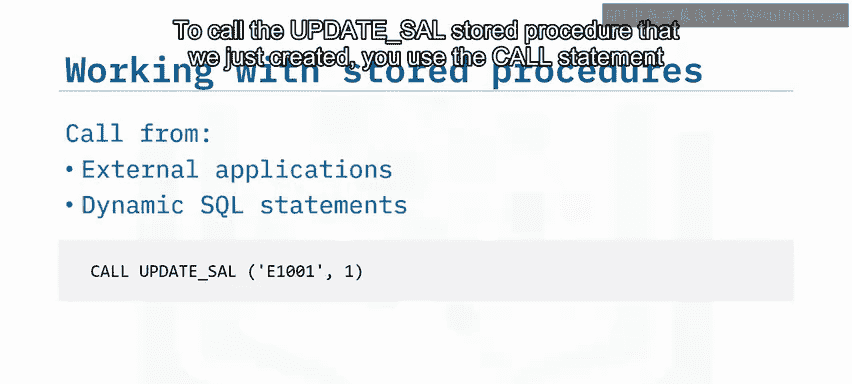

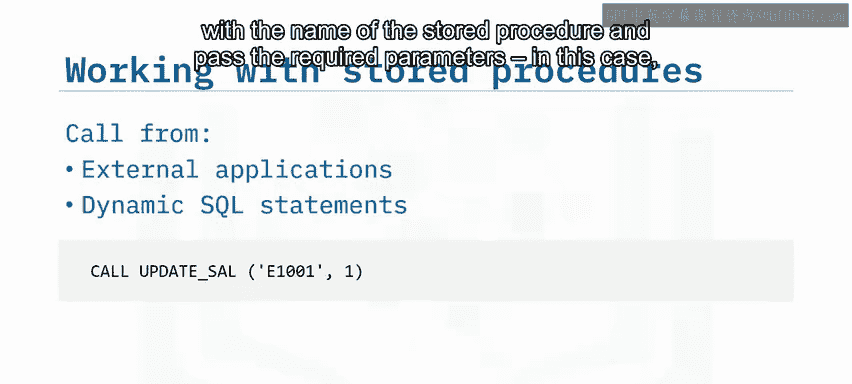

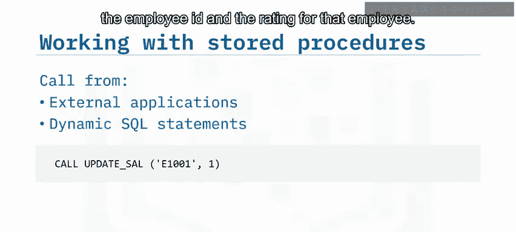

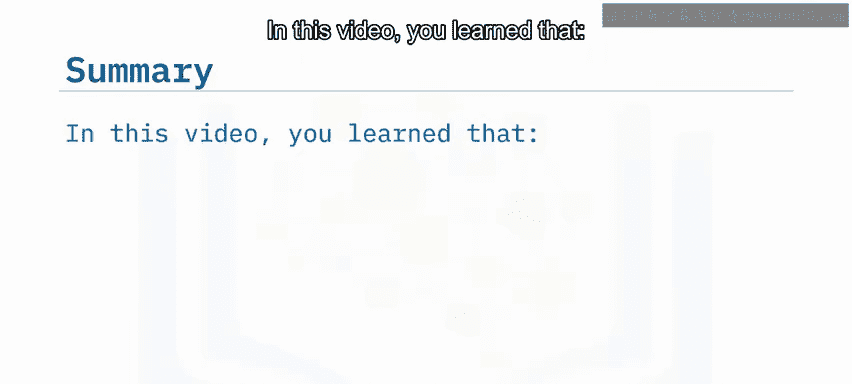

In Dy SQL statements and external applications。