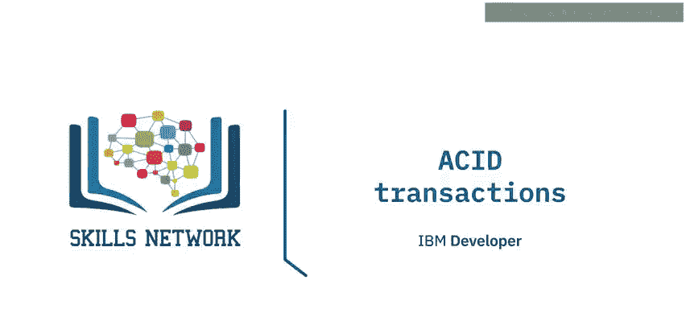
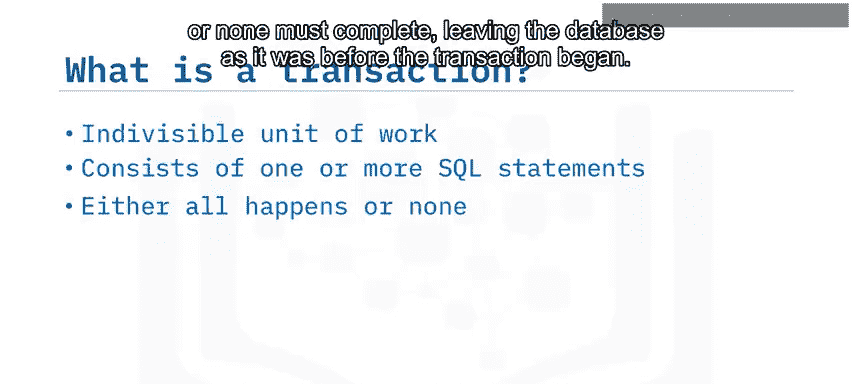
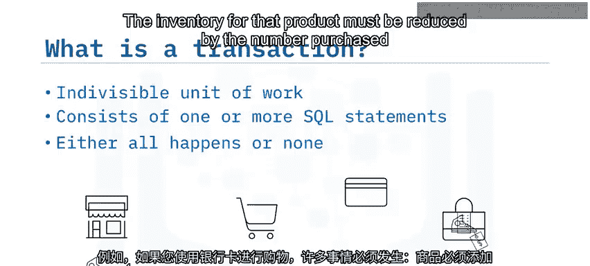
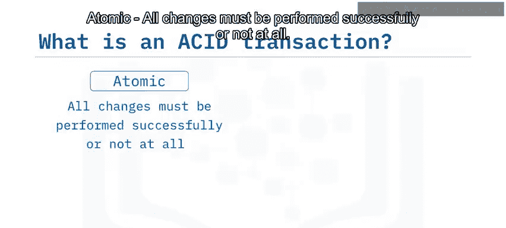
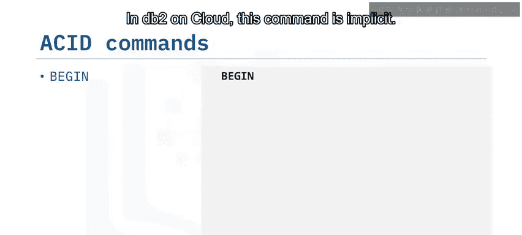
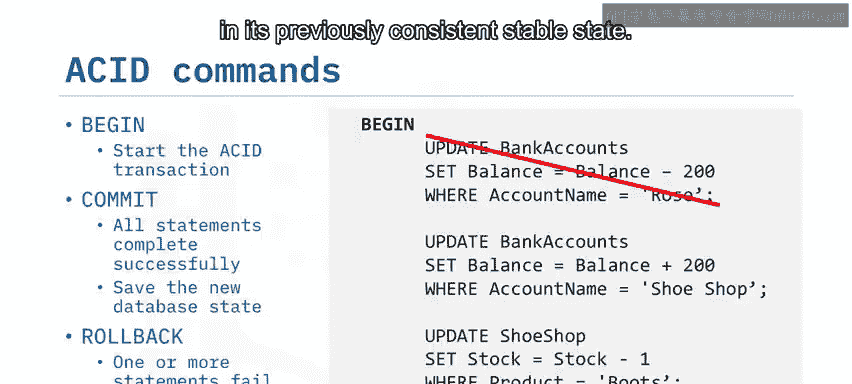
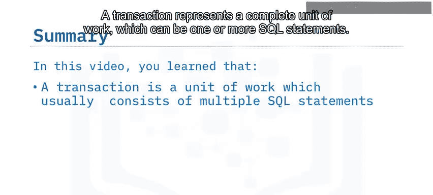
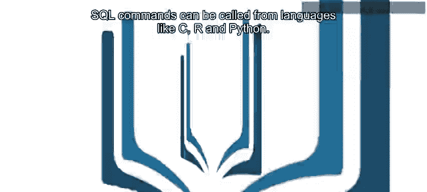

# IBM数据工程专业证书课程5：《数据科学SQL数据库和SQL课程（IBM）》｜sql-data-science｜ - P28：27_原子事务.zh_en - GPT中英字幕课程资源 - BV1Kz4y1W7h9

Welcome to acid transactions After watching this video。

 you will be able to explain what an asset transaction is。

 Give an example of an asset transaction and describe commits and rollbacks。

 a transaction is an indivisible unit of work。 It can consist of one or more SQL statements。

 but to be considered successful， either all of those SQL statements must complete successfully leaving the database in a new stable state。

 or none must complete， leaving the database as it was before the transaction began。 For example。

 if you make a purchase using your bank card， many things must happen。

 The product must be added to your cart， your payment must be processed。

 your account must be debited the correct amount and the store's account credited and the inventory for that product must be reduced by the number purchased。

 Let us look at the example in more detail。 If Roseby's boots for $200。

 then you can use an update statement to decrease her account balance。😊。

And another update statement to add $200 to the shoe shop balance and a final update statement to decrease the stock level of boots at the shoe shop by one。

 If any of these update statements fail。 the whole transaction should fail to keep the data in a consistent state The types of transaction in the example are called acid transactions。

 acid stands for atomic， All changes must be performed successfully or not at all。

 consistent data must be in a consistent state before and after the transaction， I。

 no other process can change the data while the transaction is running， durable。

 the changes made by the transaction must persist to start an asset transaction use the command begin in Db2 on cloud。

 This command is implicit。 Any commands you issue after that are part of the transaction until you issue either commit or roll back。

 If all the commands complete successfully。

Issue a commit command to save everything in the database to a consistent， stable state。

 If any of the commands fail， perhaps Rose's account does not have enough money to make the payment。

 You can issue a rollback command to undo all the changes and leave the database in its previously consistent stable state。

SQL statements can be called from languages like Java， CR and Python。

 This requires the use of database specificific access APIs。

 such as Java database connectivity or JDBC for Java or a specific database connector like IBMDB for Python Most languages use the exact SQL commands to initiate a SQL command。

 including commit and rollback as you can see in this example， remember that begin is implicit。

 you do not need to call it out explicitly Incorporating SQL commands into your application code gives you the opportunity to create error checking routines that in turn control whether the transaction is committed or rolled back。

In this video， you learned that a transaction represents a complete unit of work。

 which can be one or more SQL statements。 An acid transaction is one where all the SQL statements must complete successfully or none at all。

 This ensures the database is always in a consistent state。 acid stands for atomic， consistent。

 isolated， durable。 The SQL commands， begin， commit and rollback are used to manage acid transactions and SQL commands can be called from languages like C。

 R and Python。

