# IBM数据工程专业证书课程5：《数据科学SQL数据库和SQL课程（IBM）》｜sql-data-science｜ - P29：28_联接概述.zh_en - GPT中英字幕课程资源 - BV1Kz4y1W7h9

Hello and welcome to Join Over。

After watching this video you will be able to define the join operator。

 explain the role of primary keys and foreign keys in a join operation and list the different types of join operator a simple select statement retrieves data from one or more columns from a single table The next level of complexity is retrieving data from two or more tables。

 This leads to multiple possibilities of how the results set can be generated To combine data from two tables you use the join operator a join combines the rows from two or more tables based on a relationship between certain columns in these tables In the simplified library database example。

 author and book are entities This entity relationship diagram represents the relational data model for the author and book entity as well as other entities such as borrower loan copy and author list The information is split into different tables if。

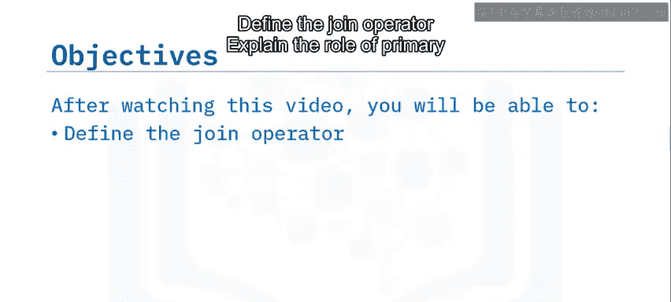

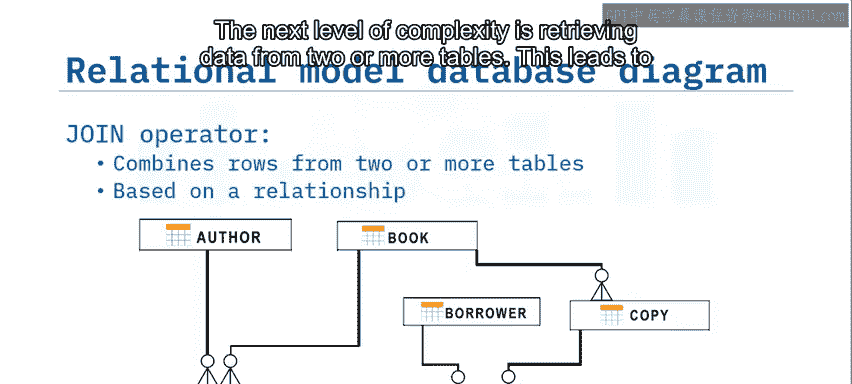

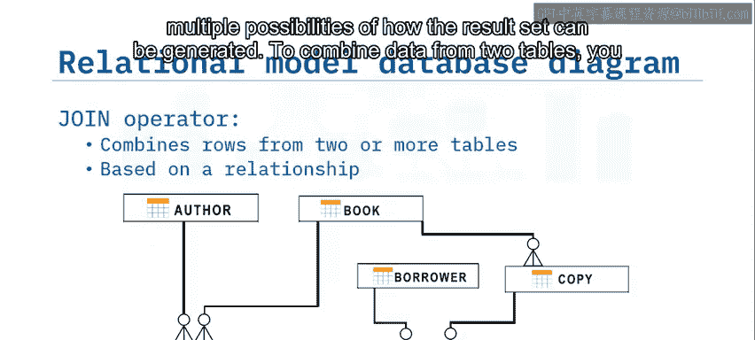

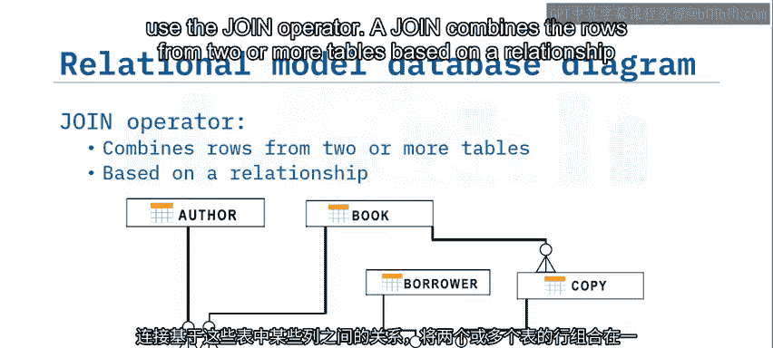

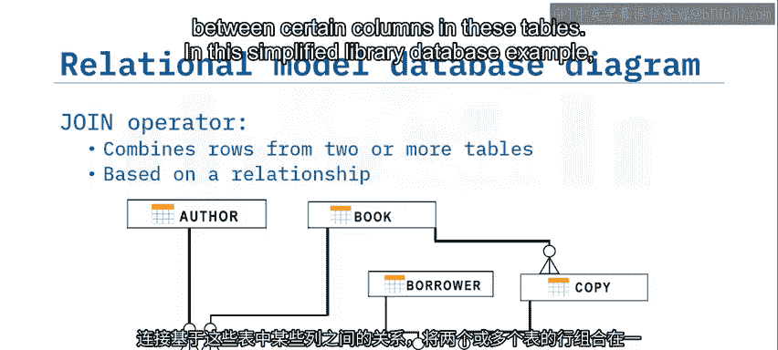

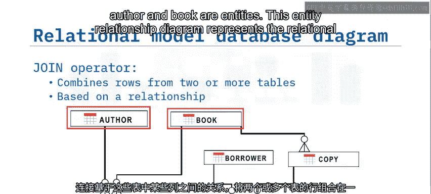

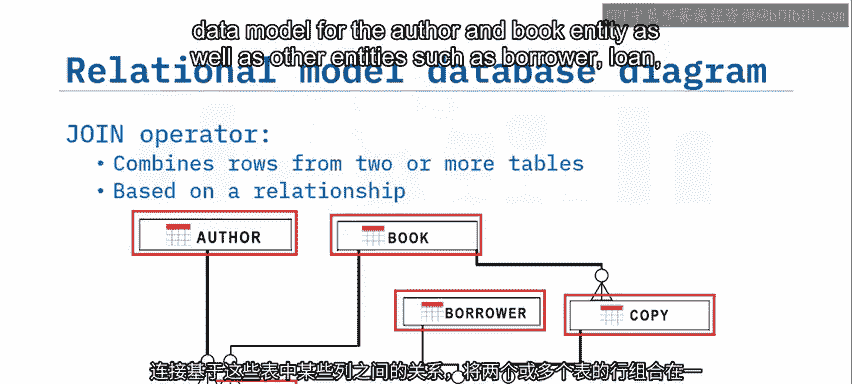

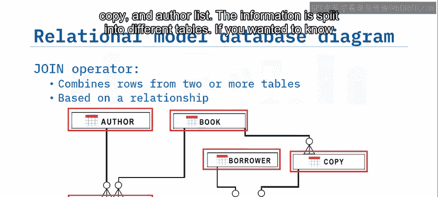

Wanted to know which borrower has which copy of a book out on loan。

 you need to gather data from three tables。 The borrower， loan and copy tables。

 This is when you need to use the join operator。 First you need to identify the relationship between these tables。

 That is the column or columns in each table to use as a link between the tables。

 In this entity relationship diagram。 Notice that the author I book I borrower I and copy I have the primary key icon A primary key uniquely identifies each row in a table。

 Not also the entity on the lower half of the screen。

 Some attributes have fK in brackets next to them。 This identifies a foreign key。

 which is a set of columns referring to a primary key of another entity。 For example。

 the loan entity has the borrower I attribute with the FK and brackets。 In this example。

 the borrower I attribute is the foreign。

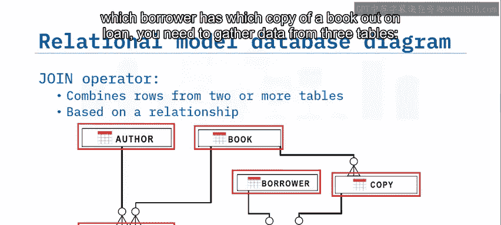

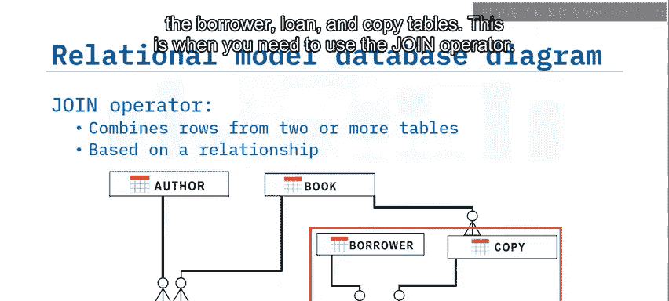

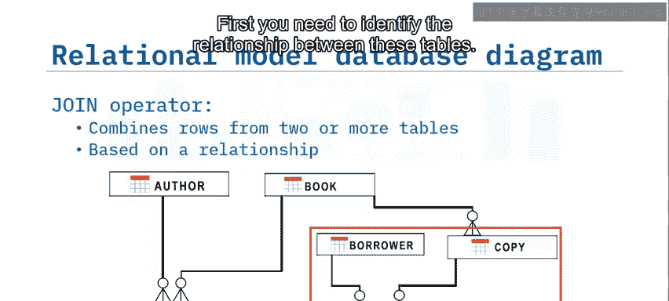

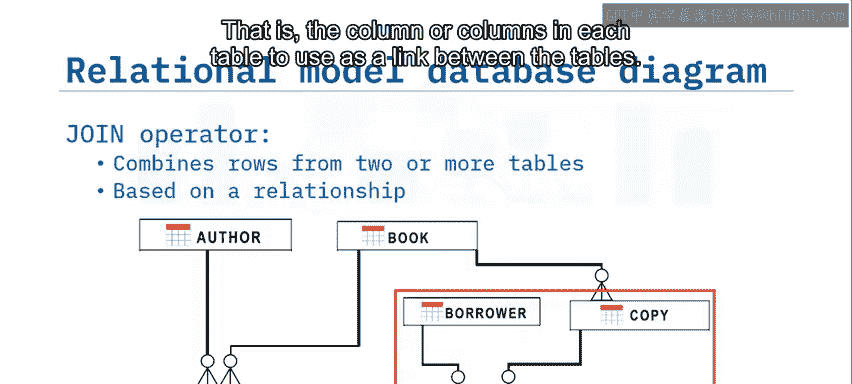

K in the loan entity， which refers to the primary key for the borrower entity。

 So if you wanted to know which borrower has a book out on loan。

 you need to gather data from the borrower and loan tables。

 you will need the borrower I from both tables thus far you have seen an example of combining two tables。

 But what if you need to combine data from three or more different tables。

 you simply add new tables to the joins For example。

 if you want to know which borrowers have a book on loan and which copy of the book they have on loan。

 First， you join the information from the borrower table and the loan table by matching borrower Is then you join the information from the loan table and the copy table by matching the copy Is SQL offers you several different types of joins you can extract a data set corresponding to the intersection of the two tables involved or you can choose a bigger data set。

 you can go。

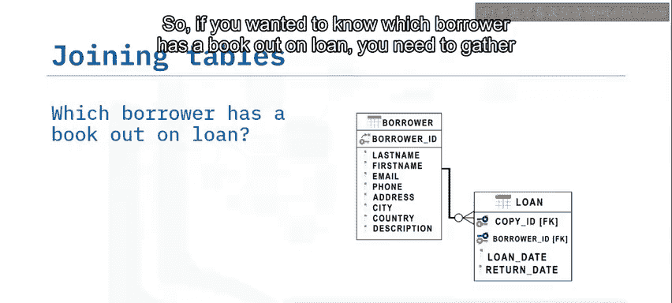

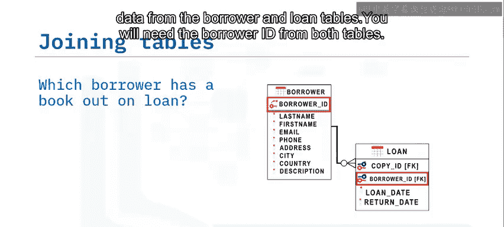

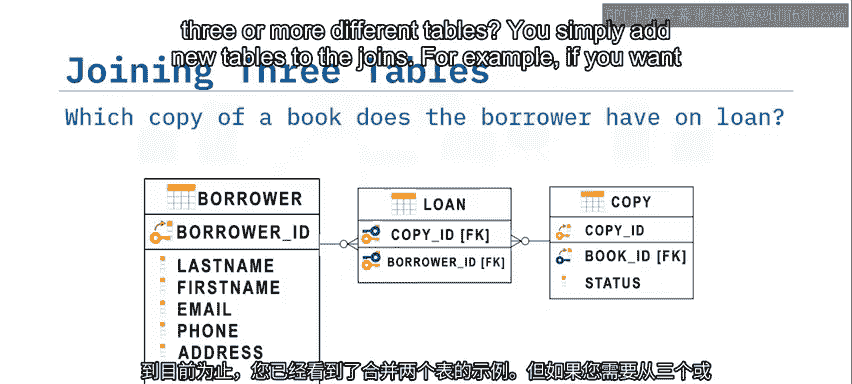

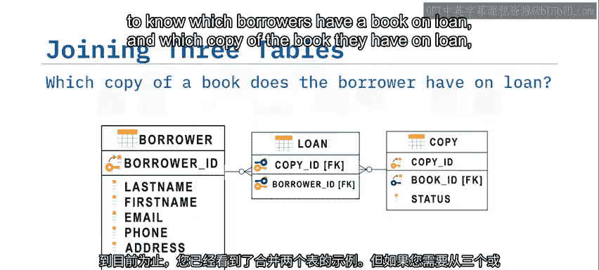

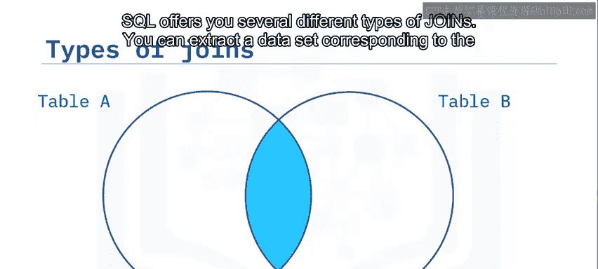

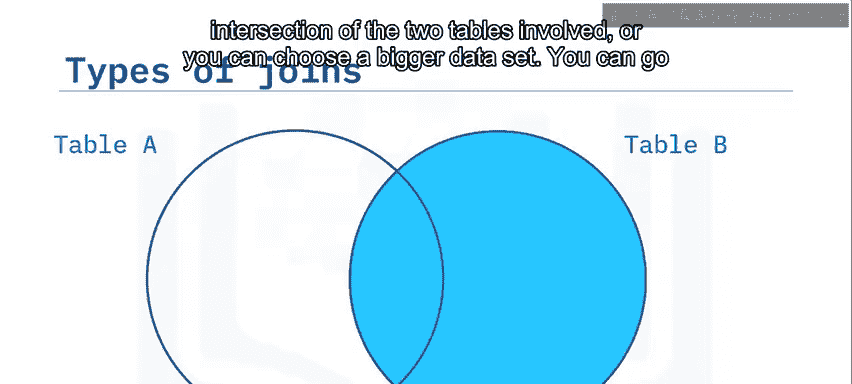

Up to the point of selecting the combination of all the data from these two tables the most common type of join is an inner join which displays only the rows from two tables that have matching value in a common column usually the primary key of one table that exists as a foreign key in the second table There are also outer joins which return matching rows and even the rows from one or the other table that don't match There are many varieties of outer joins that you can use to refine your results set In this video you learned that you can use the join operator to combine rows from two or more tables the tables being joined are related by a common column which is usually the primary key of one table and appears as a foreign key in the other table and there are two types of joins。

 inner joins and outer joins。

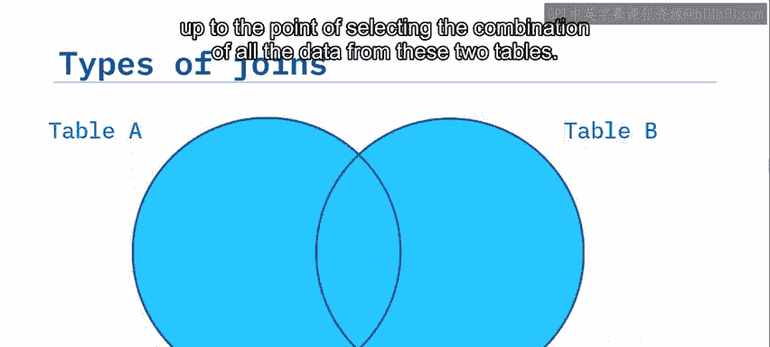

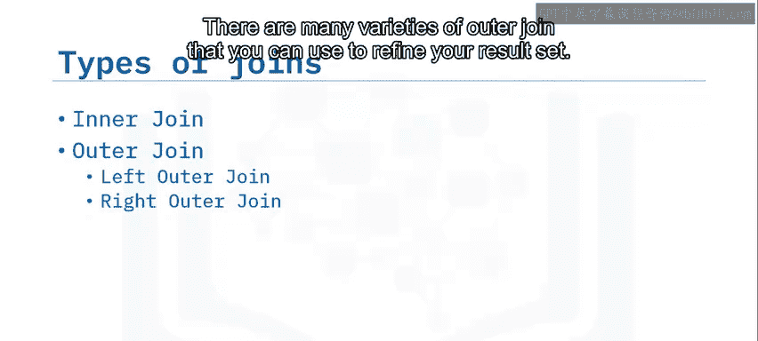

