# IBM数据工程专业证书课程5：《数据科学SQL数据库和SQL课程（IBM）》｜sql-data-science｜ - P30：29_内部连接.zh_en - GPT中英字幕课程资源 - BV1Kz4y1W7h9

Welcome to Inner joinin。After watching this video， you will be able to describe inner joins。

 explain when to use an inner join， and describe the syntax of the inner join statement。

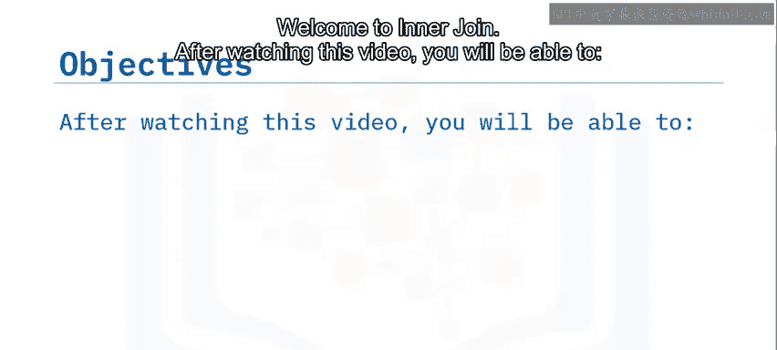

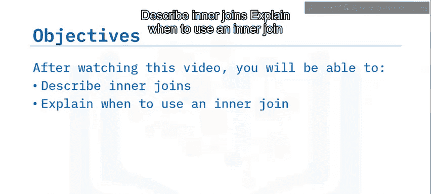

A join operation combines the rows from two or more tables based on a relationship between certain columns in these tables。

 There are two types of table joins， inner joins and outer joins。

 the most common type of join is an inner join， which displays only the rows from two tables that have matching value in a common column。

 usually the primary key of one table that exists is a foreign key in the second table。

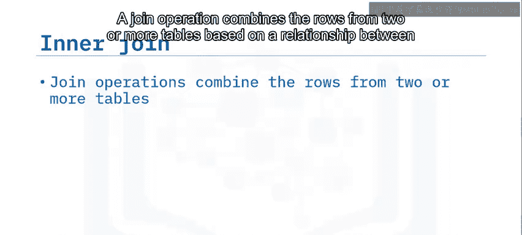

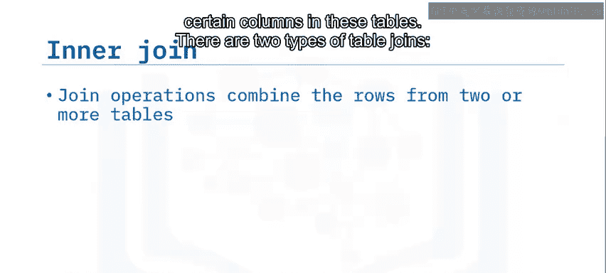

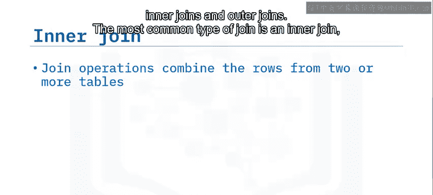

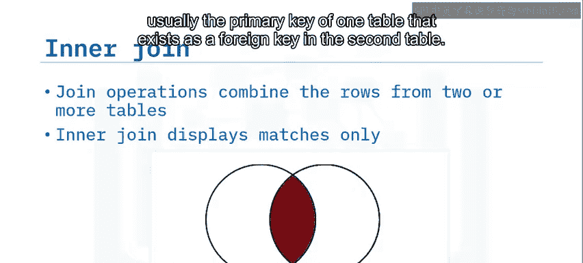

This is an example of the syntax of the select statement for an inner join。

 Imagine you want to retrieve a list of all people who are borrowing books and the date of the loan。

 You need data from both the borrower table and the loan table in the front clause。

 you specify the join between the borrower table and the loan table as borrower In join loan you identify the borrower table as B and the loan table as L。

 The table specified on the left of the join clause is known as the left table。 In this case。

 the borrower table is the left table。 For this join。

 you select borrower I D last name and country from the borrower table。

 and the borrower I D and the loan date from the loan table in the on clause。

 you specify the join predicate。 In this case， the condition that the borrower I D in the borrower table is equal to the borrower I D in the loan table。

 Notice that in this join each。

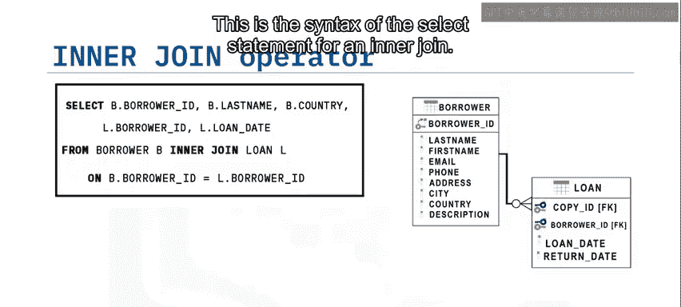

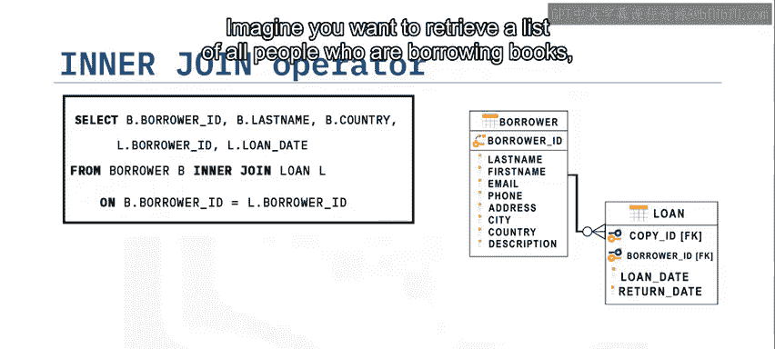

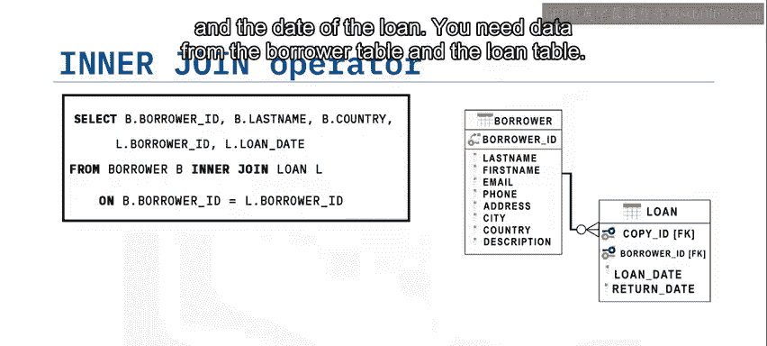

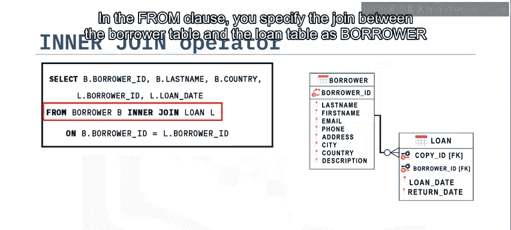

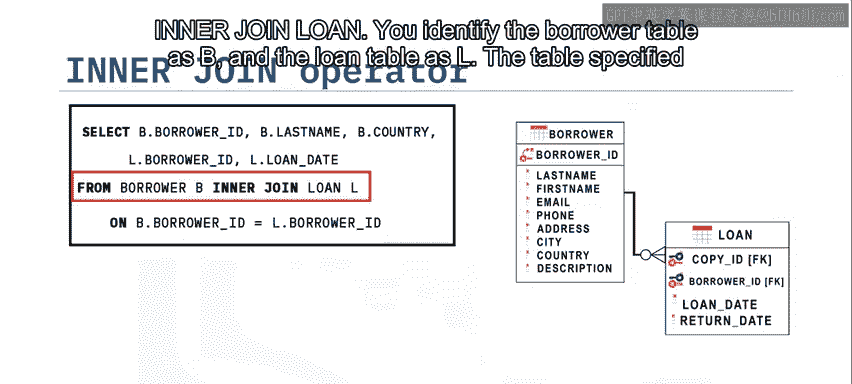

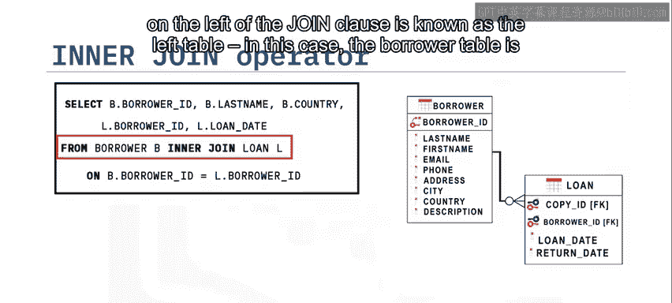

lum is prefixed with either the letter B or L in SQL this is referred to as an alias Us an alias is much easier than rewriting the whole table name The result set shows only the rows from both tables that have the same borrower ID。

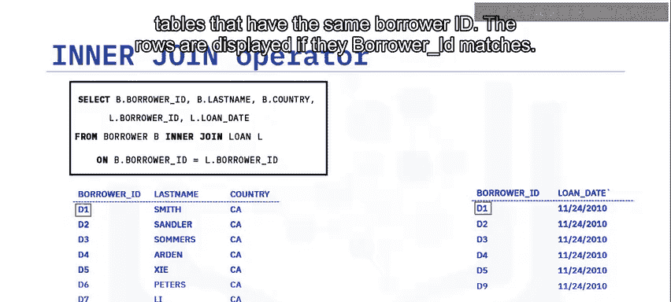

The borrower ID， last name and country columns are taken from the borrower table and joined to the borrower ID and loan date columns from the loan table。

 The rows are displayed if the borrower ID matches In this video you learned that inner joins return only the rows from the tables that have matching value in a common column Usually the primary key of one table that exists as a foreign key in the second table and rows from joint tables that do not have a matching value do not appear in the result。

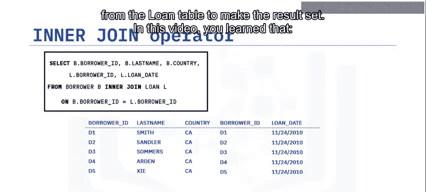