# IBM数据工程专业证书课程5：《数据科学SQL数据库和SQL课程（IBM）》｜sql-data-science｜ - P3：2_选择语句.zh_en - GPT中英字幕课程资源 - BV1Kz4y1W7h9

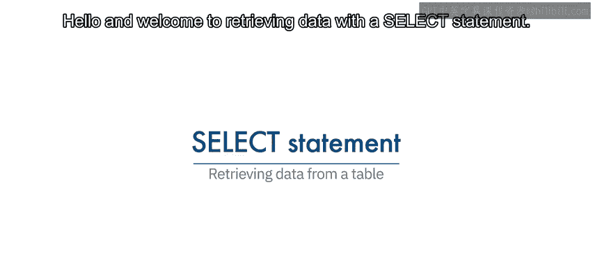

Hello and welcome to Retrieving data with the select statement In this video。

 we will learn about retrieving data from a relational database table by selecting columns of a table at the end of this lesson。

 you will be able to retrieve data from a relational database table， Def the use of a predicate。

 identify the syntax of the select statement using the where clause and list the comparison operator supported by a relational database management system。

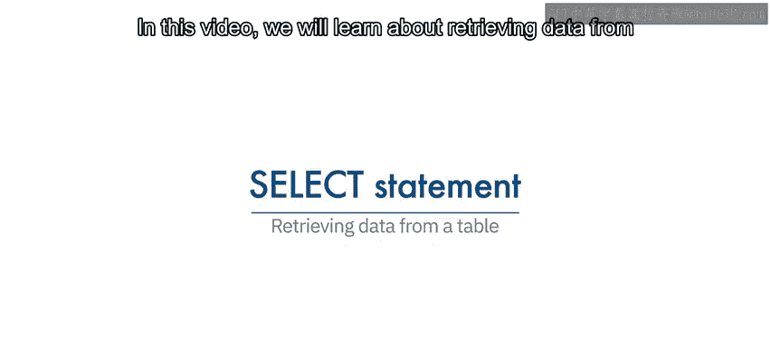

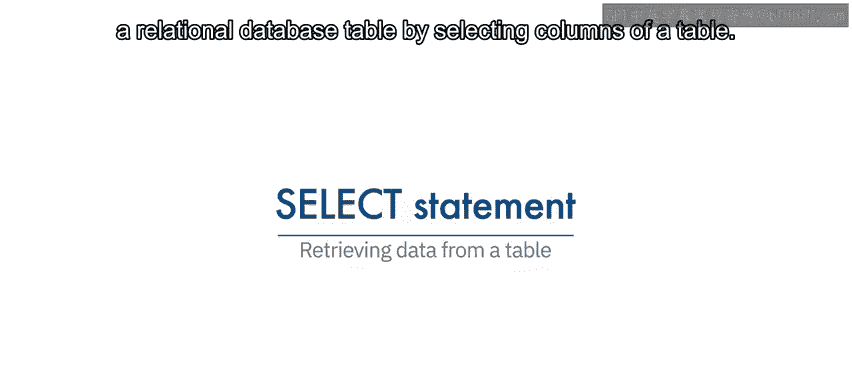

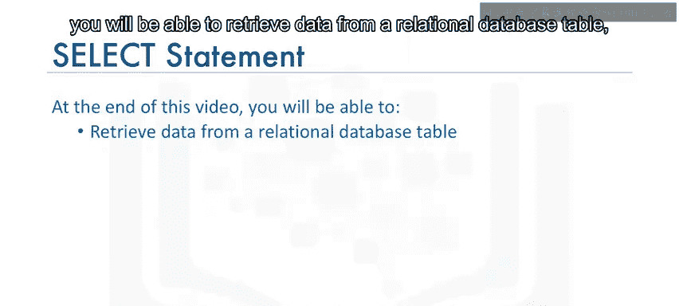

The main purpose of a database management system is not just to store the data。

 but also facilitate retrieval of the data。

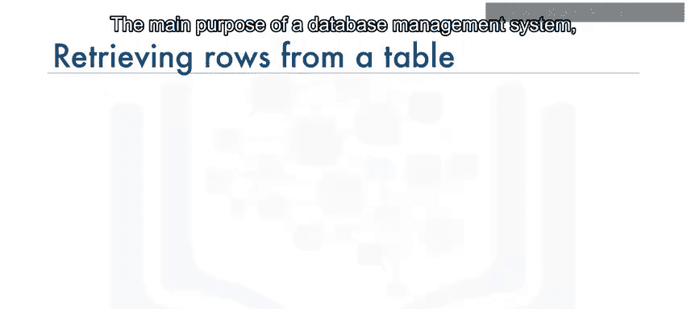

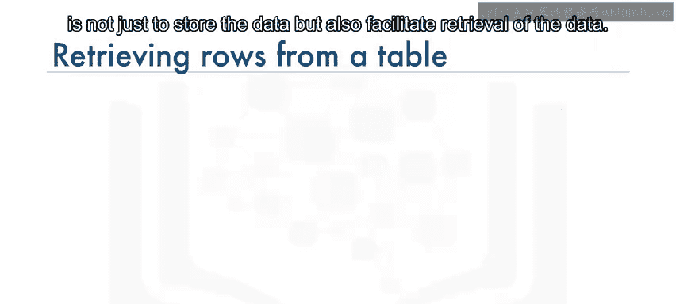

So after creating a relational database table and inserting data into the table。

 we want to see the data。

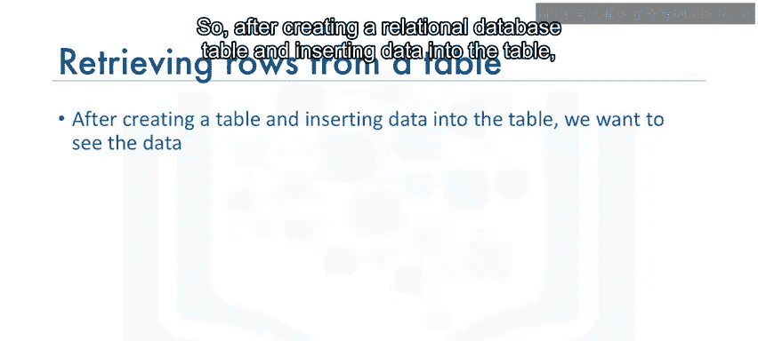

To see the data， we use the select statement。

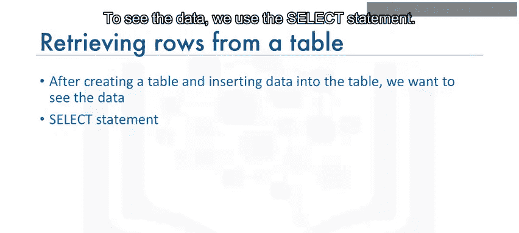

The select statement is a data manipulation language statement。

Data manipulation language statements or DML statements are used to read and modify data。

 The select statement is called a query， and the output we get from executing this query is called a result set or a result table。

In its simplest form a select statement If select star from table name。

Based on the book entity example， we would create the table using the entity name book and the entity attributes as the columns of the table。

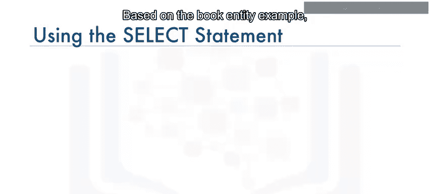

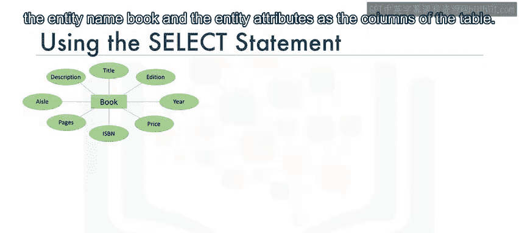

The data would be added to the book table by adding rows to the table using the insert statement in the book entity examples。

 select star from book gives the result set of four rows。

All the data rows for all columns in the table book are displayed。In addition。

 you can also retrieve all the rows for all columns by specifying the column names individually in the select statement。

You don't always have to retrieve all the columns in a table。

 You can retrieve just a subset of columns。 If you want。

 you can retrieve just two columns from the table book。 For example， book， underscore， I D and title。

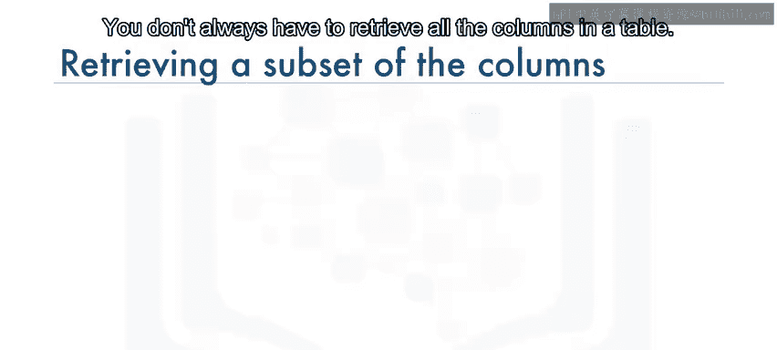

In this case， the select statement is select book underscore ID title from book。In this case。

 only the two columns displayed for each of the four rows。Also。

 notice that the order of the columns displayed always matches the order in the select statement。

However， what if we want to know the title of the book whose book underscore I D is B1。

Relationational operation helps us in restricting the results set by allowing us to use the clause where The where clause always requires a predicate。

 A predicate is a condition that evaluates to true， false or unknown。

 predicates are used in the search condition of the where clause。

 So if we need to know the title of the book whose book， underscore I D is B1。

 We use the where clause with the predicate book， underscore I D equals B1。

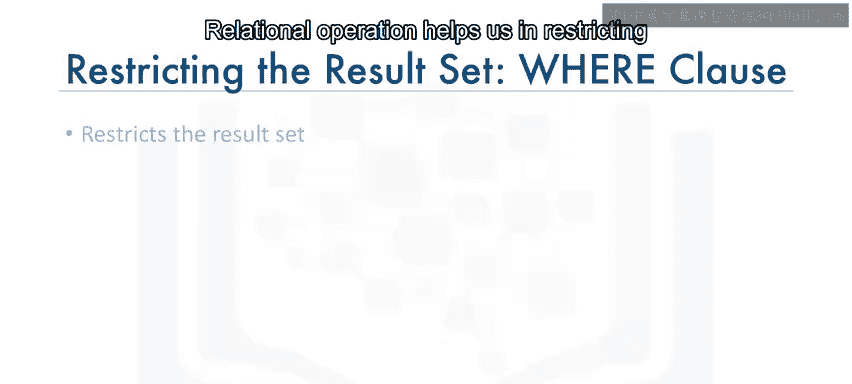

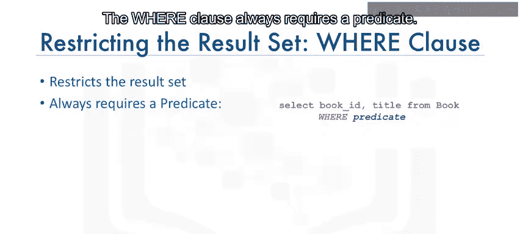

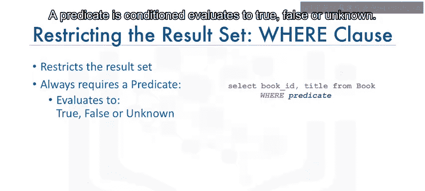

Select Book underscore ID title from book where Book_ ID equals B1。

Notice that the result set is now restricted to just one row whose condition evaluates to true。

The previous example used the comparison operator equal to in the where clause。

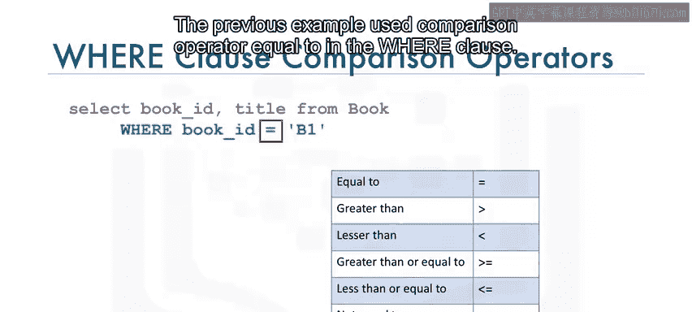

There are other comparison operators supported by a relational database management system equal to greater than less than greater than or equal to。

 less than or equal to and not equal to。

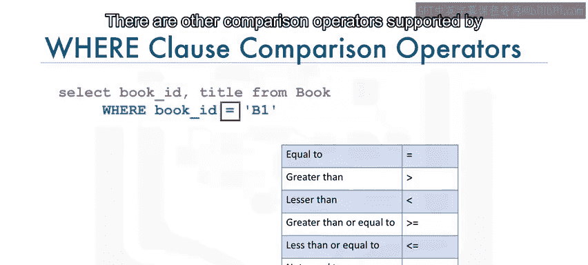

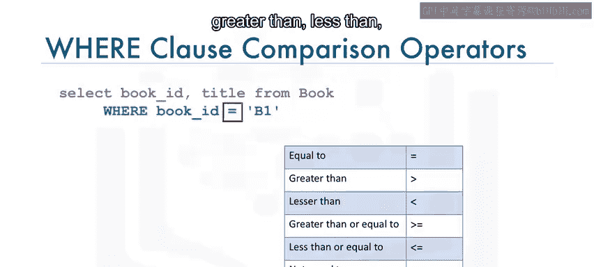

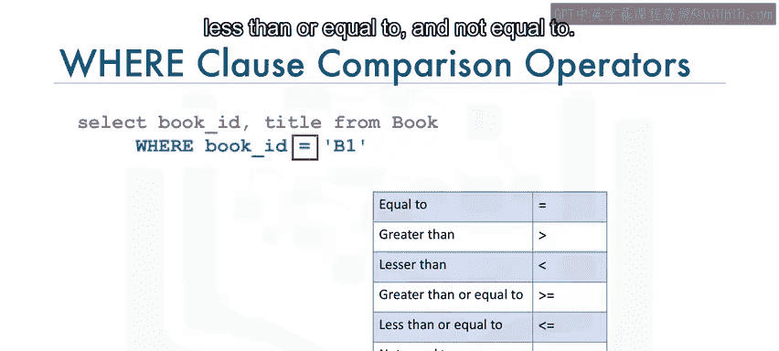

Now you can retrieve data and select columns from a relational database table。

 define the use of a predicate， identify the syntax of the select statement using the where clause。

 and list the comparison operators supported by a relational database management system。

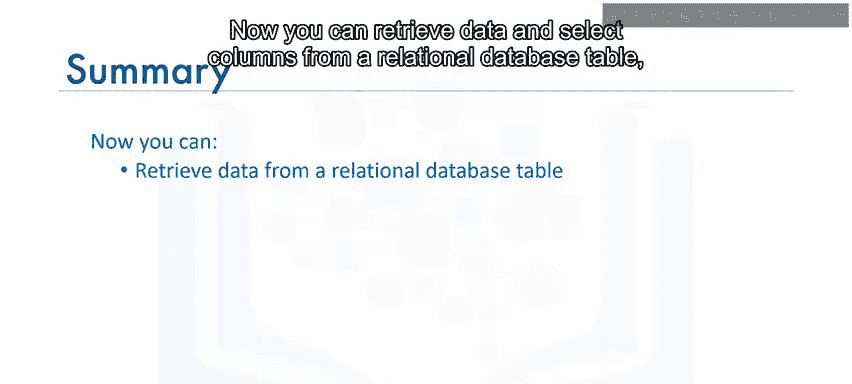

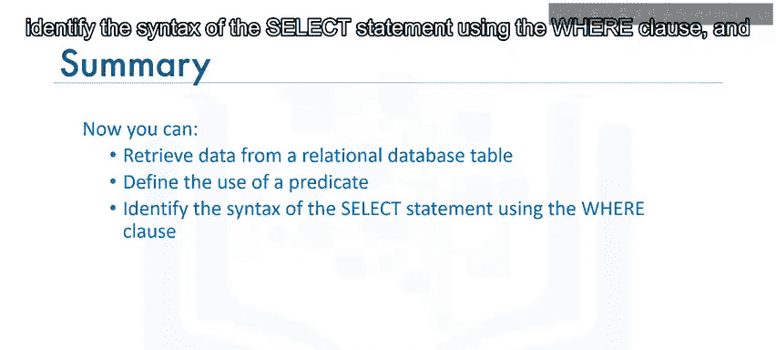

Thanks for watching this video。

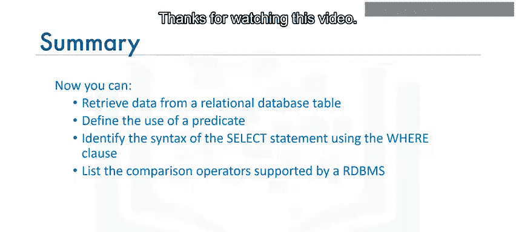