# IBM数据工程专业证书课程5：《数据科学SQL数据库和SQL课程（IBM）》｜sql-data-science｜ - P5：4_插入语句.zh_en - GPT中英字幕课程资源 - BV1Kz4y1W7h9

Hello and welcome to the insert statement。 In this video。

 we will learn about populating a relational database table。 At the end of this video。

 you will be able to identify the syntax of the insert statement and explain two methods to add rows to a table。

😊。

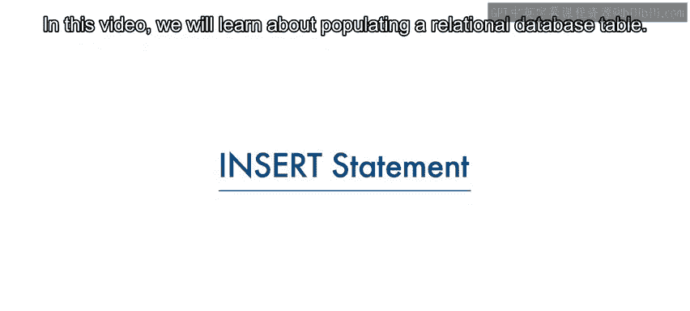

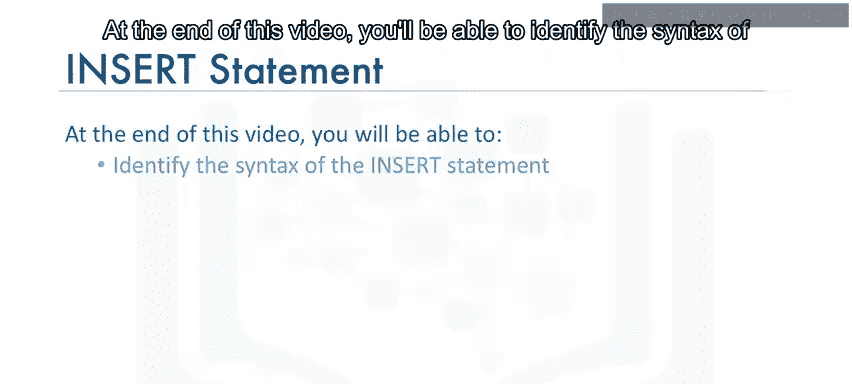

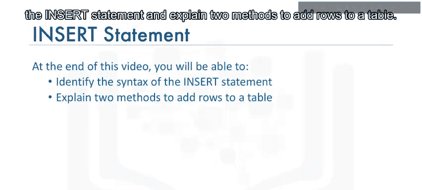

After a table is created， the table needs to be populated with data to insert data into a table。

 We use the insert statement。 The insert statement is used to add new rows to a table。

 The insert statement is one of the data manipulation language statements。

 Data manipulation language statements or DM M L statements are used to read and modify data。

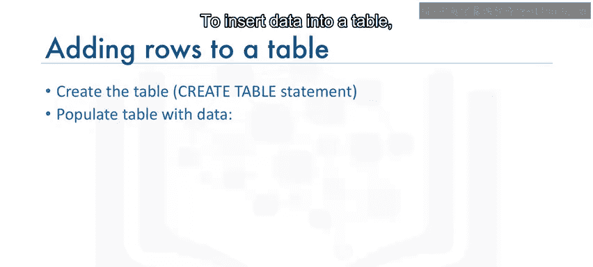

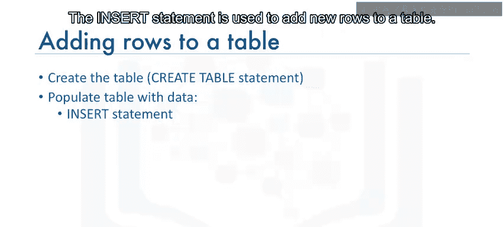

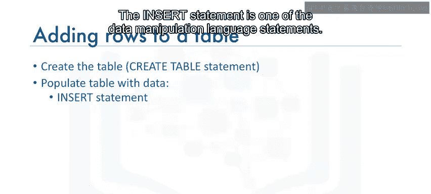

Based on the author entity example， we created the table using the entity name， author。

 and the entity attributes as the columns of the table。

Now we will add the data to the author table by adding rows to the table。

To add the data to the author table， we use the insert statement。

 The syntax of the insert statement looks like this。 insertt into table name， column name， values。

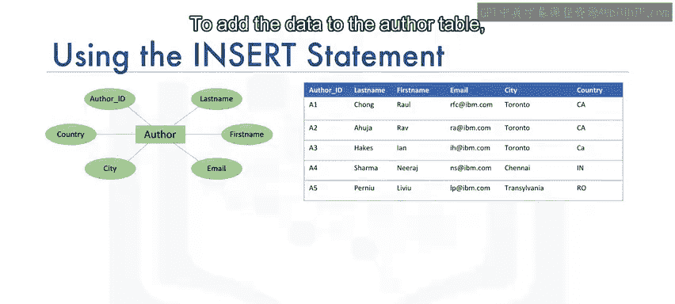

In this statement， table name identifies the table。

 The column name list identifies each column in the table。

 and the values clause specifies the data values to be added to the columns in the table。

To add a row with the data for Raoul Chong， we insert a row with an author underscore I D of a1。

 The last name is Chng。 The first name as Raoul。 The email as RF at IBM com， the city as Toronto。

 and the country S C， A for Canada。 The author table has six columns。

 So the insert statement lists the six column names separated by commas。

 followed by a value for each of the columns also separated by commas。

It is important that the number of values provided in the values clause is equal to the number of column names specified in the column name list。

 This ensures that each column has a value。Tables do not need to be populated one row at a time。

 Multile rows can be inserted by specifying each row in the values clause In the values clause。

 Each row is separated by a comma。

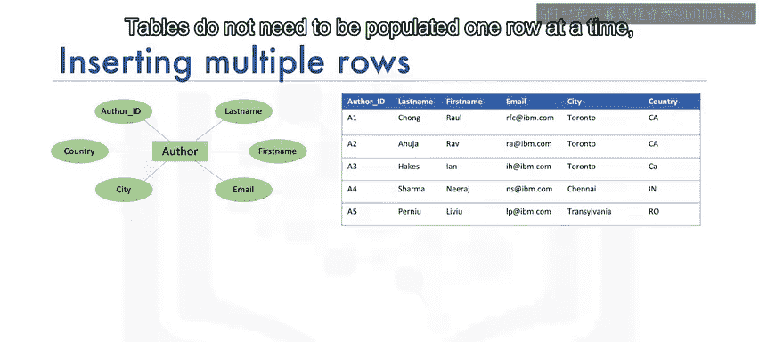

For example， in this insert statement， we are inserting two rows。

1 for Raoul Chong and one ver Ra Ahuja。Now， you can identify the syntax of the insert statement and explain the two methods to add rows to a table。

 one row at a time or multiple rows。

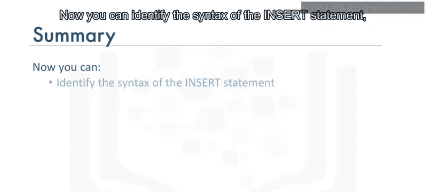

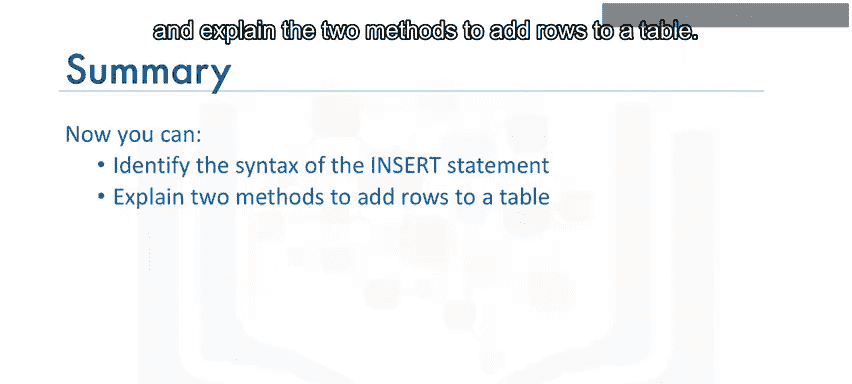

Thanks for watching this video。

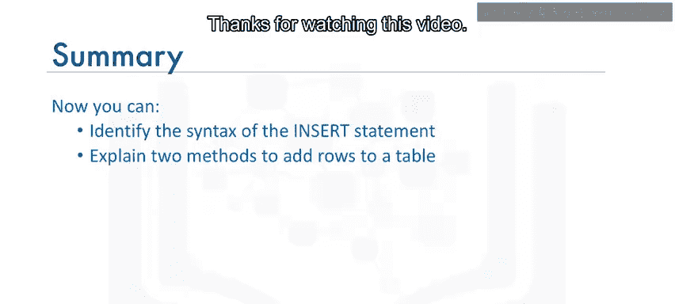