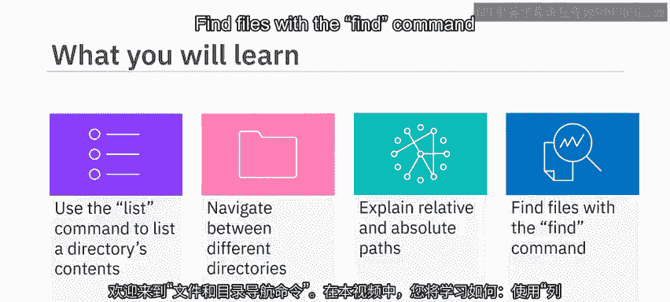
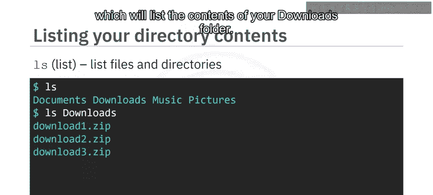
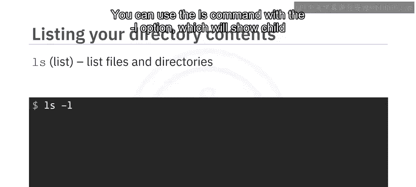
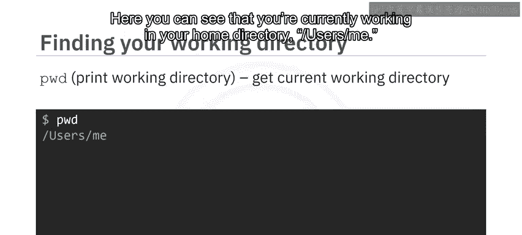
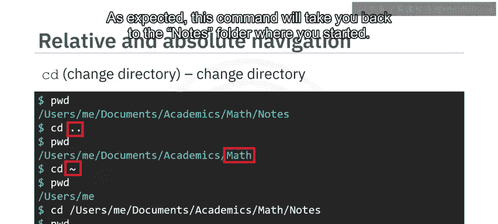
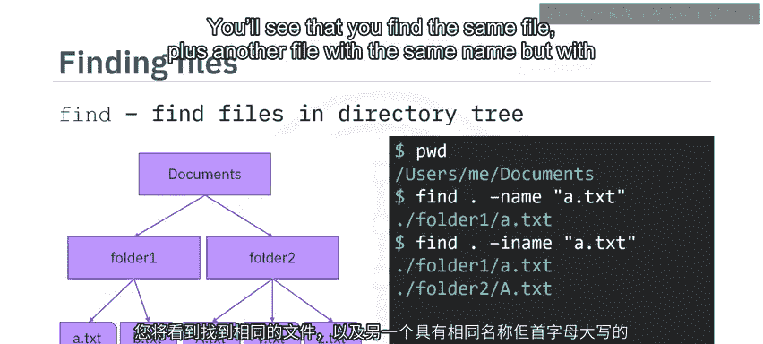

# IBM数据工程专业证书课程6：《Linux命令和Shell脚本入门实践》｜hands-on-introduction-to-linux-commands - P10：9_文件和目录导航命令.zh_en - GPT中英字幕课程资源 - BV1KV41137Lg

Welcome to file and directory navigation commands。In this video。

 you'll learn how to use the list command to list a directory's contents。

 Navigate between different directories with the change directory command。

 Explain relative and absolute paths。And find files with the Find command。

The LS or list command will list the files and directories within a directory。

 If you enter LS in your home directory， you will see all the files and directories that your home directory contains。

 You can also pass a directory name， such as downloads as a parameter to LS。

 which will list the contents of your downloads folder。

The L S command also supports options that will list additional information。

 Suppose you're currently working in your documents folder。

 and you want more information about the files within the directory。

 You can use the LS command with the minus L option。

 which will show child files and directories in a longer， more detailed format。

 You can see that the terminal has listed all the child files， directories and additional details。

 such as permissions， last modified date and owner。

At times， you may need to know which directory you're currently working in。 In these cases。

 you can use the print working directory command to get your current working directory enter PW D into the command line to use the command Here you can see that you're currently working in your home directory slash usersers slash me。

If you want to change your current working directory， you can use the change directory command。

 The change directory or C command is used to change the directory you're working in。

 Suppose you're in your home directory and wish to move to a subdirecty within it。

 such as the documents folder， simply enter C documents to change your working directory。 Now。

 if you enter PwD。 You can see that you're now working in your documents subdirecty。

The C D command enables you to change directories with either a relative or an absolute path。

 Let's say you're in a notes folder within your documents directory tree to get to the parent directory。

 relative to your current folder， entered the C D command with the relative path symbol dot dot as its argument。

 Now， your working directory is math。 The immediate parent directory of your notes folder。

 If you want to navigate directly to your home folder。 Use the Tildy symbol with the Cd command。

 This will take you to your home folder。 In this case。

 the Tildy symbol represents an absolute path to home。 Finally。

 you can also provide a full path to a directory。 Here you are referring to the absolute path name for the original notes directory。

 As expected， this command will take you back to the notes folder where you started。😊。

Lastly， the Find command is a powerful tool that will return the path to every file that matches a user specified criterion。

 Suppose your documents folder has a file structure as shown two subfolds each containing a few files。

 Let's say you're working in your documents folder and want to find the paths of all files named a dot text within your working directory to do so。

 type find dot minus name， a dot TXT。The dot argument means search within here。

 so the command will only search within your current working directory to perform a case sensitive version of your search。

 you can use the minus I name option instead。 you'll see that you find the same file plus another file with the same name。

 but with an uppercase A。

In this video， you learned that the L S command lists all files and directories contained within a specified directory tree。

The C D command is used to navigate between directories。

 Reative paths are relative to your current working directory。

 While absolute paths stand independently。 The fine command is used to find files in your directories。

