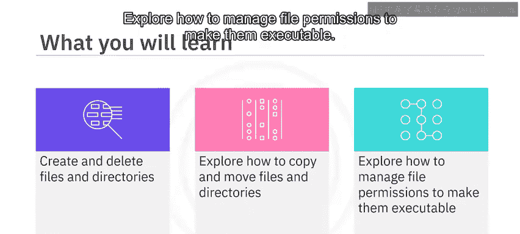
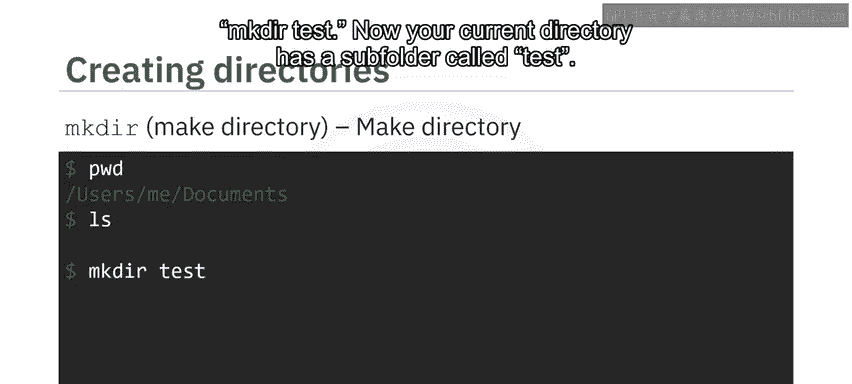
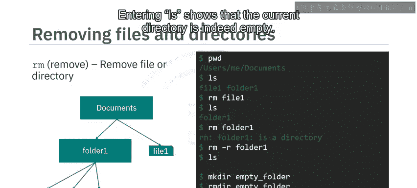
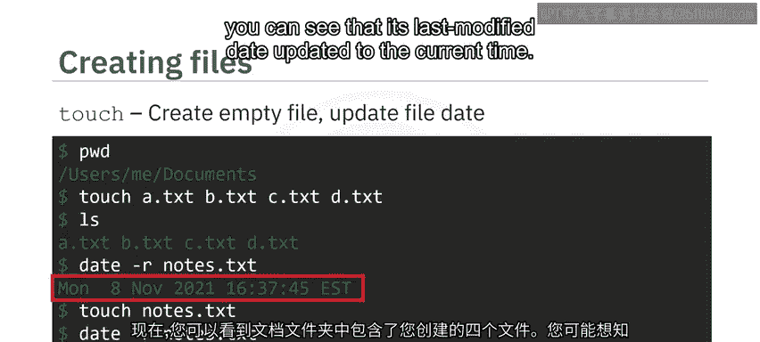
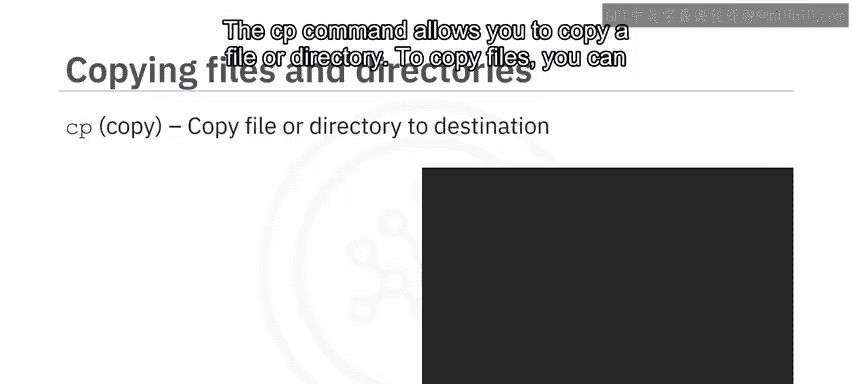
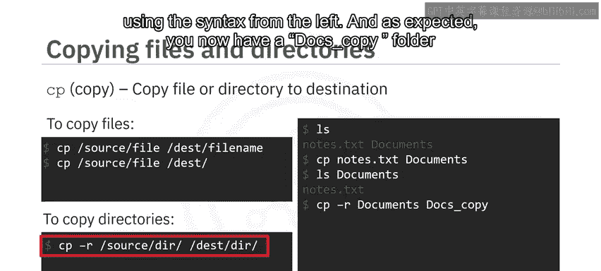
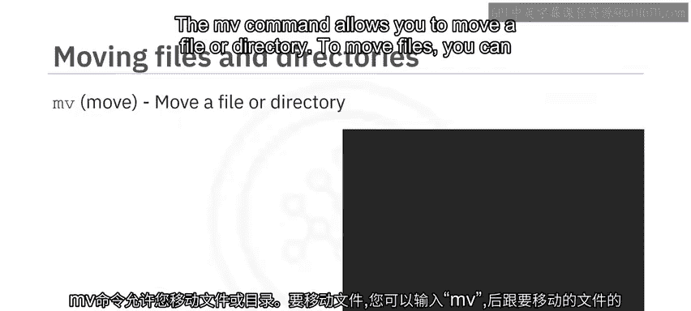
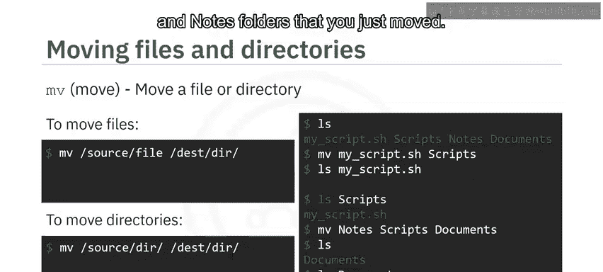
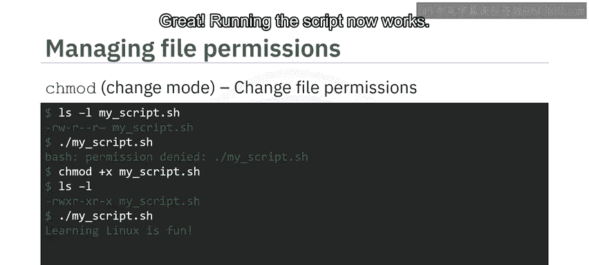
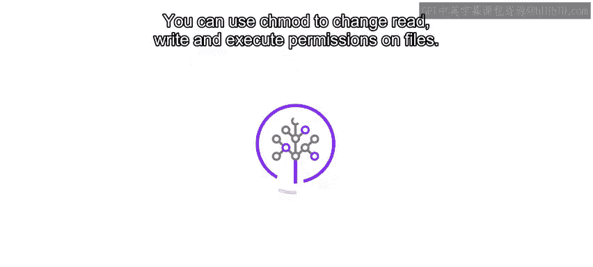

# IBM数据工程专业证书课程6：《Linux命令和Shell脚本入门实践》｜hands-on-introduction-to-linux-commands - P11：10_文件和目录管理命令.zh_en - GPT中英字幕课程资源 - BV1KV41137Lg

Welcome to File and Directory Management Commands。After watching this video。

 you'll be able to create and delete files and directories。

 explore how to copy and move files and directories。

 explore how to manage file permissions and make them executable。😊。

The make directory command is used to create directories。 Let's say you're in your documents folder。

 which is currently empty to create a folder called test。 Simply enter M K D I R Test。 Now。

 your current directory has a subfolder called test。

The R M command allows you to remove a file or directory。

 Suppose you have a file structure as shown on the left。

 And let's say you're in the documents folder。 and you wish to remove file 1。

 You can do this by simply typing R M file1。 Now you can see only folder1 is left。

 You cannot simply remove folder1 since it may contain other files。 However。

 you can easily get around this by entering R M with the minus R option。

 The minus R option means you want to remove the directory along with all its child file objects。

 Your documents folder is now empty。 According， you should always be careful when using R M with the minus R option。

 It's very easy to accidentally remove folders with important data。 Now。

 suppose you create an empty directory with the M K D IR command， and then you decide to remove it。

 The R M。O RF command is not recommended Instead， you should use the RMDIR command。

 which is used solely to remove empty directories This guarantees that you'll never accidentally delete any important files or directories entering LS shows that the current directory is indeed empty。

The touch command can be used to create empty files。 Suppose you're in your directoryies folder。

 which is empty。 and you wish to create some empty text files。

 You can do this by entering touch along with some file names A， B， C and D with the dot text suffix。

 Now， you can see that your documents folder contains the four files you created。

 You might be wondering what the touch command does to an existing file。

 Suppose your current directory contains a file called notes dot text。

 You can see when it was last modified using date minus R notes dot text。

 If you use the touch command on notes dot text。 you can see that its last modified date updated to the current time。

The C command allows you to copy a file or directory to copy files。

 you can either copy a file from a source directory and specify the file name for the file in its destination directory or simply omit the destination file name and default to keeping the same file name to copy entire directories you need to give C the minus R option so that it knows to recursively copy all subdirecties and files Let's look at some examples Suppose you have a file called notes do text and a folder called documents in your working directory。

 you can copy notes do text to your documents folder using C notes do text documents。

 Now you can see that your documents folder contains a copy of notes TxT。

 Notice that you didn't need to specify a source directory because C defaults to your current directory。

 Next you can create。

A copy of your documents folder called Docs underscore copy using the syntax from the left。

 and as expected， you now have a Docs underscore copy folder containing the same contents as the original documents folder。

The MV command allows you to move a file or directory to move files。

 You can enter MV followed by the paths of the files you want to move。

 followed by the folder you want to move them to。 Likewise， to move directories。

 you type MV with the directoryies path to be moved followed by the path and directory you want to move them to。

 Let's look at an example。 Suppose you have a file called My script S and three folders called scripts notes and documents。

 you can move my underscore script do S H to your scripts folder using the syntax from the left。

 According， entering Ls my underscore script do S returns nothing。

 but entering Ls scripts shows that you successfully moved my underscore script do S to your scripts folder。

 Next， you can move your notes and scripts folders to your documents folder using。

The syntax on the leftYou can see that your directory now just contains your documents folder and that your documents folder contains the scripts and notes folders that you just moved。

CHMOD stands for change mode and is used to change read， write and execute permissions on files。

 Suppose you have a She script file in your current directory called my underscore script do SH that Ees learning Linux is fun entering Ls minus L my underscore script do SH shows that your She script has read and write permissions。

 as indicated by the R and W characters， but if you try to execute the file。

 you get a permission denied error in order to make your script executable。

 you call C H mod on my underscore script do S H with the plus X option entering LS minus L my underscore script do SH now shows that my underscore script do SH has executable permissions as indicated by the X character Great running the script now works。

In this video， you learned that you can use the To command to create a new file or update the last modified date of an existing file you can create a directory with the MKDIR command and delete an empty directory with the RMDIR command。

You can use the CP and MV commands to copy， move， and rename files and directories。

 and you can use CH modD to change read， writer， and execute permissions on files。

