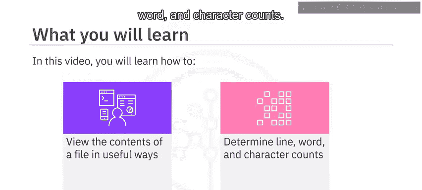
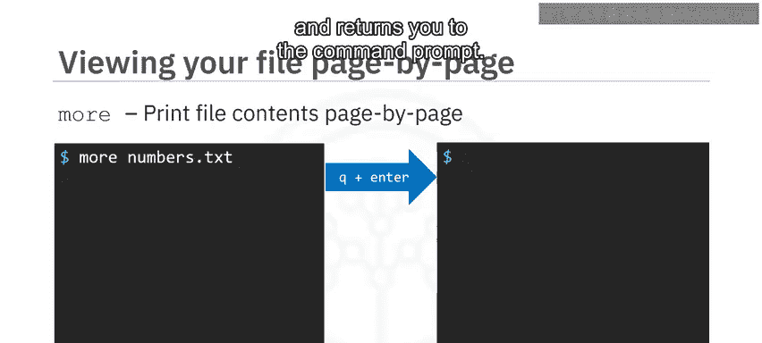
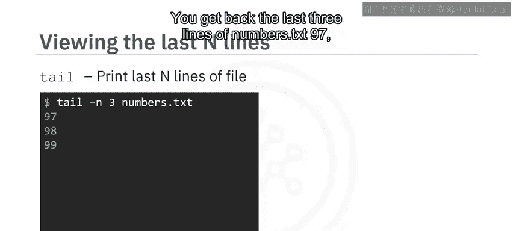
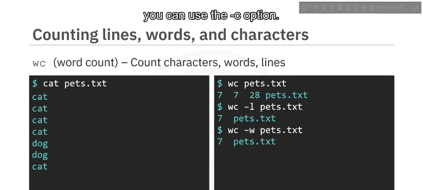

# IBM数据工程专业证书课程6：《Linux命令和Shell脚本入门实践》｜hands-on-introduction-to-linux-commands - P12：11_查看文件内容.zh_en - GPT中英字幕课程资源 - BV1KV41137Lg

Welcome to Viewing File contentt。In this video， you will learn how to apply commands that operate on files to view the contents of a file in useful ways。

 and determine line word and character counts。

There are several useful commands for viewing file content to begin with。

 you can use the CAT command to print the entire file to standard output。

Suppose your current directory contains a single file called numbers dot text。

 which you can see by entering the LS command to print the contents of this file to standard output。

 you can type CA numbersumb。 TxT， which produces the output shown here。

 consisting of the numbers 89 through to 99。You can see that the output takes up the entire terminal window。

 The file is much longer than the 12 lines you see here， and for this reason。

 you might not always want to use CA to view contents。 thankfully。

 there are alternative commands for cases such as these。

The more command allows you to view a files content in a page by page format by entering more numbers do text。

 you see the numbers 0 to 8 on page1 as shown by page。

 we just mean the current terminal window If you expand your terminal window vertically。

 you also increase the page size。 and when you click the spacebar。

 you will see the next page which displays the numbers 9 through 17。

 En Q quits the more program and returns you to the command prompt。

You can use the head command to print the first 10 lines of your file。

 entering head numbersumbers dot text returns the first 10 lines or the numbers 0 through9 as shown。

You can specify the number of lines you would like head to return using the minus n option by entering head minus n3 numbers dot text。

 You get back the first three lines of numbers dot text as 012。

 The tail command is used to print the last 10 lines of a file。

 entering tail numbers do text returns the last 10 lines of numbers dot text。

 Naly the numbers from 90 through to 99。Just like with the head command。

 you can use the minus n option to change the number of lines returned by entering Ta minus n3 number dot text。

 you get back the last three lines of number dot text， 97， 98 and 99。

You can use the WC command to count the number of characters， words or lines in your file。

 Imagine you have a file called pet。text entering catP。

text shows that the file contains the word cat or the word dog on each line by entering WC pet。text。

 you get the result 77，28 pettex， which means that your file contains seven lines。

 7 words and 28 characters。But 7 times 3 is 21。 So why does WC see 28 characters。

 Because it also counts new line characters。 You can't see them there。

 but there are seven new line characters， one of which represents and a file to view only line count。

 you can use the minus L option， which returns7 pet dot text and similarly， to view only word count。

 you can use the minus W option and to view only character count， you can use the minus C option。

In this video， you learned how to apply the CA more head and tail commands to view file contents in multiple ways。

 and determine the line， word and character count of a file using WC。

