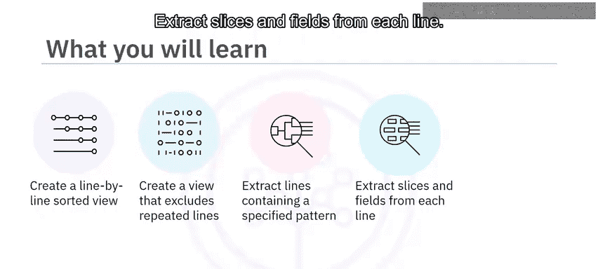
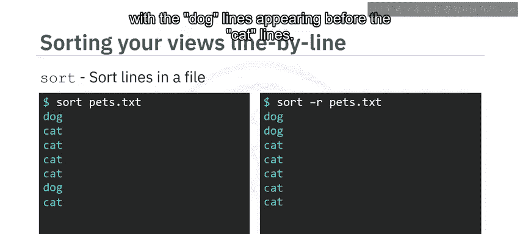
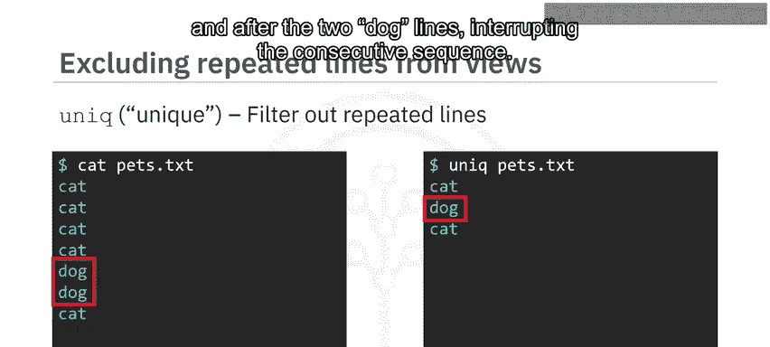
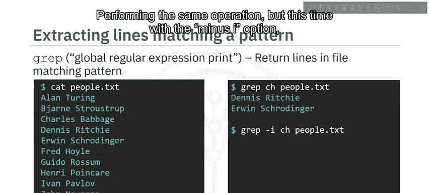
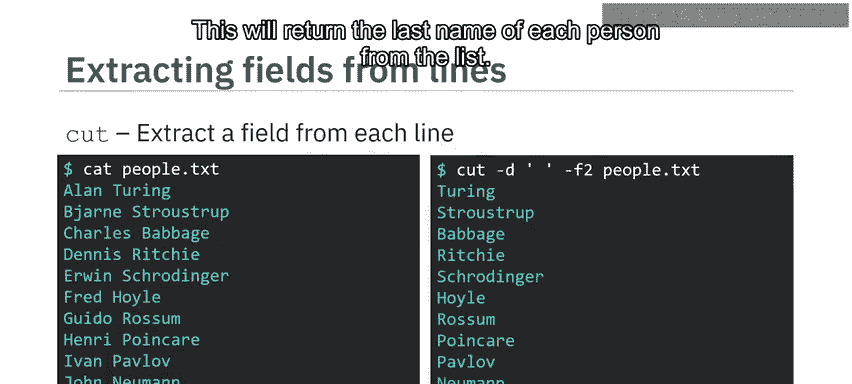
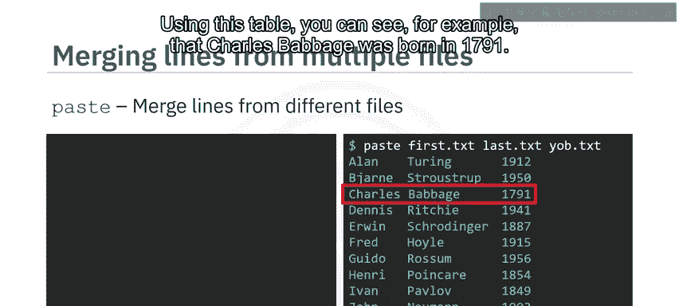
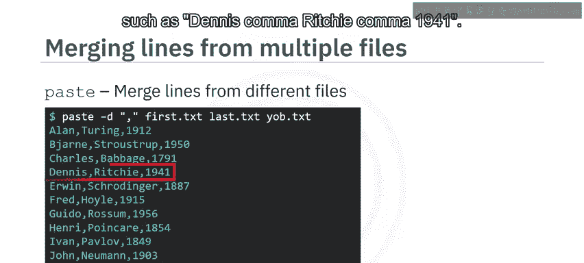

# IBM数据工程专业证书课程6：《Linux命令和Shell脚本入门实践》｜hands-on-introduction-to-linux-commands - P13：12_用于整理文本文件的有用命令.zh_en - GPT中英字幕课程资源 - BV1KV41137Lg

Welcome to Useful Commands for wrangling text files。In this video。

 you will learn how to apply commands that operate on files to create a line by line sorted view。

 create a view that excludes repeated lines， Ex lines containing a specified pattern。

 extract slices and fields from each line。

And merge lines from multiple files。The sort command sorts the lines of a file alpha numerically and prints the sorted result to standard output by entering sortpes dot text。

 you get back the alphabetically sorted output with cat repeated five times and dog repeated twice if you enter sort minus R pets dot text。

 you get back the lines sorted in reverse order with the dog lines appearing before the cat lines。

If you have repeated lines in your file， you can use the unique command to filter out the repeated lines。

 recall the contents of pets do TX T by entering cat pets dot text。 by entering unique pets do T X T。

 you get back cat， dog and cat Note that the unique command only removes duplicated lines if they are consecutive。

 Thus， the word cat appears twice here because cat appears before and after the two dog lines interrupting the consecutive sequence。

The Grpp command， which stands for global regular expression print。

 returns lines of a file matching a specified pattern， such as a regular expression。

 Suppose you have a list of famous people's names stored in a file。

 which you can view by entering cat people dot text。

 you can use Grpp to find all lines in people dot T X T that contains the consecutive characters C H to do this。

 you give Grpp， the matching term C H followed by the file name。 The output returns two results。

 Dennis Ritchie and Irwin Schrodinger containing a lowercase match to C H。

 Per the same operation But this time with the minus I option returns an extra result。

 Charles Babbage， which has an uppercase C。 the minus I option expands the pattern search by making it case insensitive。

😊。

You can also use the cut command to extract specific sections from each line in your file。

 Here you see the list of famous names again， such as Alan Tring and Charles Babbage。

 you can use the Cu command to extract the second to9 characters from every line by entering cut minus C29 people dot text。

 you can save from the output that Alan Tring is returned as Land Try。

Let's look at a more practical example for using cut with text files。

 Suppose you want to extract only the last name of each person on your list。

 You know that each line of your list is made up of two fields。 The person's first and last names。

 A space separates these fields。 Here， yourre cutting to extract the second field from each line。

Using the minus Dspace quote option， you can specify that the field delimiter or the character that indicates the break between fields is a space。

 then use the minus F2 option to return the second field from each line。

 this will return the last name of each person from the list。

Additionally， you can use the paste command to merge lines from multiple files。

 Imagine you're given the following three text files all with the same number of lines。

 A text file is called first dot text containing a list of people's first names。

 A compliment text file called last dot text， which contains the last names of the same people。

 and a third text file called Y O B dot text， which lists each person's year of birth。

 You can view these files as a table by entering paste first dot T X T last dot T X T Y O B dot T X T。

 Notice that the three columns are evenly aligned because paste uses a tab as a default delimiter。

 using this table。 you can see， for example， that Charles Babbage was born in 1791。😊。

You can specify a delimiter other than tab using the minus D option with the paste command。

 For example， you can use a comma as a delimiter by entering paste minus D with a comma surrounded by double quotes together with the first。

 last， and YOB text files As you can see， this will create a table combining all three files with a comma between each field such as Dennis。

 comma Rie， comma 1941。

In this video， you learned how to view the lines of a file alpha numerically using sort。

 Remove repeated lines from your view with unique。 Get the lines of a file that match your desired criteria using Grp。

 Extract slices and fields from lines with cut。 merge lines from different files using paste。

