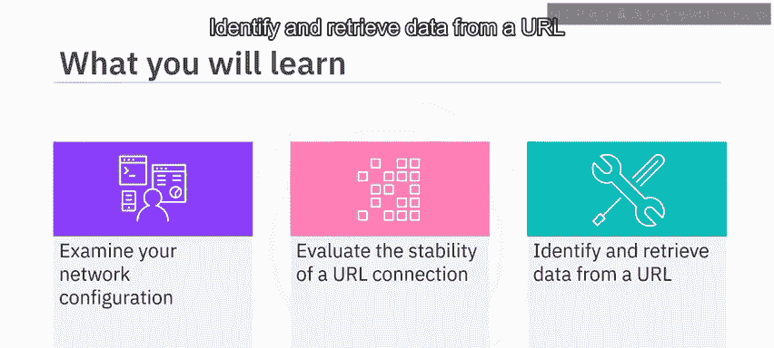
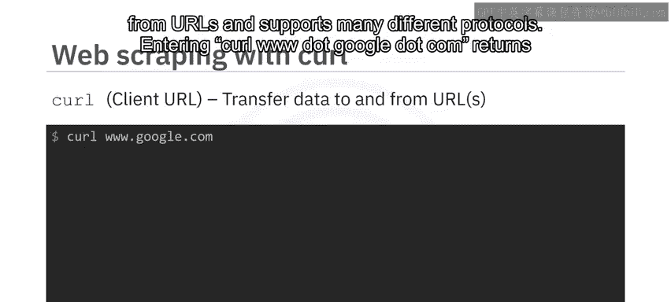
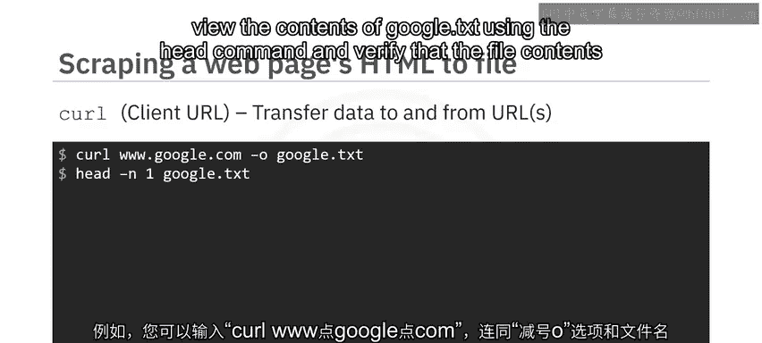
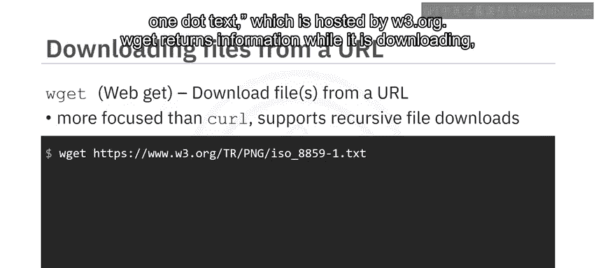
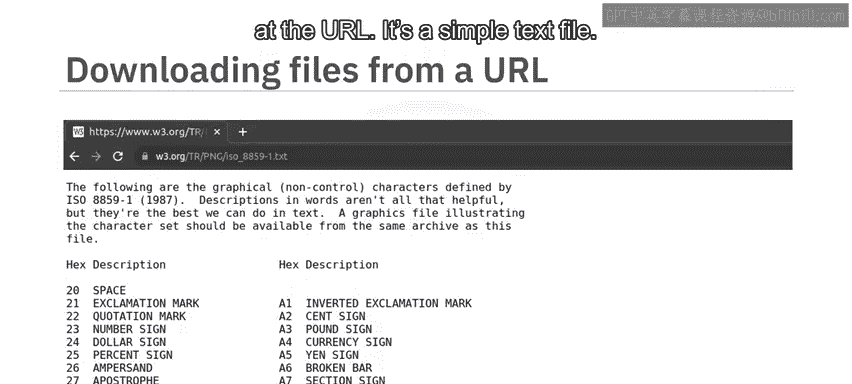

# IBM数据工程专业证书课程6：《Linux命令和Shell脚本入门实践》｜hands-on-introduction-to-linux-commands - P14：13_网络命令.zh_en - GPT中英字幕课程资源 - BV1KV41137Lg

Welcome to networking commands。After watching this video。

 you'll be able to examine your network configuration。

 evaluate the stability of a URL R connection and identify and retrieve data from a URL。😊。

The host name command is used to get or set the host name and other information。

 which uniquely identifies your computer， entering the host name command without any options returns the host name of your machine。

 which in this example is my Linux machine dot local。

 The dot local suffix appears in the host name if your machine has local domain set to drop the domain suffix。

 You can include the minus S option If you use the minus I option。

 Ho name will provide the Ip address of the host name。The IF Config command。

 which stands for interface configuration， displays information regarding all your devices's communication devices。

 If you enter IF config with no options， you get a lot of information， including the I P address。

 Mac addresses and the hardware specifications of your communication devices。

 A lot of this information is beyond the scope of this course and would be more useful for system administrators。

You can also specify a specific device you want IF config to inspect。

 such as an Ethernet adaptaper called Eho， entering IF Config E0 returns information about your ethernet adapter。

 such as its internet address， the number of packets received。

 including counts of errors and dropped packets， the same metrics applied to transmitted packets and the total amount of data received and transmitted。

You can use the ping command to test connectivity to a host or I address。

 Ping sends packets known as ICM Internet control message protocol requests to the server。

 listens for a response and print a result。 for example。

 by entering ping Google com Ping returns a line of info for each successful response to an echo request and continues until you abort with control C and after ping aors。

 it prints summary statistics for the ping results for each echo request ping reports useful information。

 including the I address of the given URL1，4，2 do2，5，1 do 4，1 do 6。

8 and the total roundtri time in milliseconds to provided statistics at the end include how many packets were transmitted and received the percentage of packets dropped and the minimum average maximum and standard deviation。

😊，Of the round trip times in milliseconds。If you would like the P command to return a set number of Ping results。

 you can use the minus C option entering Ping minus C5go co returns the five ping results。

 aborts and then prints the same statistics it would print without the minus C option。

The curl command is a powerful tool that enables you to transfer data to and from URLs and supports many different protocols。

 entering curlwww。 Google co returns the entire HM content of the landing page at Www。

 Google com using the default HtTP protocol。 You can see， for example。

 the path to a PNG file for the Google G logo。 You can render the logo by appending its path to Google com in your browser。

😊。

You can even get curl to write the contents of a URL to a local file。

 This is done using the minus O option。 For example。

 you can enter curl Www Google com together with the minus O option and a file name such as Google text。

 You can then view the contents of Google TXT using the head command and verify that the file contents indeed match the previous output。

😊。

Similar to curl， the W get command is used to retrieve files located at a URL。

 Wge is like curl in that it can retrieve a file located at a URL or the Hm code for a web page。

 but it's more specialized in its protocol support and has recursive downloading capabilities。

 This is useful when a URL might point to a folder that contains several files。

 Here you use Wge to download a single test file called IO underscore 88591 do text which is hosted by W3。

 org Wge returns information while it is downloading such as resolving and connecting to the target server。

 HttP request sent， awaiting a response and saving the file which it automatically names for you to the current directory。

For reference， here is what your browser shows you when viewing。

 looking at the data located at the URL， it's a simple text file。

By entering head-12 ISO underscore 88591 dot text， you see the first 12 lines of the contents of the downloaded file。

 As expected， the file contains the exact same data that you just saw on the previous slide。

In this video， you learned that the host name command is used to get or set the host name。

 The I F config command displays information regarding all your devices。 communication devices。

 You can use the Ping command to test connectivity to a host or I P address。

 The curl command enables you to transfer data to and from URLs。

 The W get command is used to retrieve files located at a URL。😊。

