# IBM数据工程专业证书课程6：《Linux命令和Shell脚本入门实践》｜hands-on-introduction-to-linux-commands - P15：14_文件存档和压缩命令.zh_en - GPT中英字幕课程资源 - BV1KV41137Lg

Welcome to F Archiving and compressionpression Commands。

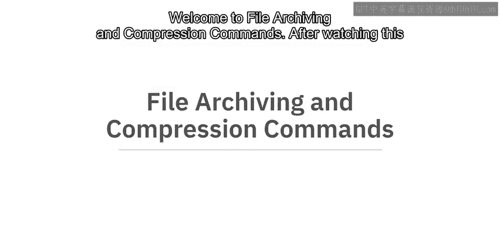

After watching this video， you will be able to distinguish file archiving from file compression。

 create archived files and unpack them， and apply commands to compress。

 decompress and extract files from archives。

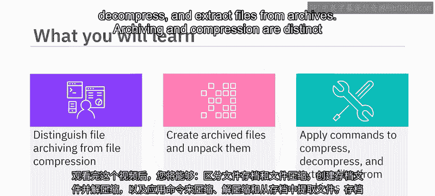

Ariving and compression are distinct processes which are usually combined Archiving is the process of storing information that you don't use regularly。

 but want to preserve。

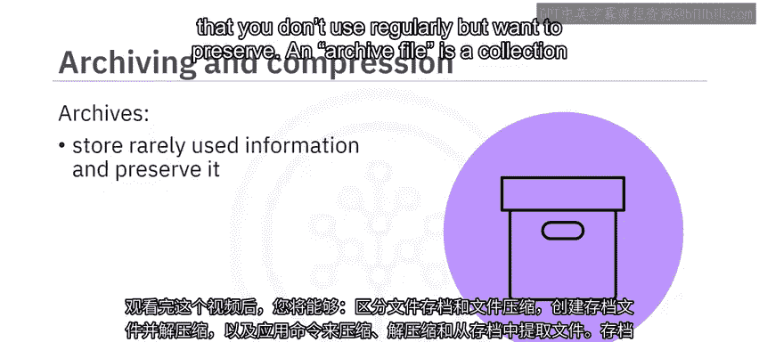

An archive file is a collection of data files and directories that are stored as a single file archiving makes the collection more portable and serves as a backup in case of loss or corruption。

File compression， on the other hand， involves reducing the size of a file by taking advantage of redundancy in its information content。

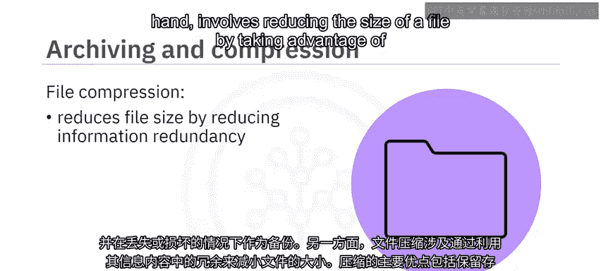

The main advantages of compression include preserving storage space， speeding up file transfers。

 and reducing bandwidth loads。Now suppose you have created a notes directory for keeping track of your course materials you decide it would be a good idea to archive your notes in case you need them in the future your notes directory tree has the following structure。

 it contains two subfolders called math and physics。

 each of which contains files called by the same names， Week one and week two。

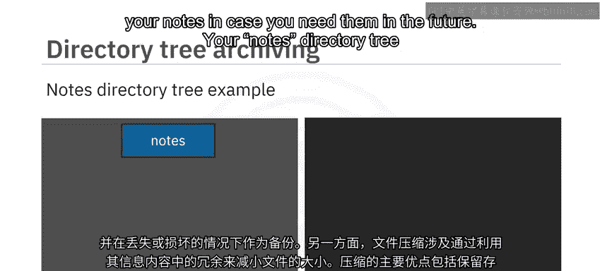

Using the LS command with the minusR option， you can recursively list all the directories and files in your current directory tree。

 you can see the correspondence with the graphical representation of the tree。

 starting with the parent Note directory， the mathth and Phyic subdirecties。

 and the week1 and week two files within the mathth and Phy folders。

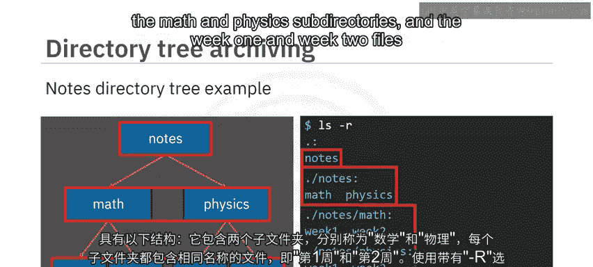

You can use the TAR or tape Archer command to archive and D archive files and directories a popular term for an archived TAR file is a TA ball to archive your entire notes directory including its subdirecties and all files within enter the command TR minus CF a name for the archived files such as Note。

 tar followed by the file or directory you wish to archive which is notes。

The C option means create a new archive and the F flag tells star to interpret its input from fileile rather than from the default。

 which is standard input。Entering LS shows that your current directory now contains the original notes folder as well as the Note。

 tar archive file。If you would also like your archive to be compressed。

 you can enter the same command except now you include the minus Z option。

 which filters the archive through a new compression program called GZip。Adding the suffix。

gZ to the output name ensures that Windows based programs， for example。

 will correctly recognize the file type。Entering LS now shows the compressed Note。t。

gz file that you created。You can check the contents of your archived Note file by calling TAR on your notes TAR ball with the minus T or list option。

 this lists all the files and directories in your TA ball。

 and as expected it has the same structure as your original notes folder with notes as the parent directory。

 math and Ph as subdirecties and week1 and week two files at the terminal notes。

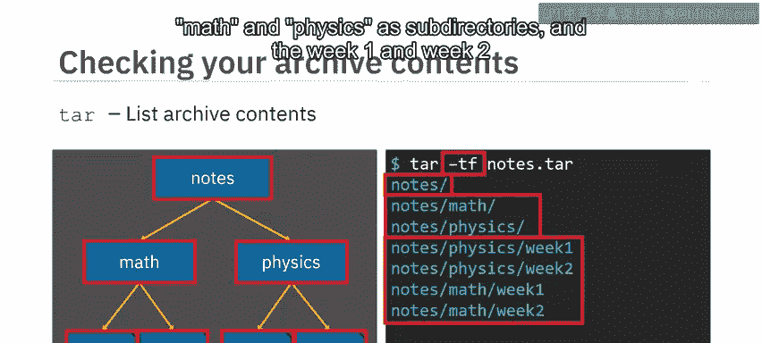

You can also unpack or dearchive your archived files using the TAR command。You can enter TR minus XF。

 followed by the archive file name， Notet tarR， plus an optional destination name， for example。

 notes， which happens to be the default the minus X option tells TAR to extract file and directory objects from the archive。

Now， if you enter LS minus R， you can see that the archived Notes folder has been dearchived into a parent folder called noteses。

 subfolders called mathth and Phic， and the four week one and two files you started with。

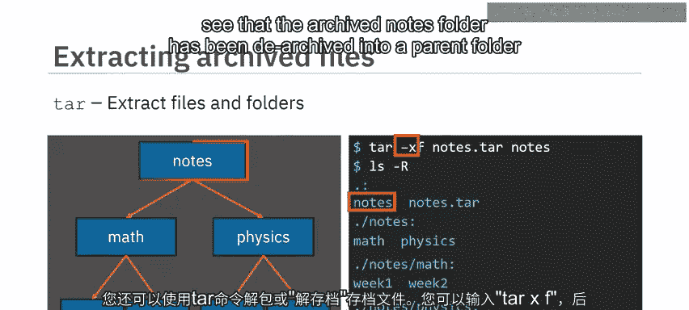

This verifies that the original structure of your notes directory is intact。

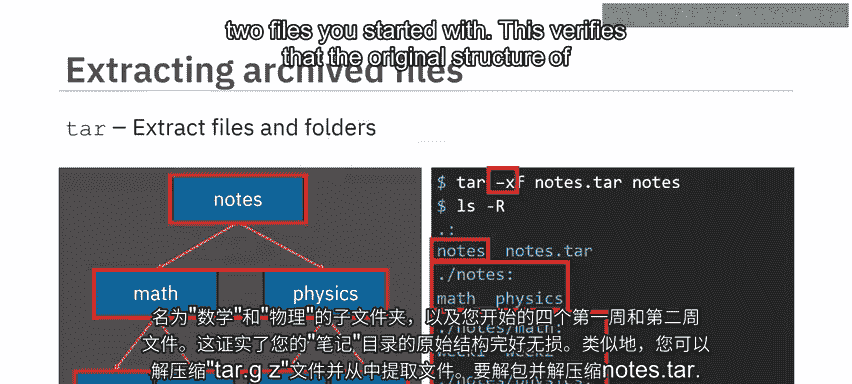

Similarly， you can decompress a tarR。gZ file and extract the files from it to unpack and decompress the notes。

t。gz file， you can enter tarAR minus Xzf followed by the compressed archive file name， Note tarR。

gZ and an optional destination folder Note。Again， by entering LS minusR。

 you can see the directories and files have been unpacked as expected。

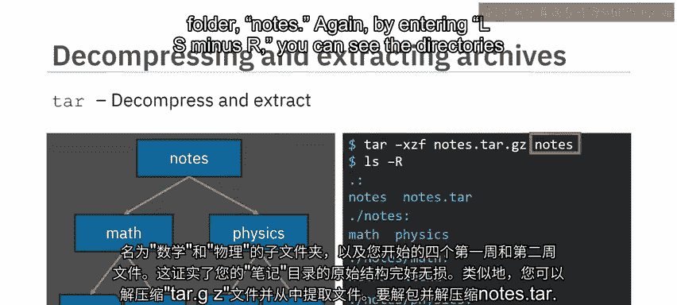

You can use the zip command to compress files and directories and package them into a single archive Notice the order of operations that zip implements zip compresses files prior to bundling them。

 whereas tarR with the minus Z option achieves compression by applying G zipip on the entire tarball。

 but only after bundling it。To compress your notes directory and package it to a zip file。

 enter zipminR Notees。zip notess。And after entering LS。

 you can see that the Note Do zipip archive has been created。

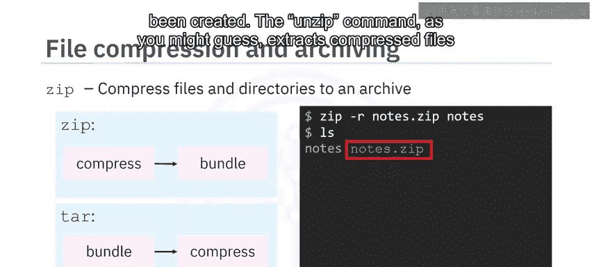

The unzip command， as you might guess， extracts compressed files from a zip archive and decompresses them to unzip your notes。

 zip file， simply enter unzip noteses。zip。After entering LS minus R。

 you can see that UnZip has created your notes folder and unpacked your directories and your week1 and two files as expected。

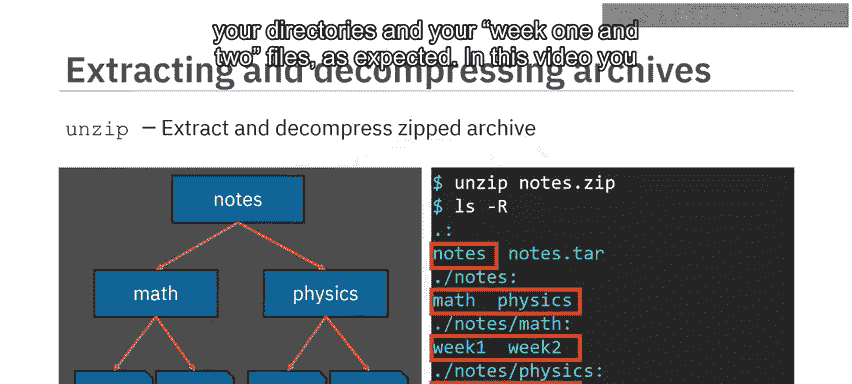

In this video you learned that the main advantages of file compression include preserving storage space。

 speeding up file transfers， and reducing bandwidth loads you can use the zip command to compress files and directories and package them into a single archive of compressed files you can use TA to archive files and directories into a tarA ball and optionally apply GZip compression to the TAball file you can use unzip to unpack and decompress the zip archive and finally you can use TAR to decompress and unpack a tar。

 GZ archive。

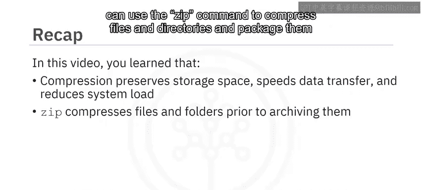