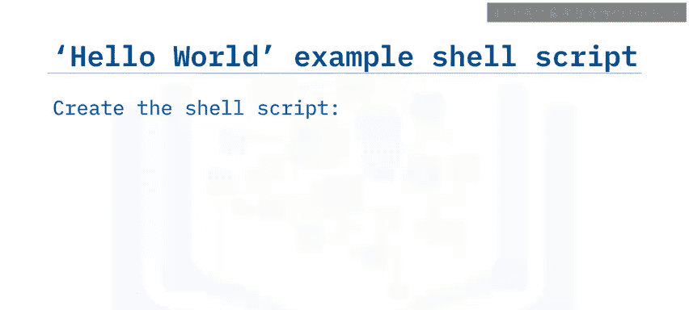
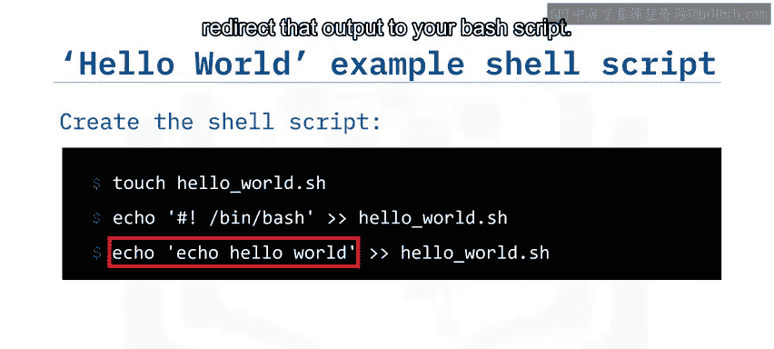
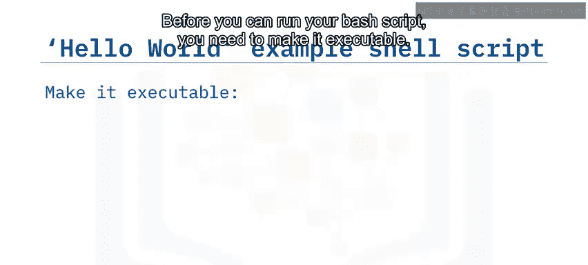
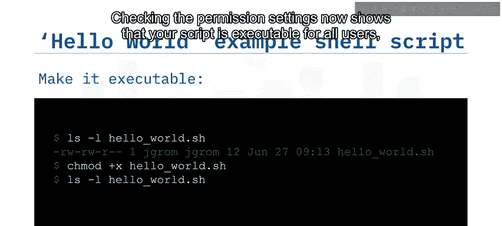
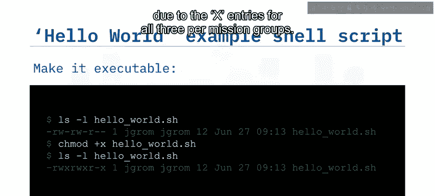
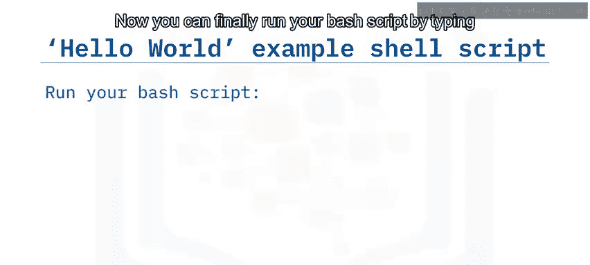
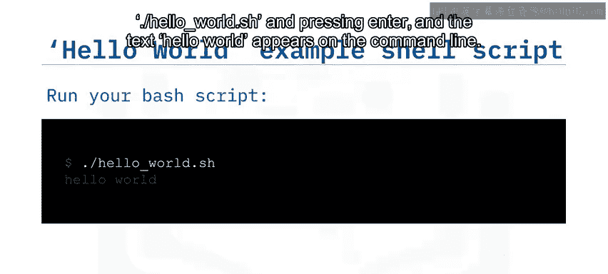
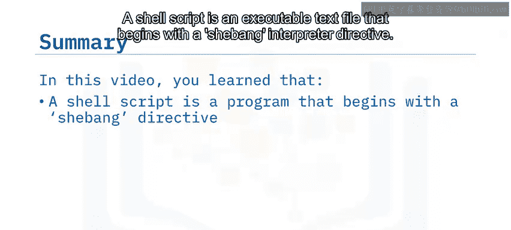

# IBM数据工程专业证书课程6：《Linux命令和Shell脚本入门实践》｜hands-on-introduction-to-linux-commands - P16：15_shell 脚本入门.zh_en - GPT中英字幕课程资源 - BV1KV41137Lg

Welcome to Shell scripting Bass。After watching this video。

 you will be able to outline what a script is， list use cases for scripting。

 describe the Shabang interpreter directive， and create and run a simple hello world Shell script。

A script is a list of commands that can be interpreted and run by a program called scripting language commands can be entered interactively at the command line or listed line by line in a text file。

Scripting languages are usually not compiled， they are interpreted at runtime Scs are generally slower to run than compiled languages。

 but they are also much easier and faster to develop。

Scrips are widely used to automate processes such as ETL jobs， file backups and archiving。

 and general system administration tasks you can use scripts for nearly any computational task。

 including application integration and plugin and web application development。

A shell script is an executable text file in which the first line usually has the form of an interpreter directive。

 the interpreter directive is also known as a Shabang directive， which has the following form。

 Pound B interpreter plus an optional argument。Interpreter is an absolute path to an executable program。

 and the optional argument is a string representing a single argument。

Shell scripts are scripts that invoke a shell program。 For example。

 Pob/lash bin/shH invokes the B shellll or other compatible shell program from the bin directory Poundb/lash bin/lash ba Shibang invokes the bash shellll Shibang directives aren't limited to She programs For example。

 you could create a Python script with the following directive Poundb slash user slash bin/lash and Python 3。

Here we demonstrate how a She script can be used to run a program with a simple Ho world example。

From the command prompt， you can create a simple Hello world Shell script as follows。

Use the touch command to create an empty text file called Hello Worldl dotsh The dosh extension is a convention used to indicate that the file is a shell script Now。

 turn your text file into a bash script by echoing the bash Shabang and appending that echoed text to your file using the double greater than symbol。

 which is the bash output redirection operator used for a pending output2 file。Finally。

 use the Echo command to print the statement， Echo hellello world。

 and again redirect that output to your Bsh script Before you can run your Bsh script。

 you need to make it executable First check the current permission settings of your script by using the LS command with the minus L option。

The R andW entries indicate that the script is readable and writeriable。

 but the lack of an X means it is not executable the RW and X entries apply to three user based permission groups。

 the owner which is you， the group， and all users。You can make it executable for all users by invoking the change mod command with the plusLX option。

Checking the permission settings now shows that your script is executable for all users due to the X entries for all three permission groups。

Now you can finally run your bash script by typing dot/helelloworld。sh and pressing enter。

 and the textHello world appears on the command line。

In this video you learned that a Shell script is an executable text file that begins with a chabang interpreter directive。

 a She script can be used to execute commands as well as run other programs。

Scriping languages are not compiled， they are interpreted at runtime。

 and compiled languages may be much faster than scripting languages。

 but they also require more development time。