# IBM数据工程专业证书课程6：《Linux命令和Shell脚本入门实践》｜hands-on-introduction-to-linux-commands - P17：16_管道 变量和过滤器.zh_en - GPT中英字幕课程资源 - BV1KV41137Lg

Welcome to filters， Pis， and Va。After watching this video。

 you will be able to outline the following bash shellll scripting features。

 describe and use pipes and filters， and explain and set shell and environment variables。

Filters are She commands or programs which take their input from standard input。

 normally the keyboard， and return their output to standard output， which is normally the terminal。

We can think of a filter as a transformer， a program that transforms input data into output data。

Here are many examples including word count， cat， more， head， sort， Grep， and so on。

The value of filters is that they can be chained together， which brings us to the pipe command。

 The pipe command denoted by a vertical slash immensely extends the functionality of shells。

 It allows you to chain together sequences of filter commands。 The use pattern looks like this。

Accordingly， the output of command1 becomes the input of command 2 and so on， and not surprisingly。

 pipe is short for pipeline， for example， you can pipe the output of LS to the sort command with the minusR option which results in a reverse sorted list of directory contents。

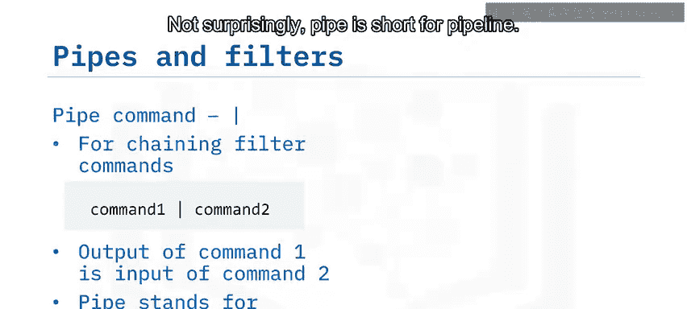

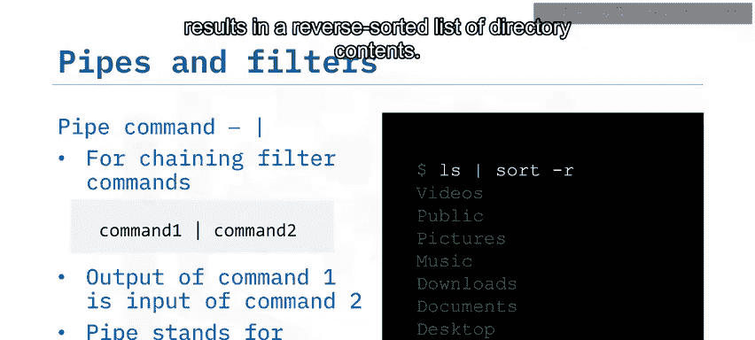

Shell variables are variables that are limited in scope to the shell in which they were created According。

 shells cannot see each other's shell variables you can invoke the set command to list all variables and their definitions that are visible to the current shell。

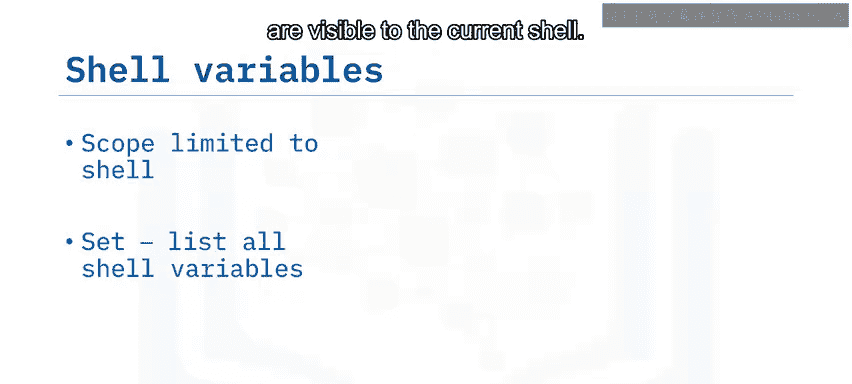

Because it also lists a lot of subsequent information。

 you can pipe the output to head in order to show just the first four variable definitions。

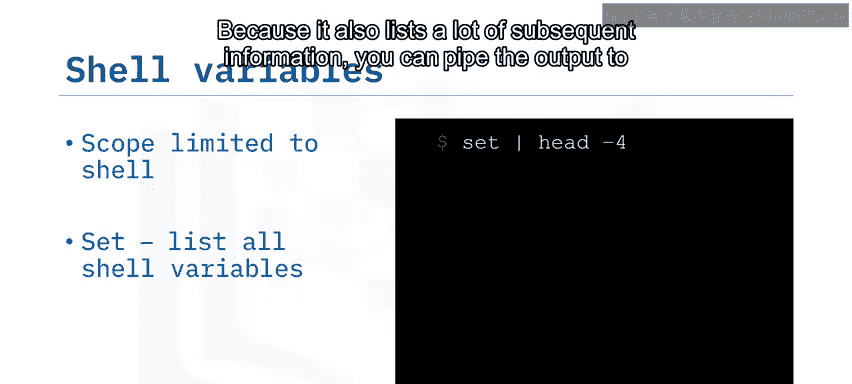

To define a new shell variable， simply use the equal sign to assign a value to your chosen variable name。

Notice that there are no spaces around the equal sign。

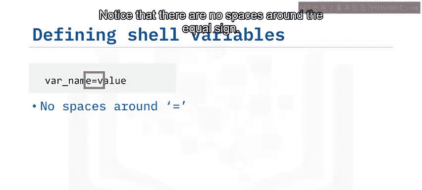

As an example， let's define a shell variable called greetreings， which stores the stringHo。

To see the contents of the new variable greetings， use the dollar sign to access its value。

 then echo it back。You can display multiple variables as well。

 Let's define another variable audience with the value world。

 then echoing both variables back returnsHello world。

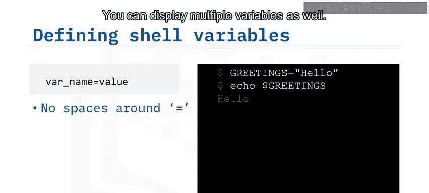

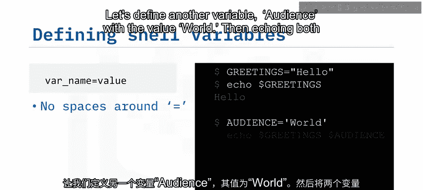

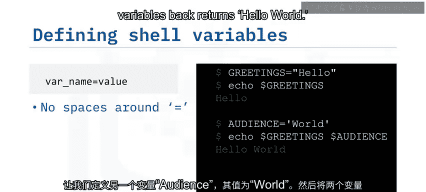

To clear a variable， use theUnset command， for example， Unset audience deletes the variable audience。

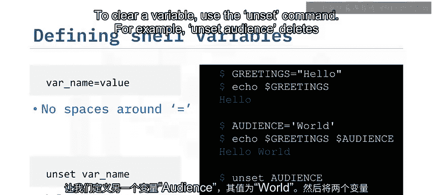

Environment variables are just like shell variables， except they have extended scope。

 they persist in any child processes spawned by the shell in which they originate。

You can extend any shell variable to an environment variable by applying the export command to it for example。

 export greetings makes greetings an environment variable。

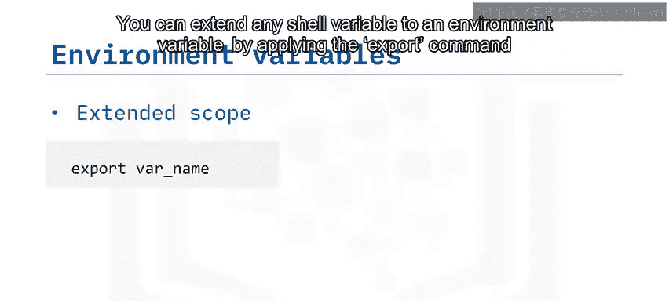

To list all environment variables， use the endV command Let's check whether greetings was exported as an environment variable by piping the output of NV2 GP and filtering the results using the patternG。

Indeed， greetings is now an environment variable。

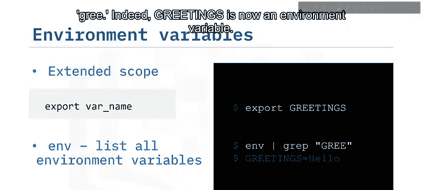

In this video you learned that filters are shell commands or programs such as word count， catt， sort。

 etc， that transform the input provided to them the pipe operator can be used to create a pipeline of chain filter commands。

 whereby output of one command becomes the input of another command Shell variables can be assigned values with a simple equal sign en listed using the set command and environment variables are shell variables with scope extended to all child processes of the shell they are created using the export command andlist using the end command。

