# IBM数据工程专业证书课程6：《Linux命令和Shell脚本入门实践》｜hands-on-introduction-to-linux-commands - P18：17_bash shell 的有用功能.zh_en - GPT中英字幕课程资源 - BV1KV41137Lg

Welcome to useful features of the Bash Shell。After watching this video。

 you will be able to outline the following bashhell scripting features， Me charactersacters。

 quoting input output redirection， command， substitution， command line arguments。

 and batch versus concurrent modes of execution。Metacharacters are special characters that have meaning to the shell。

 The pound symbol is used to include comments which are ignored by the shell。 For example。

 this comment does not return anything。 The semicolon is a metacharact used to separate commands typed on the same line。

 For example， these two commands Re their outputs on two lines like this。

 The asterisk is used to represent any number of consecutive characters within a file name pattern。

 For example， this expression returns all objects in the slash bin directory with names starting with BA and followed by any characters which in this case is bash。

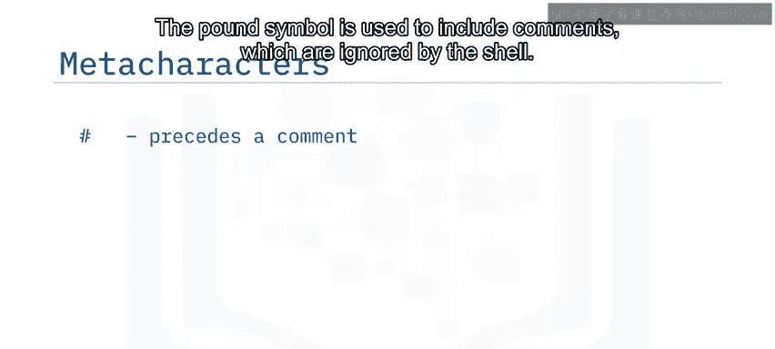

And the question mark acts as a single character version of the asterisk meta characteract。

 For example， this expression lists all objects in the slash bin directory having a single character in place of the question mark。

 namely the bash and dash paths。

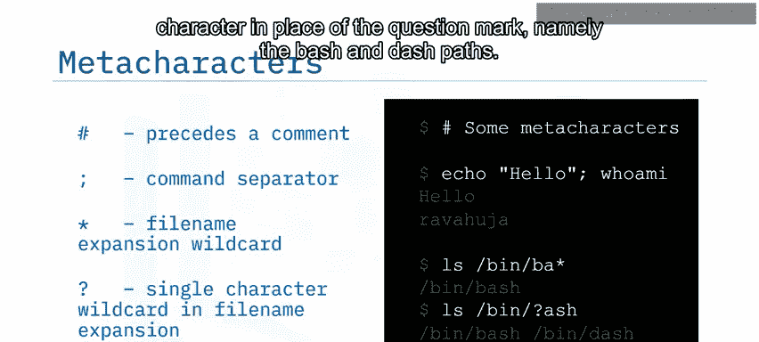

Quoting is used to specify whether the shell should interpret special characters as metacharact or escape them you can use the backslash to escape interpretation of a single character as a metacharact here。

 the backslash tells bash to interpret the dollar sign as's text rather than the default variable name。

 so the output is literally dollar one each。

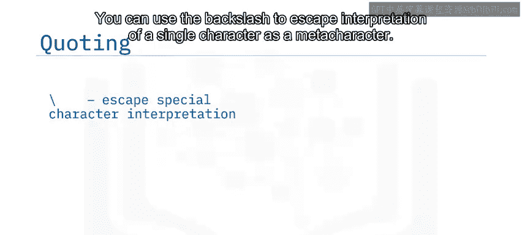

Double quotes will interpret text literally， except for any metacharacters which will be interpreted according to their special meanings。

 For example， the dollar one expression without the preceding backslash is interpreted as a variable。

 which in this case is empty， as we see here。 Notice that it printed the space before each。

Single quotes， on the other hand， are used to interpret all contents as literal characters。

 For example， this expression returns the same result as the first example above。

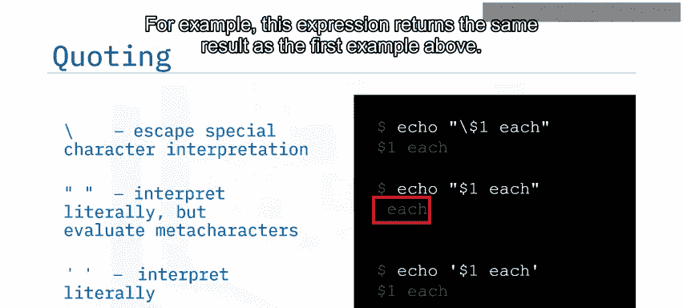

Input output or IO redirection refers to a set of features used for redirecting either the standard input。

 which is the keyboard or the standard output， which is the terminal。

 The greater than symbol is used to redirect standard output of a command to a file。

 It also creates the file if it doesn't exist and overwrites its contents if it already exists。

 You can avoid overwriting by using the double greater than symbol。

 which appends output to any existing content。

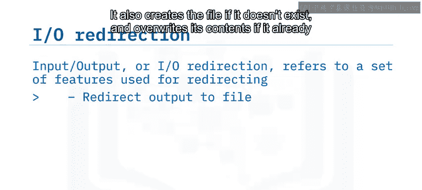

The combination2 greater then redirects an error message to a file， to append the error message。

 for example， to an error log file， just add another greater than sign。And lastly。

 the less than sign is a redirection which is used to pass file contents as input to the standard input。

Let's look at a few examples You can start by simultaneously creating a file and populating it with some text like this you can then cap the file to see what's there As you can see line1 was written to EG。

t textex。Now you can try adding another line to the file。And viewing the contents again。

 you can see that the file contains exactly the two lines you added。

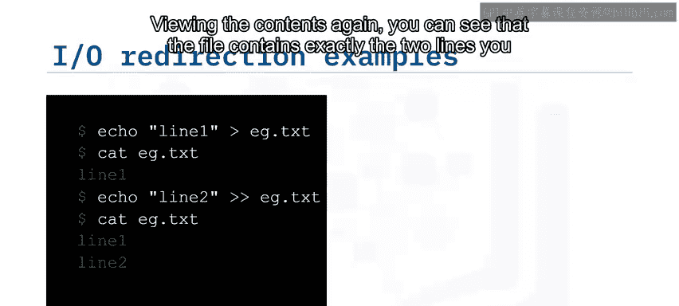

Entering something like the word garbage returns an error。

 This expression catches the error message and redirects it to the file Air dot text。

 and indeed the contents of Air dot text is what can be expected。

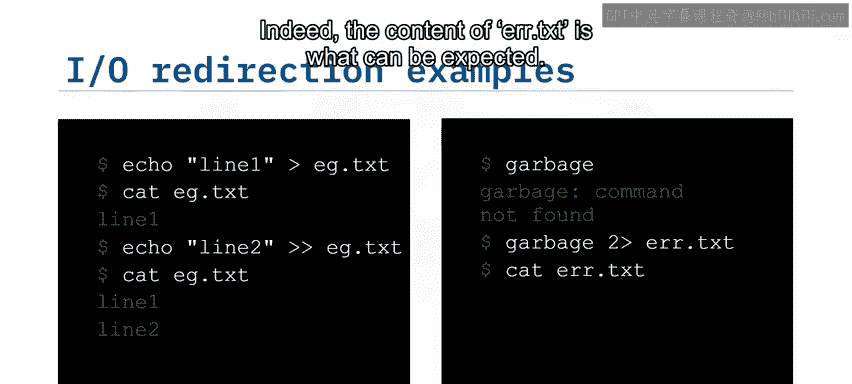

You can use command substitution when you want to replace a command with its output there are two equivalent notations in the first。

 the command is encapsulated by parentheses with a dollar sign out front while in the second。

 the command is encapsulated within back ticks， also known as back quotes。

Let's say you want to store the current directory path in a variable called here。

 you can use command substitution on the PWD or present working directory command to capture its output and assign it to the variable here。

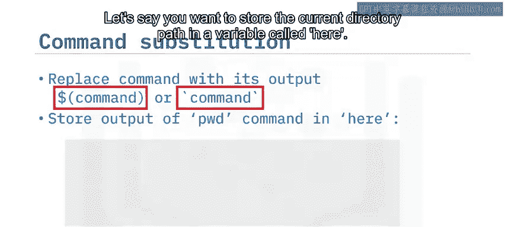

And indeed， echoing its value returns the current directory。

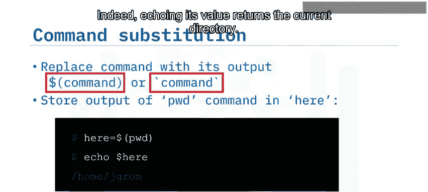

Command line arguments are arguments used by a program that are specified on the command line in particular。

 they provide a way to pass arguments to a shell script。

 which is itself a program command line arguments for a bash script are specified like this。

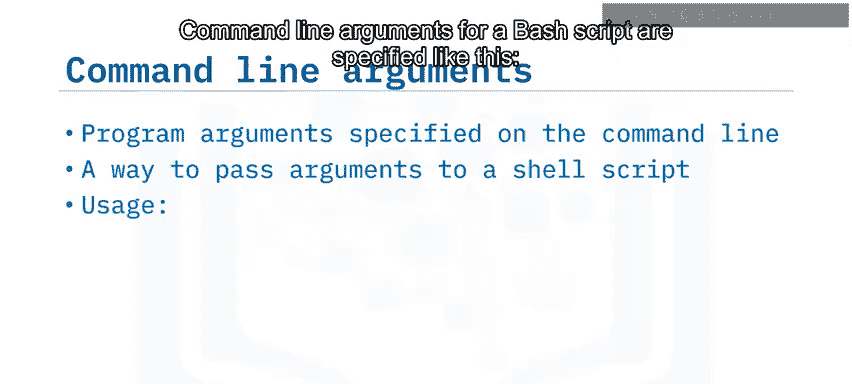

Here， the arguments， AG 1 and AG2 are passed to mybaashscript。sh。

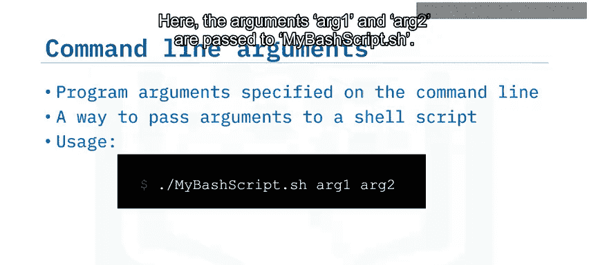

Bash has two main modes of operation batch mode， which is the usual mode runs commands sequentially。

 For example， these two commands separated by the semicolon meta character will be executed in a particular order command2 only runs after command one is completed。

In concurrent mode， commands run in parallel the Ampersand operator after command1 directs command1 to operate in the background and passes control to command2 in the foreground。

In this video， you learned that metacharacters are special characters that have meaning to the shell quoting is used to specify whether the shell should interpret special characters as metacharacters or escape them input output or IO redirection refers to a set of features used for redirecting you can use command substitution when you want to replace a command with its output command line arguments provide a way to pass arguments to a shell script and finally。

 in concurrent mode， multiple commands can run simultaneously。

