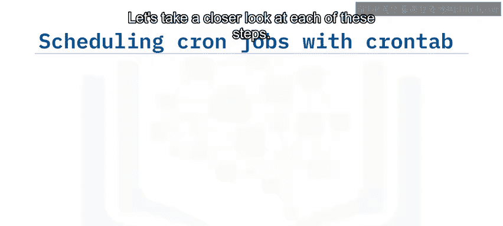
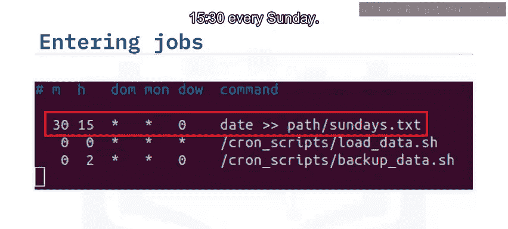
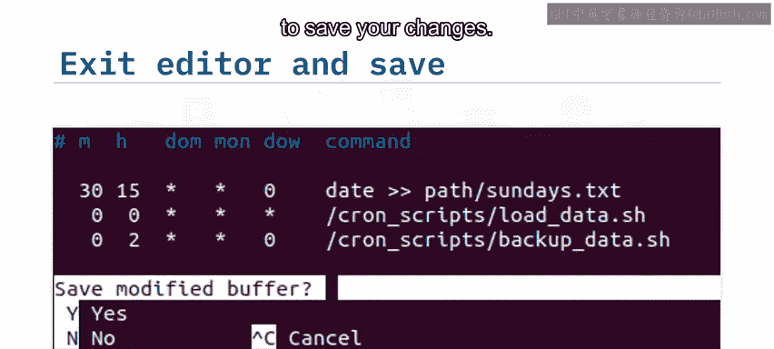

# IBM数据工程专业证书课程6：《Linux命令和Shell脚本入门实践》｜hands-on-introduction-to-linux-commands - P19：18_使用 cron 调度作业.zh_en - GPT中英字幕课程资源 - BV1KV41137Lg

Welcome to scheduling Jobs using Crron。After watching this video。

 you will be able to schedule Chroron Jobs with Chron tabab， understand the CrN syntax。

 and view and remove Chon jobs。Whether you are a system administrator or a data engineer or even a developer。

 there may be times when you want to schedule certain jobs to run automatically at certain times for example。

 you may want to schedule a load script to run every day at midnight and a backup script to run every Sunday at 2am the Chron U on Linux and Unix like operating systems allows you to do just that。

Cron is the general name of the tool that runs scheduled jobs consisting of shell commands or shell scriptsCN is the demon or service that interprets CrronTab files every minute and submits the corresponding jobs to Crron at scheduled times a Cron tabab short for Cron T is a file containing jobs and scheduled data CrronTab is also a command that invokes a text editor to allow you to edit a Crtab file。

Entering Chroron tabab minus E on the command line opens the default text editor using the editor you can specify a new schedule and a command。

 which has the following syntax。Command can be any shell command， including a call to a shell script。

 the symbols stand for minute， hour， day of month， month and day of week。

All five positions must have either a numeric entry or an asterisk。

 which is a wild card symbol that means any。 For example。

 the following syntax means append the current date to the file Sundays do text at 1530 every Sunday。

 closing the editor and saving the changes adds the job to the Cr table。

Let's take a closer look at each of these steps。

Entering Chron tabab minus E on the command line opens the default text editor In this case。

 the default editor is cannu Nano。Conveniently， instructions for setting up Chme jobs are included here as comments In for using the editor are also included。

 but you likely will only need control X in this context。

Here I have entered three example Crron jobs notice that the extra spaces are ignored so to improve the readability you can align your entries as columns under the header the first entry instructs Cron to append the current date to the file Sundays。

 text at 1530 every Sunday the next line specifies a load data Shell script to run at midnight every day while the last line results in Crroron running the backup data Shell script to run at 2am。

 on Sundays。

To save the job， first type control X to exit the editor。

 then enter Y to save your changes The jobs are now in production。

RunningCron tabab with the L option returns a list of allCron jobs and their schedules。

I use Ta to avoid returning all of the comments from the Crron Tab file to remove a job。

 simply invoke the Crroown Tab editor， delete the corresponding line in the Crown Tab file。

 and save the changes。In this video， you learned that Ch jobs can be scheduled to run periodically at selected times。

Minute hour， day of month， month， day of week and command is the Chron Jo syntax Chron jobs can be edited running Chron tabab minus E and Ch Tab minus L lists all Ch jobs in the Cron table。

