# IBM数据工程专业证书课程6：《Linux命令和Shell脚本入门实践》｜hands-on-introduction-to-linux-commands - P1：0_课程介绍.zh_en - GPT中英字幕课程资源 - BV1KV41137Lg

Welcome to this course about Linux commands and Shell Scris。

In this course you will explore how to get started with using Linux and the most commonly used shellll commands You will recognize that a shell is a powerful user interface for Linux and Uni like operating systems it can interpret commands and run other programs it also enables access and interactivity with files。

 utilities and applications Additionally you will discover how to create She scripts to automate tasks。

 run batch jobs and quickly create useful programs。This course has three instructors。

 Rammesh Sanarreti， Ravahucha and Sam Praopchuk Rammesh Sanarreti is a seasoned subject matter expert with skill Up technologies Ravahucha is a global program director at IBM and the architect for several IBM professional Cs and Sam Praopchuk is a data scientist and software developer at IBM。

Now， learning Linux commands and Shell scripting Bsh in particular。

 also makes you more flexible whether you are a software developer， data scientist， data engineer。

 systems administrator， DevOs professional， system architect， or software engineer。

Once you have a good understanding of BH commands， it's relatively easy to write scripts that simplify the building process of all sorts of data pipelines and application workflows。

In this course， you will learn all about the basics of Linux， the use of common Linux commands。

 and the basics of Shell scripting with bash。We will start off with an introduction to Linux。

 you will learn about the origins of UniX and Linux， the architecture of a Linux distro。

 and how to accomplish simple tasks in a Linux terminal。

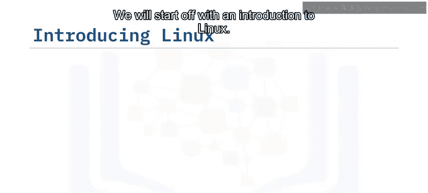

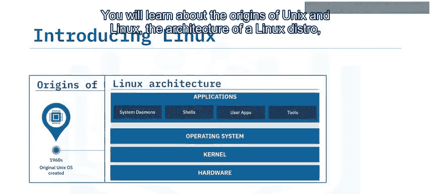

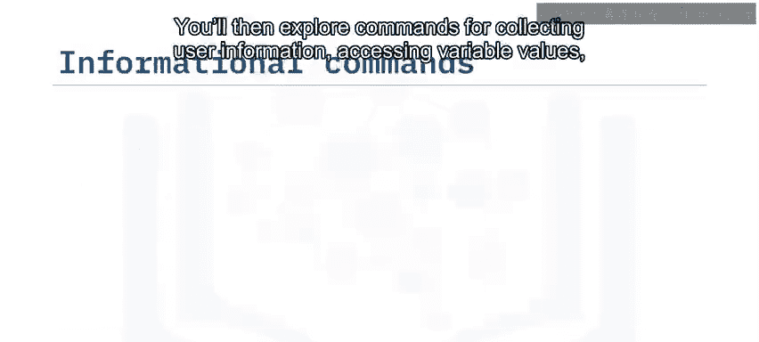

You'll then explore commands for collecting user information， accessing variable values。

 and printing useful output to the terminal window。

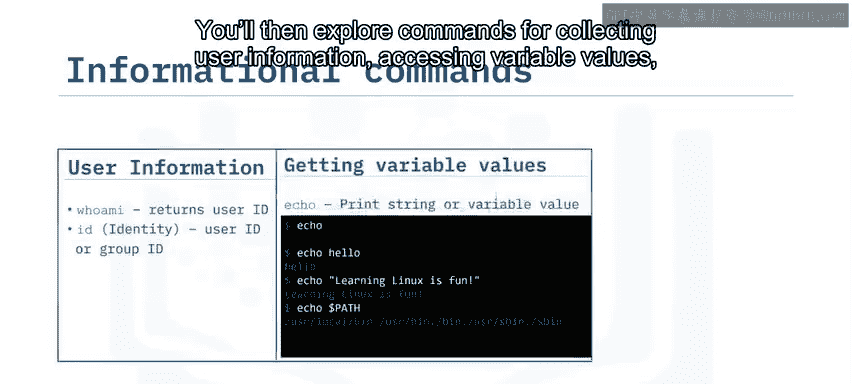

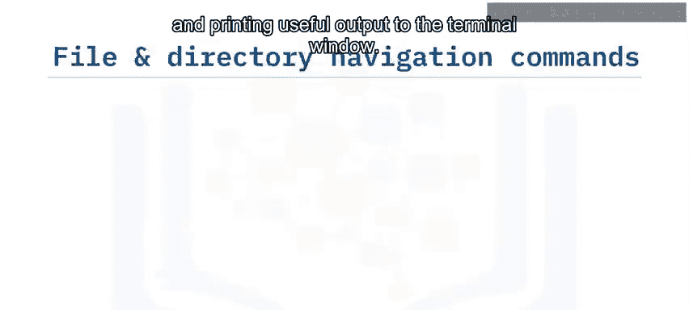

You will learn how to navigate your file system by listing your directories and their contents。

 determining where you are within your directory tree at any time。

 moving to other directories with ease， and quickly finding the files you need you will also learn how to manage your files and directories by creating new directories。

 removing unwanted directories， creating new files and copying and moving files and directories。

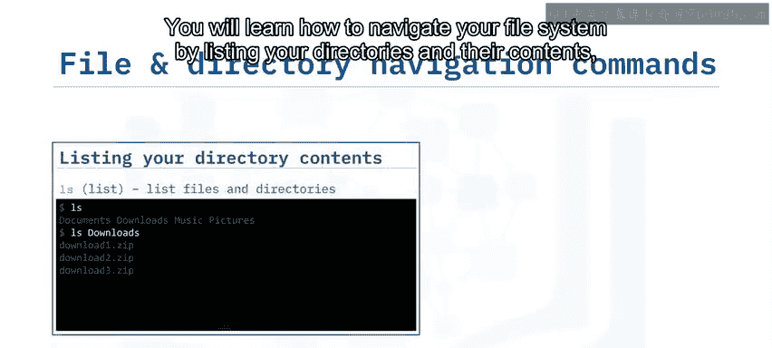

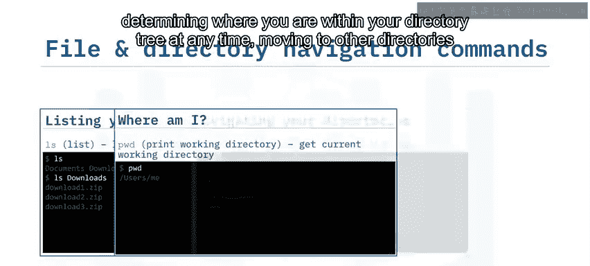

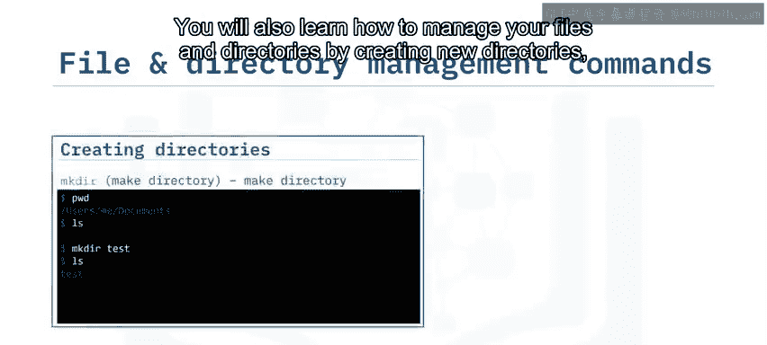

You will learn how to view the contents of your files in various ways， for example。

 using the CA command and the more command， you will also discover how to get useful summary information about the contents of your files you will also gain experience with creating customized views of your file contents。

 for example， by sorting the contents line by line。

 excluding repeated lines from the view and extracting particular sections from each line。

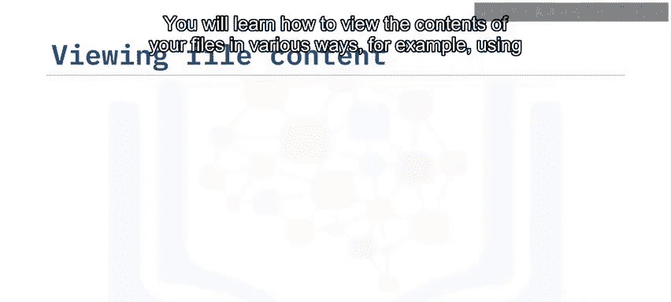

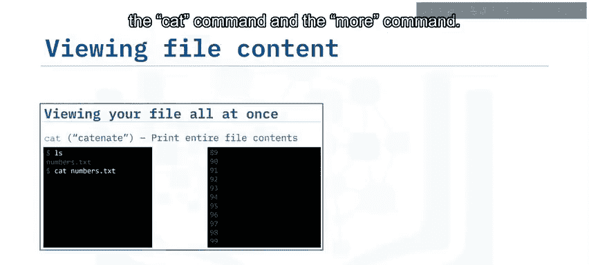

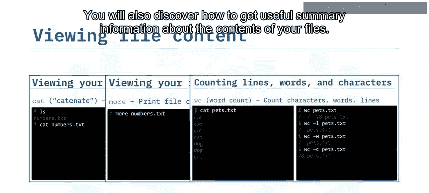

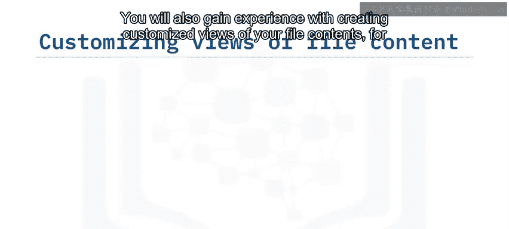

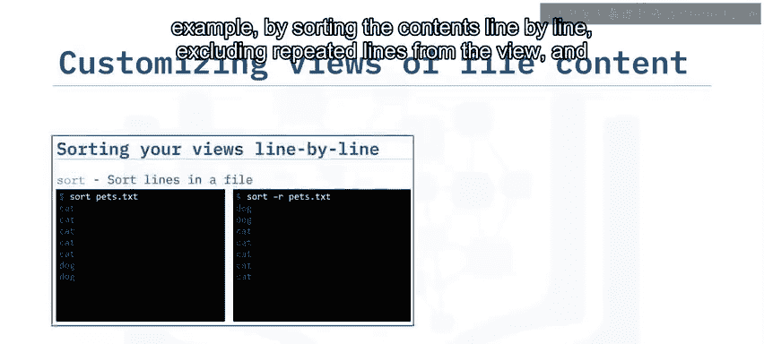

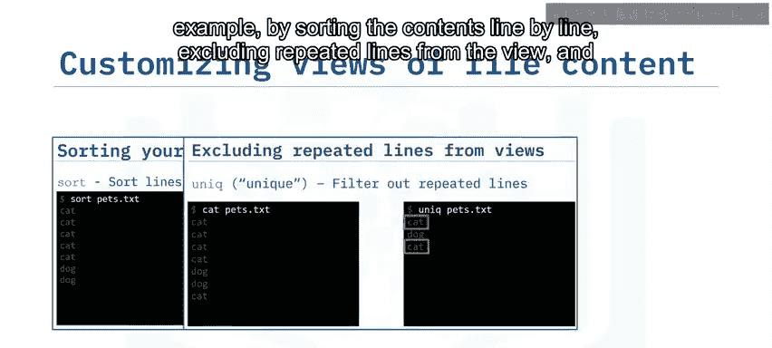

You will get hands-on experience with archiving the files and directories in a directory tree。

 extracting files and folders from your archives， and extracting and decompressing files from zipped archives。

 and you will also gain skills by applying networking commands， for example。

 determining your host name， getting detailed information about your network configuration and conveniently downloading files from the web。

We'll continue with an introduction to She scripting you will explore all aspects of scripts and bash shellll scripting what She scripting is used for and how to create and run your own shell scripts you will also gain valuable knowledge about filter commands and chaining your filters together using the pipe command In addition。

 you will learn about defining shell variables and environment variables you will discover useful features of the bash shellll along the way including the use of metacharacters。

 input and output redirection and passing arguments specified on the command line to your She scripts。

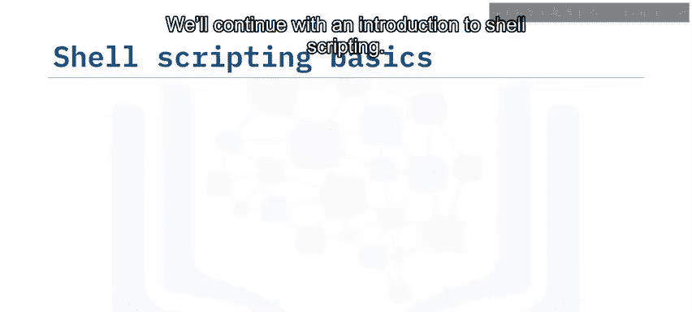

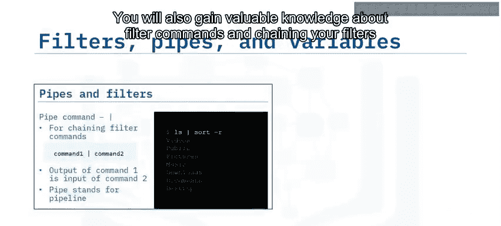

You will also discover how to put your She scripts into production by learning all about the Crron service for running jobs。

 scheduling your jobs with Chron tabab， and viewing and editing the Cron jobs currently running on your system。

Finally， you will put your newly acquired skills to the test by completing a hands on project that involves various Linux commands and building a shell script。

To get the most from this course， watch every video and check your learning by taking the quizzes。

 use the discussion forums to connect with your peers and the teaching assistants。

 and most importantly， make sure you complete the hands-on labs to practice your new skills and demonstrate your abilities。

Congratulations on beginning the next step of this exciting journey and good luck！

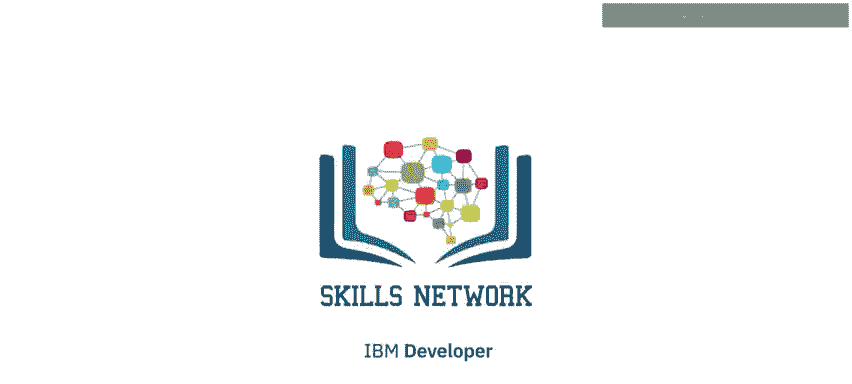