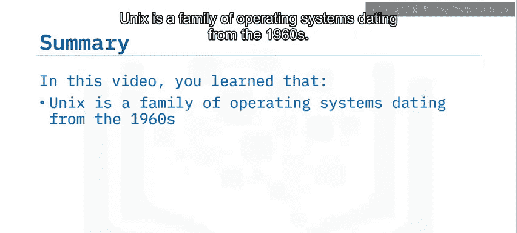
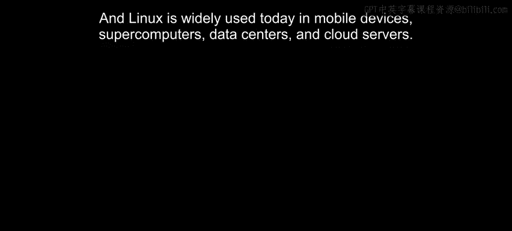

# IBM数据工程专业证书课程6：《Linux命令和Shell脚本入门实践》｜hands-on-introduction-to-linux-commands - P2：1_介绍 linux 和 unix.zh_en - GPT中英字幕课程资源 - BV1KV41137Lg

Welcome to Introduction to Linux and UniX。After watching this video。

 you will be able to explain what an operating system or OS is。

 describe the origins of Linux and UniX， and list some of the features of Linux and UniX。

What is an operating system Well， it's software that manages computer hardware and resources and allows interaction with hardware to perform useful tasks。

So what is UniX it's actually a family of operating systems。

 some popular UniX based operating systems include Oracle Solaris and Open Sois， free BSD， HUX。

 IBM AIX and Apple Mac OS， which is one of the most popular desktop operating systems today。

In the 1960s， the original UniX OS was created at AT&T Bell Labs， however。

 like many operating systems at the time， it was made for a specific hardware system， in this case。

 the PDP7 computer In the 1970s， the UniX OS was rewritten in C distinguishing itself from other systems and making it portable to many hardware architectures。

And then in the late 1970s， UC Berkeley developed Berkeley softwareware distribution or BSD。

 an add on two Uni providing additional software and capabilities The famous Mac OS was later derived from BSD。

So what is Linux Linux is a family of UniX like operating systems however。

 when referring to Linux people are usually talking about a specific distribution or flavor Linux was developed as an effort to create a free open source version of the UniX OS。

Key Linux features include the following Linux is free and open source。

 which means anyone can view the source code and with so many eyes on the source code。

 Linux has become the most secure OS over the years its multi-user Linux is designed to support multiple users accessing the system simultaneously it also supports multitasking running multiple jobs and applications at the same time and it's portable Linux has been ported to run on many different types of devices and hardware platforms from desktops to servers to appliances。

How did Linux start In the 1980s， Ganu was developed at MIT Gau stands for Ganu's not Unix and was made as a free open source set of the existing UniX system tools。

 and in 1991 Linus Torbals developed a free open source version of the UniX kernel called Linux。

 The kernel is the core component of an OS that enables components to communicate with the Ma's hardware。

Here is Linus Torvald's famous post， where he shared his progress making his own open source Ex like Colel。

 he references Minix， which was another eunx like Colel at the time。Soon after in 1992。

 the potential of unifying Gaoe and the Linux kernel was realized as popular Linux operating systems began to appear。

 and in 1996， a computer scientist named Larry Ewewing created Tuucks the Penguin。

 which was later adopted by Linus Torvalds as the official Linux mascot。Today。

 the BSD based Mac OS runs on millions of devices across the world。

 billions of Linux instances run on servers， serving us the modern web。

 and especially among developers， modern Linux operating systems such as Uuntu are beginning to gain popularity in the PC space。

Okay， well what are the most common use cases for Linux today First。

 it's used in billions of smartphones around the world via the Android operating system which uses a Linuxbased kernel Linux is also widely used in supercomputers where many Linux powered servers are clustered together for high performance computing applications Enterprise and cloud data centers also use Linux over millions of servers running all kinds of applications。

 web servers， databases and so on and finally， versions of Linux can easily be used as your PCs operating system Many people install Linux today as a learning experience or as their daily driver。

In this video you learned that UniX is a family of operating systems dating from the 1960s Linux was originally developed in the 1980s as a free open source alternative to UniX Linux is multiuser portable and supports multitasking and Linux is widely used today in mobile devices。

 supercomputers， data centers and cloud servers。

