# IBM数据工程专业证书课程6：《Linux命令和Shell脚本入门实践》｜hands-on-introduction-to-linux-commands - P3：2_linux 发行版.zh_en - GPT中英字幕课程资源 - BV1KV41137Lg

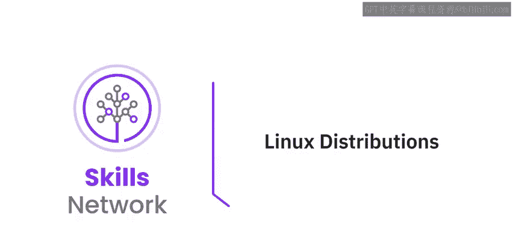

Welcome to Linux Disbuts。

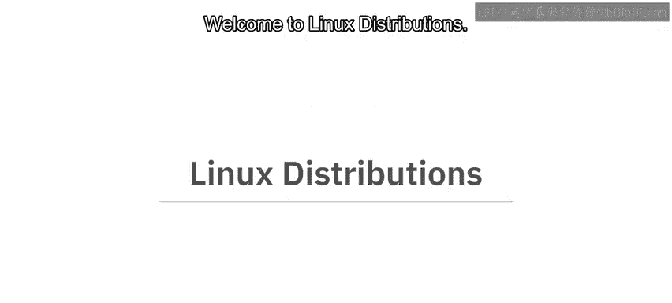

After watching this video， you will be able to describe what a Linux distribution is。

 differentiate between some common Linux distributions。

 and identify the use cases of some popular Linux distributions。

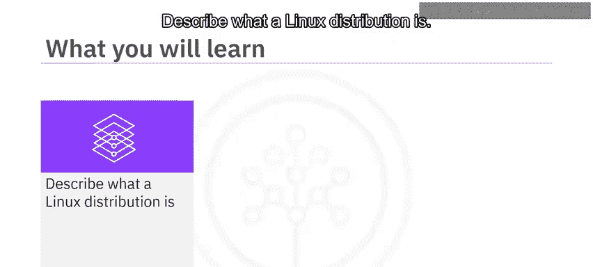

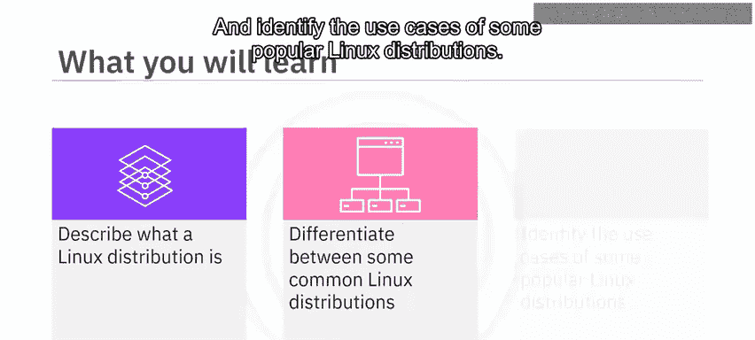

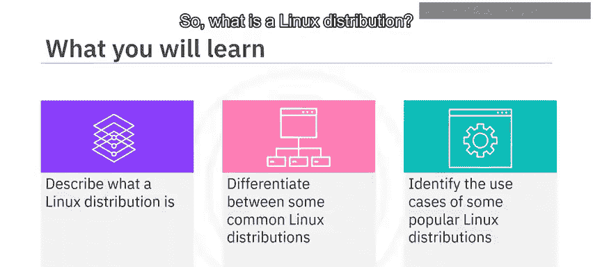

So what is a Linux distribution a Linux distribution is a specific flavor of the Linux operating system it may also be referred to as a distro All Linux distributions must use the Linux kernel this is the core component of the Linux operating system that enables the system to properly use the computer's hardware and today there are hundreds of Linux distros each tailored for a specific audience or task。

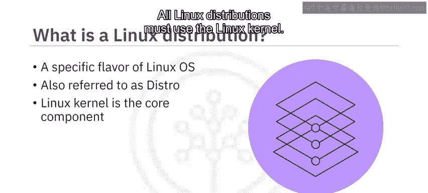

Okay， so what differentiates Linux distros from each other Each Linux distro includes a unique set of default utilities that are part of the operating system。

 such as commands and applications that come pre-packaged with the distribution Each distro has its own graphical user interface or GuUI that you use to interact with the operating system。

 Each distro supports a specific set of commands that you can use in a shell。

 window4 entering and receiving output from commands and lastly。

 each distro provides differing levels of support。

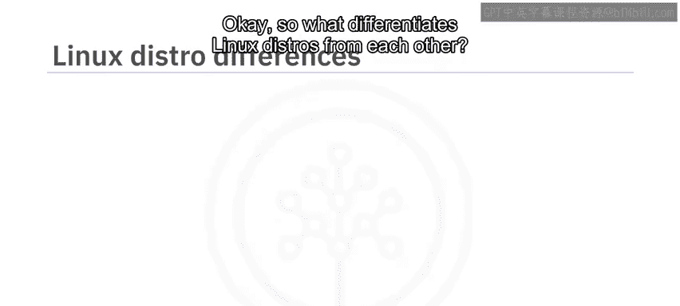

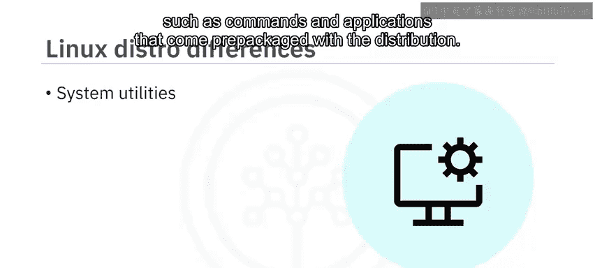

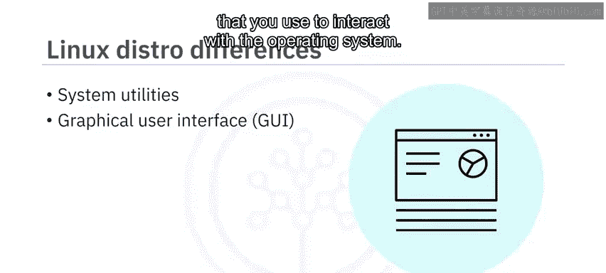

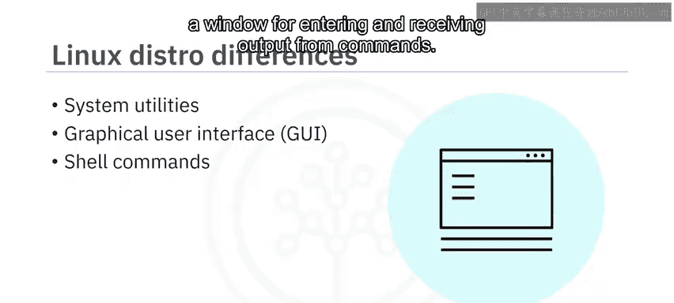

It could be developed and managed as a community backed project or maintained by a commercial enterprise。

 and it could be a longterm support version or LTS or a rolling release。

 where stable package updates are released on a rolling schedule。

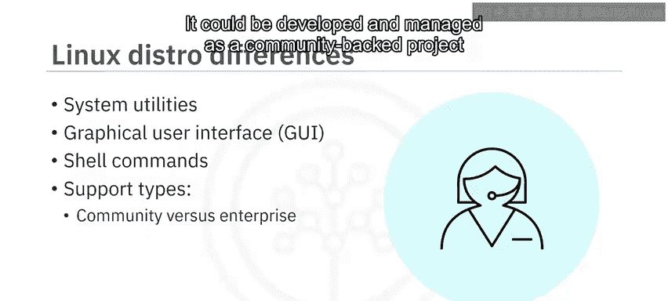

Debian is one of the earliest rooted distros with the first release in 1993 named version 0。

01 and the first official stable release in 1996 version 1。

1 It is known for being stable reliable and fully open source It supports many computer architectures or types of hardware these features result in Debian being highly regarded in the server space and furthermore。

 Debian is the largest community run distro currently available。

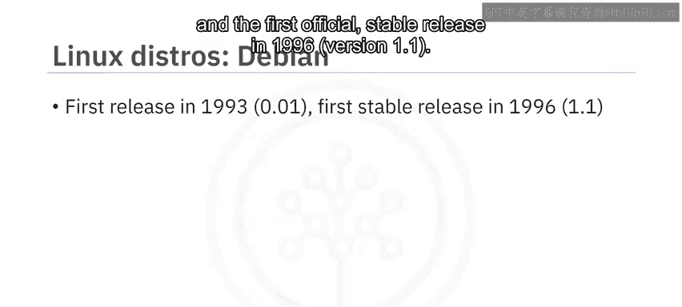

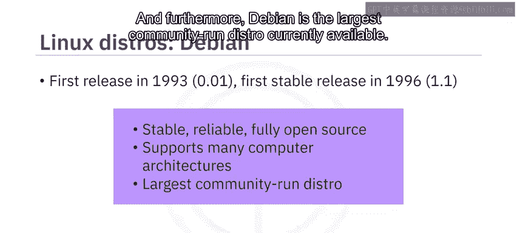

Another popular distro is Uuntu This is also an early rooted distro with its first official release in 2004 Uuntu is Debian based。

 meaning that it's built on top of Deian and uses a lot of the same tools as Debian OS Uuntu is developed and managed by Canonical and Uuntu has three official editions。

 desktop for personal computers， laptops and workstations。

 server for simple file servers or multi nodeode clouds， and core for the internet of things。

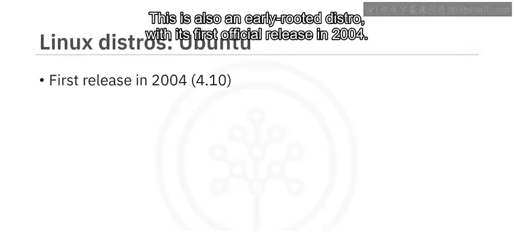

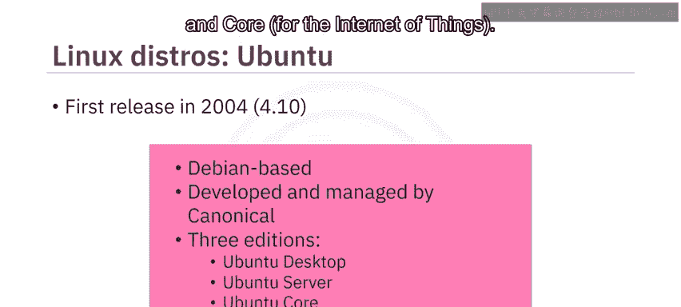

Red Hat Linux like Deian is a core Linux distro， meaning that it is not derived from another Linux distro Red Hat is known for being stable。

 reliable and fully open source， it's managed by Red Hat and IBM subsidiary Today it ships as Red Hat Enterse Linux or RHEL。

 an addition focused entirely on enterprisese customers。

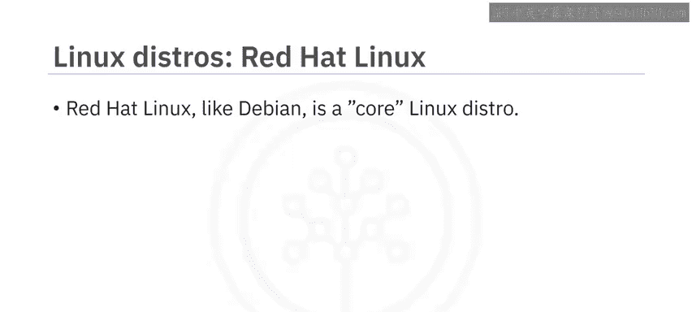

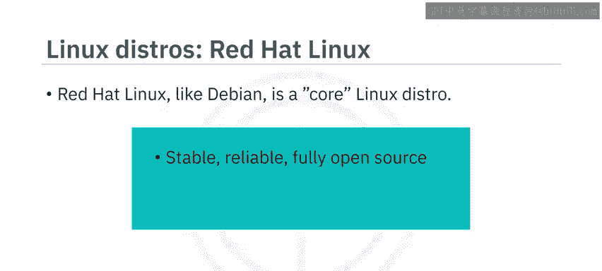

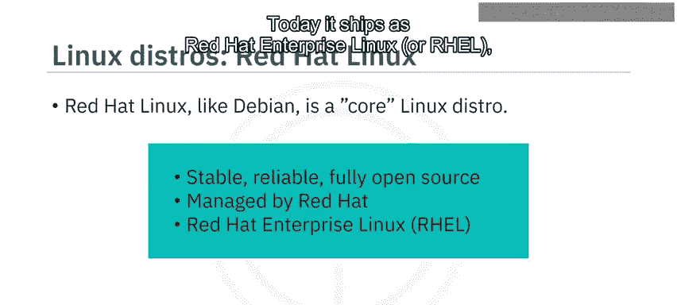

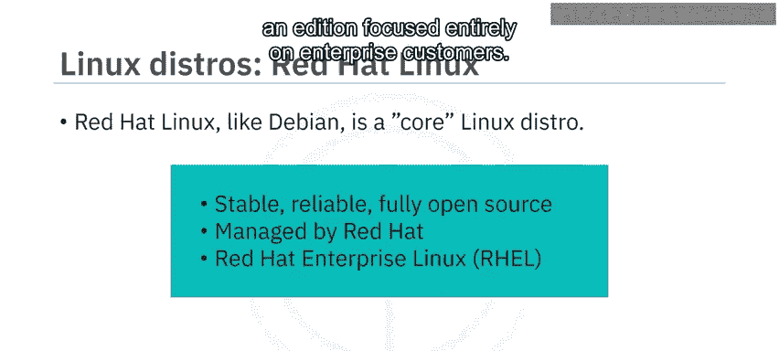

Next is fedora which is known as a stable operating system that supports many architectures。

 it's also very reliable and secure offering unique firewall and security features。

 it's actively developed with a large and growing community， and it's sponsored by Red Hat。

 consly Red Hat uses much of fedora's codebase after testing of course。

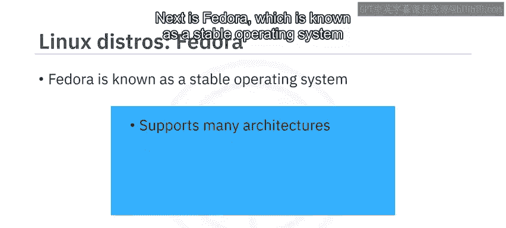

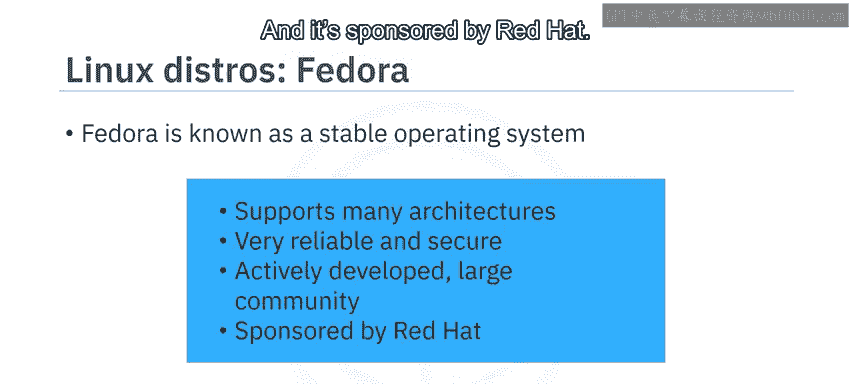

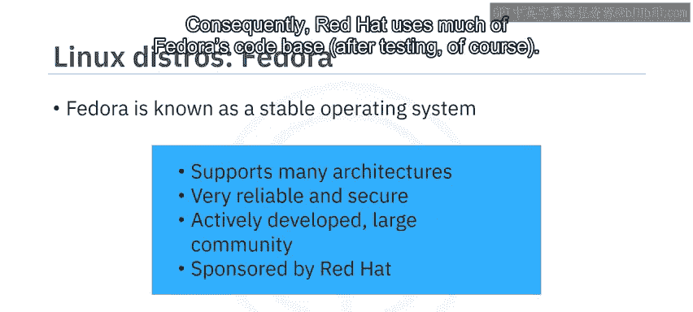

Another Linux distro is Susi Linux Enterprise also known as SLE Susy Linux Enterprise is available in two editions。

 Server or SLES and desktop or SLE It supports many architectures such as Ar for Raspberry Pi and uses the Susy package hub which enables users to install packages that aren't officially part of SLE。

 and it's maintained by the small German open source software company Suusi。

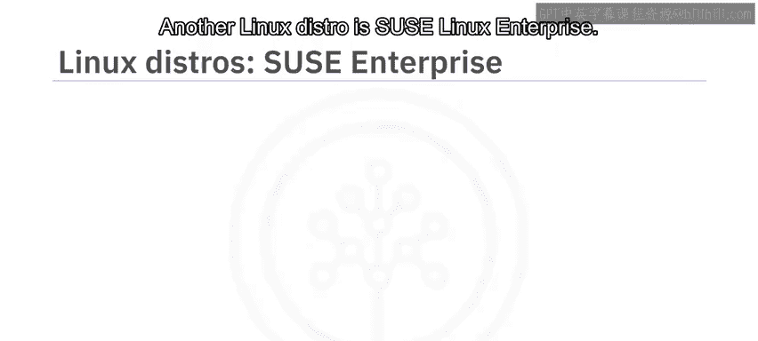

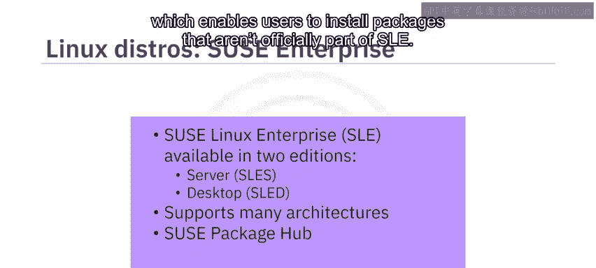

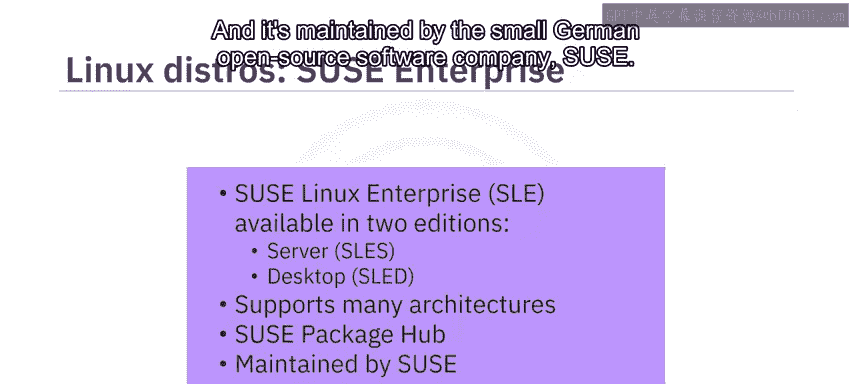

And finally， we have ArchRC Linux the unique doit yourself approach of ArchRC Linux allows users to customize every part of their system。

 This makes it highly configurable， a freedom that makes Arch very popular。

 but it also means that you need a strong understanding of Linux and system tools in order to use arch effectively。

 and because ArchRC isn't focused on stability in the same way as other distros。

 it has easy access to the newest software， which has little guarantee of being completely stable。

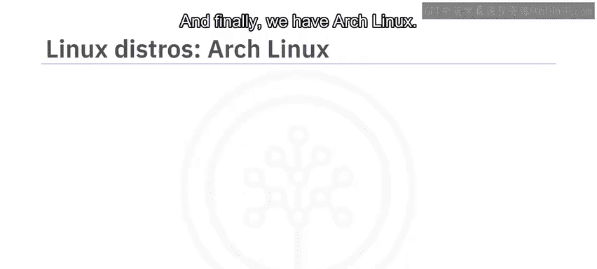

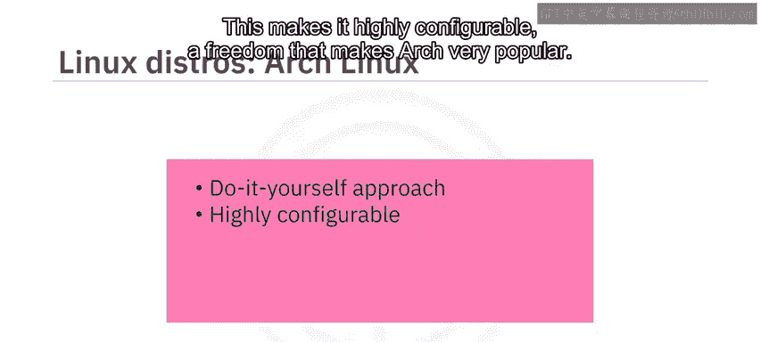

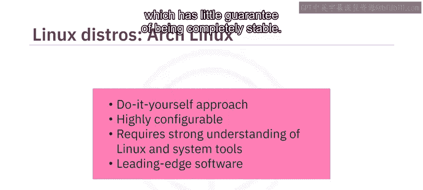

In this video， you learned that Linux distros can be differentiated by their user interfaces。

 their shell applications and how the operating system is supported and built。

 the design of a Linux distro is catered towards a specific audience Debian is highly regarded in the server space for its stability。

 reliability and for being open source Red Hat Enterprise Linux。

 and IBM subsidiary is focused completely on enterprise customers and Suusi Linux Enterprise supports many architectures such as arm for Raspberry Pi。

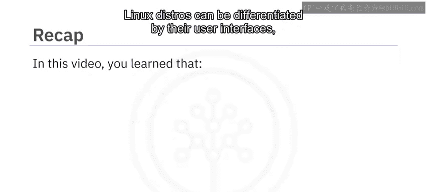

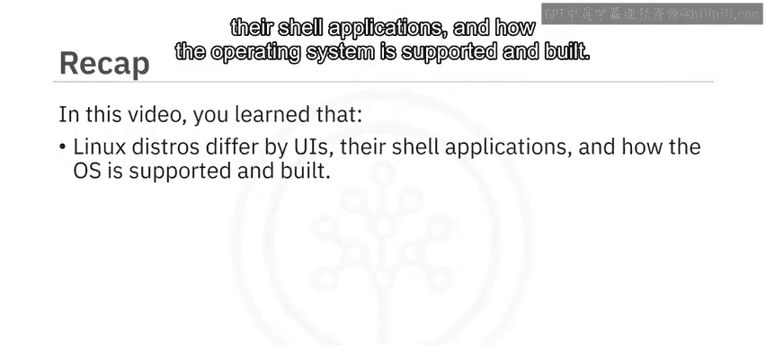

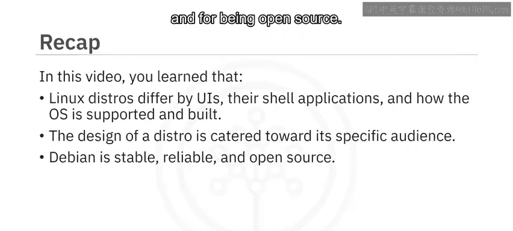

