# IBM数据工程专业证书课程6：《Linux命令和Shell脚本入门实践》｜hands-on-introduction-to-linux-commands - P4：3_linux 架构概述.zh_en - GPT中英字幕课程资源 - BV1KV41137Lg

Welcome to overview of Linux Archecture。After watching this video。

 you'll be able to list the layers of a Linux system。

 explain the roles of each layer in a Linux system， and describe the Linux file system。

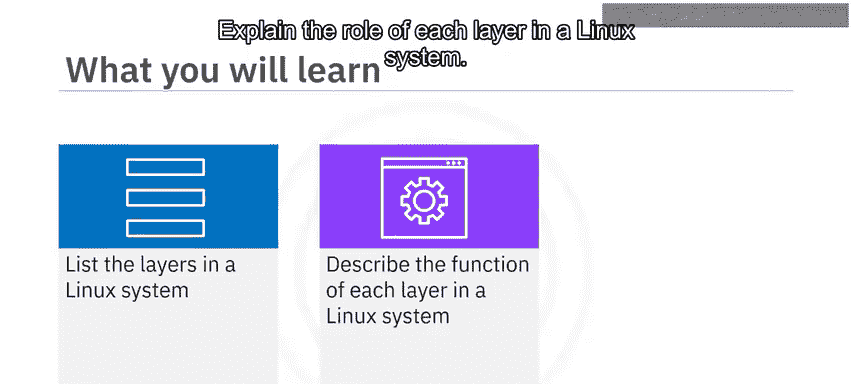

The Linux system comprises five distinct layers。 The outermost layer of the Linux architecture is the UI or user interface。

 which allows users to interact with the system using a keyboard or mouse。

 The application layer include system demons， shells。

 user apps and tools used to perform tasks in a Linux system。

 The applications communicate with the operating system to perform tasks。

 The O is responsible for jobs that are vital for system stability such as job scheduling and keeping track of time。

 All Linux operating system are built on top of the Linux kernel。

 which performs the most vital lower levelve jobs。 The kernel is the core component of the operating system and is responsible for managing memory processing and security。

 The kernel interacts with the hardware layer， which includes all the physical or electronic devices in the computer such as processors。

 memory modules。

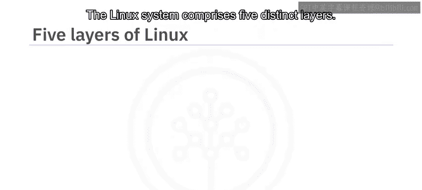

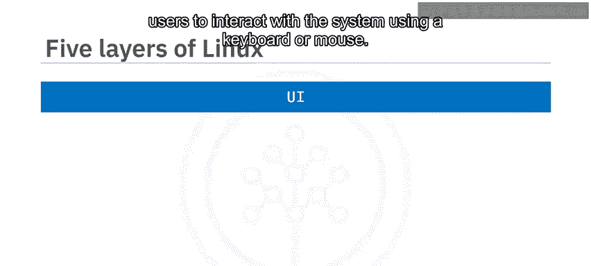

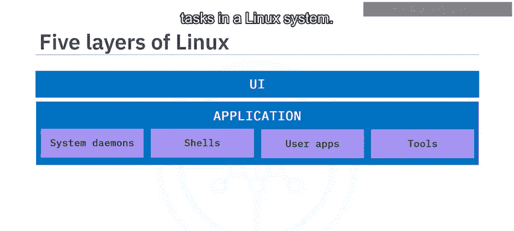

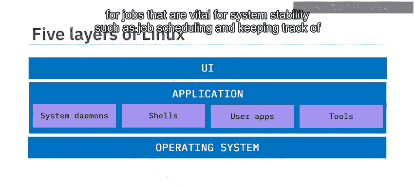

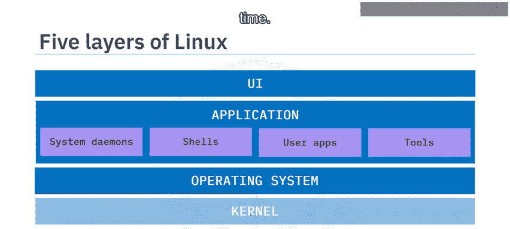

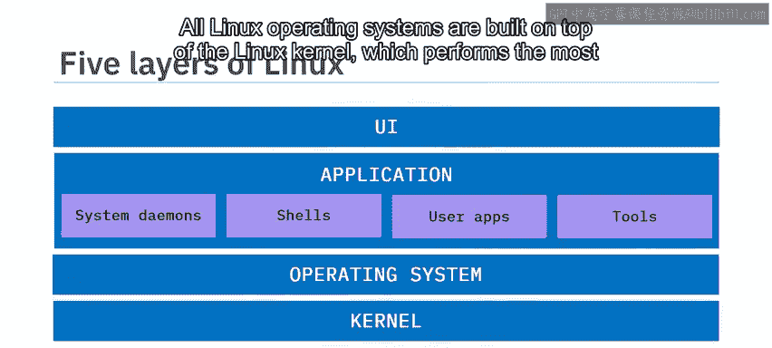

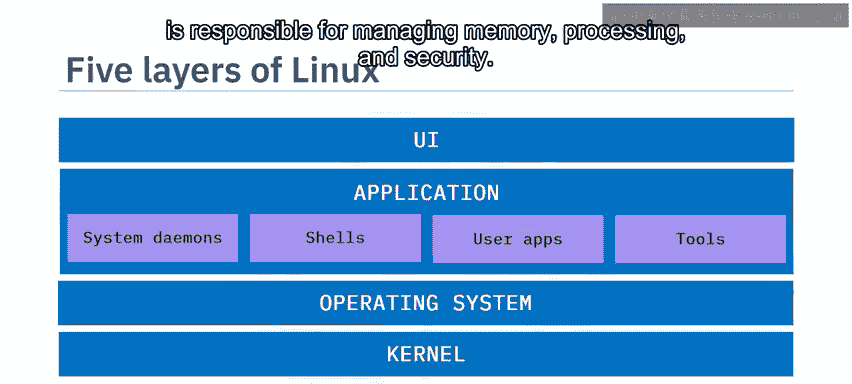

Inputut devices and storage。

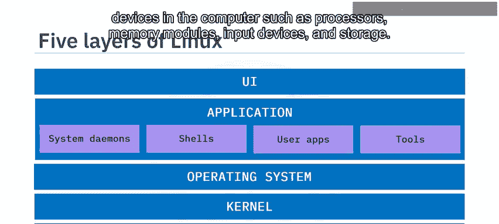

The first layer in a Linux system is the user interface The UI allows users to perform tasks by controlling applications with the keyboard Detop versions of Linux include a graphical user interface or GuI layer which is similar to Microsoft Windows This extends the UI functionality to other control devices such as a mouse you might use a Linux machine to use a web browser to send your friend an email or use a music player to listen to your favorite song。

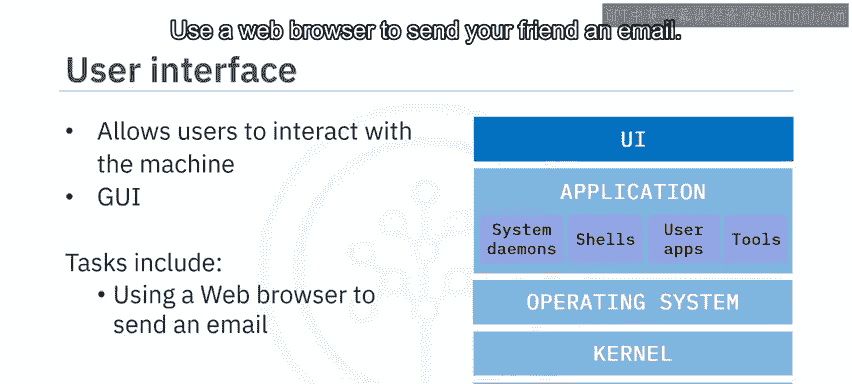

Applications are the software that enables a user to perform a task in a Linux system；

 applications can include the following， system tools such as compilers， programming languages。

 shells which are special applications that are often part of the operating system itself。

 and user apps which can be any kind of applications from browsers to text editors to games。

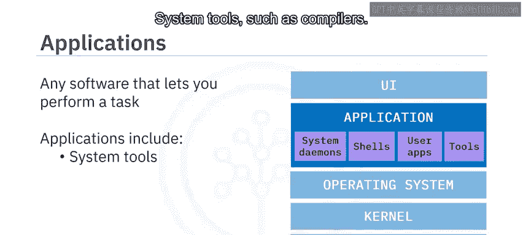

The operating system controls the jobs and programs that are vital to system health and stability。

 It functions also include assigning software to users。

 detecting errors and implementing measures to prevent complete system failures。

 and performing file management。

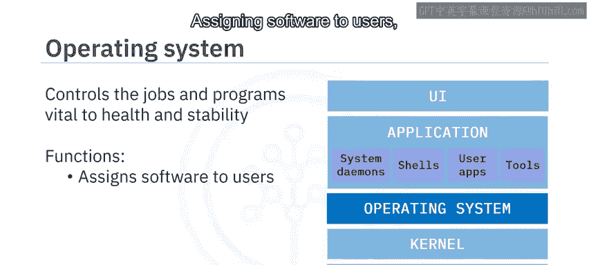

In a Linux system， the operating system is built on top of the Linux kernel。

 which performs the most vital operations。 The kernel is the lowest level software in a Linux system and has complete control of the system。

 It starts as soon as your computer boots and remains in your computer's memory while the system is running。

 It also acts as a bridge between your apps and your machine hardware。

 enabling the two to communicate effectively using system calls。 The kernel has four key jobs。

 Me management， process management， managing device drivers for proper hardware support and assuring the system remains secure。

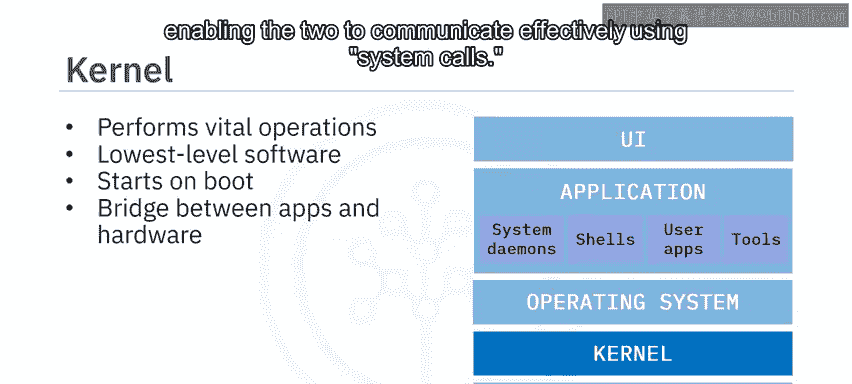

The final layer in the Linux system is the hardware consisting of the physical or electronic devices that make up your computer。

 This layer can include the following the central processing unit or CPU。

 which is responsible for executing most calculations， the random access memory or RA。

 which is a fast storage unit used to hold the temporary information。

 your applications need to run storage for data that needs to persist when your computer is powered off your computers screen。

 and any USB devices such as a keyboard， mouse or USB drive。

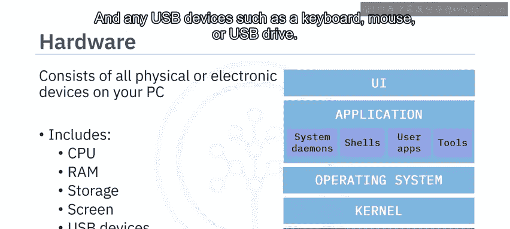

The Linux file system is the collection of files on your machine。

 it includes the files needed to run the machine and applications as well as your own files containing your work。

 the top level of your file system is the root directory symbolized by a forward slash below this is a treelike structure in the directories and files in the system。

 and the file system assigns appropriate access rights to the directories and files。

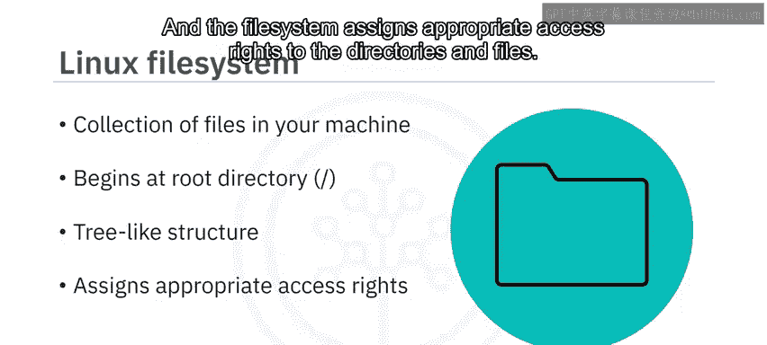

The very top of the Linux file system is the root directory。

 which contains many other directories and files。 One of the key directories is slash bin。

 which contains user binary files， binary files contain the code。

 your machine reads to run programs and execute commands。

 It's called slash bin to signify that it exists directly below the root directory other key directories include slash user。

 which contains user programs， slash home， which is your personal working directory。

 where you should store all your personal files， slash boot， which contains your system boot files。

 the instructions vital for system startup and slash media。

 which contains files related to temporary media such as C or USB drives that are connected to the system。

 There are several other directories in the root directory but you will not need to access them during this course All the files and directories in a Linux system are organized。

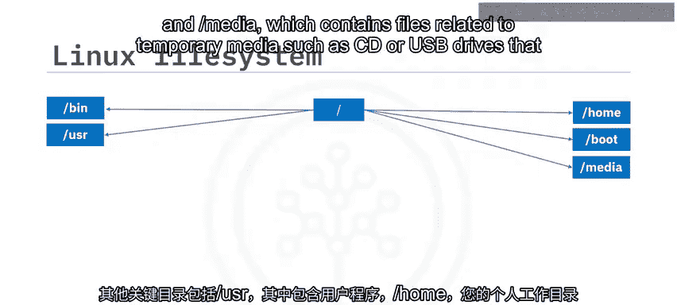

ToOne of these designated folders， depending on the purpose of the file or directory。

In this video you learned that a Linux system consists of five key layers。

 the user interface is the layer that enables the user to interact with applications using control devices。

 applications enable users to perform certain tasks within the system The operating system runs on top of the Linux kernel and is vital for system health and stability The kernel is the lowest level software and enables applications to interact with your hardware hardware includes all the physical and electronic components of your PC and the Linux file system is a treelike structure consisting of all directories and files on the system。

