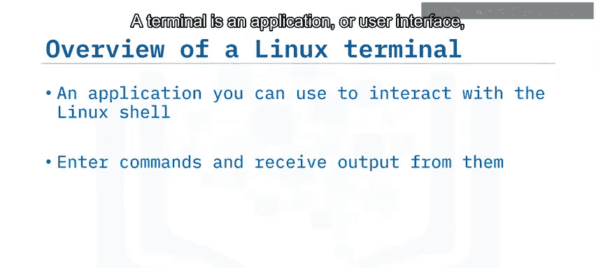
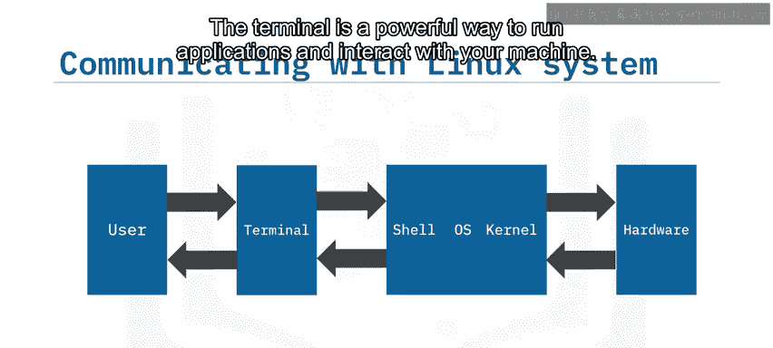
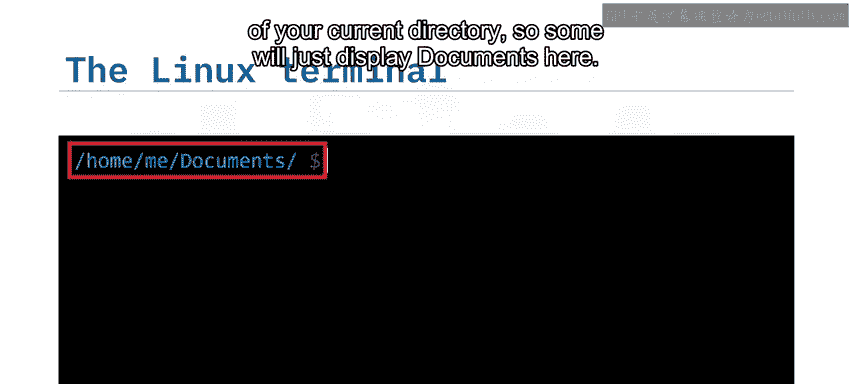
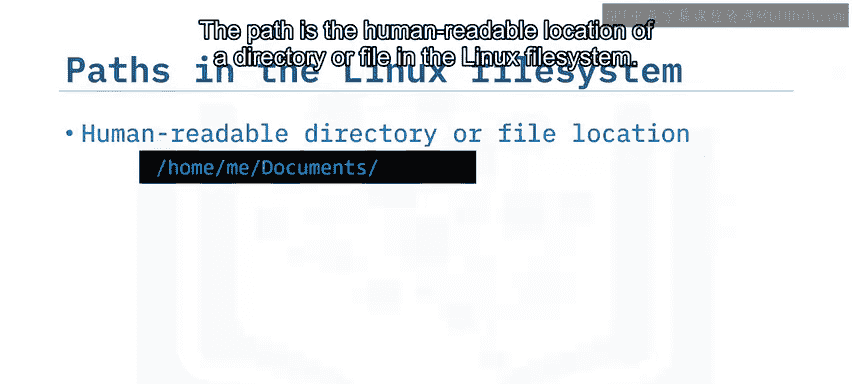
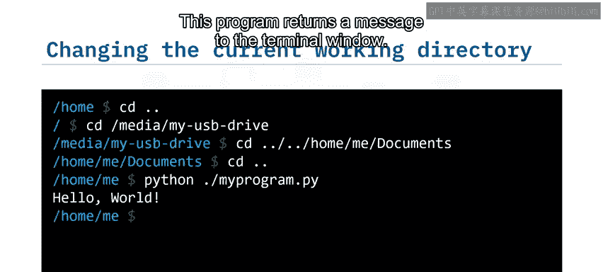
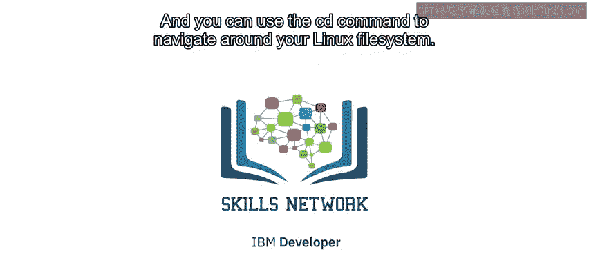

# IBM数据工程专业证书课程6：《Linux命令和Shell脚本入门实践》｜hands-on-introduction-to-linux-commands - P5：4_linux 终端概述.zh_en - GPT中英字幕课程资源 - BV1KV41137Lg

Welcome to Linux Terminal Overview。After watching this video。

 you will be able to describe what the Linux shell is， describe what a Linux terminal is。

 explain how a Linux terminal and shell work together。

 and use a Linux terminal to navigate directories。The Linux She is an OS level application that interprets commands In early versions of UniX and Linux。

 the shell was the only way to interact with the operating system Today you can also use graphical user interfaces。

 but the shell remains a popular and flexible choice and an easy way to run script files。

You can use Shell commands to perform tasks such as moving and copying files， writing to。

 and reading from files， extracting and filtering data， and searching for data。

There are many shell versions， but the base functionality of most is the same。

 Some popular examples include bash and Cish。You interact with the Linux shell through a Linux terminal。

 a terminal is an application or user interface where you enter the commands you want to run and receive any output from those commands For example。

 to start the Python application and run a program called My program。 Pi type Python space。

 My program do PY When you press enter the She runs the command This program prints the wordsHello world to the terminal。

So how our commands run First we have a user who wants to run a command they enter the command in a terminal which is then relayed to the shell。

 the core components of the operating system and kernel translate the command for the hardware to perform When the hardware completes the command。

 the kernel reads any changes or results and sends them back via the shell to the terminal for the user's information。

The terminal is a powerful way to run applications and interact with your machine。

Now， most terminals have a similar user interface for you to enter commands the area where you enter commands is called the command line and the vertical line or cursor is the command prompt This indicates where the text that you type will be displayed In this example the current working directory is the documents directory。

 which is inside the Me directory which is inside the home directory。

The current working directory is the location where the shell will look for any commands that you specify to run。

 For example， the Python program in the previous example。

Not all terminals display the full location or path of your current directory。

 so some will just display documents here。

The path is the human readable location of a directory or file in the Linux file system。

 the A/lashB structure indicates that the file or directory named B is located inside the directory named A。

There are also special paths， a single Tilde symbol refers to the user's home directory。

 a single slash at the beginning of a path refers to the root directory。

 two periods refer to the parent of the current directory and a single period refers to the current directory。

So let's look at how you can use the terminal to change the current working directory。

You use the CD command that stands for Change directory。

 enter CD slash to go to the root directory and enter CD bin to move into the bin directory the bin directory which is inside route。

 contains programs required by the system。One of these programs or executable files is called LS。

 You can run the LS program in the current working directory by entering。/ls。

 use it to display in the terminal window the names of all files and directories within the current directory。

Many commands located in the bin folder are also built into the shell。

 so you can run them from other locations too navigate to your home directory using CD Tilde。

 and even though the current working directory/ho/me does not contain the LS program you can still run the command successfully。

Let's look at some more examples again， starting at the slashH directory， enter CDspace。

t dot to change the current working directory to the parent of the existing current working directory So in this example。

 the parent of slash home is s or the route directory to then navigate to a USB drive called MyUSB drive in the media directory。

 enter CDspace/lash media/ MyUSB drive。You can also navigate up and down the tree in one command to navigate up to the media directory。

 then up to the root， enter Cspace。t dot/。t dot， and then to navigate down to the documents directory in the Me directory in the home directory。

 enter/lash home/lashme/lash documents。Pres enter to submit the command and move to the documents folder。

Let's move up to the slash home slashme directory。Start the Python application and run a program in the slash home slash me directory called My program。

 Pi This program returns a message to the terminal window。

In this video， you learned that a Linux shell is an OS level application that you can use to enter commands and view the output of those commands。

 you use a terminal to send commands to the shell and you can use the CD command to navigate around your Linux file system。

