# IBM数据工程专业证书课程6：《Linux命令和Shell脚本入门实践》｜hands-on-introduction-to-linux-commands - P6：5_创建和编辑文本文件.zh_en - GPT中英字幕课程资源 - BV1KV41137Lg

Welcome to Creating and Editing Text Fi。After watching this video。

 you will be able to list popular text editors for Linux， describe a popular GuUI based text editor。

 and use command line editors to work with a file。You use text editors to write code in your Linux environment。

 there are many editors to choose from and they can be grouped into two main categories。

 command line text editors and GuI text editors。Examples of command line text editors are Ganu Nano。

 a small and friendly modeless text editor， VI， a traditional command line editor originally created for UniX。

 and VIm， a powerful mode based command line editor based on VI。

A popular GuUI based editor is G Edit， which is the default editor from the Nome Environment。

 and EmX is another text editor that is one of the oldest free open source projects still under development you can use EmX in GooI mode or within a command line。

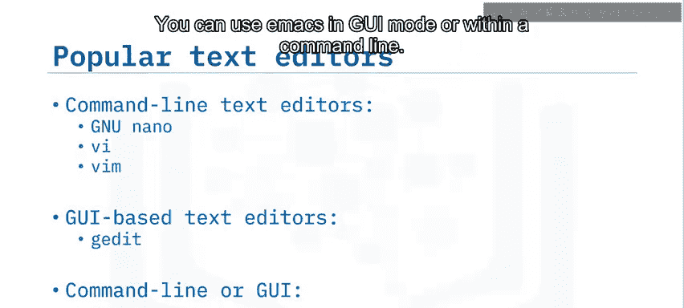

Gedit is a popular modern text editor that comes pre-installed on most Linux distros。

 it's designed as a general purpose text editor and in keeping with the philosophy of the knownme project。

 it emphasizes simplicity and ease of use with a clean and simple GuI GEit provides many features to enhance your text editing experience。

 including an integrated file browser， undo and redo functionality search and replace functions with support for regular expressions in the search string and extensibility using plugins from the Gedit plugins package。

The text editor uses syntax color coding to help you interpret and focus on different aspects of your code。

Gnu Nano is a command line text editor that provides undo and redo features。

 search and replace with support for regular expressions in the search string， syntax highlighting。

 automatic indentation of code， line numbering， line by line scrolling。

 and multiple buffers so you can work with many files at the same time。

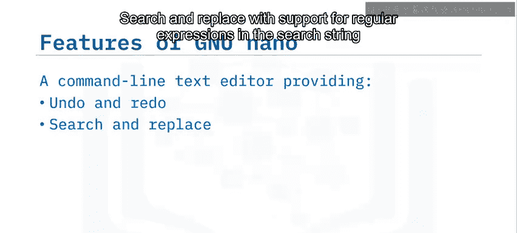

To open a text file in Nano， type Nano followed by the file name to open this opens a new text editor window in which you can edit the file。

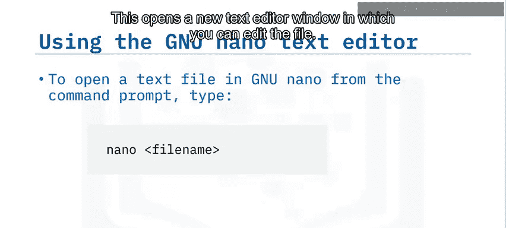

Here is what the nano app looks like。 The main area displays the text of the open file。

 which in this case is the source text from the nano Wikipedia page。

 The cursor is currently located at the beginning of the file。

 but you can navigate within the text using the arrow keys page up and down keys or home and end keys Any text you type is entered at the cursor。

 You can also delete text using the delete and backspace keys pressing enter starts a new line。

At the bottom of the nano window， there is a list of commands that you can use in the editor to access the commands。

 simultaneously press control and the letter for the command， for example， to get help。

 press the control and G keys。Let's see how to use a few of the editing options。

To search for a text string， you can press C W to use the where is option。

This opens a new pane at the bottom of the app window。And here's a closer view of that new pain。

Within the square brackets， you can see the most recently searched string， which here is 1999。

Type the string you want to find， for example， HTTPS and press Enter。

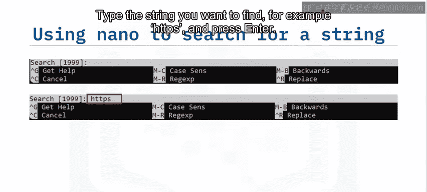

The cursor moves to the first instance of the search string it finds after the current position of the cursor here。

Nanno supports many other editing features， which you will explore in one of the labs for this course。

Now Vm is a traditional and very powerful command line editor。

 it takes some time to get accustomed to how it works， but with some practice。

 your fingers will develop muscle memory to accomplish all of your text editing tasks at speed。

Entering ViIm at the command prompt opens the VIm app。

 you can also specify a file name to edit a new or existing file。VIm has two basic modes。

 insertst mode where you enter text and command mode where you do everything else After you start a VIm session。

 press I to enter insertst mode， type some text， for example。

 some text and press the escape key to exit insert mode and switch to command mode。

 and the text is written to the buffer at the current cursor location。

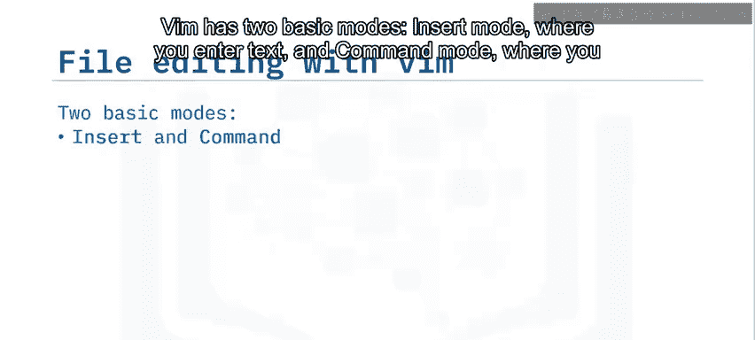

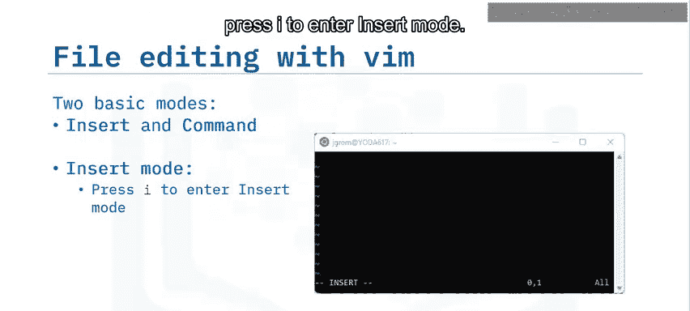

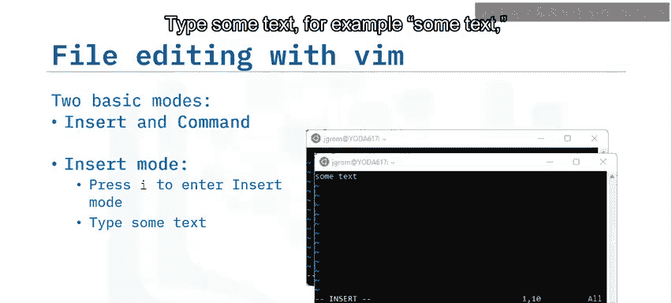

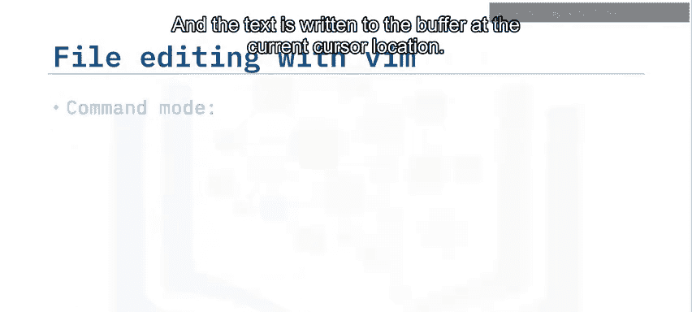

Now you are back in command mode and you can save your file with a file name using the colon Save command along with a file name such as example dot text。

 the buffer is written to the file and a message is displayed showing the file name that it is a new file it has one line with 10 columns and that it was successfully written。

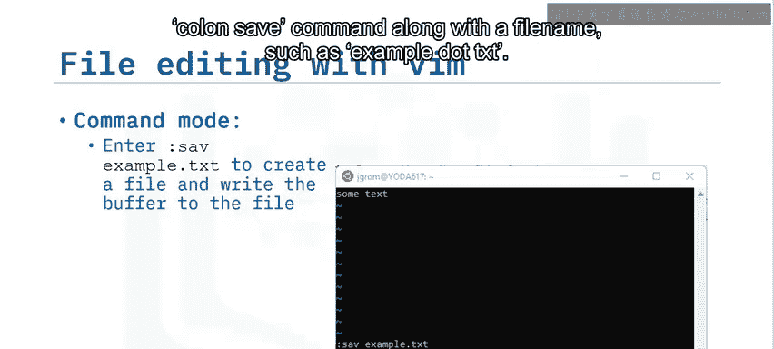

And now that your file already exists， you can use the more common colon W command to write any changes to the file。

To quit your VIm session， enter calling Q。And to quit and discard any changes made since the last right operation。

 include the Bang or exclamation mark， as in Colin Q Bang。This was a very short introduction to Vim。

 but there are many commands that you can use to navigate the text buffer and perform operations such as searching。

 copying， pasting and moving text around you'll get to practice some of these commands in an upcoming lab。

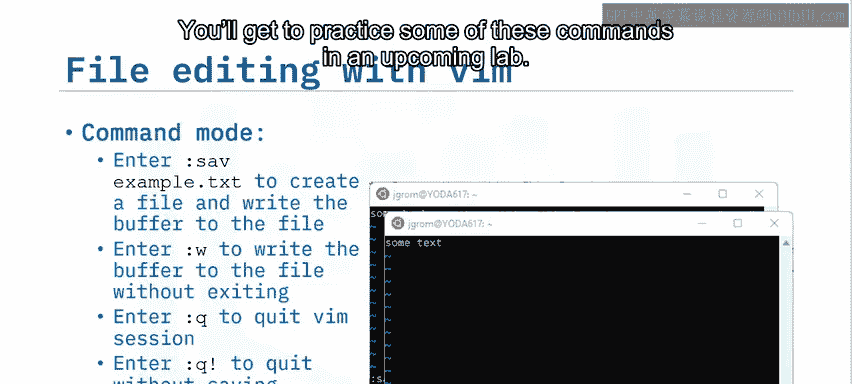

In this video， you learned that you can use a variety of command line or GuUI based text editors to work with your Linux code。

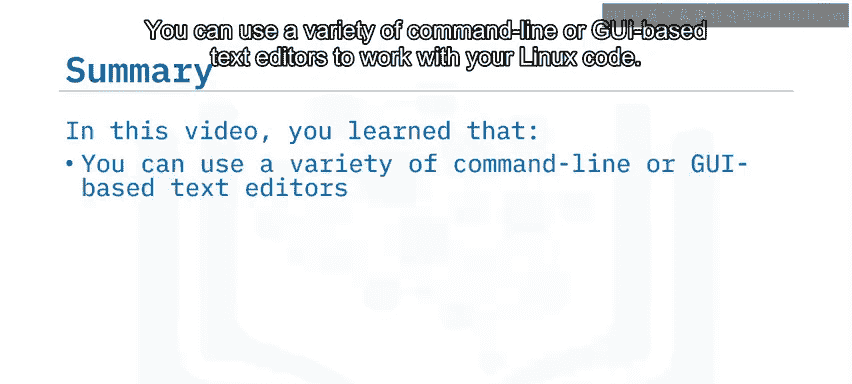

GEit is a GuUI based editor that provides many features to simplify your work。

Gnu Nano is a command line editor that provides similar functionality in a command line format。

 and VIm is another command line editor that uses insert mode to enter data and command mode to work with the file。

So you've seen how to use a text editor to work with existing files this will be helpful as you learn how to use Linux commands to create files and append text to them。

