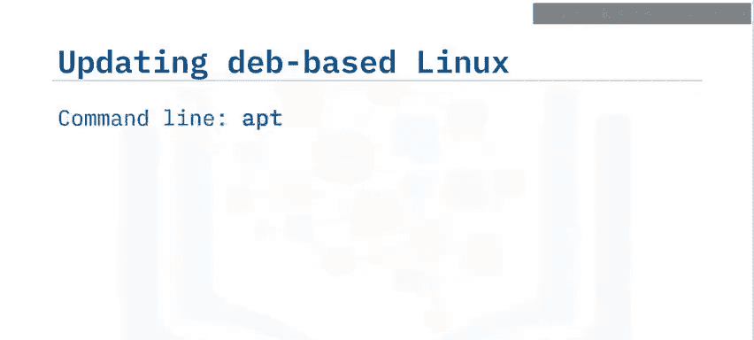
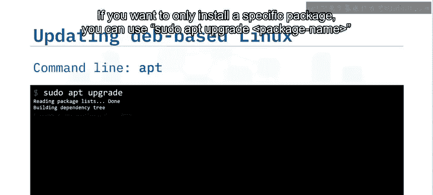
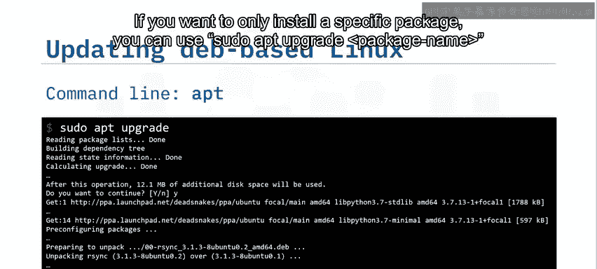
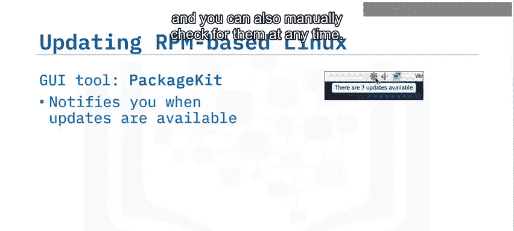
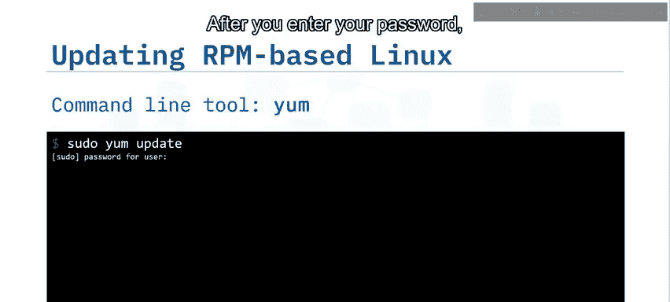
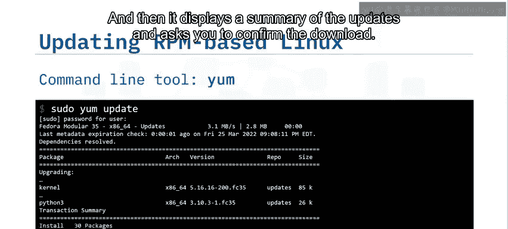
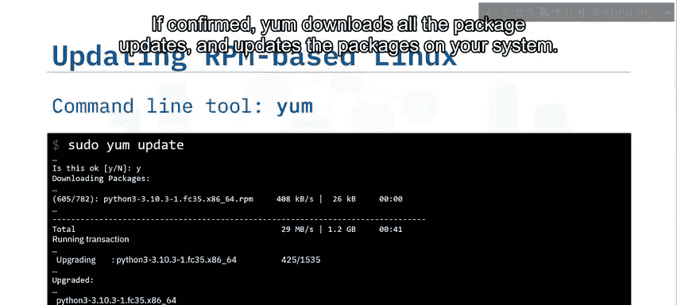
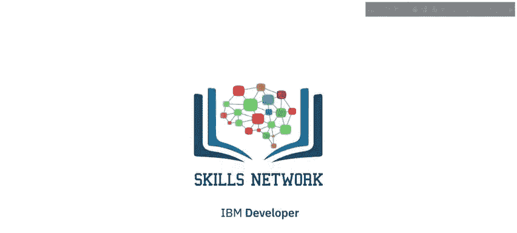

# IBM数据工程专业证书课程6：《Linux命令和Shell脚本入门实践》｜hands-on-introduction-to-linux-commands - P7：6_安装软件和更新.zh_en - GPT中英字幕课程资源 - BV1KV41137Lg

Welcome to installstaling softwareftware and Updates。After watching this video。

 you will be able to describe packages and package managers。

 differentiate between packages for Deb and RPM based distros。

 use a package manager to install updates， and use a package manager to install software。

Both software updates and software installation files for Linux operating systems are distributed in files known as packages These packages are archive files containing the required components for either installing new software or updating existing software you use package managers to manage the download and installation of packages different Linux diss provide different package managers。

 some are GuUI based and some are command line tools。

Deb and RPM packages are used by package managers in Linux operating systems。

 they are distinct file types containing software or updates for different Linux operating systems。

Dot Deb files are used for Debian based distributions such as Debion。

 Ubutu and Mint Deb stands for Debion， and dorpM files are used for Red Hat based distributions such as Sent OS Red Hat Enterprise Linux。

 feddoa and Opensusi RPM stands for Red Hat Pack Manager。Deb and RPM formats are equivalent。

 so the contents of the file can be used on other types of Linux OSs。

If you find that a package that you want to use is only available in the other format。

 you can convert it using the Ali tool to convert packages from RPM format to De。

 simply use the Ali command and specify the package name that you want to convert。

 to convert to RPM format， use the RSwitch with the Ali command。

Package managers provide several benefits， they can automatically resolve dependencies between packages。

 they can notify you when updates are available， GuUI based package managers can automatically check for security and software updates on a regular basis。

 and they can automatically install updates or let you select and install just the ones you want。

GuI based Linux distro package managers include Pack kitt and Update Manager。

Update manager is a goI tool for updating Debased Linux systems By default。

 update manager checks for software updates daily and automatically downloads and installs any security updates daily All other updates are displayed weekly you can also manually check for updates at any time。

Update Manager will notify you when software updates are available。

 select the updates you want to install， click installst updates， if prompted。

 enter your user password and click OK， and update manager installs the updates in the background while you continue working。

Apt is a command line tool for updating Debbased Linux systems you use pseudo app update command to find available packages for your distro The output for this command lists each available package builds a dependency tree and lets you know how many packages can be upgraded。

To install the packages， use the pseudo A upgradegrade command if you want to only install a specific package。

 you can use pseudoA upgradegrade package name。

Package kit is a GuI tool for updating RPMbased Linux systems When updates are available。

 package kitt displays a Starburs stcon in the notification area It automatically checks for updates at a configurable interval and you can also manually check for them at any time。

 clicking the Starbursst stcon opens the software update window which lists all available software updates select the updates you want to install and then click install updates if requested enter your password and click OK and package kit installs the updates in the background while you continue working。

YUum is a command line tool for updating RPM based systems YM stands for Yellow Dog Upator Moified to update all packages in your system。

 type pseudo yum Up After you enter your password， yM fetches all available package updates。

 and then it displays a summary of the updates and asks you to confirm the download。

If confirmed， YEM downloads all the package updates and updates the packages on your system。

 and when finished， it displays the successcc message complete。

You can also use command line tools to install new software。

 use the a command with the install switch to install a package on a Deb based system and use the YM command with the install switch to install software on an RPM based system。

Many software applications use package managers such as the popular PIP or Conda packages for managing Python environments。

 For example， assuming you already have a Python environment and the relevant PIP package。

 you can easily install the popular panndadas library used for data wrangling in Python。

 enterPIipP installs pandas to instruct the PIP package manager to search for the latest panda's package。

 download the panda's package， check for dependencies and update as required and install the pandas package When the installation is complete。

 the package manager displays the new software version number。

In this video you learned that do Deb and dorpM are distinct file types used by package managers in Linux operating systems Deb and RPM formats can be converted from one to the other Update manager and package kit are popular GuUI based package managers used in Deb and RPM based distros respectively and A andE are popular command line package managers used in Deb and RPM based distros respectively。

