# IBM数据工程专业证书课程6：《Linux命令和Shell脚本入门实践》｜hands-on-introduction-to-linux-commands - P8：7_常见 linux shell 命令概述.zh_en - GPT中英字幕课程资源 - BV1KV41137Lg

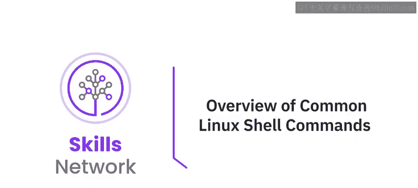

Welcome to overview of Common Linux Shell Commands。

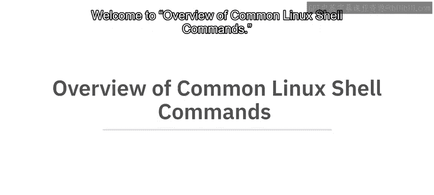

After watching this video， you will be able to define what a shell is。

 list shell command applications and recall common shell commands。😊。

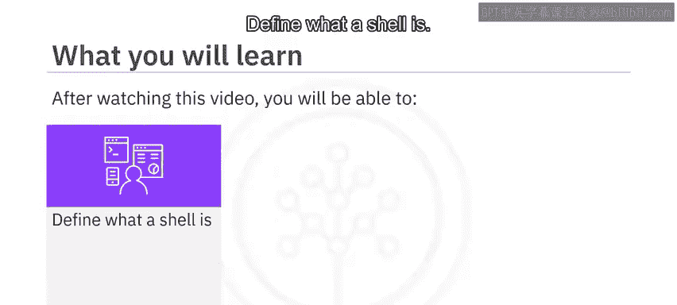

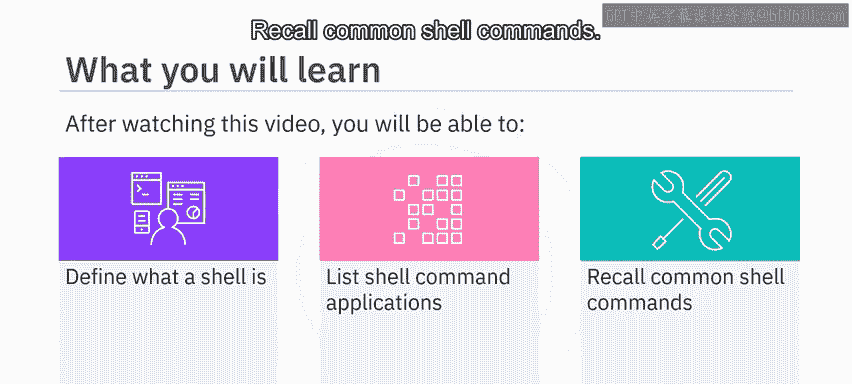

A shell is a powerful user interface for Uniix like operating systems。

 It can interpret commands and run other programs。😊，A shell which enables access to files。

 utilities and applications， is also an interactive language。 a shell is also a scripting language。

 and it can be used to automate tasks。The default shell on Linux systems is usually bash。

 Other shells include the B shell， S， H， the corn shell， K， S H， T， C shell， Z shell and fish。

For this course， we will only use the bash shell， which stands for Bn again She to find out what the default is。

 enter print end shell on the command line。 This returns the path to the default shell program。

 which in this case is bash。 If your default shell is not bash。

 you can always switch to it simply by entering bash on the command line。

 We will use the dollar sign to represent the command prompt throughout this course outside of this course。

 You may encounter the greater than symbol being used for the same purpose。

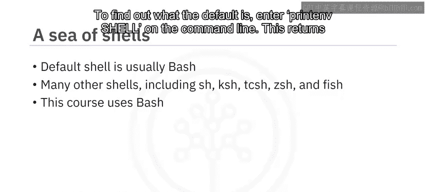

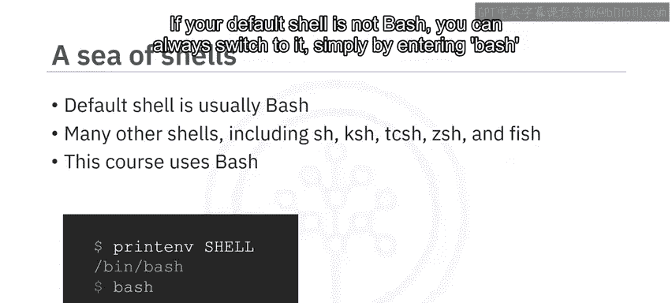

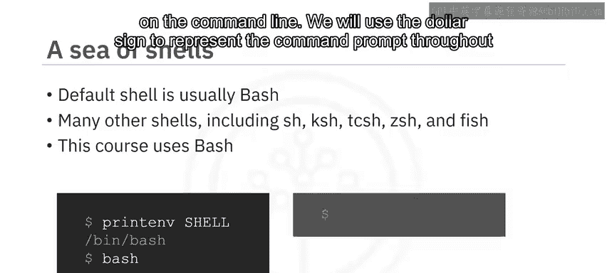

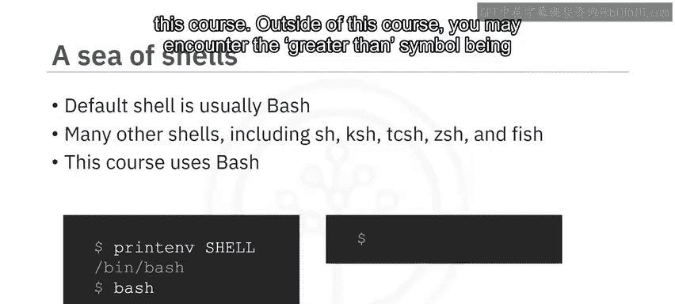

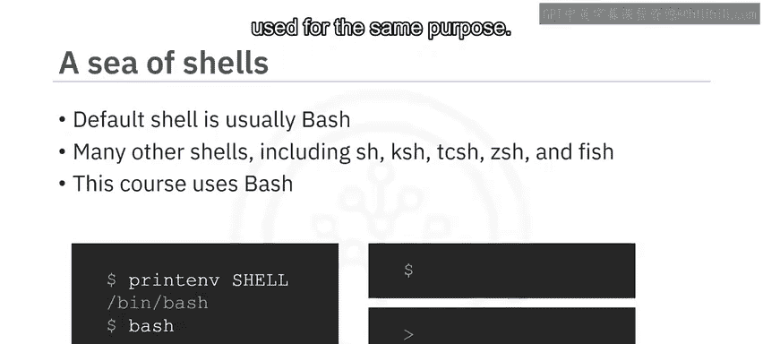

Applications of She commands include getting information。

 navigating and working with files and directories， printing file and string contents。

 file compression and archiving， performing network operations。

 monitoring performance and status of the system， its components and applications。

 and running batch jobs such as ETL operations。

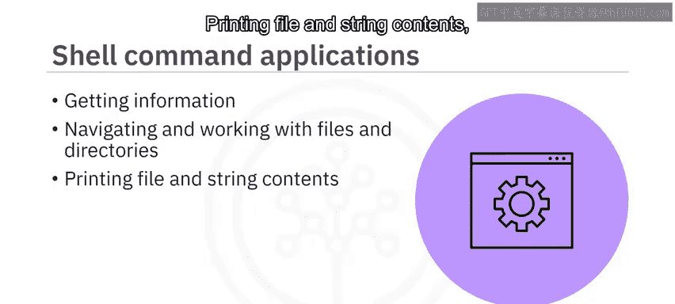

Some common shell commands for getting information include Who am I。

 which returns the user's username， I D， which returns the current user and group Is。

 U name returns the operating system name。 P S displays running processes and their Is。

 top displays running processes and resource usage， including memory。

 CPU and I O D F shows information about mounted file systems。

 Man fetches the reference manual for any shell command。 and date， prints today's date。

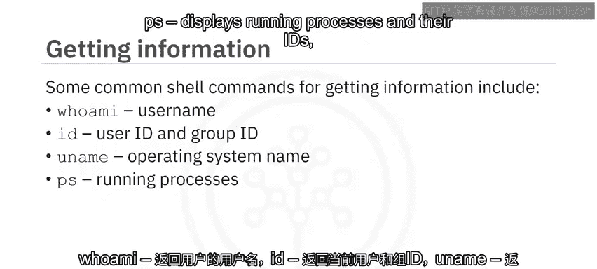

Some common shell commands for working with files include C， copy， file， M V， change file。

 name or path， R M， remove file， touch， create empty file， update file timestamp。 change mod。

 change or modify file permissions。 W C， get count of lines， words， characters and file and Gr。

 return lines in file matching pattern。

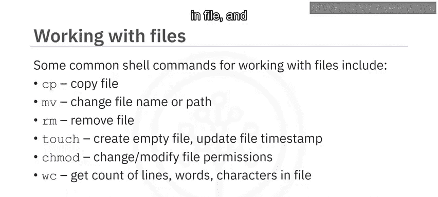

Very common shell commands for navigating and working with directories include Ls lists the files and directories in the current directory。

 Find used to find files matching a pattern in the current directory tree。

 Pw D prints the current or present working directory。 Make De makes a new directory。

 C D changes the current directory to another directory and RMD removes an entire directory。

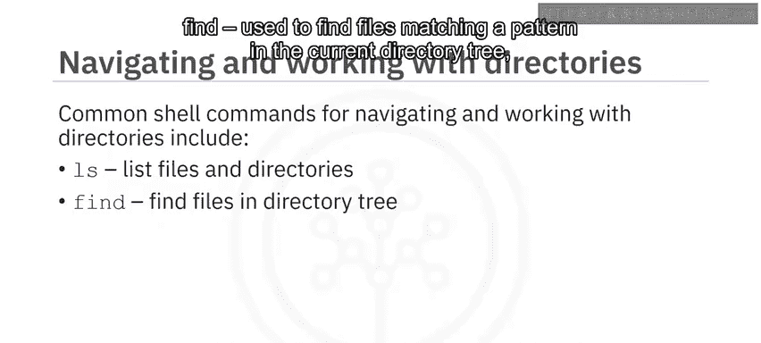

For printing file contents or strings， common commands include CA。

 which prints the entire contents of a file， more used to print file contents one page at a time。

 Head for printing just the first end lines of a file。

 Ta for printing the last end lines of a file and the very common echo command。

 which echoes an inprint string by printing it。 It can also echo the value of a variable。

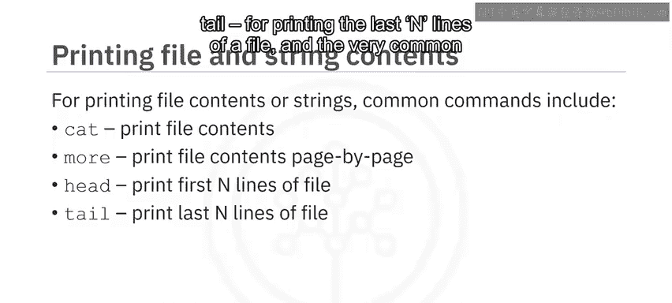

Shell commands related to file compression and archiving applications include TR。

 which is used to archive a set of files， zipip， which compresses a set of files and unzip。

 which extracts files from a compressed or zipped archive。

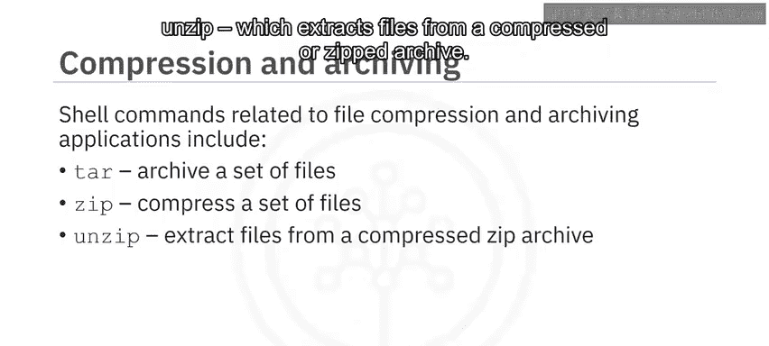

Networking applications include the following host name， prints the host name。

 Ping sends packets to a URL and prints the response。

 I F Config displays or configures network interfaces on the system。

 curl displays the contents of a file located at a URL。

 and the W get command can be used to download a file from a URL。

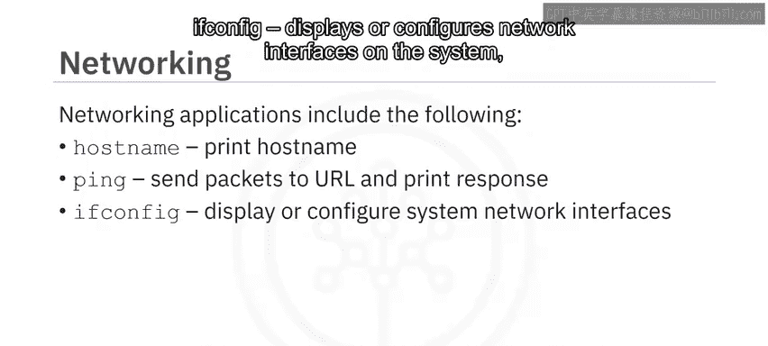

We should mention that if you happen to be running a Windows machine and you want to run Linux on it。

 you can do so in various ways。 Linux can be installed on a separate drive partition。

 Swing between the two operating systems requires a reboot。Alternatively。

 you can install Linux on a virtual machine， or you can install a Linux emulator such as Sigin。

 or use the Windows subsystem for Linux， a compatibility layer for running Linux binary executables natively on Windows。

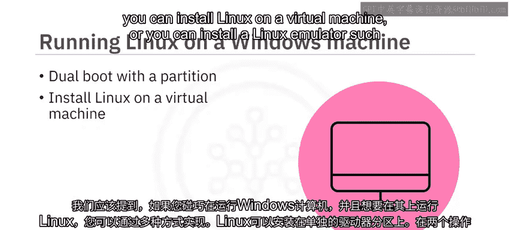

In this video， you learned that a shell is an interactive user interface for running commands。

 a scripting language， and an interactive language。

 Shell commands are used for navigating and working with files and directories。

 Shell commands can be used for file compression。😊。

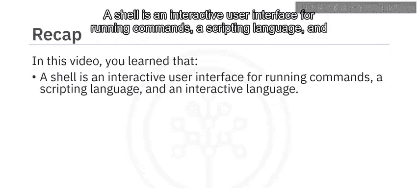

The curl and W get commands respectively can be used to display and download files from URLs。

 the E command print string or variable values， and the cat and tail commands are used to display file contents。

