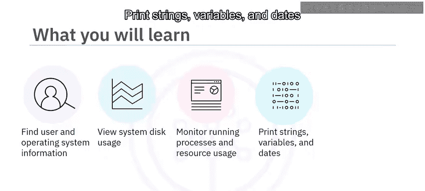
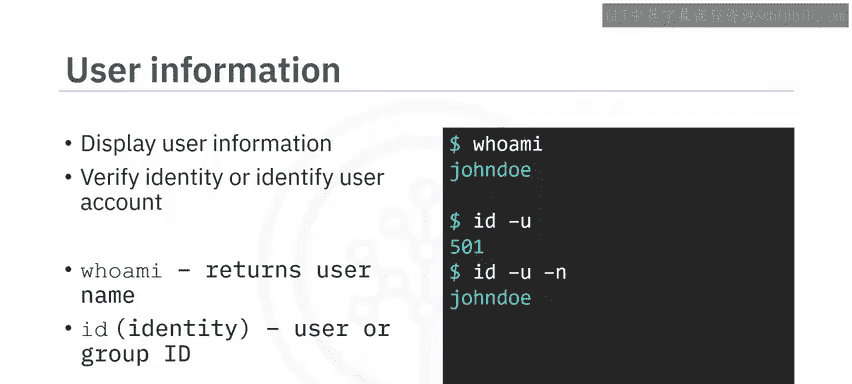
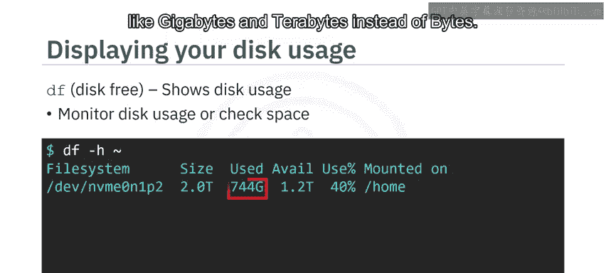
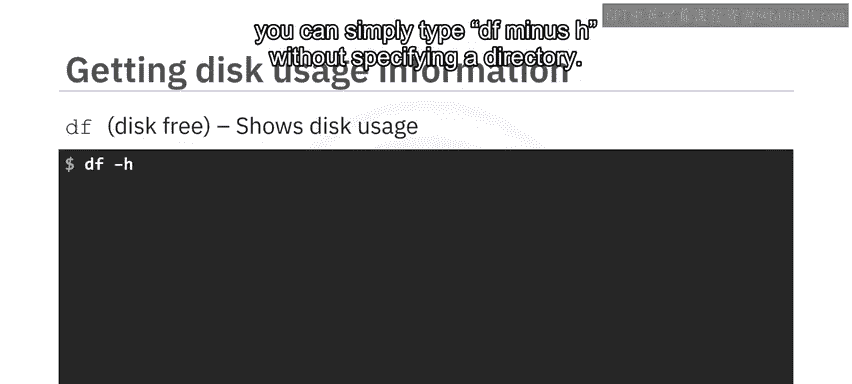
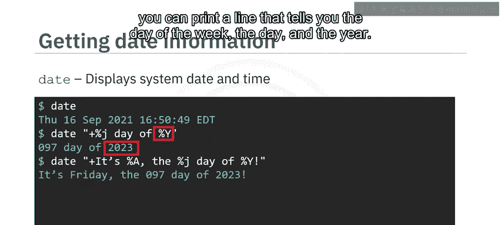
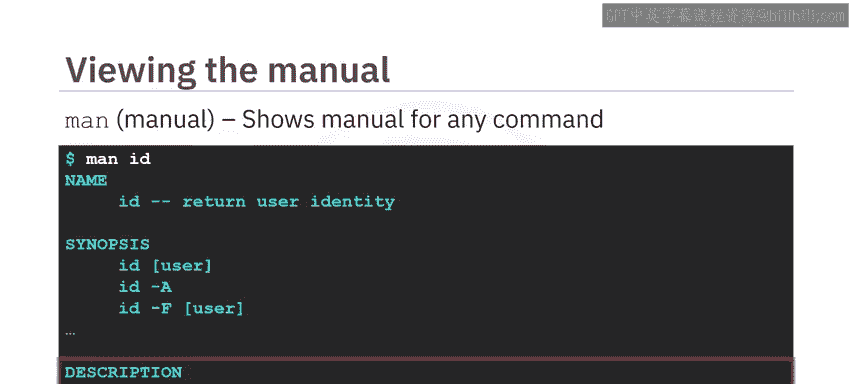

# IBM数据工程专业证书课程6：《Linux命令和Shell脚本入门实践》｜hands-on-introduction-to-linux-commands - P9：8_信息命令.zh_en - GPT中英字幕课程资源 - BV1KV41137Lg

Welcome to Informational commands。After watching this video。

 you'll be able to find user and operating system information， view system disk usage。

 monitor running processes and their resource usage， print strings， variables and dates。

 display manuals for commands。😊。

You can use informational commands in your terminal to display user information about your system。

 Use info commands are useful when you need to verify the identity of the current user or determine which user account as running a particular command or process。

 For example， the command， Who am I displays the current user's username。

 The who am I command takes no arguments and has no options。

 Here you see a user example for someone logged in as user John Doe Similarlyly。

 the I command returns the user or group I， which is a number assigned to each user or group in the Linux system In this example。

 using I with the minus U option returns the numerical I of the user。

 If you would like the name corresponding to the numerical user I。 Add the minus N option。

The U name command， which stands for Unix name， returns OS information such as the kernel name and version number。

 This can be used to identify the type of system you're working on or diagnose system related issues。

 En the U name command returns the name of the operating system。

 which in this case is Darwin including the minus S and minus R options returns both the O name and its version。

 You can also view more detailed version information using the minus V option。

You can use the Df or diskfr command to display your systems's disk usage。

 It can be useful in situations where you need to monitor disk usage or check the available space on a particular file system。

 For example， entering Df minus H Tilde displays the following table。

 which is specific to your home directory represented by the Tildy symbol。 In this table。

 you can see all the disks mounted on your home directory。 In Linux。

 you can mount a disk onto a directory， which means that the file system of that disk becomes accessible through that directory。

 The table also displays the percentage of storage used on each disk。

 The minus H option makes the output human readable expressing disk space in units like gigabytes and terabytes instead of bytes。

To view disk usage on all file systems， you can simply type DF minus H without specifying a directory。

 the output includes the size， capacity used and available space for each file system。

To see the currently running processes on your system， you can use the P or process status command。

 This is helpful when you need to monitor or manage processes using P with the minus E option will list all processes running on the system。

 regardless of which users started them。 The P command displays information such as the name of each running process。

 the process I D and the time in minutes and seconds that each process has been running。

The top or table of Pro command acts a task manager and will show a table running processes and their resource usage。

 This command comes in handy when you need to monitor system performance or identify resource heavy processes here we show a usage example with the minus n option and the number3 to display the top three running tasks Chrome。

 top and Spotify by default， tasks are sorted by CPU usage This is a simplified output of the top command for this video。

 but top provides many other details such as memory usage and the executable file location。

Although simple， the echo command in Linux is a powerful tool to display text or variables on the terminal or in a shell script。

 En just echo is similar to telling the terminal to print nothing。 and it will return a new line。

 If you would like to echo a single word， such as hello。

 you can simply type echo hello and the terminal will return the word strictly speaking。

 you don't need to add quotes around a string with spaces for echo to work as expected。

 but it's considered best practice to include quotes using echo with a quoted string returns the quoted contents。

 Learn Linux is fun。 exclamation point Additionally。

 you can view the value of a variable such as our system's path variable by typing a dollar sign followed by the variable name。

 This can be helpful when troubleshooting or scripting。

 Here you can see each path of your systems path variable delimited by colons。😊。

Another helpful command is date， which displays the current system date and time。

 En date returns the default date format。 the day of the week， the day， month， year。

 time and the time zone。 you can also extract certain parts of the date to print like in this example to format the output encapsulate within quote。

 a combination of text and control characters preceded by a plus sign。

 format controls are indicated with the percent symbol。 In this case。

 percent J and percent Y output the numerical day of the year and the year itself， respectively。

 This command prints97 end for the 97th day of the year。 The words day of and the year 2023。

 Notice how percent Y is replaced by the year 2023。 Finally。

 here is another example to show how you can further combine format controls with text to print unique stream。

😊，By bringing together controls like percent A， percent J， and percent Y with text。

 you can print a line that tells you the day of the week， the day， and the year。

This video has only covered the basics of these commands。

 If you want to learn more about how to use a command， you can use the man or manual command。

 All default Linux commands come with a manual that you can display using man。 For example。

 entering man I will display the manual for the I command。

 The manual will provide a basic summary of what the command does， such as return user identity。

 Also listed are the options for the I command， such as minus a square brackets indicate optional parameters。

 such as user， which allows you to specify a username。

 The man command also provides a more detailed description of the command。

 which explains it in greater detail。 The man command even has its own man page。

 You can use it to learn more about the manual command and its uses。😊。

In this video， you learned how to get user information with the Who am I and I D commands。

 Get operating system information using the you name command。

 Check system disk usage using the D F command， monitor processes and resource usage with P and top print string or variable value using Echo print and extract information about the date with the date command and read the manual for any command using Man。

