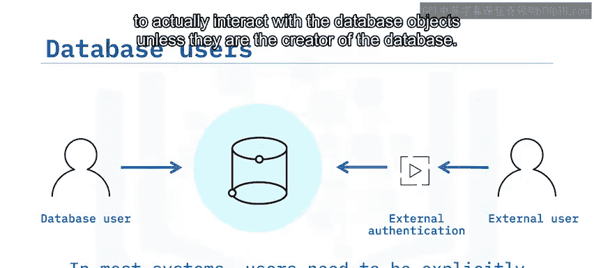
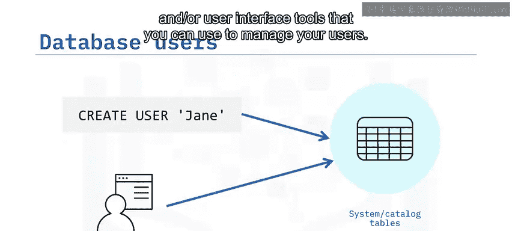
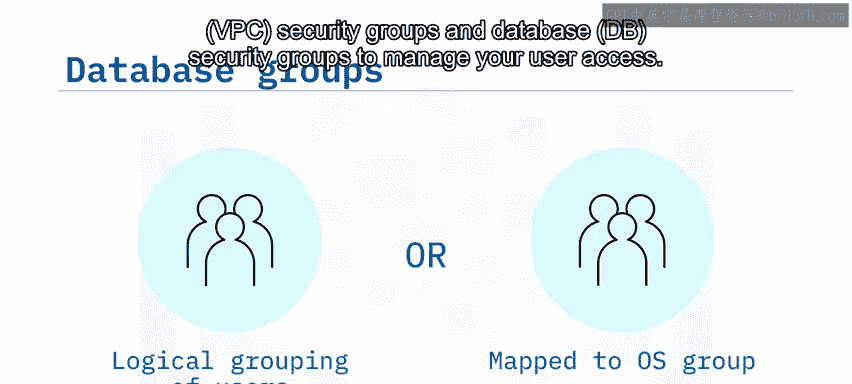
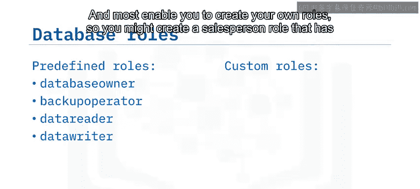
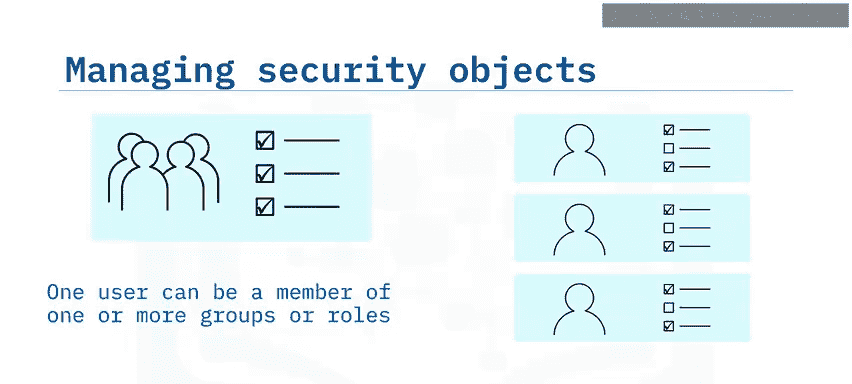
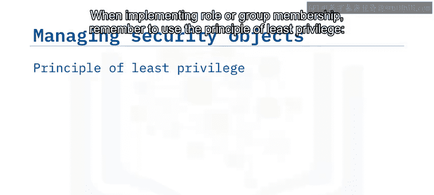
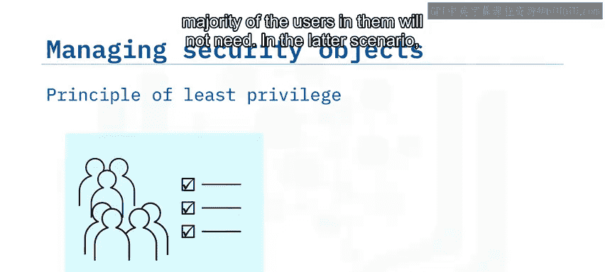
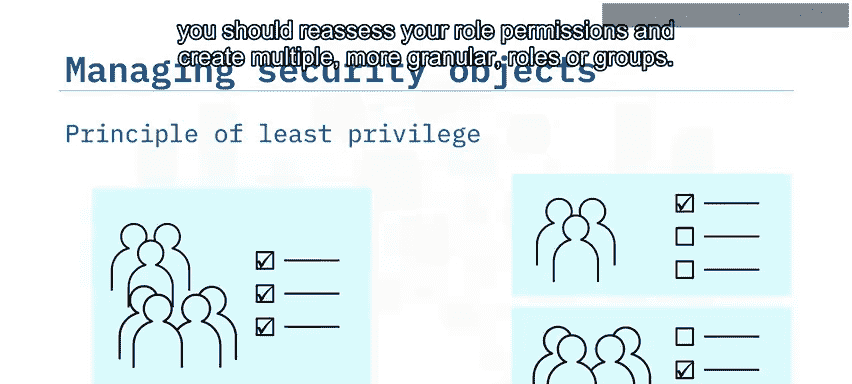
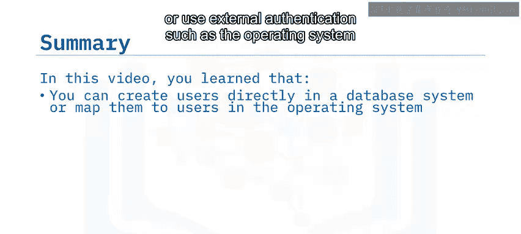

# IBM数据工程专业证书课程7：《关系数据库管理（DBA）》｜relational-database-administration｜ - P11：10_用户 组和角色.zh_en - GPT中英字幕课程资源 - BV1b14y1q7zT

Welcome to Users groupss and roles。After watching this video。

 you will be able to describe users groups and roles。

 explain how users groups and roles work together， and manage database security objects。

A database user is a user account that is allowed to access specified database objects depending on the DBMS and your security policies。

 a user might be explicitly created and authenticated within the database system。

 or may be created externally and authenticated using external authentication。

 such as the operating system or external identity management services like Kber， LDAP and Cloud IAM。

When you first create a user， they will generally have few if any permissions to actually interact with the database objects。

 unless they are a creator of the database。

User names are stored in system tables or catalog tables。

 which you should not try to edit directly All RDBMSs will provide SQL commands and or user interface tools that you can use to manage your users。

Some RDBMSs support the concept of user groups in some cases such as Postgres。

 you define groups in the database and they are logical groupings of users to simplify user management in other systems such as SQL server and DB2 you can map a database group to an administrative group in the underlying operating system This is particularly useful when you are using that operating system to authenticate your users Similarlyly。

 if you are running your database on Amazon Relational database service or RDS for example。

 you can use virtual private cloud or VPC security groups and database or DB security groups to manage your user access。

Database roles are similar to database groups in that they confer privileges and access rights to all users of that role a database role defines a set of permissions needed to undertake a specific role in the database For example。

 a backup operator role would have permissions to access a database and to perform backup functions。

Some RGBMSs have a set of predefined roles that you can use for your users。

 such as a database owner or backup operator role， and most enable you to create your own roles so you might create a salesperson role that has the permissions a salesperson will need on the relevant tables in the database。

Assigning privileges to groups or roles rather than individual users greatly simplifies your security management tasks If you know that a set of users all need access to the same functionality to fulfill their job role。

 you can put those users in one group and assign the relevant permissions to the group if the job role changes in the future。

 it is quicker， easier and less prone to mistakes to just add the new permissions to the group rather than individual users Similarlyly。

 if a new member of staff joins the team， you can simply add them to the role or group rather than having to assign all the separate permissions to them One user can be a member of one or more roles。

 so the head of the sales group could be a member of the group heads role and the salesperson role。

When implementing role or group membership， remember to use the principle of least privilege。

 only adding users to groups they need to be a member of。

 and ensuring that your roles don't include any permissions that the majority of users in them will not need in the later scenario you should reassess your role permissions and create multiple more granular roles or groups。

In this video you learned that depending on the database you can create and authenticate users directly in the database system or use external authentication such as the operating system in some systems you define groups in the database to manage users and in others you can map database groups to operating system groups。

 you can use predefined database roles to assign privileges to common sets of database users。

 you can define custom roles for your own requirements and groups and roles simplify user management。

