# IBM数据工程专业证书课程7：《关系数据库管理（DBA）》｜relational-database-administration｜ - P15：14_数据库监控概述.zh_en - GPT中英字幕课程资源 - BV1b14y1q7zT

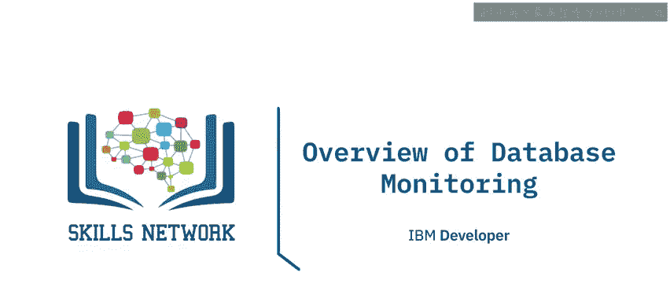

Welcome to overview of database monitoring After watching this video。

 you will be able to explain why proactive monitoring is important。

 identify what baseline data you should create， and describe the options available for monitoring database usage and performance。

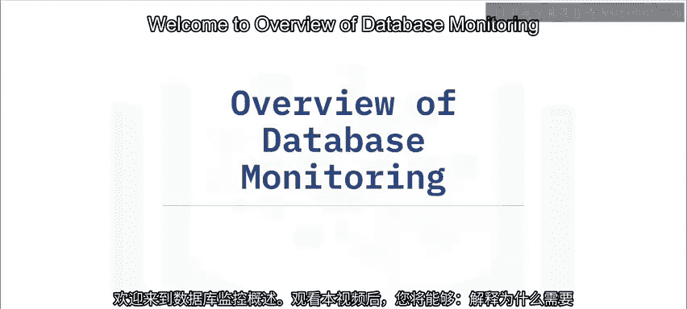

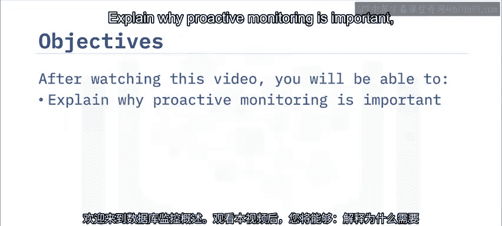

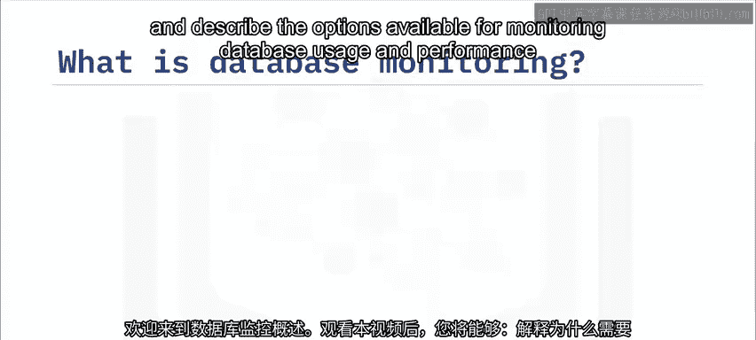

For many database admins， one of the most challenging and necessary elements of database management is performance tuning。

 and one of the critical parts of this process is database monitoring The term database monitoring refers to the different tasks related to the scrutinization of the day to day operational status of your database Data monitoring is crucial to maintain the health and performance of your relational database management system。

 regardless of which vendor's database product you are using。

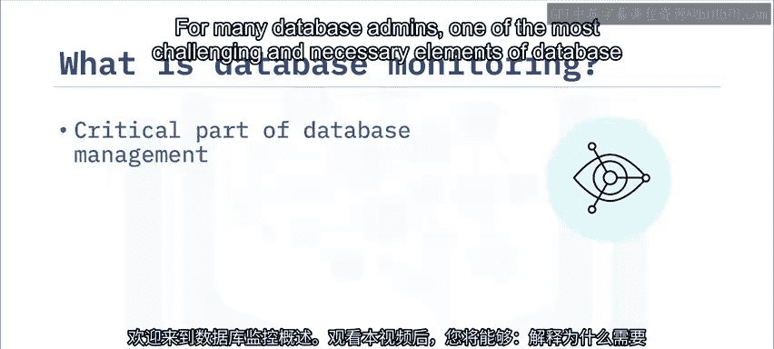

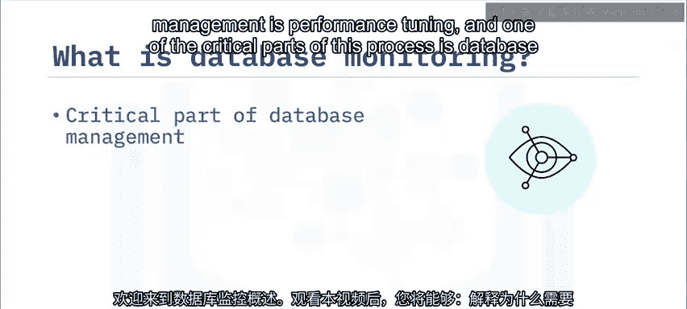

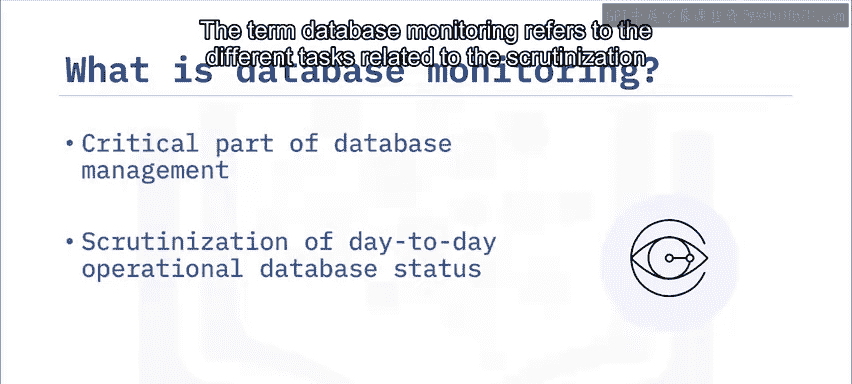

When you perform regular database monitoring， it helps to identify issues in a timely manner so that you can maintain the health and accessibility of your database system if you do not perform this monitoring function。

 then problems and outages in your database might go undetected until it's too late This can cause your users and customers to lose confidence in your service and potentially your organization could lose customers and income because of it most relational database management systems offer tools that enable you to observe the current state of your databases and to track their performance as circumstances vary over time。

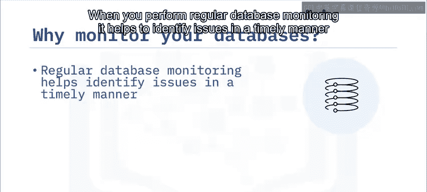

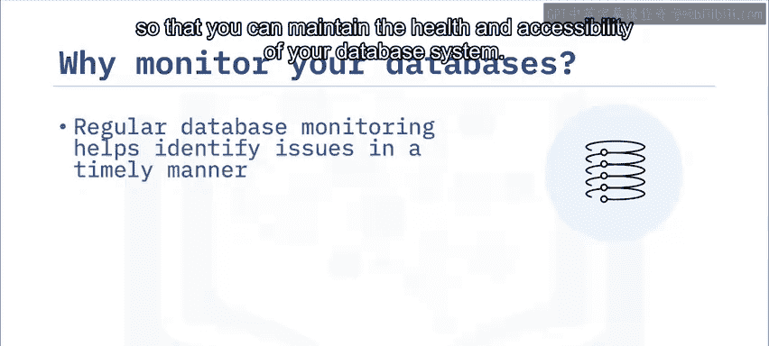

As a database admin， you can then utilize this information to perform several database monitoring tasks。

 including forecasting your future hardware requirements based on database usage patterns。

 analyzing the performance of individual applications or database queries。

 tracking the usage of indexes and tables， determining the root cause of any system performance degradation。

 optimizing database elements to provide the best possible performance。

 and assessing the impact of any optimization activities。

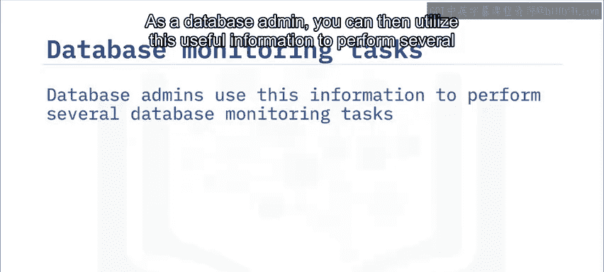

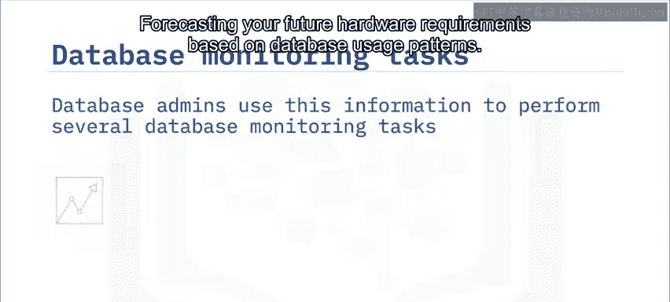

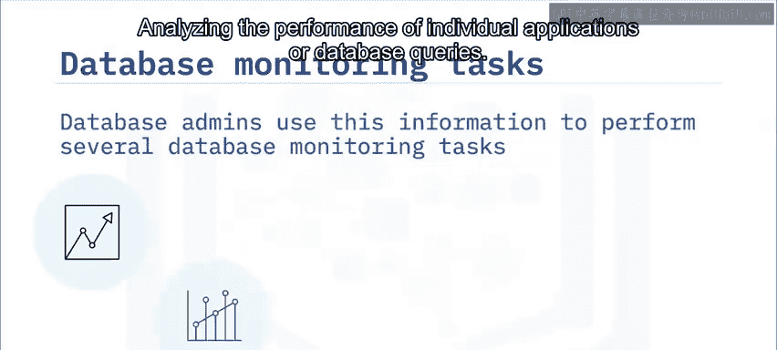

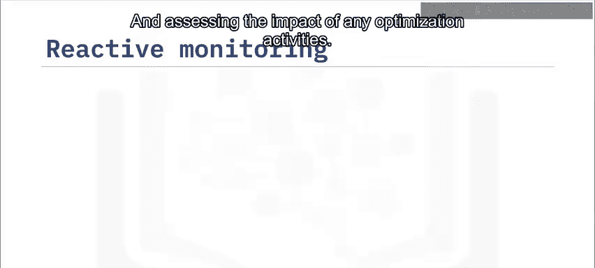

Before we can talk about the importance of proactive monitoring。

 we need to differentiate it from reactive monitoring reactive monitoring is done after an issue occurs when you act indirect response to that issue。

 perhaps by fixing a configuration setting or adding more resources， for example。

 the most common situations when reactive monitoring occurs is either when your database security has been breached。

 or the performance of your database reaches critically low levels。

 or when some other kind of major database incident occurs that greatly impacts your business and therefore needs resolving as soon as possible。

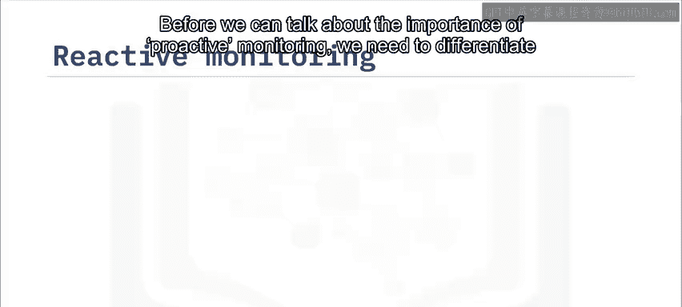

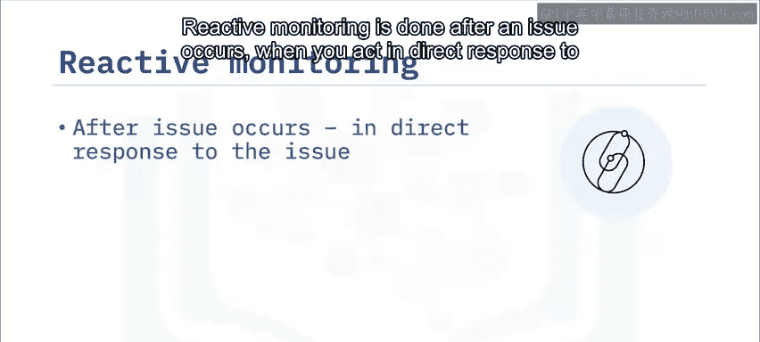

In contrast， a proactive monitoring strategy seeks to prevent this reactive panic by identifying issues before they grow into large problems。

 This is primarily achieved by observing specific metrics from your database。

 then sending alerts to interested parties if the values of these metrics reach abnormal levels。

 Pro monitoring typically utilizes automated processes to perform tasks such as regularly verifying that a database system is online and accessible。

 verifying that configuration changes to not adversely affect the performance of the database system and that the database system is operating and performing at acceptable levels。

 This proactive approach is widely considered to be the better strategy and is preferred by most database admins。

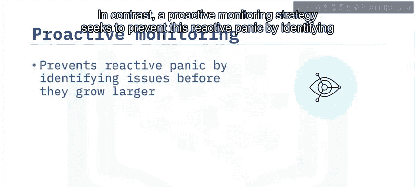

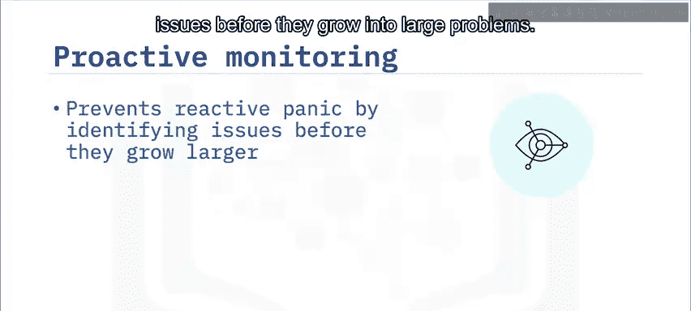

To determine whether your database system is performing at its most optimal。

 you first need to establish a baseline for your database system's performance To do this。

 you need to record key performance metrics at regular intervals over a given time period。

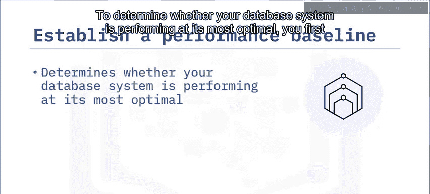

Once you have established a database system performance baseline。

 you can then compare these baseline statistics with the performance of your database system at any given time if your comparison indicates that the current performance measurements are either significantly above or below the performance baseline。

 then these can become potential targets for further analysis and investigation。

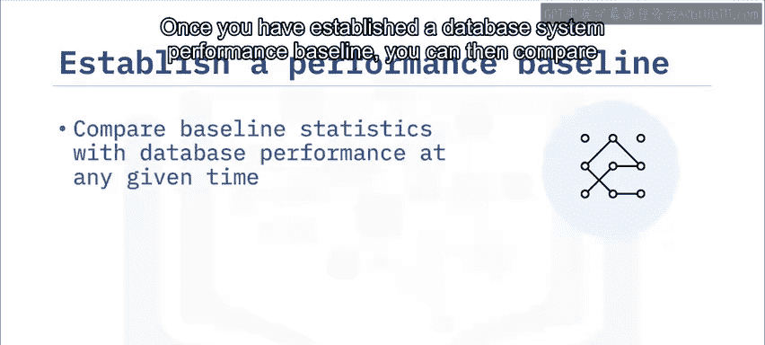

From these investigations， you might then determine that some database elementss need reconfiguring or optimizing。

Even when things are working well and as expected， you can still use your performance baseline data to help you determine operational norms。

 such as your peak and off peakak hours of operation。

 typical response times for running queries and processing batch commands。

 and the time taken to perform database backup and restore operations。

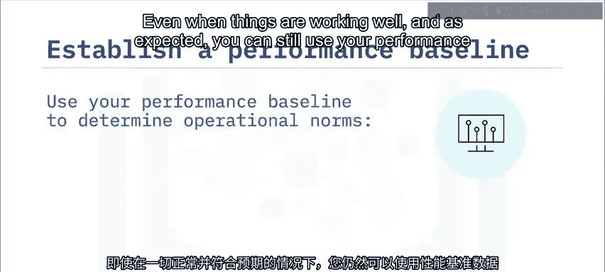

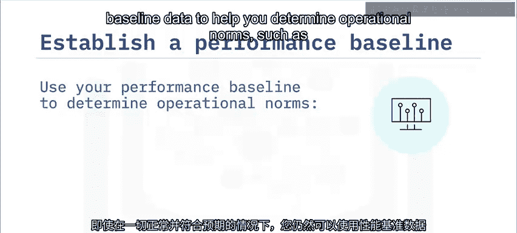

The following areas typically have the greatest effect on the performance of your database system。

 system hardware resources， network architecture， operating system， database applications。

 and client applications。

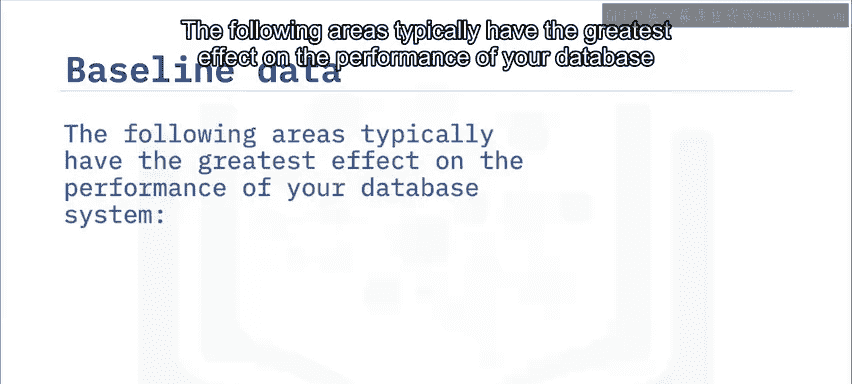

There are two ways to monitor operations in your database you can view information that shows the state of the various elements of your database in real time using monitoring table functions For example。

 you can use a monitoring table function to examine the total amount of space used in a table These table functions let you examine monitoring elements and metrics that report on virtually all aspects of database operations monitoring table functions use a lightweight high speed monitoring infrastructure。

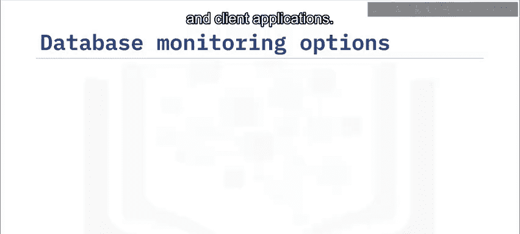

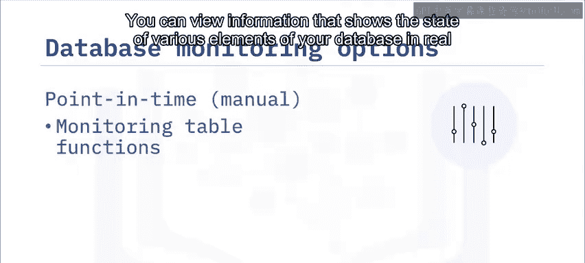

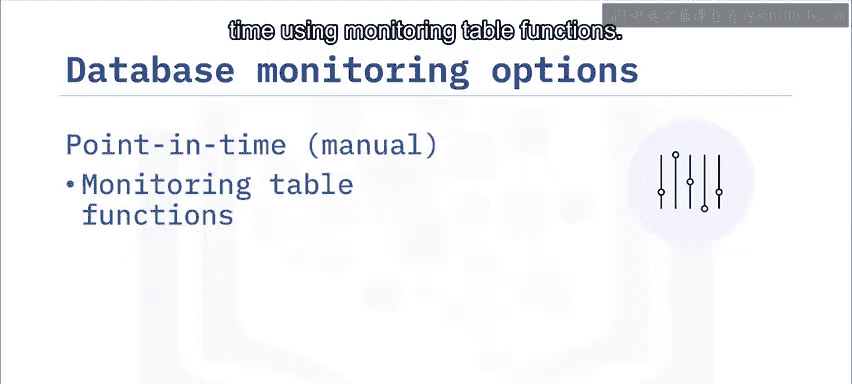

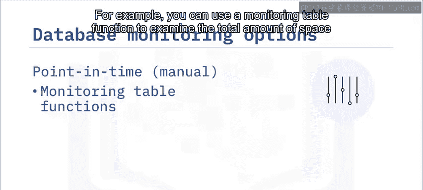

Alternatively， you can set up event monitors to capture historical information as specific types of database events occur over a given time period Even monitors capture information about database operations over time as specific types of events occur For example。

 you can create an event monitor to capture information about locks and deadlocks as they occur in the system。

 or you might create an event monitor to record when a threshold that you specify， for example。

 the total processor time used by an application or workload is exceeded。

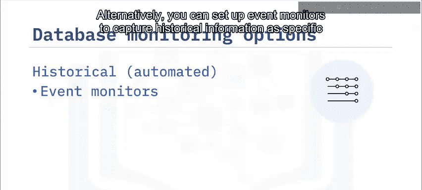

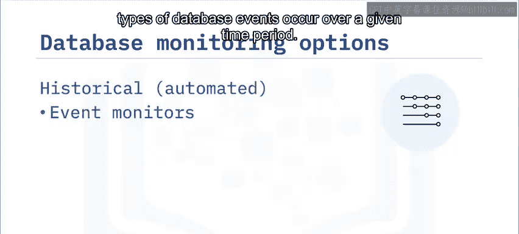

Event monitors generate output in different formats and can write this output to regular tables。

 some even have additional output options。In this video you learned that database monitoring is crucial to maintain the health and performance of your relational database management system Pro monitoring seeks to prevent a reactive panic by identifying issues before they grow into larger problems you need to establish a baseline for your database systems performance to determine whether your database system is performing at its most optimal。

 and to monitor operations in your database， you can either view the state of various elements of your database at a specific point in time or you can set up event monitors to capture historical information as specific types of database events occur over time。

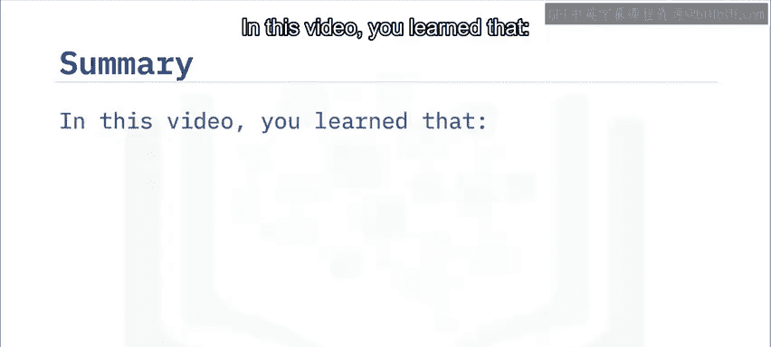

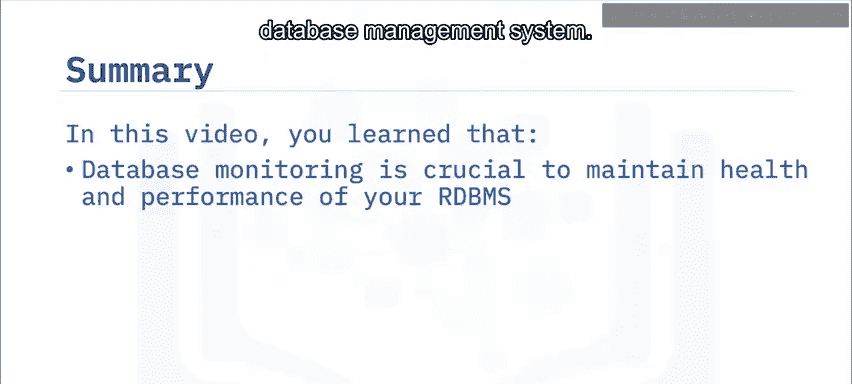