# IBM数据工程专业证书课程7：《关系数据库管理（DBA）》｜relational-database-administration｜ - P16：15_监控使用和性能 第 1 部分.zh_en - GPT中英字幕课程资源 - BV1b14y1q7zT

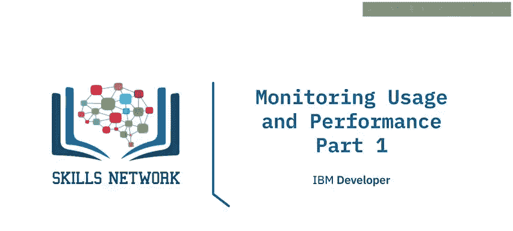

Welcome to Monit U and Performance Part1 After watching this video。

 you will be able to explain why you need to monitor at different levels and describe the four levels at which you should monitor。

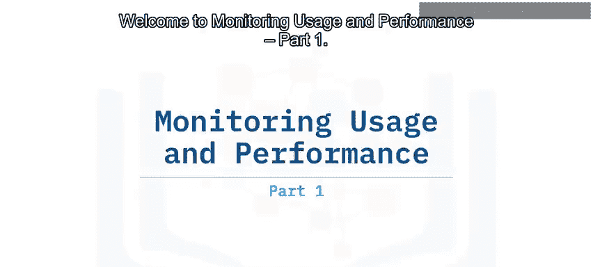

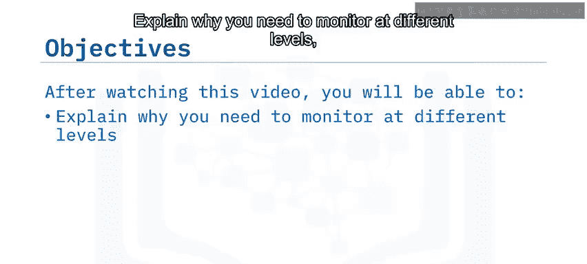

You need to use the appropriate tools to monitor your database and effectively monitor its performance。

 but regardless of which monitoring tools you use， the relevant information is obtained by using several key performance indicators or KPIs which are more commonly referred to as metrics。

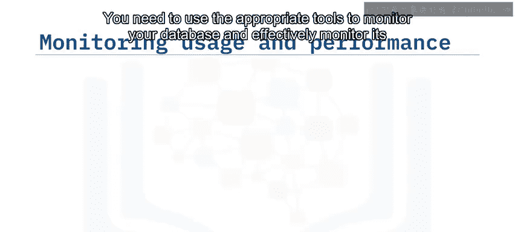

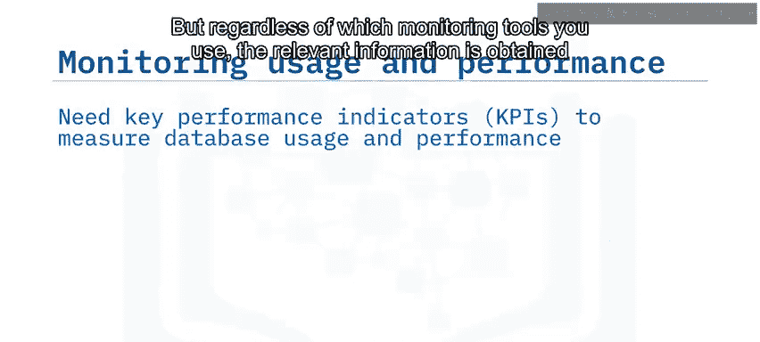

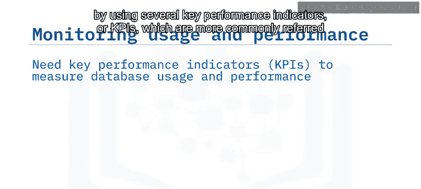

Datase performance is measured by using these key database performance metrics which enable database admins to effectively optimize their organization's databases for best performance apart from monitoring for performance reasons。

 regular monitoring is also useful for operations A and security purposes The ultimate goal of monitoring is to identify and prevent issues from adversely affecting database performance。

 however， some issues that occur may be caused by your hardware or perhaps your software or possibly your network connections or even the queries that you execute or some other unknown factor The point is issues can arise in several areas of your database environment therefore to efficiently and successfully monitor the usage and performance of your databases。

 you need to monitor at several distinct levels within your database environment。

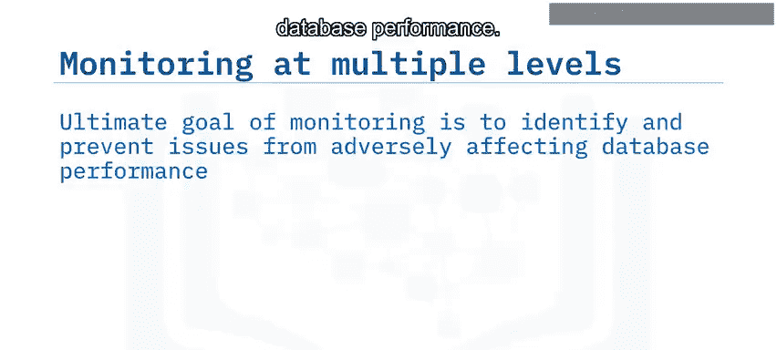

The form monitoring levels are the infrastructure level， the platform level， or instance level。

 the query level， and the user or session level。

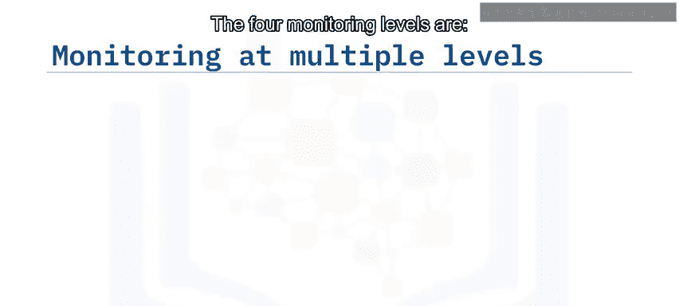

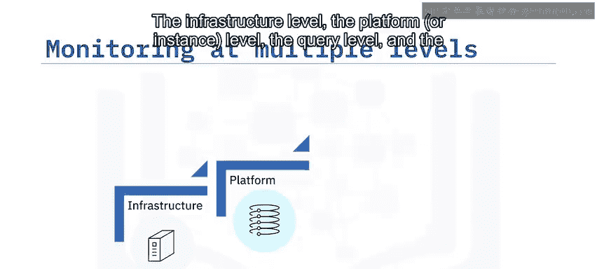

So first， there's the infrastructure level， it's vital that all the underlying infrastructure components such as operating systems。

 servers， storage hardware resources， and network components be working efficiently under the hood of the database platform and the queries。

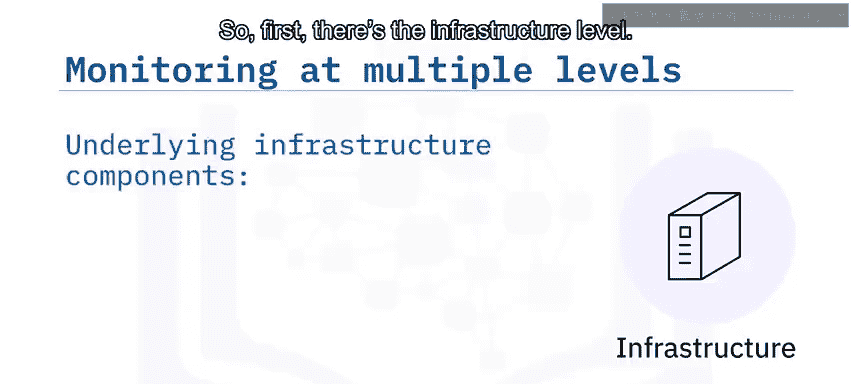

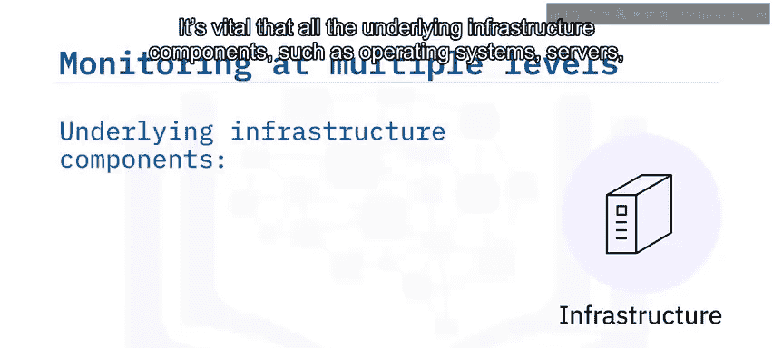

Next， there's the instance or database platform level irrespective of whether you're handling relational database systems such as DB2。

 PostgresQL， MySQL or any other flavor of relational database system for that matter。

 or if you're managing a combination of more than one of them together。

 each platform is a consideration in terms of performance database monitoring at the platform level is crucial because it offers holistic insight into all the elements necessary to maintain consistent database performance。

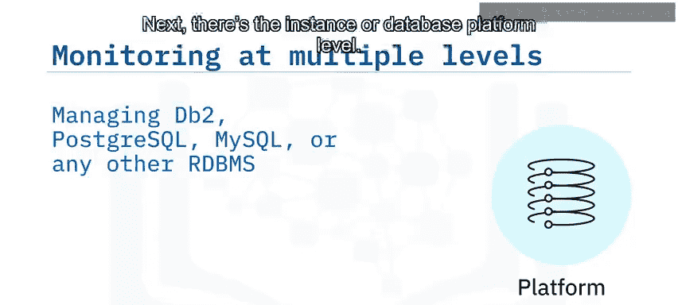

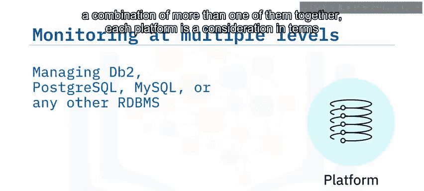

Next is the query level Typically your line of business applications will be repeatedly running queries against your database instances and then formatting and returning the relevant results of those queries to your users the majority of bottlenecks that might occur at this level will primarily be due to inefficient query statements that may cause latency。

 mishandle errors and diminish query throughput and concurrency。

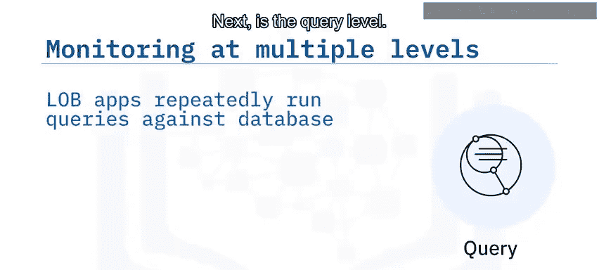

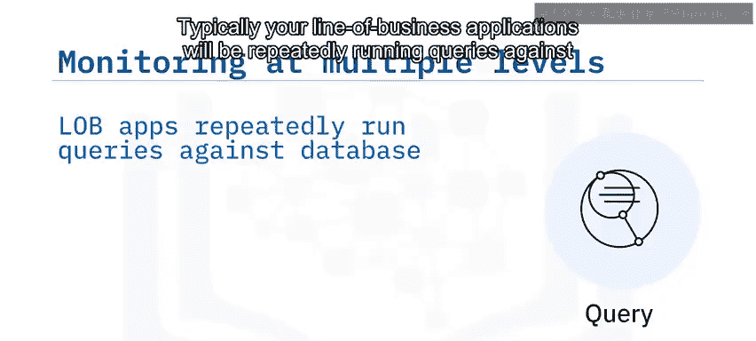

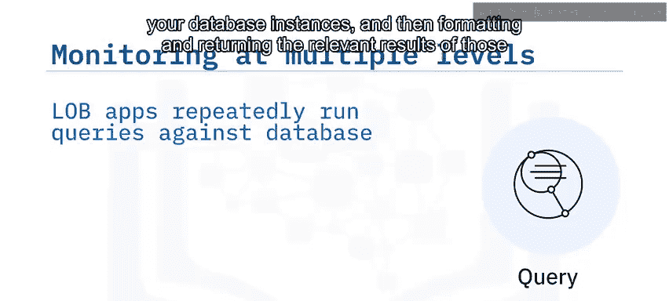

And lastly， we have the user or session level this level can often be the most misleading monitoring level of them all because if your users are complaining about something not working。

 then you can just obtain further information about the issue they are having investigated and hopefully fix it but what if your users aren't currently complaining about things not working Can you just assume that everything is running fine。

 put your feet up and relax unfortunately， no， just because there may not be an issue right now doesn't mean that there won't be one just around the corner Truly successful monitoring means constantly monitoring the usage performance and behavior of your database system in a proactive and continuous manner the Nrvana of database monitoring is achieved when you proactively identify issues before your users even are aware of them Mon all four of these levels is crucial to maintaining service level agreements or SLs such as highava。

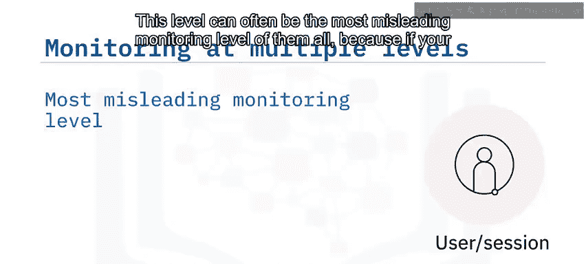

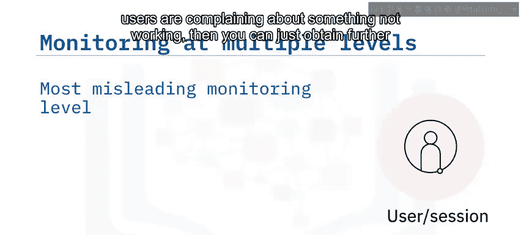

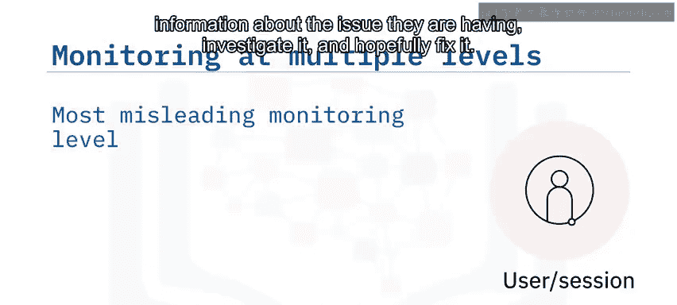

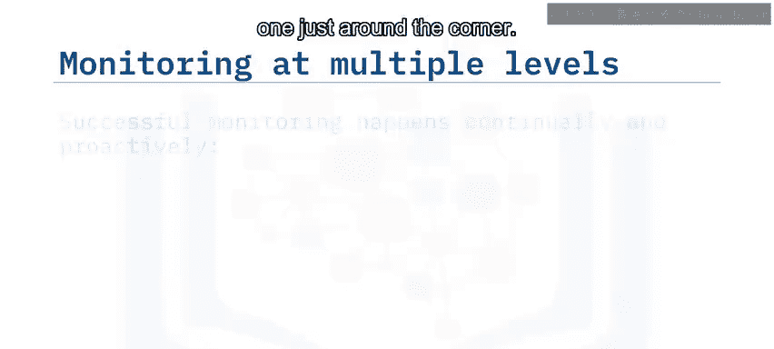

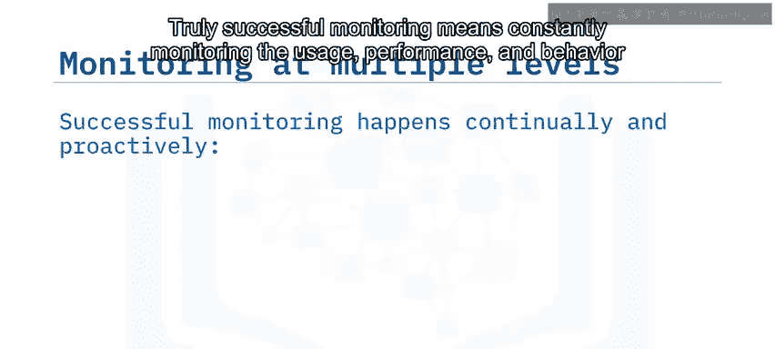

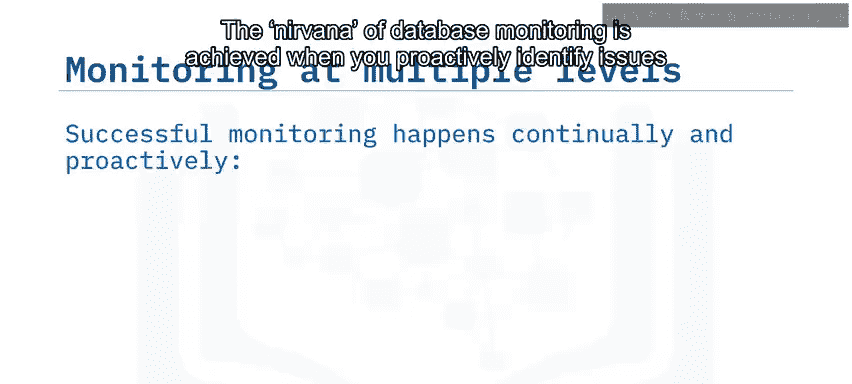

High up time and low latency for your databases。

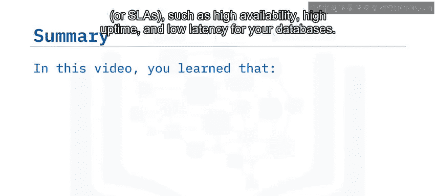

In this video， you learned that database performance is measured by using key performance indicators known as metrics。

 metricss enable DBAs to optimize organizations databases for best performance。

 successful database performance monitoring means monitoring at multiple levels。

 and you should monitor at the infrastructure， platform， query and user levels。

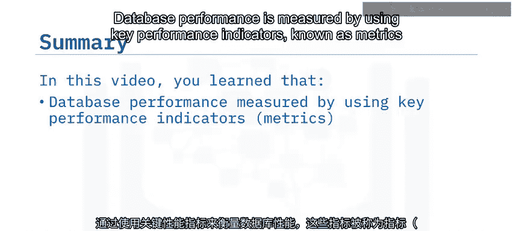

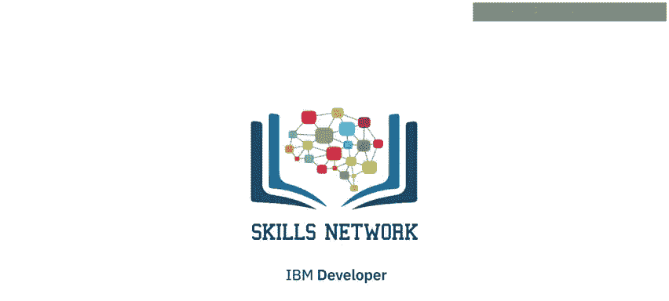