# IBM数据工程专业证书课程7：《关系数据库管理（DBA）》｜relational-database-administration｜ - P1：0_数据库管理员的工作日.zh_en - GPT中英字幕课程资源 - BV1b14y1q7zT

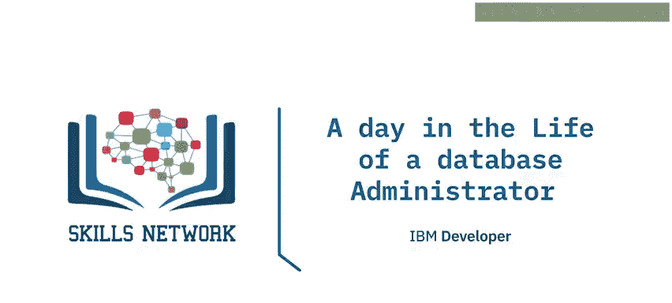

Welcome to a day in the Life of a database administrator。

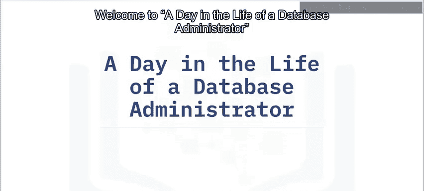

After watching this video， you will be able to describe a typical day for a database administrator and identify common tasks a database administrator performs。

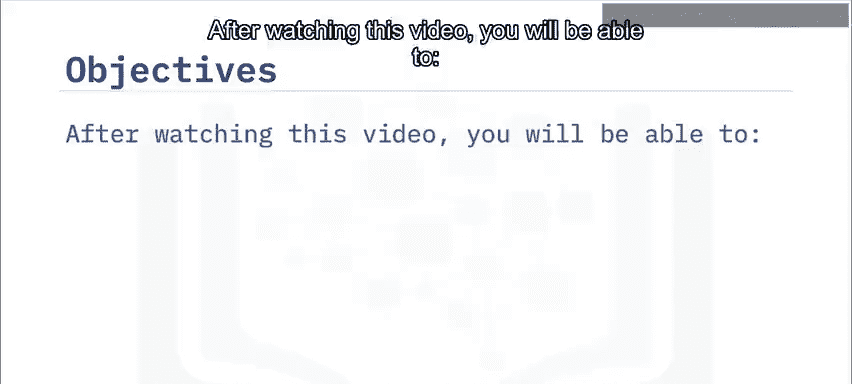

This is Rigel， a database administrator or DBA。

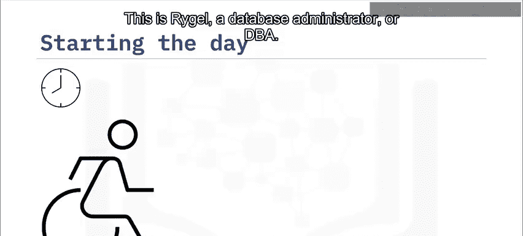

Grabbing a coffee， he starts his day by checking that the databases he is responsible for are all up and running with no errors。

 Roel uses preconfigured dashboards to make sure he gets the most crucial information quickly and easily。

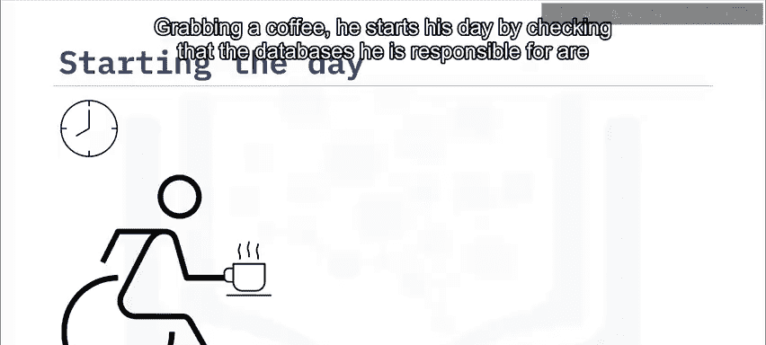

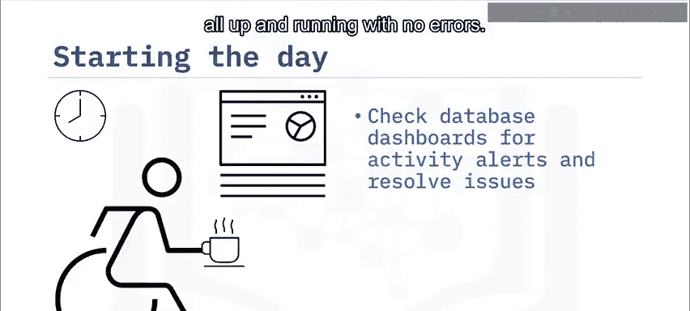

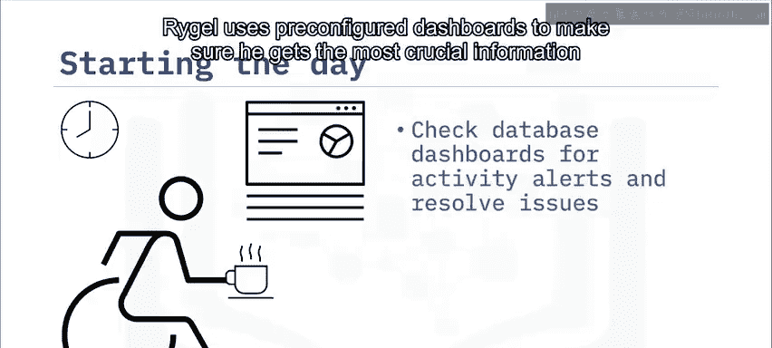

Todays a good day。 There's only one minor alert that Rigel resolves without issue。

 The next activity of the day is to check that the scheduled overnight tasks ran。

 Rigel checks that the scheduled backups have completed and double checks the schedule for tonight。😊。

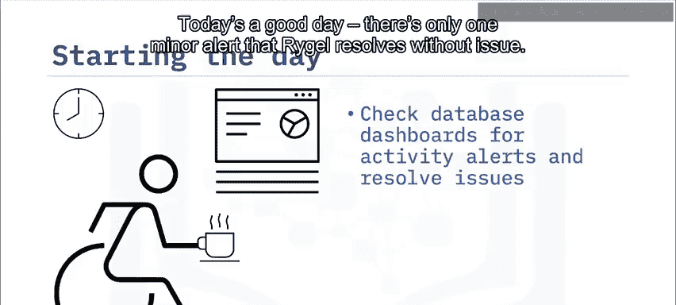

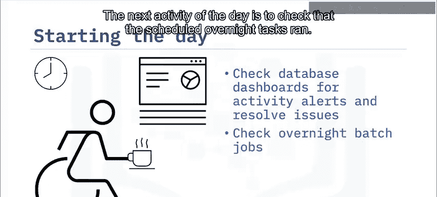

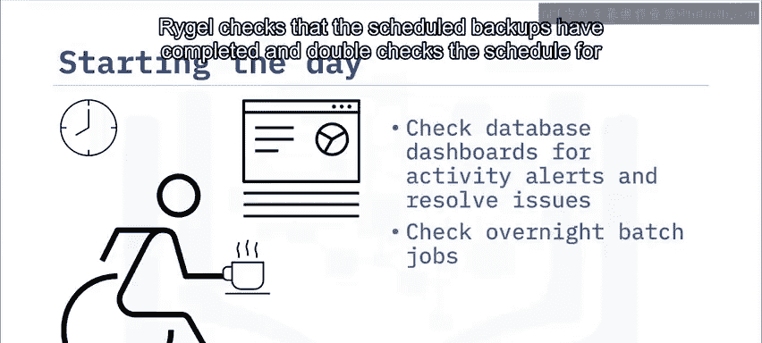

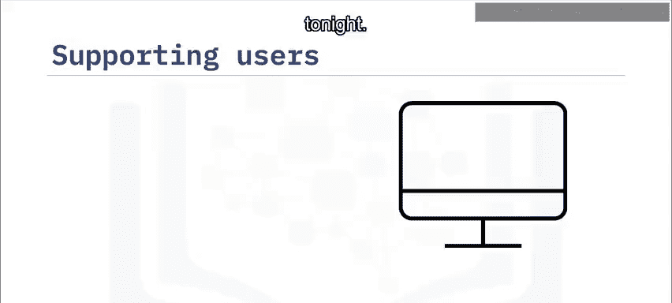

Happy that the dashboards and scheduled backups haven't revealed any problems Rael checks his email he's looking for user requests。

 usually these will arrive as support tickets from the self-service portal or the help desk Today he finds for support tickets and an email from a developer in marketing with whom he has worked before asking for a feature improvement。

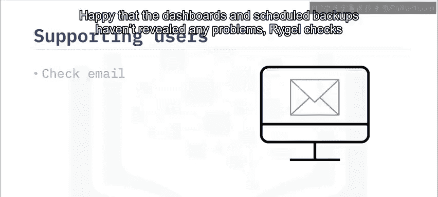

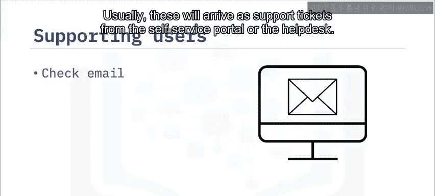

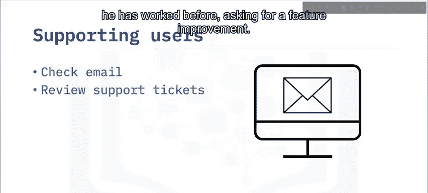

Rigel triages the support tickets and plans how he will respond to them。

 Some users are requesting assistance with slowrunning queries。

 so Rachel reviews query plans and helps with some query optimization。

 The developer in marketing is requesting additional fields for a database that tracks the results of a marketing campaign。

 So Ra discusses the changes required to the database schema with her and asks her to submit the request through the self-service portal to track and document the response。

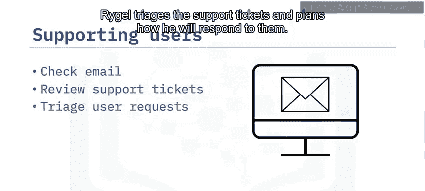

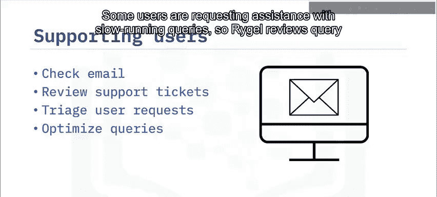

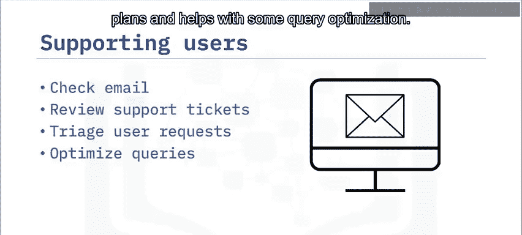

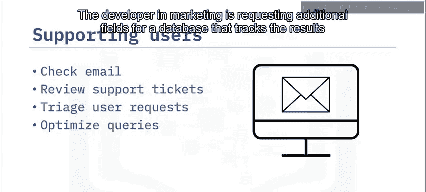

After a quick lunch， Ra attends a planning meeting for a new database Attendeees include developers。

 data engineers and data architects he's working with them on a database designed to ensure high read performance for a business intelligence workload he'll make sure that the appropriate resources are allocated for future userb growth and develop a stress testing scenario to find out the maximum load the database can handle。

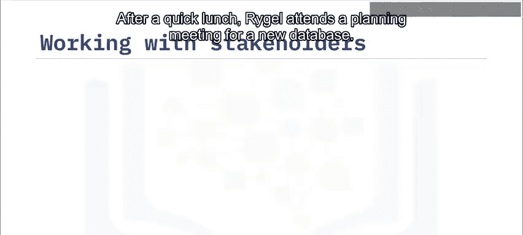

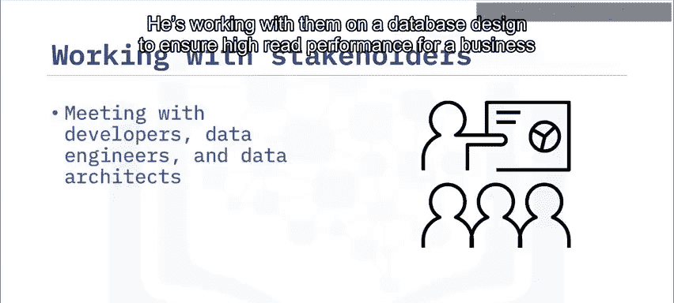

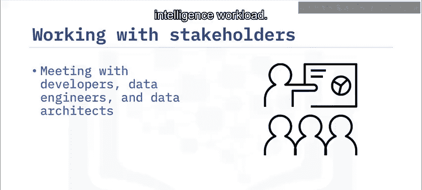

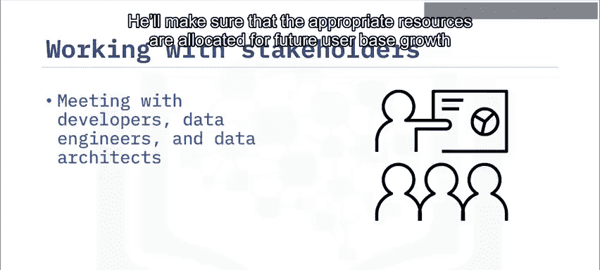

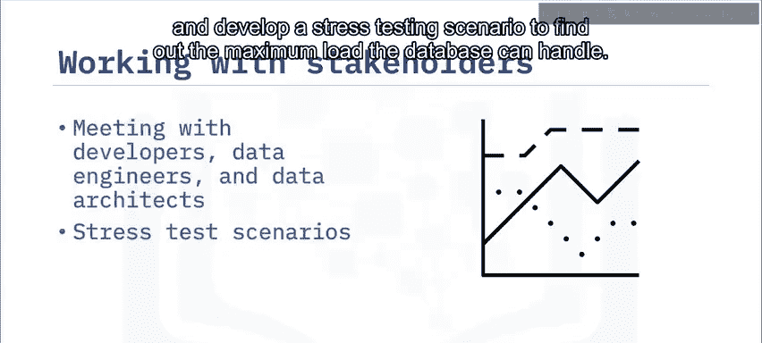

GBAs like Reggel use analytics to determine appropriate server resources like storage space， RA。

 processing power， and log file size。Rachel heads back to his desk to finish up his day。

 he spent some time configuring an alert to be sent to his mobile phone。

 and now he'll know immediately if the alert gets triggered。

As he works， he keeps an eye on his email watching four support tickets。

 a couple arrive and Rigel deals with them swiftly just before packing his bag。

 Rajgel makes some final checks。 he reviews the dashboards and checks he has scheduled the overnight tasks correctly。

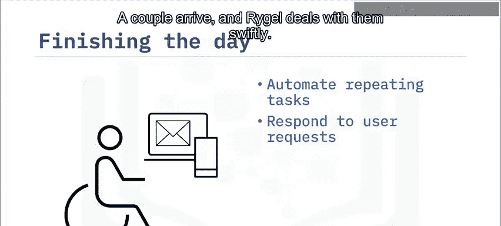

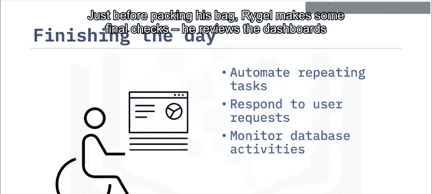

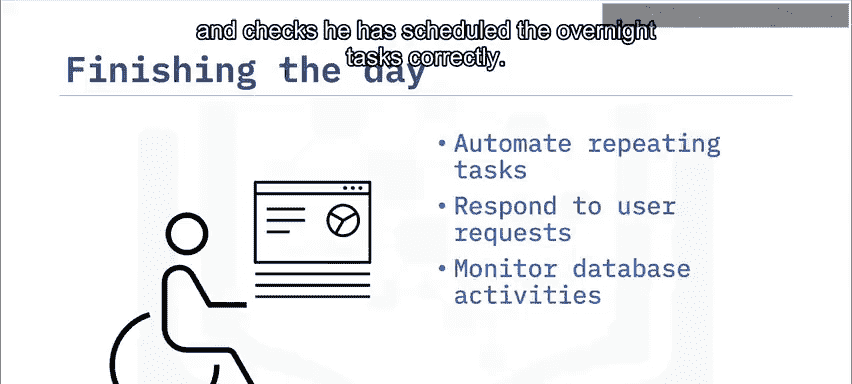

Happy with a good day， Rigel heads home Tomrow is another day。

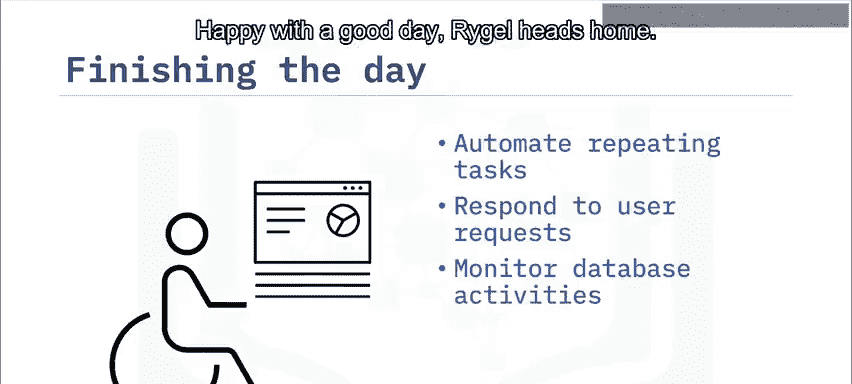

In this video， you learned that a typical day for a database administrator includes checking the state of the database and resolving any issues。

 responding to support tickets， meeting with developers and other stakeholders。

 and monitoring database activity。

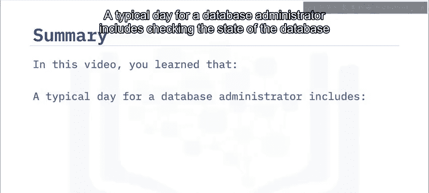

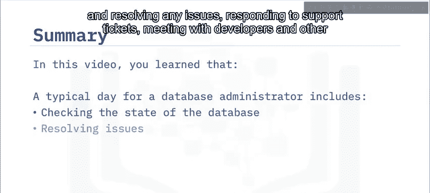

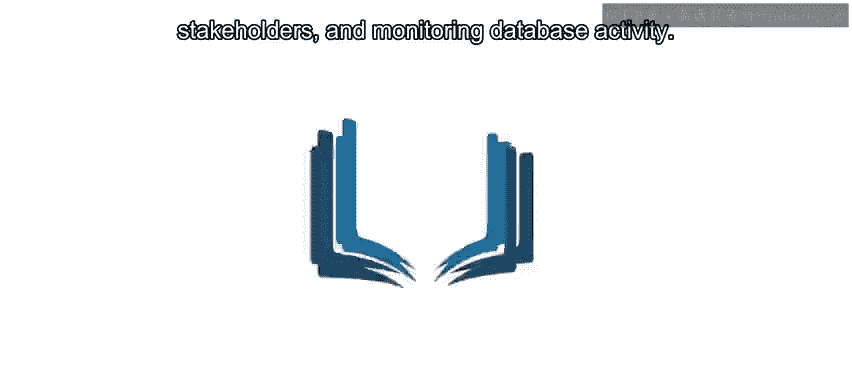