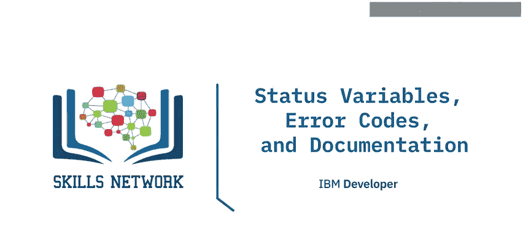
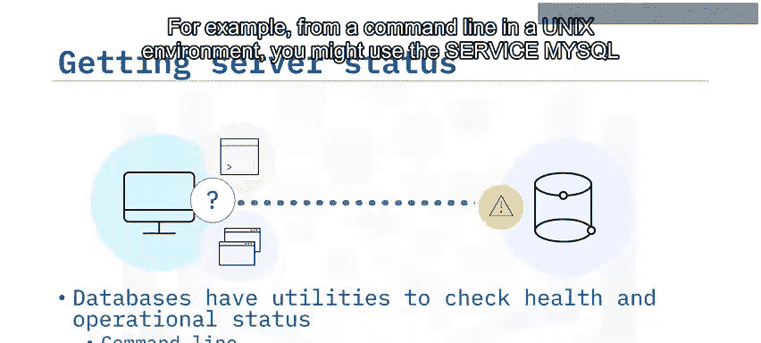
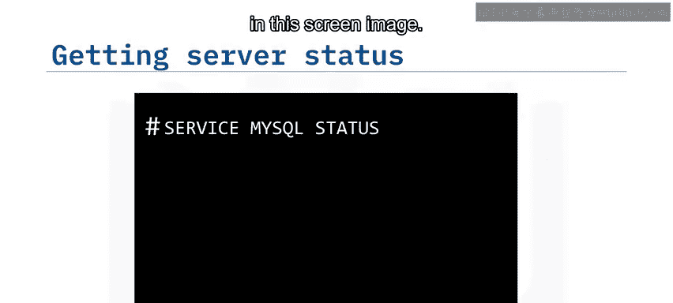
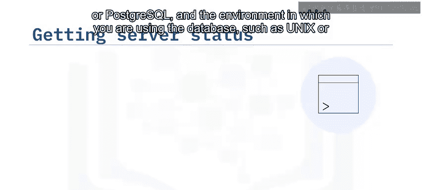
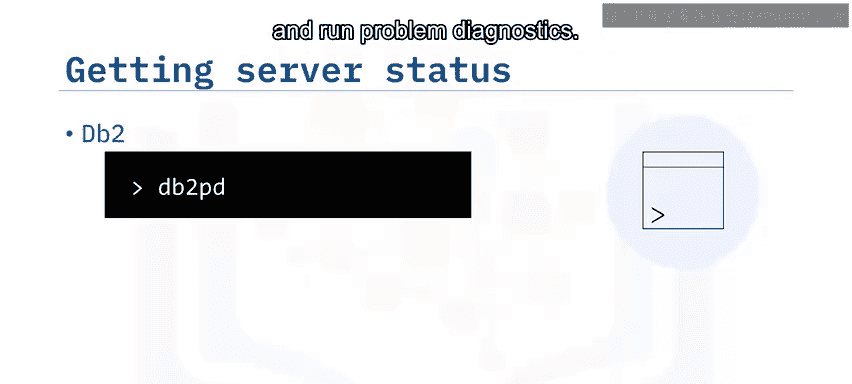
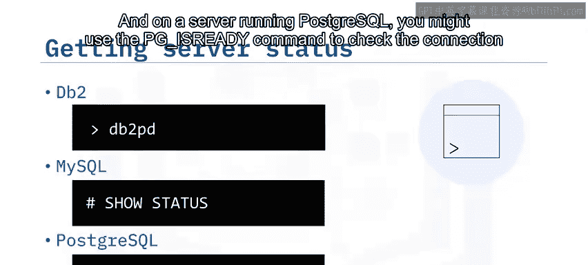
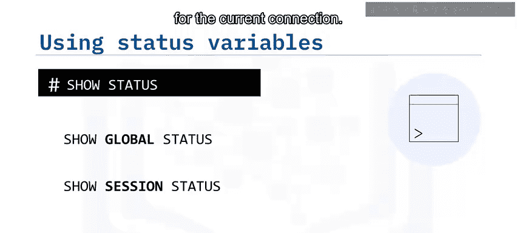
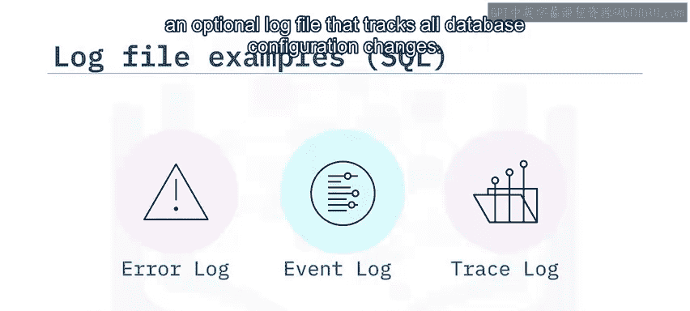
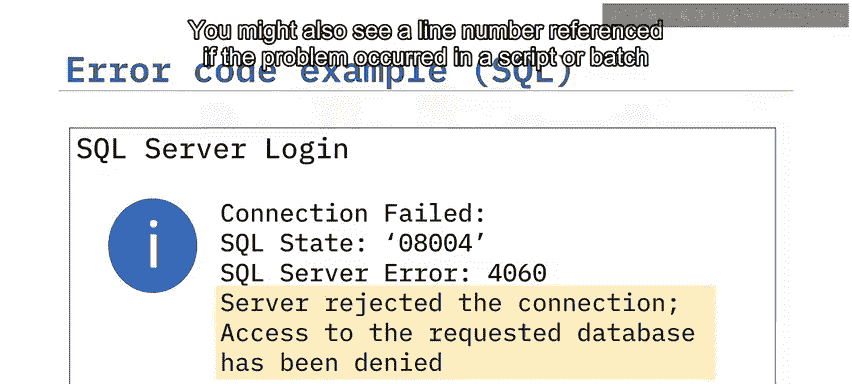
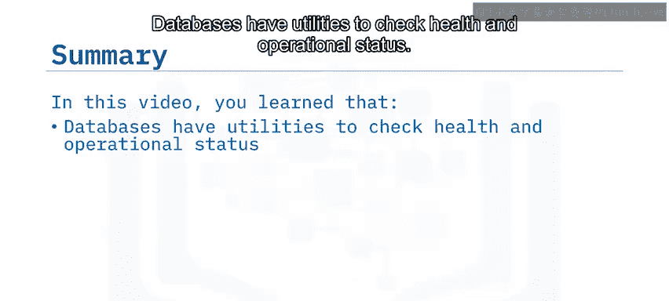

# IBM数据工程专业证书课程7：《关系数据库管理（DBA）》｜relational-database-administration｜ - P21：20_使用状态变量 错误代码和文档.zh_en - GPT中英字幕课程资源 - BV1b14y1q7zT

Welcome to usinging Staus variables， error codes， and documentation。After watching this video。

 you will be able to describe how to obtain server status information。

 explain how to retrieve error codes and information。

 and describe how to use RDBMS documentation for troubleshooting。

When a database is experiencing a problem， you will first want to check the health and status of the database All databases have a variety of commands and utilities that allow you to quickly get a snapshot of a database's health and operational status these utilities are accessed through either typed commands or a graphical interface。

For example， from a command line in a UniX environment。

 you might use the service MySQL Sta command to view My SQL status。

And the output might indicate that the database server status is running or is OK as shown in this screen image。

Available commands and syntax vary with the database you are using， such as DB2， MySQL or PostgresQL。

 and the environment in which you are using the database， such as UniX or Windows For example。

 in DB2， you can run the DB2 PD command to monitor the status of a DB2 instance and run problemble diagnostics for a database using MySQL。

 you might use the show status command to get server status information。

And on a server running PostgresQL， you might use the PG underscore Is Ready Command to check the connection status of a PostgresQL database server。

Databases use many status variables to provide information about their operation。

 and status variables can be either global or session based a global status variable may represent status for some aspect of the server itself。

 for example， aborted underscore connects or the aggregated status over all connections to my SQL For example。

 bytes underscore received and bytes underscore sent If a variable has no global value。

 the session value is displayed a session status variable sometimes called a local status variable represents values for the current connection。

You can also use a like clause and pattern with a show session statement to show status variable information that matches a specific pattern。

 For example， if you used the statement， show status like key percent。

 you would only see the status for variables with key in the name。In addition to commands。

 you may also have a graphical interface with dashboards and reports for monitoring database status and information in real time for example。

 on a Microsoft SQL server running on Windows Ser， you could use activity monitor to get information about SQL server processes and how the processes affect the current instance of SQL server and use system monitoritor to verify status and monitor SQL server performance。

There are many possible log files you can use to help identify when and where an error occurred。

 the most used ones are server and operating system logs which log general server activity。

 connectivity and other aspects of the server or servers running the database and database error logs which log information and error specific to the database being operated such as MySQL or PostgresQL system。

Log files are important tools for discovering when an error occurred in the description of the error。

 for example， in a typical SQL server， some of the most accessed logs are the error log file which is created every time SQL server is started。

 the event log file which shows informational and error events。

 and the default trace log which is an optional log file that tracks all database configuration changes。

Whether you use log files or receive an error message。

 you will most likely need to interpret specific error messages and error codes， for example。

 error messages or logged errors may contain a message and ID number that can be used to troubleshoot the problem。

 they may also contain other information such as the name of the procedure that caused the problem。

 the state of the database when the error occurred and additional descriptive information。

 the severity of the problem or both。You might also see a line number referenced if the problem occurred in a script or batch file。

After checking database status and compiling information。

 your next step is to learn more about the error you are experiencing。

There are many documentation and help sites available on the internet with air code tables that can help you decode and correct errors popularopular resources include for IBMdb2。

 information can be found at ibm。com/cs/db2 for Postgresql information can be found at Postgresql。

org/s for Microsoftsoftsql， information can be found at docs。microsoft。

com/sql and for mysql information can be found at dev。mysql。com/c/。In this video。

 you learned that databases have utilities to check health and operational status The available commands and their syntax vary with the flavor of the database you are using databases use many status variables to provide information about their operation and status variables can be either global or session based databases may also have a graphical user interface with dashboards and reports for monitoring database status and information in real time There are several log files you can use to help identify when and where and error occurred。

 and there are many documentation and help sites available on the internet with error code tables that can help you decode and correct errors。

。