# IBM数据工程专业证书课程7：《关系数据库管理（DBA）》｜relational-database-administration｜ - P4：3_系统对象和数据库配置.zh_en - GPT中英字幕课程资源 - BV1b14y1q7zT

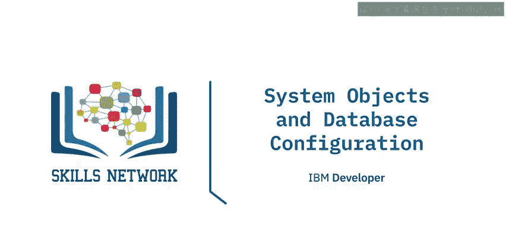

Welcome to System Object and database Con After watching this video。

 you will be able to describe the purpose of system objects。

 recognize different types of system objects， describe how to use configuration files。

 explain common configuration settings， and describe how to configure on premises and cloud databases。

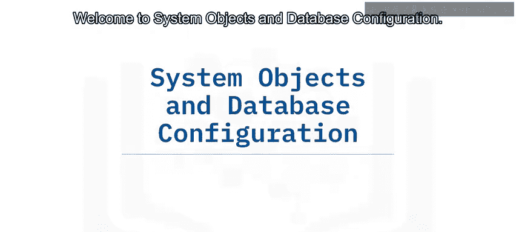

Whether trying to find out if new indexes are helpful。

 the transaction count on a database at a specific time or who's connected to the database at any given time。

 data that allows you to know how your databases are performing is crucial。

 RDBMSs store information about their databases known as metadata in special databases。

 schemas or catalogs， they store specific types of information about the database。

 such as the name of the database or table， the data type of a column， or access privileges。

 known as metadata。

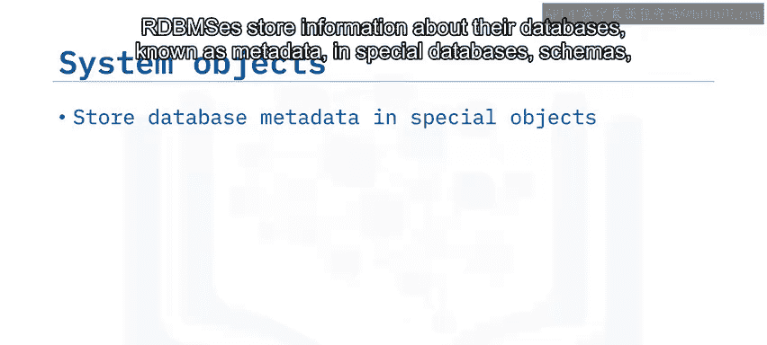

Other terms used for this information store are data Dictionary and System catalog。

 the RDBMS controls and updates the system objects。

 but you can query the metadata tables to discover information about the objects in the database。

Different RDBMSs use different names for their metadata stores DB2 uses the catalog and the directory The catalog consists of tables of data about everything defined to the DB2 system when a user creates alters or drops any object DB2 inserts updates or deletes rows of the catalog that describe that object and how it relates to other objects the directory contains the DB2 internal control data used by DB2 during its normal operation among other things the directory contains database descriptors。

 access paths for applications and recovery and utility status information。

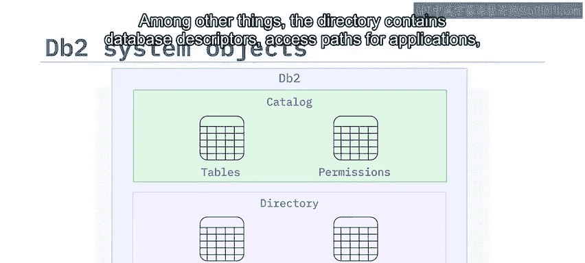

MySQL uses a system schema to store database metadata For example。

 each new MySQL instance has four system databases， information underscore schema， MySQL。

 performance underscore Schema and cis each system database contains several read only tables。

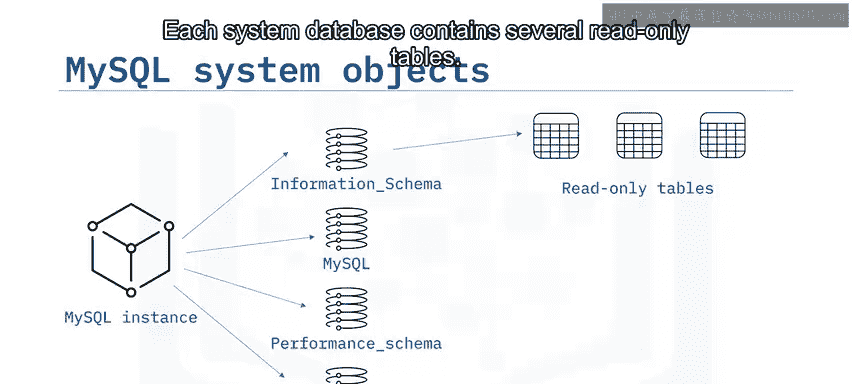

PostgresQL uses the system catalog， which is a schema with tables and views that contain metadata about all the other objects in the database and more With it。

 you can discover when various operations happen， how tables or indexes are accessed。

 and whether the database system is reading information from memory or needing to fetch data from disk。

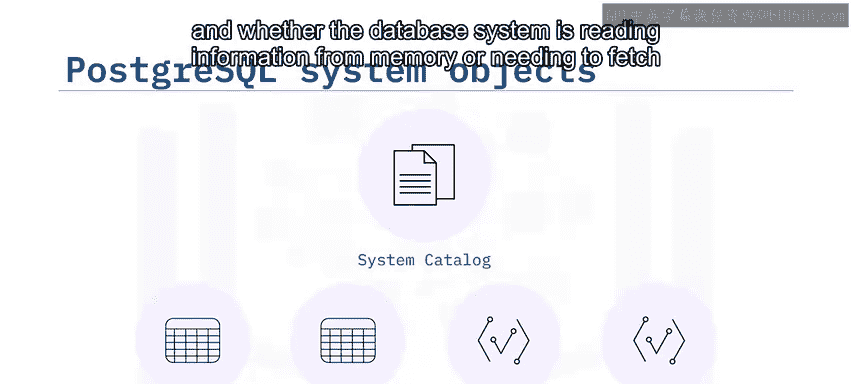

During any database installation， you supply parameters like the location of the data directory。

 the port number that the service listens on for connections， memory allocation， and much more。

 you can accept the default options or supply custom values to suit the environment。

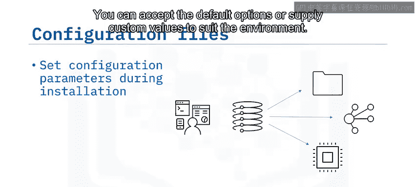

The database installation process saves this information into files known as configuration or initialization files the database uses the information in these files to set parameters as it starts up。

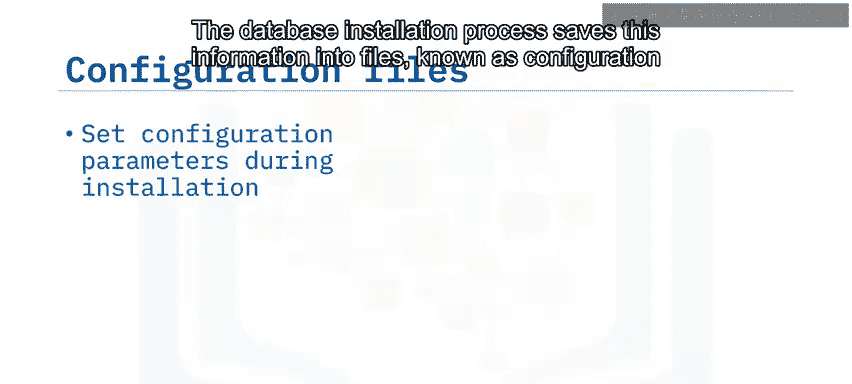

Again， different RDBMSs use different files， file locations and settings， still。

 they all serve the same purpose to provide the initial configuration information for the database as it starts up and operates。

Configuration information can include general settings like the location of data and log files and the port the server listens on for requests。

 or configuration information can be more focused like settings that affect performance including memory allocation a connection timeout and the maximum packet size to store configuration information Db2 uses the Sql Db file MySqL uses my any files on Windowsbased systems and my。

cnf files on Linuxbased systems and PostgresqL uses the Postgresql。com file。

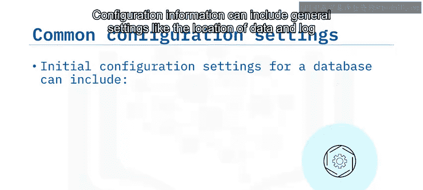

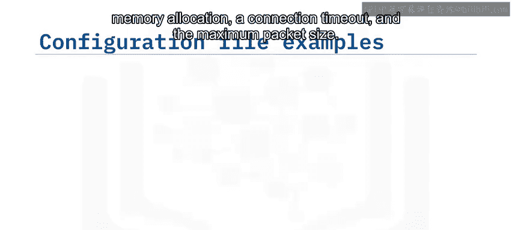

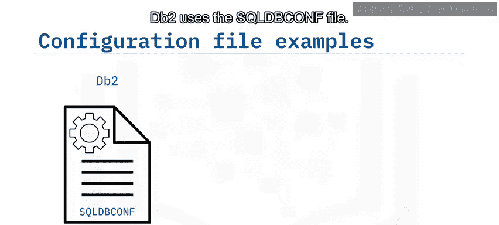

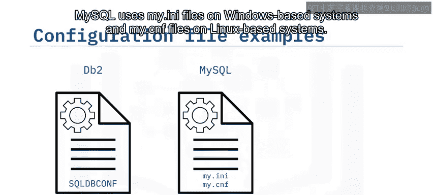

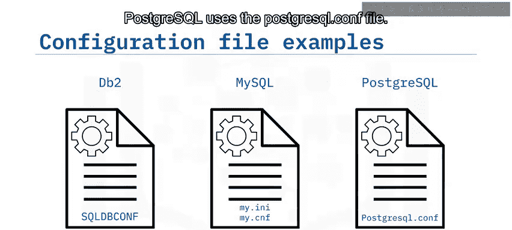

Now suppose you want to modify these parameters after the database has started in and on premises RDBMS。

 you stop the database service， modify the file， and then restart the service causing the database to read the modified settings。

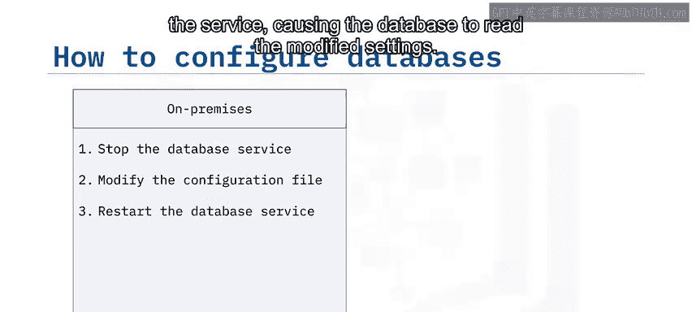

In a cloud based RDBMS， you select configuration options as you create the database One advantage of cloud based systems is that you can scale many configuration options such as storage size and compute power through a graphical interface as the service is running you don't have to edit configuration files。

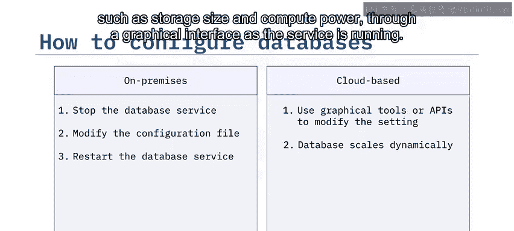

In this video you learned that system objects stored database metadata you can query these objects to get information about the configuration and performance of your database  different RDBMSss use different names for their system objects most use the terms system schema。

 system tables， catalog or directory configuration files store the information that the database needs as it initializes。

 and again， different RDBMSss use different names for the configuration files like SQL DBconf my。

in or Postgresql。com。

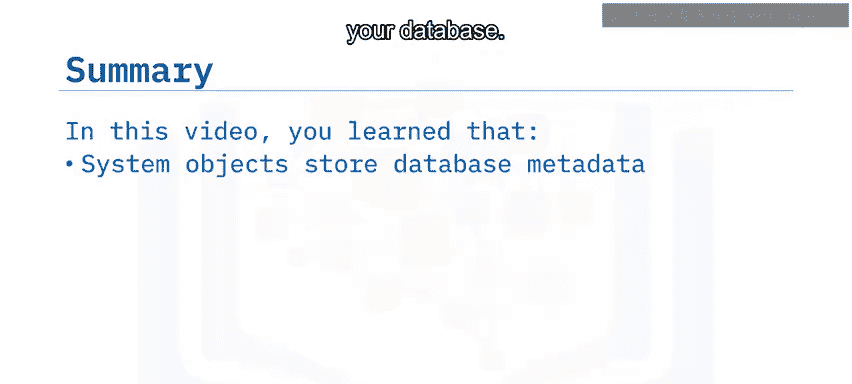

In an on premises RDBMS， you edit the configuration file to change a setting。

 and in a cloud based RDBMS， you can scale settings dynamically。

