# IBM数据工程专业证书课程7：《关系数据库管理（DBA）》｜relational-database-administration｜ - P6：5_备份和恢复简介.zh_en - GPT中英字幕课程资源 - BV1b14y1q7zT

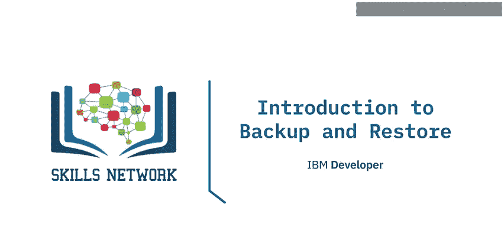

Welcome to Introuction to backup and Restore After watching this video。

 you will be able to describe common backup and restore scenarios。

 explain the difference between physical and logical backup。

 list the objects that you can backup and restore， and explain what you need to consider when backing up databases and their objects。

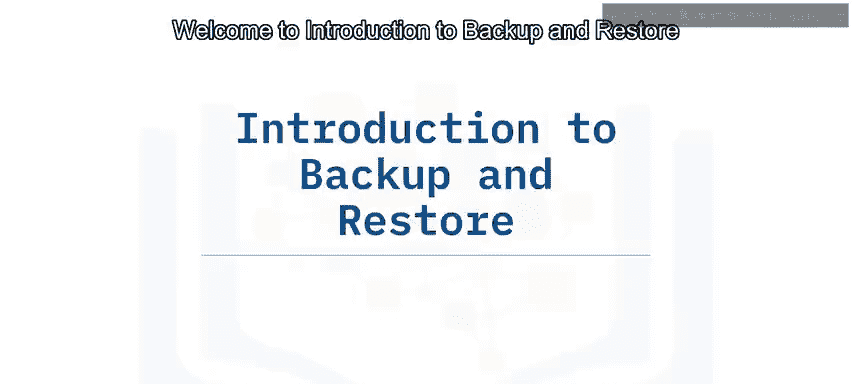

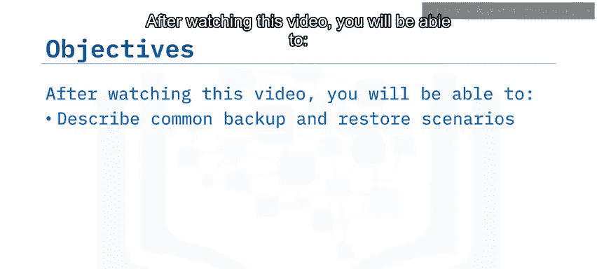

Backup and restorestore is a common phrase in database conversations and often used to refer to the process of backing up data for protection purposes。

 restoring it after data loss from an unplanned shutdown。

 accidental deletion or data corruption However， there are other scenarios when you might want to backup or restore your databases or objects within them As a data engineer。

 you are likely to perform data backup and restore operations to transfer data from one database to another This may be to facilitate a change of RDBMS to share data with or load data from a business partner or to create a copy of the data for use in another location or system such as development or test When backing up databases。

 you can perform either logical or physical backups a logical backup creates a file containing DDL such as create table and DL commands such as insert that recreate the。

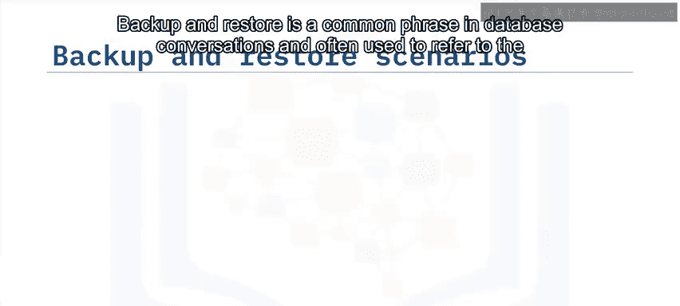

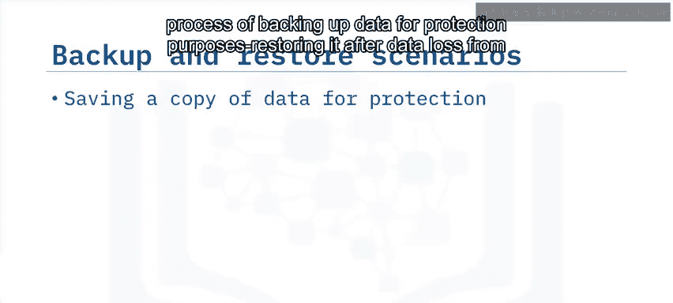

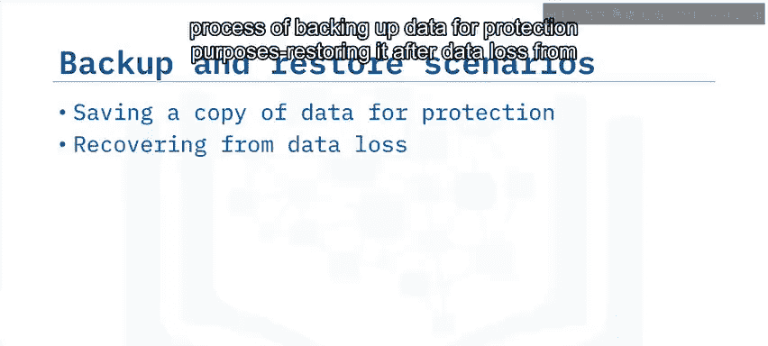

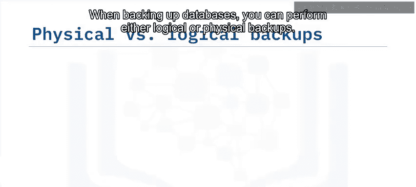

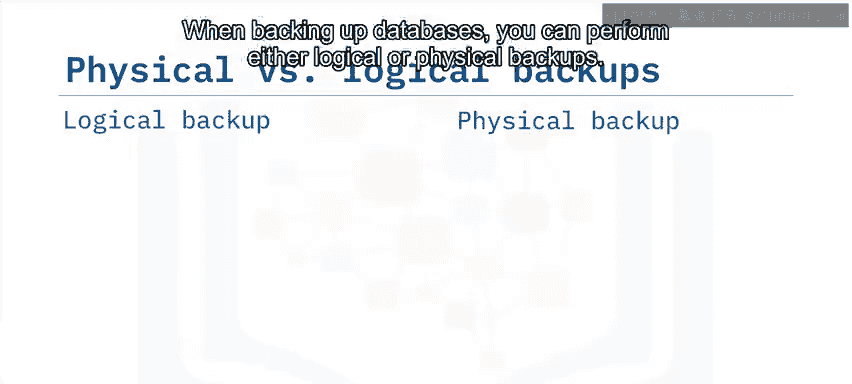

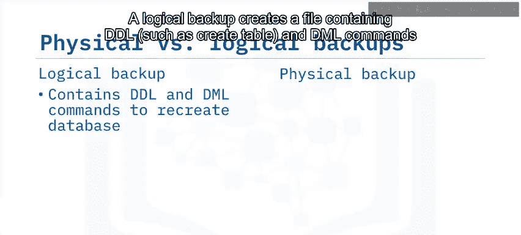

Objects and data in the database As such， you can use this file to recreate the database on the same or another system General when you perform a logical backup and restore。

 you reclaim any wasted space from the original database because the restore process creates a clean version of the tables Gene logical backups can take a long time for large databases and may impact the performance of other queries that are concurrently running logical backups enable you to backup granular objects for example。

 you can backup an individual database or table You typically use backup， restore， import， export。

 dump， and load utilities to perform logical backups。

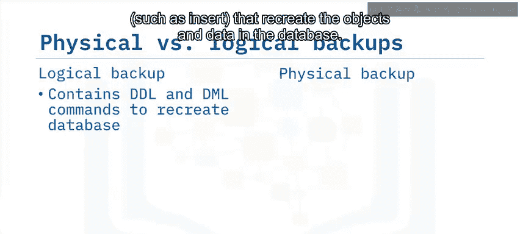

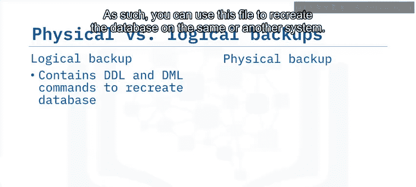

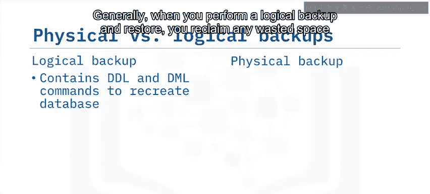

A physical or raw backup creates a copy of all the physical storage files and directories that belong to a table。

 database or other objects， including the data files configuration files and log files to aid point in time recovery physical backups are often smaller and quicker than logical backups they are useful for large or important databases that require fast recovery times They are similar to backing up any other types of files on your physical system however。

 this means you won't be able to easily recover individual tables or database objects if a physical file contains data from more than one object because the backup file is specific to the RDBMS you can only restore it to a similar system This approach of taking storage level snapshots is common for databases utilizing specialized storage systems and on cloud you can choose exactly which parts of a database you want to backup up。

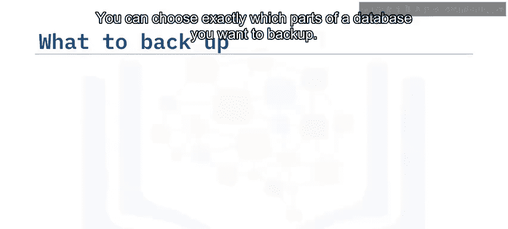

On the RDBMS you are using and type of backup you are performing you can backup as a whole database。

 the contents of a schema， one or more tables from a database。

 a subset of data from one or more tables in a database or a collection of other objects in the database and because you can also choose the regularity and type of backup you perform。

 you can customize your backup policies to exactly meet your needs when using backup and restore。

 you should remember to check that your backup file or files are valid and that you can use your restore plan to restore them successfully it is essential to check these when using backup and restore as part of your disaster recovery plans as an invalid backup or an inability to restore can result in data loss you should also ensure that you secure the transfer and storage location of your backup files at the same level that you secure the data in your database when performing backups some R。

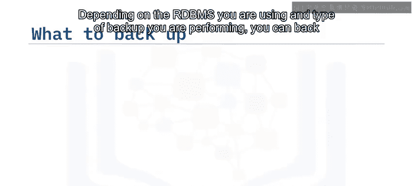

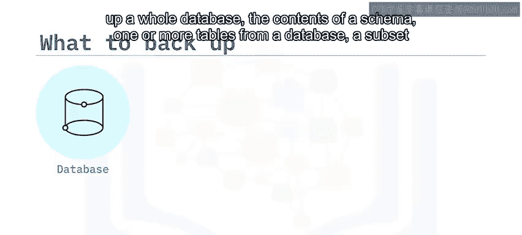

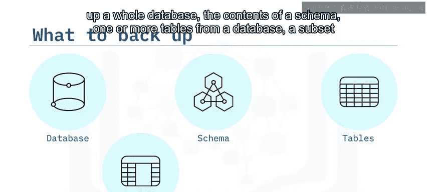

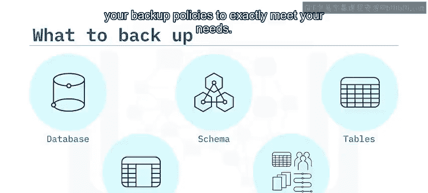

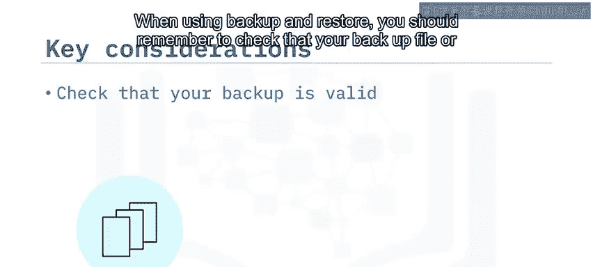

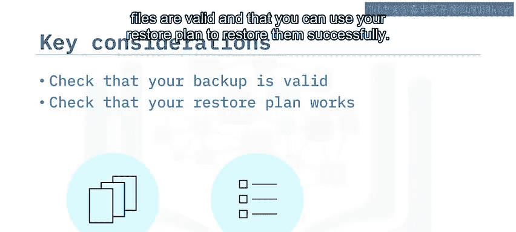

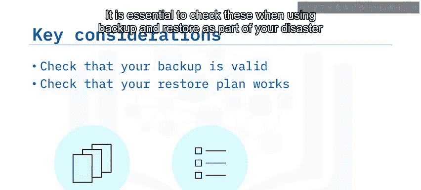

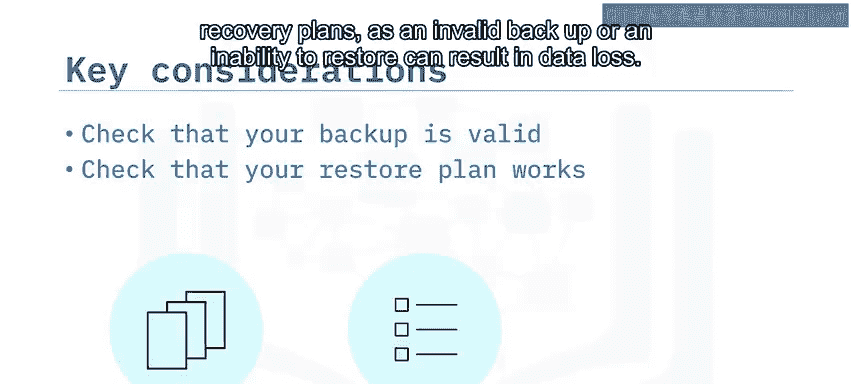

MS support additional options that you can use you may be able to configure a compression level for the backup files Coming the files will reduce the output file size。

 which can be useful for large databases or if you are packing up to a remote location However it comes at a cost of time taken to perform the backup and the restore procedures you may also be able to encrypt the backup files to reduce the risk of any data being compromised but again this will increase the time taken for the backup and restore In this video you learned that you can use backup and restore for data recovery and other purposes physical backups create a copy of the raw database storage files and directories whereas logical backups extract the data from a database and save it in a special format you can backup hold databases or objects within them you should always check that your backup is safe and usable and that your restore plan works and。

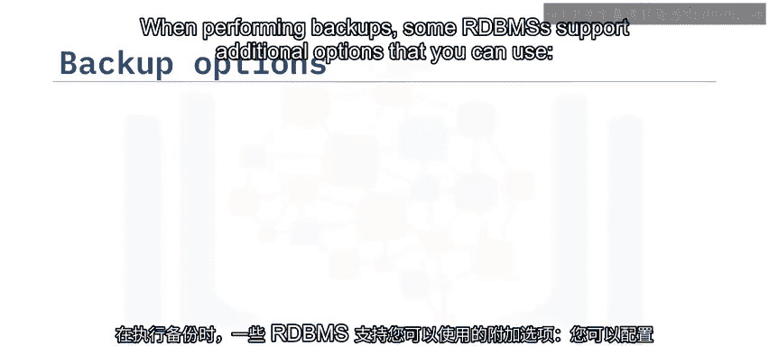

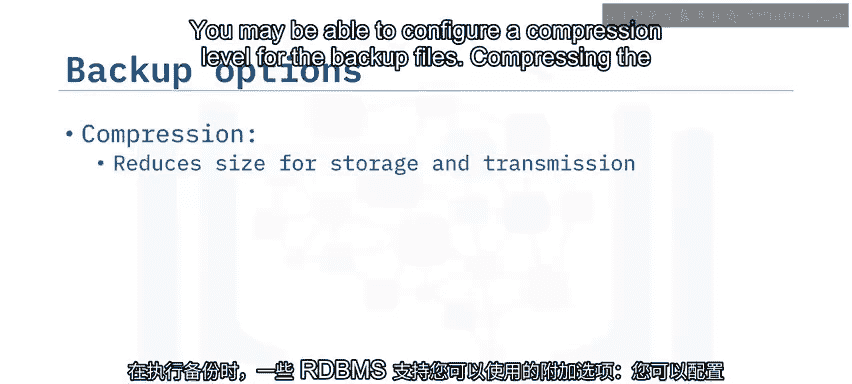

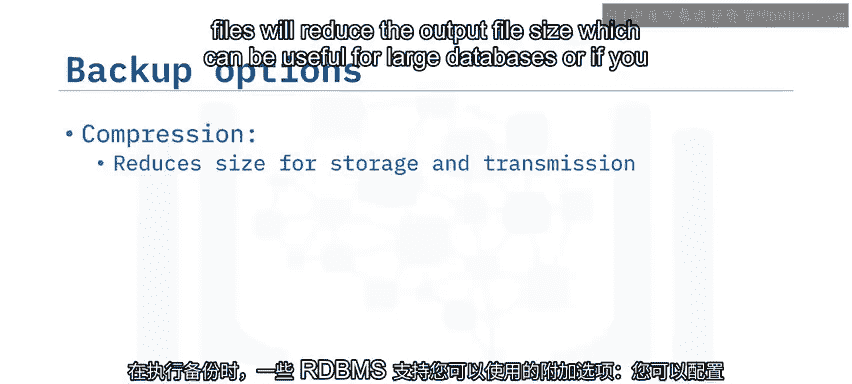

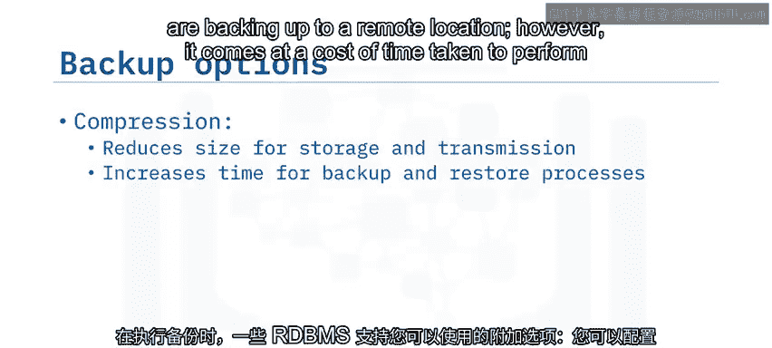

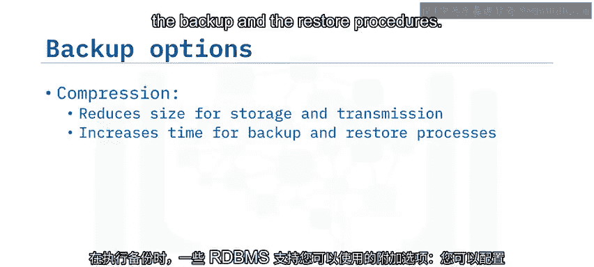

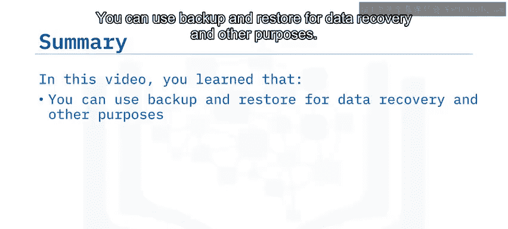

You can use backup options to compress or encrypt your files。

