# IBM数据工程专业证书课程7：《关系数据库管理（DBA）》｜relational-database-administration｜ - P7：6_备份类型.zh_en - GPT中英字幕课程资源 - BV1b14y1q7zT

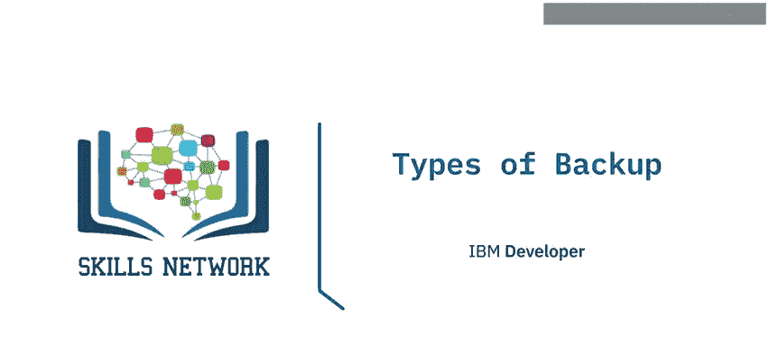

Welcome to T of backup After watching this video， you will be able to identify common types of database backup and describe the advantages and disadvantages of different types of database backup。

 there are many different types of backup that you can use to meet your backup and restore needs。

 The choice of which are available to you depends on the database system that you are using。

 The commonly used types include full backup point in time backup differential backup and incremental backup。

 a full backup is a complete copy of all the data in the object or objects that you are backing up Per full backup simplifies the restore and recovery processes。

 because you just need to locate the latest full backup and restore that one file。 However。

 as the size of your database increases， the time bandwidth and storage for the backup file also increases。

 If you decide to keep previous copies of the backup for safety。

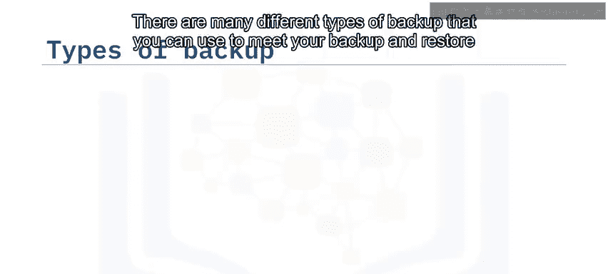

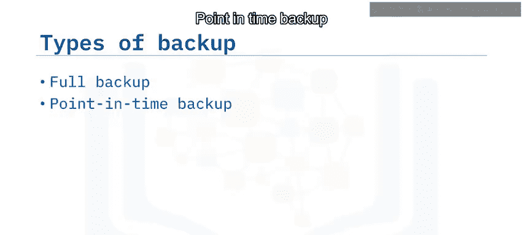

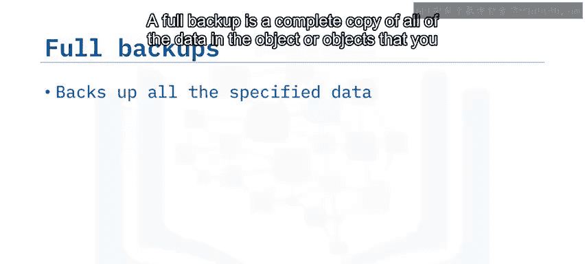

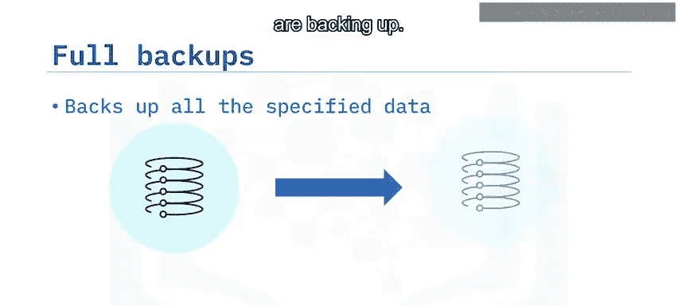

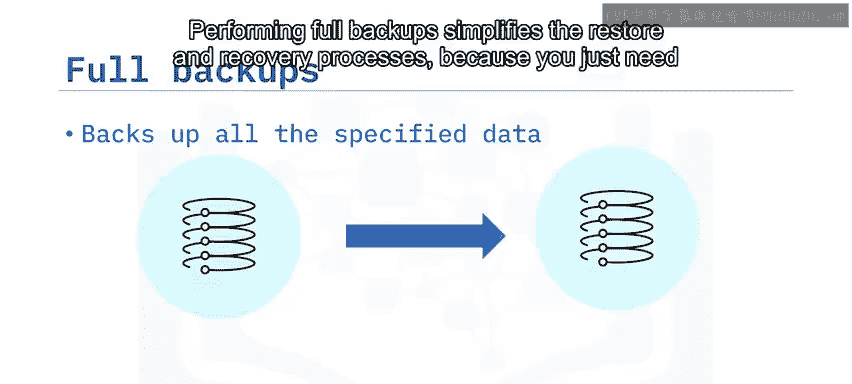

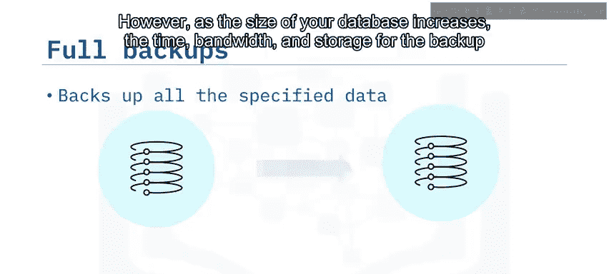

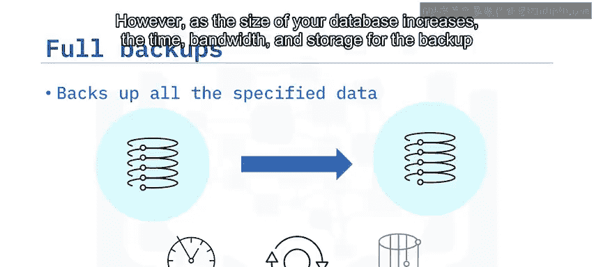

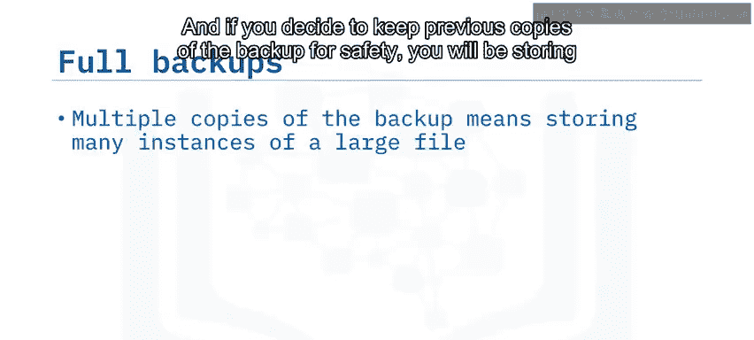

You will be storing many instances of a large file。 However， if you only want one copy。

 you must accept the risk that if the backup file is corrupt， you cannot restore your data。

 Also consider that if only a subset of your data is regularly changing。

 you could be needlessly backing up the same data many times Storing a complete copy of your data outside of the RDBMS means that you must ensure it is adequately secured and that it cannot be accessed by anauthorized users when you restore a full backup。

 you restore the data to the state that it was in when the backup was taken。

 but the database may have processed many transactions since that time。

 which should ideally be restored too one way around this issue is to enable logging of each transaction on your database and then you can use the information in the log file to reapply the transactions to the restored database The process of reapplying transactions。

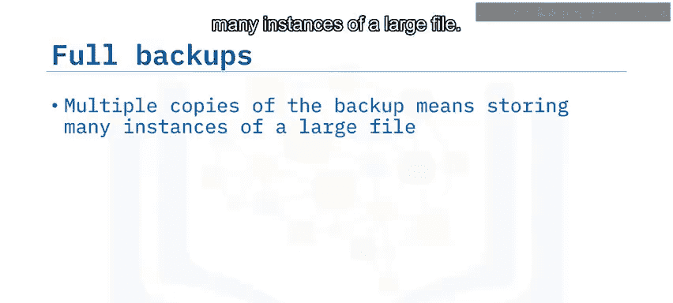

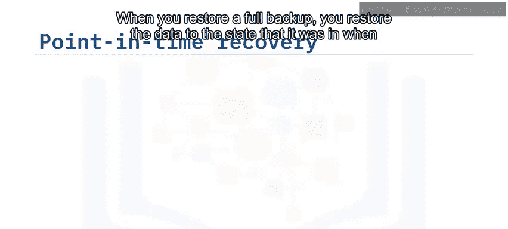

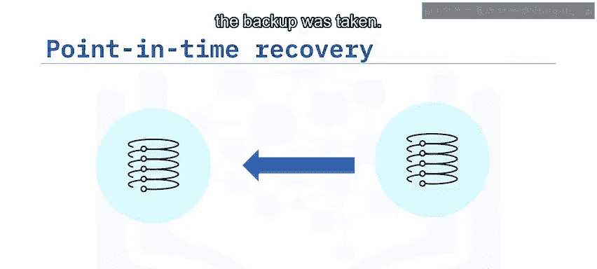

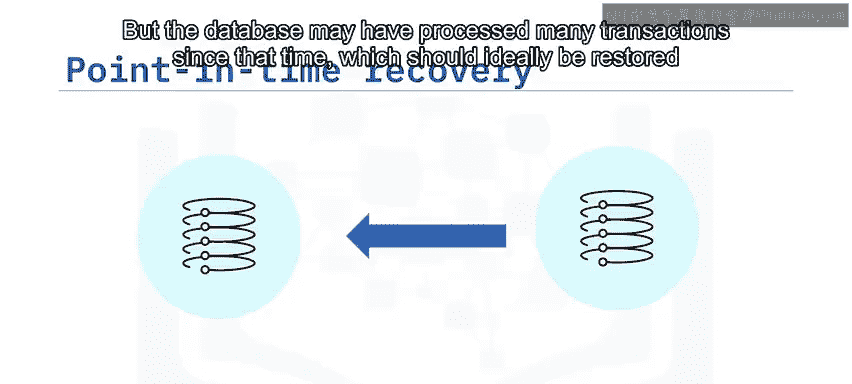

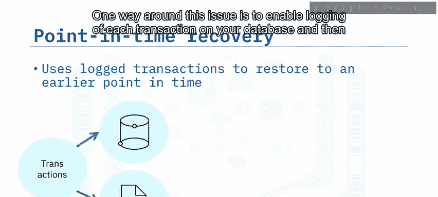

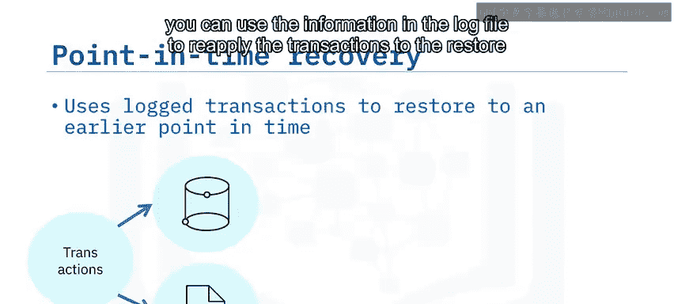

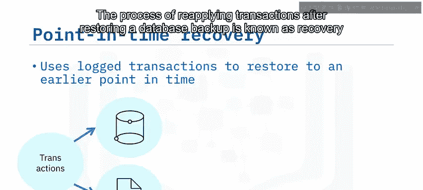

After restoring a database backup is known as recovery。

 it enables you to recover the data to a state that it was in at a particular time。

 hence the name point in time recovery For example。

 if you know that a DL statement run at 1105am erroneously deleted some data。

 you can restore the latest full backup， then reapply the transactions up to that point in time。

 minimizing the loss of data changes that occur between the last full backup and the moment that the wrong data was deleted Different database systems use different terminology for the log containing the transaction information For example。

 my SQL calls it the binary log Postgres calls it the right a ahead log and DB2 on cloud calls it the transaction log because full backups can require a lot of time bandwidth and storage。

 One alternative is to use them in conjunction with differential backups a differential。

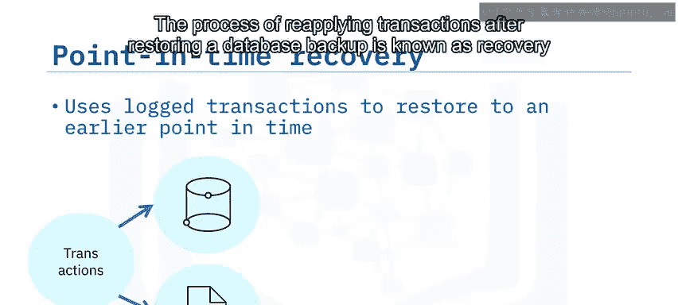

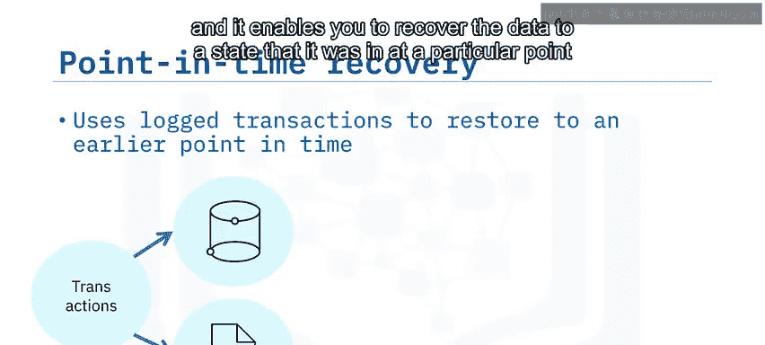

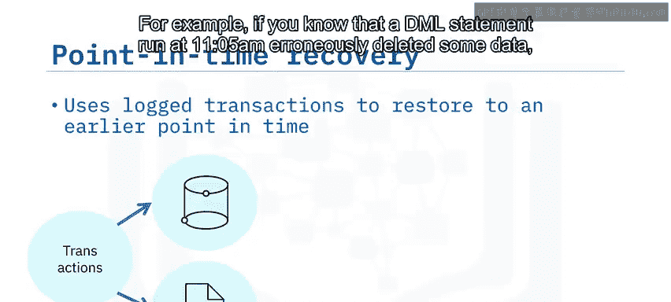

Backup consists of a copy of any data that is changed since the last full backup was taken。

 This makes the differential backup file much smaller than the full backup file。

 reducing the time bandwidth and storage needs for the backup while still enabling you to restore a recent copy of the data。

 For example， you could perform a full backup once a week on a Sunday。

 then run a differential backup every day of the week。

 Each differential backup contains all the changes since the full backup was taken on the Sunday。

 So if you need to restore the database on a Tuesday。 you first restore the full backup from Sunday。

 then restore the differential backup from Tuesday。

 you do not need to restore Monday's differential backup because all the changes in that file are also included in the differential backup from Tuesday。

 restoring data from full and differential backup will take longer than simply restoring a full backup。

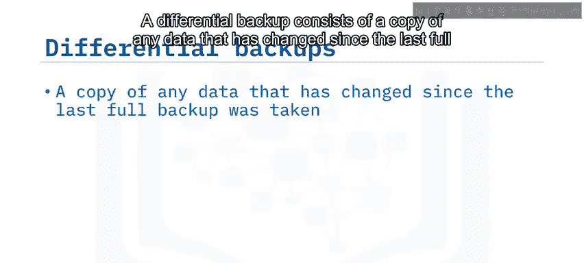

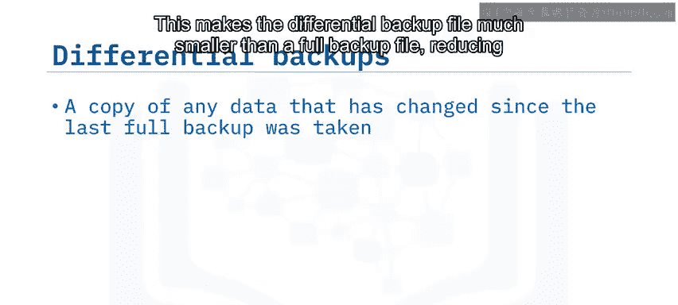

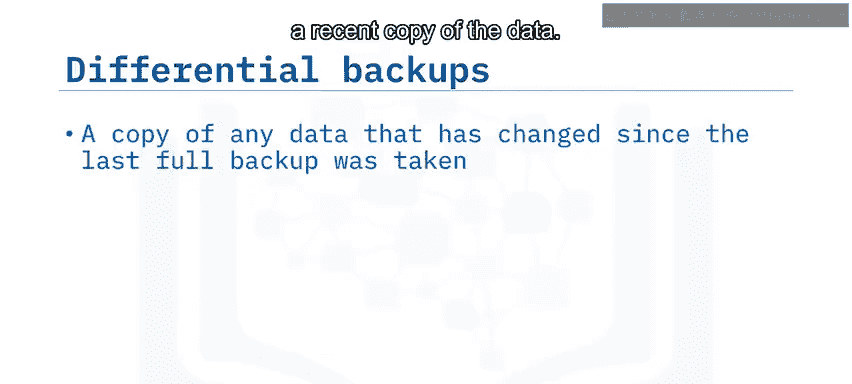

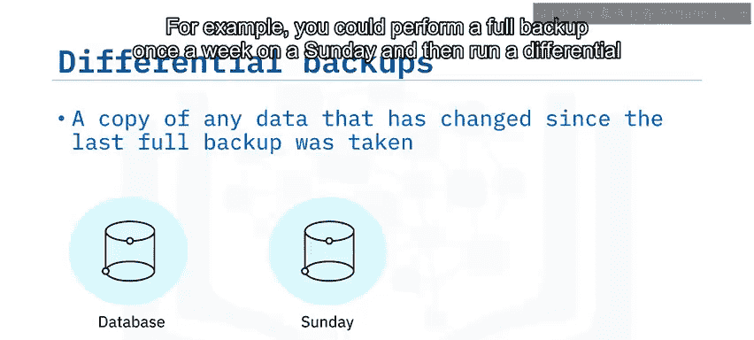

you restore data less frequently than you back it up， you are likely to save time overall。

 I backups are similar to differential backups， but they can only contain data that has changed since the last backup of any type was taken。

 for example， you could perform a full backup once a week on a Sunday。

 then run an incremental backup every day of the week。

 Each incremental backup only contains changes since the backup was taken on the previous day。

 So if you need to restore the database on a Tuesday。 you first restore the full backup from Sunday。

 then the incremental backup from Monday， and then the incremental backup from Tuesday。

 restoring data from full and incremental backups will take longer than simply restoring a full backup or restoring differential backups。

 but the time taken to perform the incremental backups is likely to be less than needed for a differential backup。

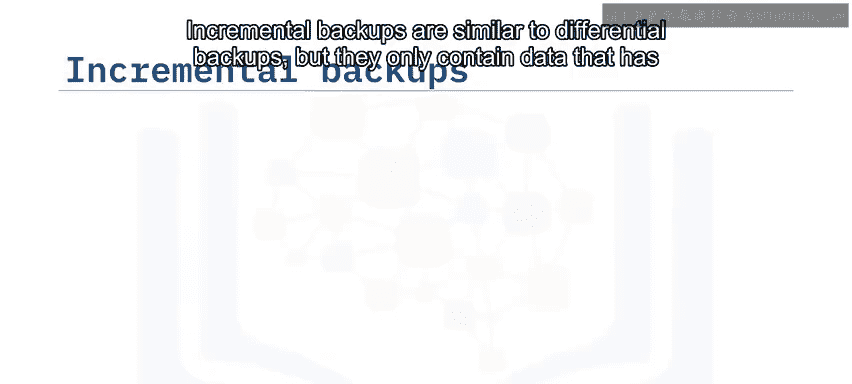

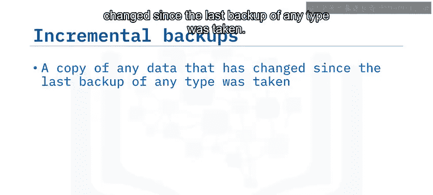

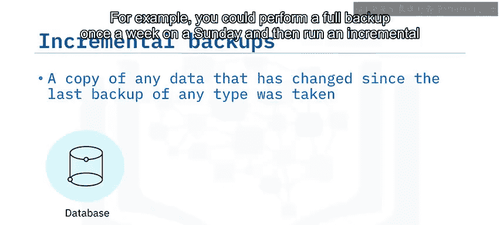

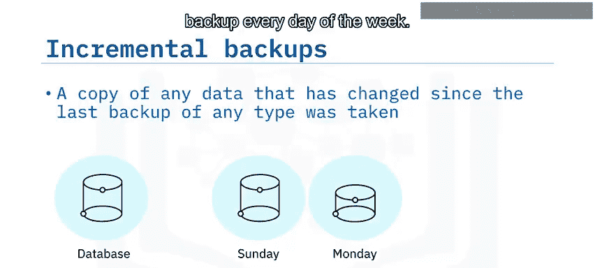

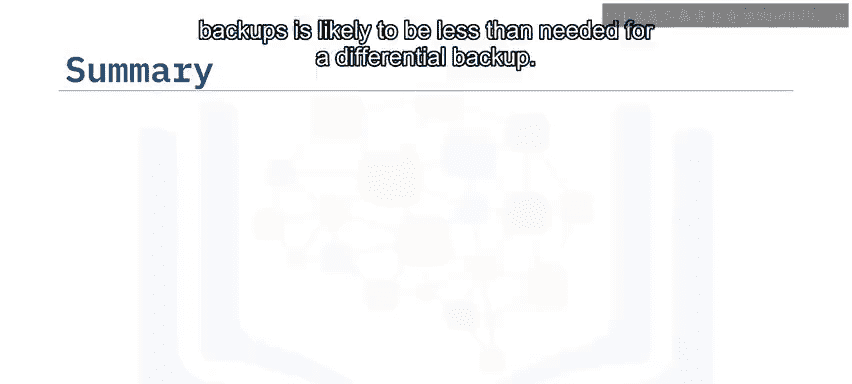

In this video you learned that full backups are simple to create and restore but can be slow to run and result in large files Point in time recovery provides a more granular recovery model than just using full database backups。

 differential backups are quicker to run than full backups， but the restore process can take longer。

 and incremental backups are even quicker to run， but the restore process can take longer still。

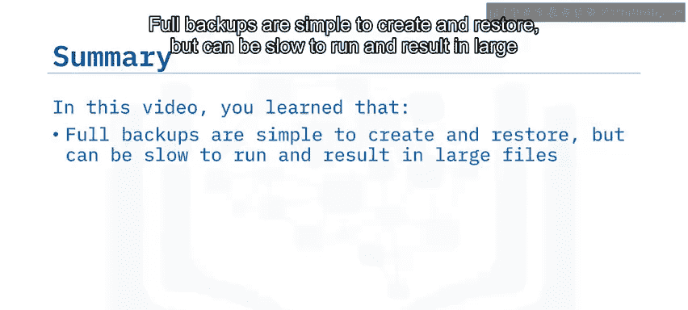

