# IBM数据工程专业证书课程8：《使用Shell、Airflow和Kafka的ETL和数据管道课程（IBM）》｜etl-and-data-pipelines - P10：9_关键的数据流水线过程.zh_en - GPT中英字幕课程资源 - BV1Q94y1r7YG

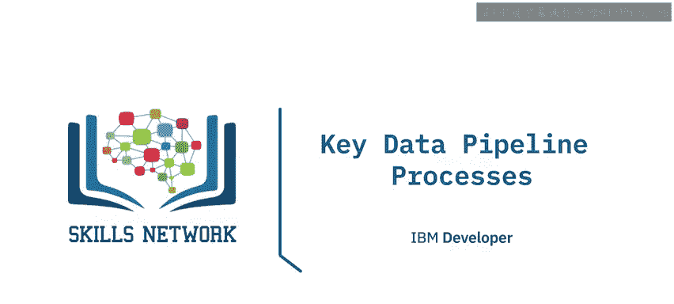

Welcome to key Data Pi processes。

After watching this video， you will be able to list key data pipeline processes。

 describe data pipeline monitoring considerations， and describe data pipeline solutions for mitigating dataflow bottlenecks。

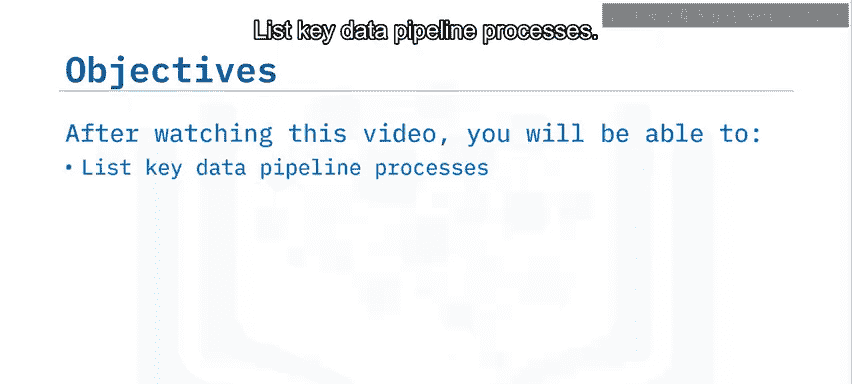

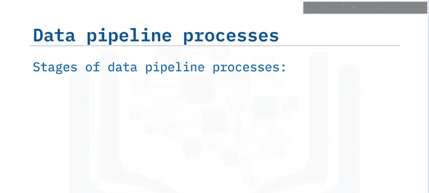

Data pipeline processes typically have the following stages in common。

 extraction of data from one or more data sources， ingestion of the extracted data into the pipeline。

 optional data transformation stages within the pipeline and final loading of the data into a destination facility。

 a mechanism for scheduling or triggering jobs to run， monitoring the entire workflow。

 and maintenance and optimization as required to keep the pipeline up and running smoothly。

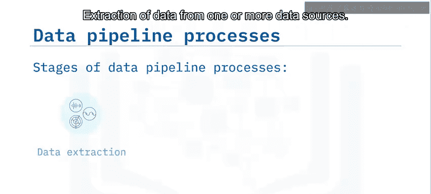

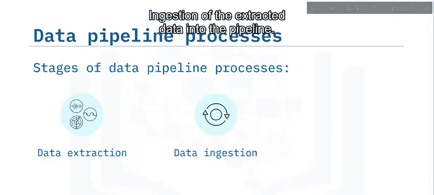

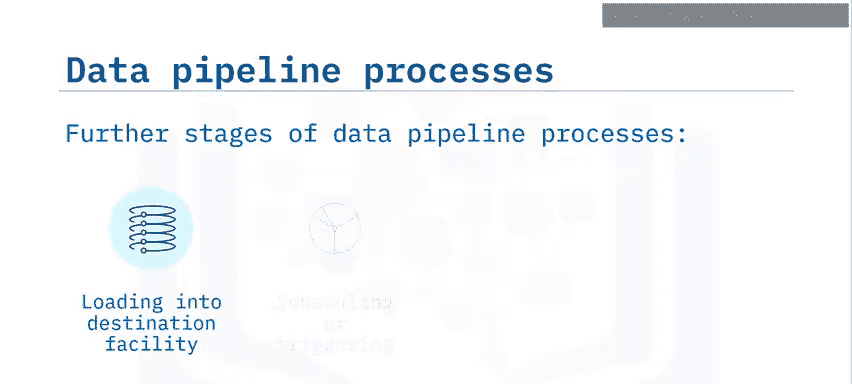

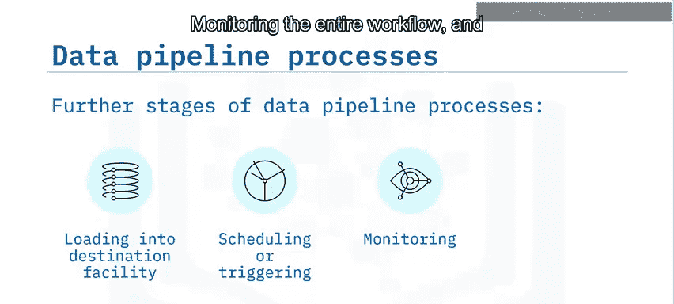

The data pipeline needs to be monitored once it is in production to ensure data integrity。

 some key monitoring considerations include latency or the time it takes for data packets to flow through the pipeline。

 throughput demand， the volume of data passing through the pipeline over time。

 errors and failures caused by factors such as network overloading and failures at the source or destination systems。

 utilization rate or how fully the pipeline's resources are being utilized， which affects cost。

 and lastly， the pipeline should also have a system for logging events and alerting administrators when failures occur。

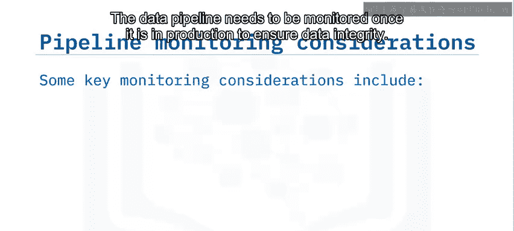

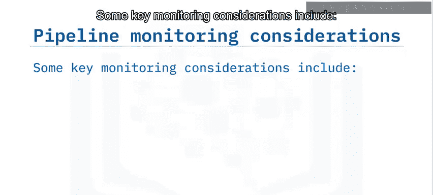

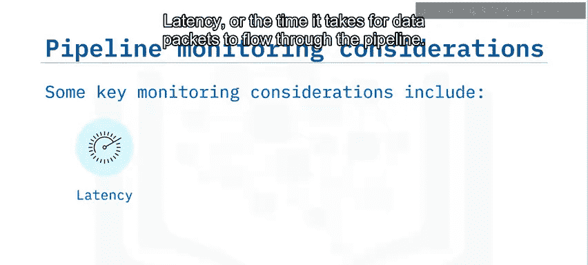

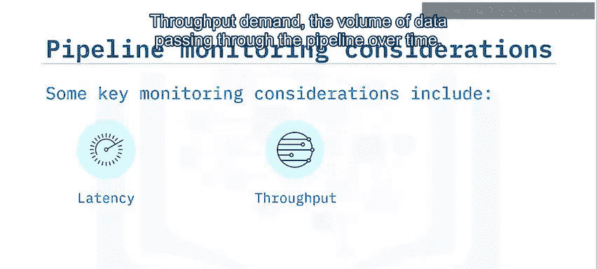

Ideally， at the moment， one stage has completed its process on a packet of data。

 The next packet in the queue would be available to it just in time。 In that case。

 the stages is never left to idle while the pipeline is operating and there are no upstream bottlenecks。

 extending this notion to all stages of the pipeline implies that all stages should take the same amount of time to process a packet。

 This means that there are no bottlenecks， and we can say that the entire pipeline has been load balanced。

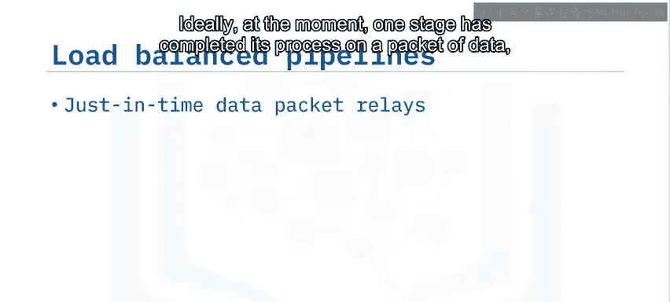

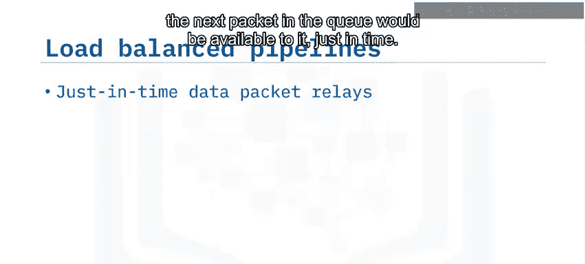

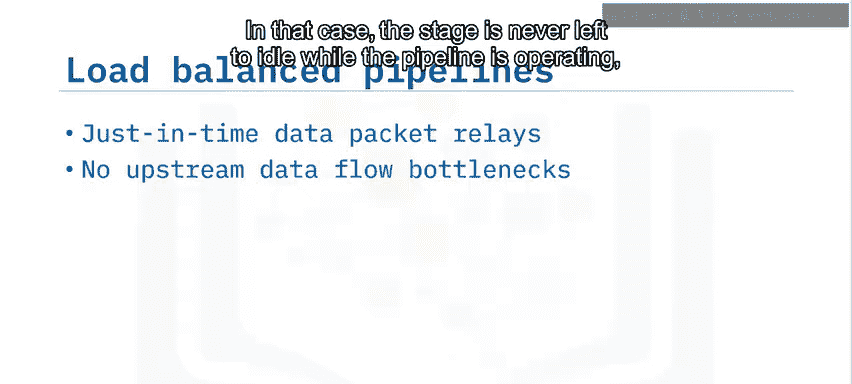

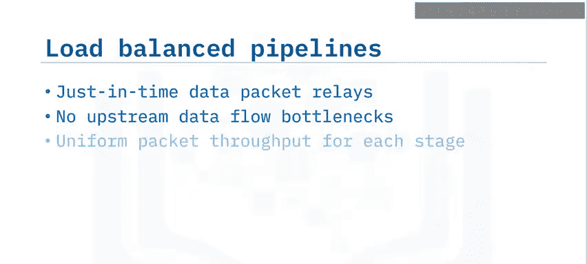

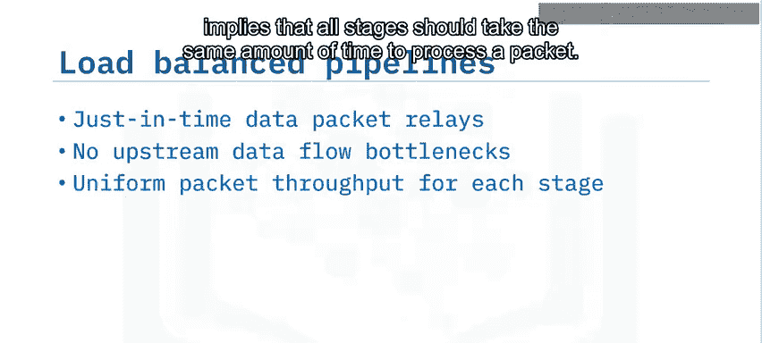

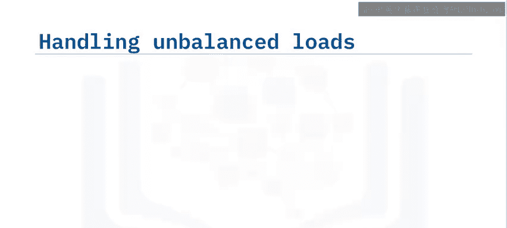

Let's take a closer look at this idea。 Sose your pipeline has a bottleneck in one of its stages。

 such as the longer red section here， which has more latency than the other stages in the pipeline if it's possible to parallelize that stage。

 for example， by splitting the data into two concurrent stages like this。

 then you can reduce this stages's latency。

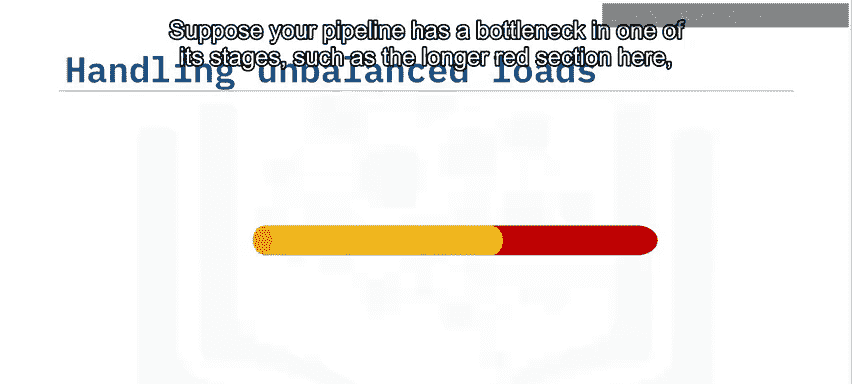

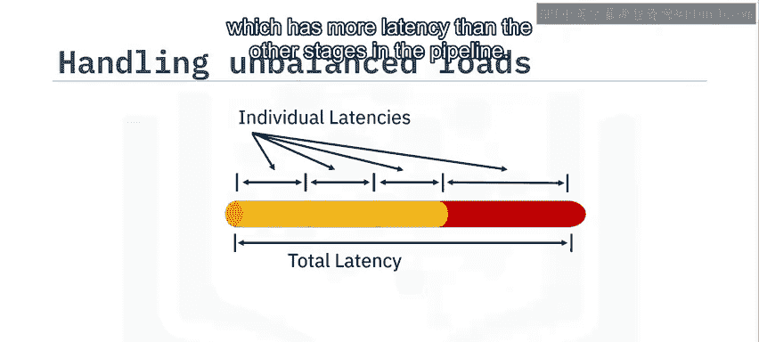

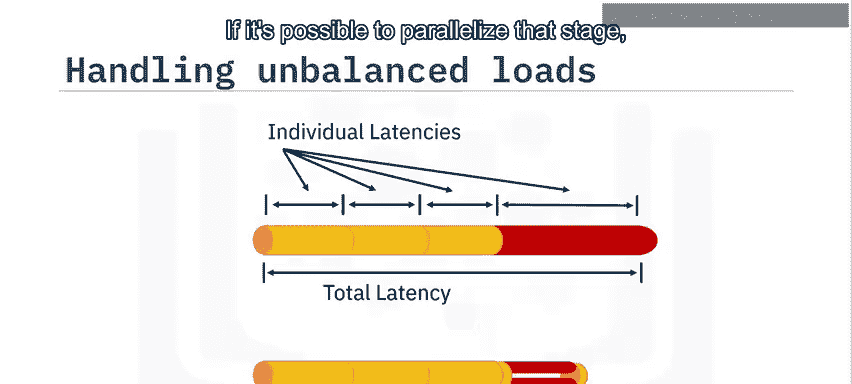

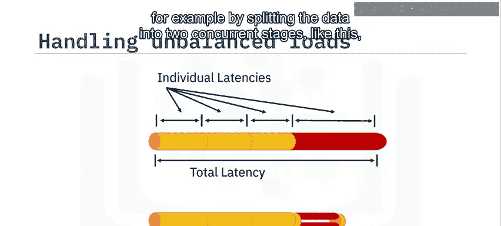

There will be a little overhead in managing the parallelization and a recombination of the output back into the pipeline。

 but the overall latency will be reduced。

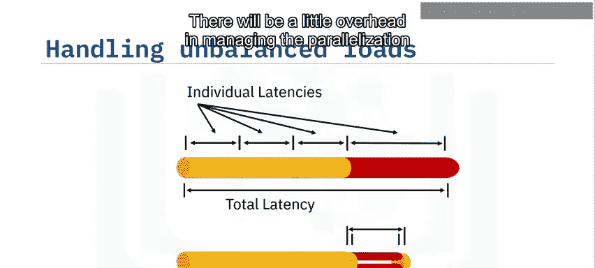

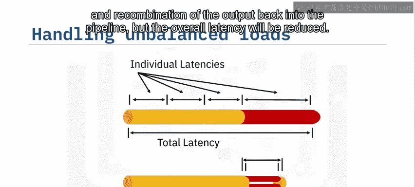

Due to the time and cost considerations， pipelines are rarely perfectly load balanced。

 this means there will almost always be stages which are bottlenecks in the data flow if such a stage can be parallelzed。

 then it can be sped up to align better with the flow rate。

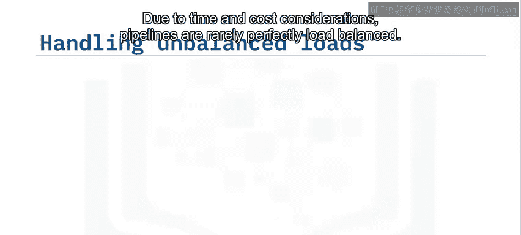

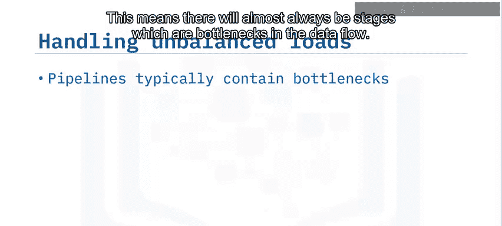

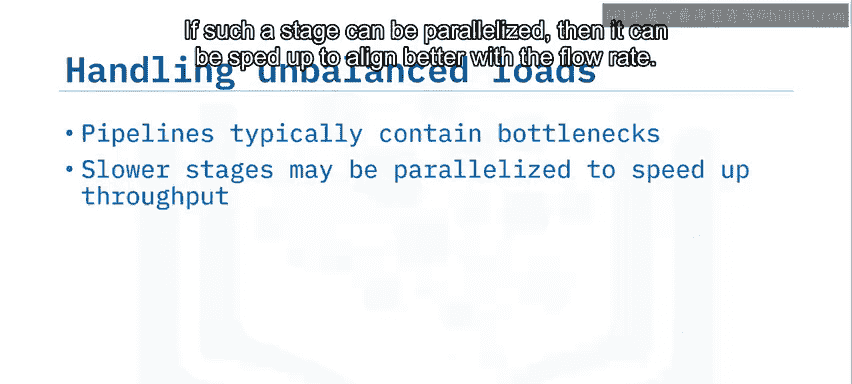

A simple way to parallelize a process is to replicate it on multiple CPUs， cores。

 or threads and distribute data packets as they arrive in an alternating fashion amongst the replicated channels。

Pipelines that incorporate parallelism are referred to as being dynamic or nonlinear as opposed to static。

 which applies to serial pipelines。Further synchronization between stages is likely still possible。

 and a typical solution is to include input and output or IO buffers as needed to smooth out the flow of data。

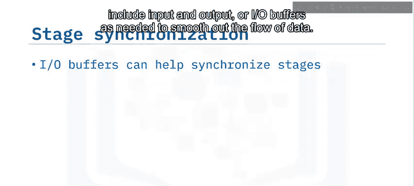

An IO buffer is a holding area for data placed between processing stages。

 having different or varying delays buffers can also be used to regulate the output of stages having variable processing rates and thus may be used to improve throughput。

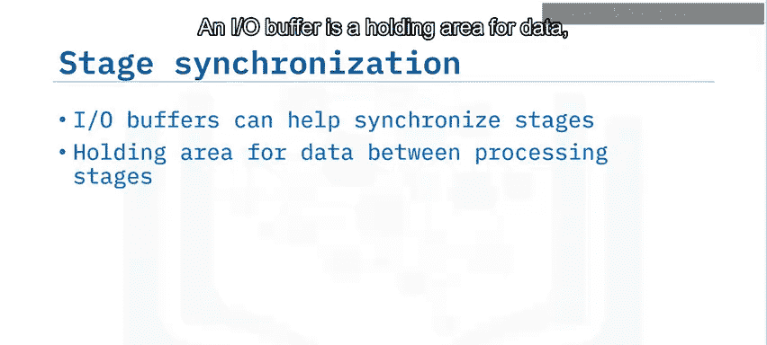

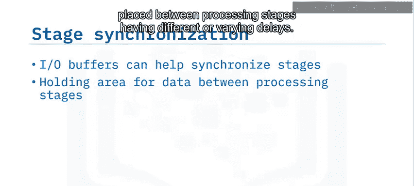

Single input and output buffers are also used to distribute and gather loads on paralleled stages。

In this video， you learned that in addition to extraction， transformation and loading。

 data pipeline processes include scheduling， triggering， monitoring， maintenance and optimization。

 pipeline monitoring considerations include tracking latency， throughput。

 resource utilization and failures， and finally， unbalanced or varying loads can be mitigated by introducing parallelization and IO buffers at bottlenecks。

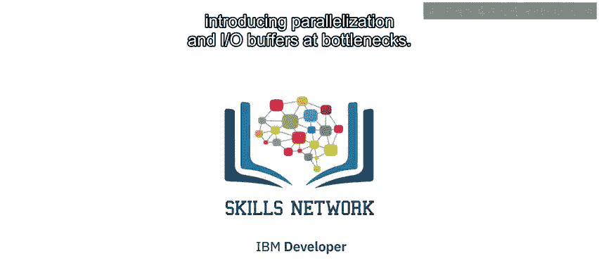