# IBM数据工程专业证书课程8：《使用Shell、Airflow和Kafka的ETL和数据管道课程（IBM）》｜etl-and-data-pipelines - P11：10_批处理与流式数据流水线的用例.zh_en - GPT中英字幕课程资源 - BV1Q94y1r7YG

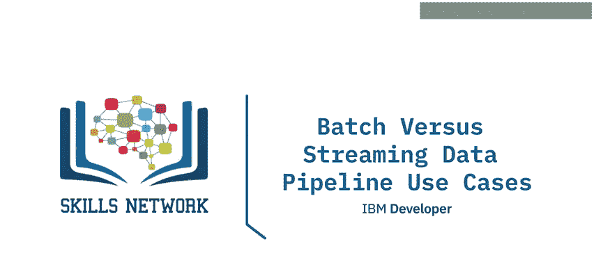

Welcome to batchch v streaming data Pi use cases After watching this video you will be able to differentiate between batch and streaming data pipelines。

 describe microcro batchch and hybrid Lambda data pipelines。

 list use cases for batch data pipelines and list use cases for streaming data pipelines。

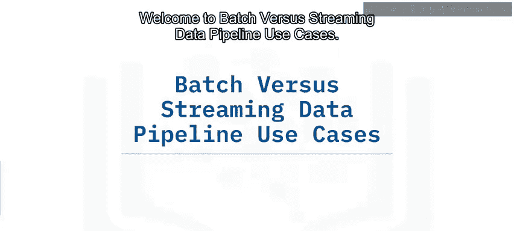

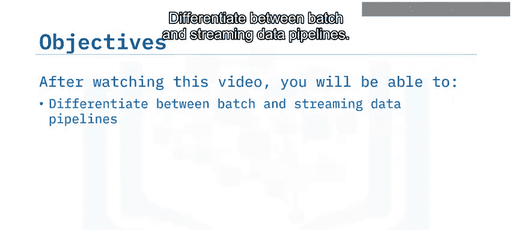

Batch data pipelines are used when data sets need to be extracted and operated on as one big unit batch processes typically operate periodically on a fixed schedule。

 ranging from hours to weeks apart， they can also be initiated based on triggers such as when the data accumulating at the source reaches a certain size batch processes are appropriate for cases which don't depend on recency of data Ty batch data pipelines are employed when accuracy is critical but competitive mission critical streaming technologies are rapidly maturing streaming data pipelines are designed to ingest packets of information such as individual credit card transactions or social media activities。

 one by one in rapid succession stream processing is used when results are required with minimal latency。

 essentially in real time with streaming pipelines。

 records or events are processed immediately as they occur events。

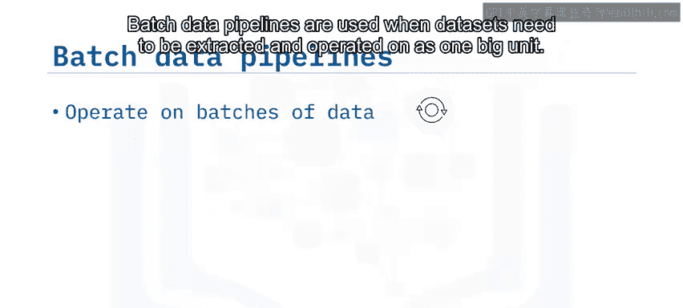

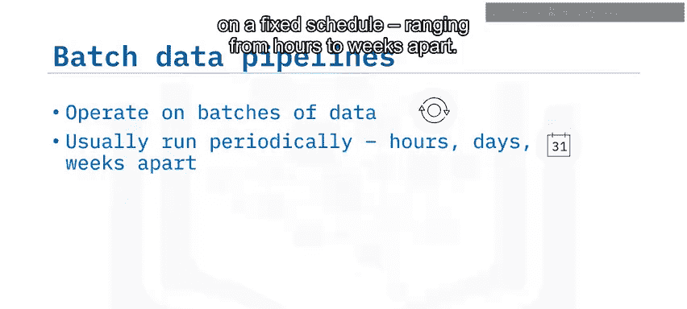

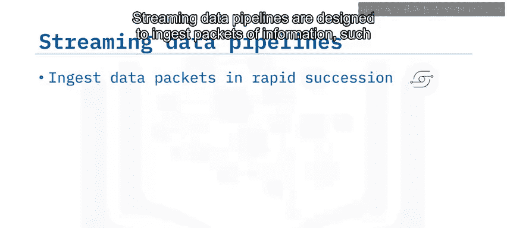

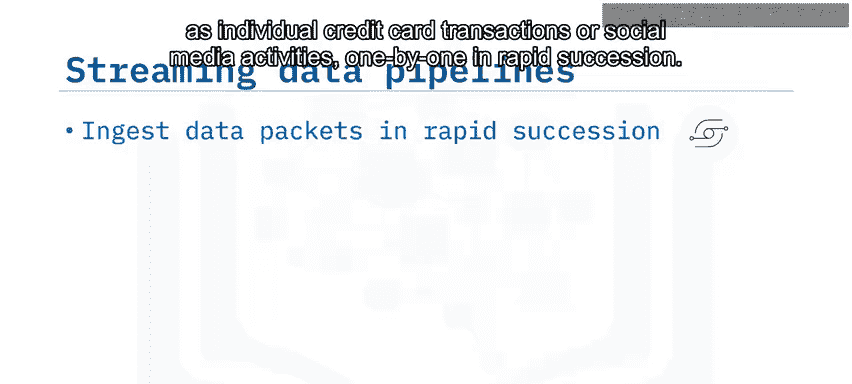

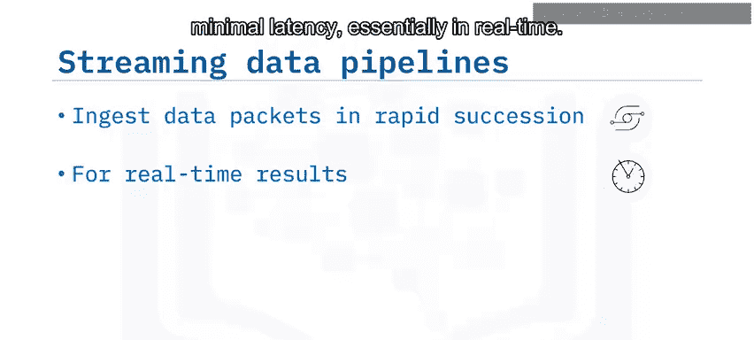

Streams can also be appended to storage to build up a history for later use Use including other software systems can publish or write and subscribe to or read event streams。

By decreasing the batch size and increasing the refresh rate of individual batch processes。

 you can achieve near real time processing using micro batchches may also help with load balancing leading to lower overall latency。

 useful when only very short windows of data are required for transformations。

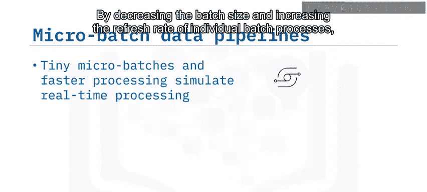

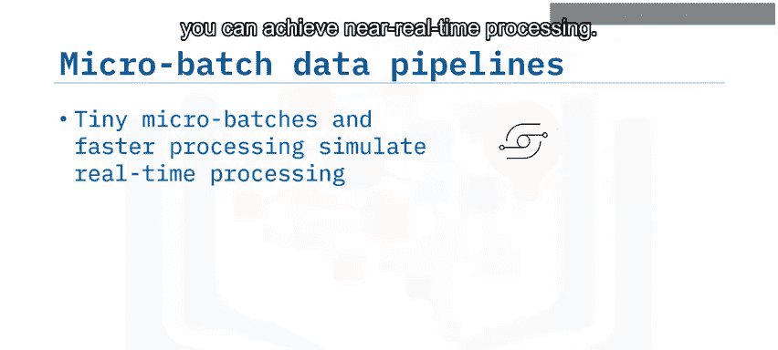

The use case differences between batch and stream processing come down to a tradeoff between accuracy and latency requirements with batch processing。

 for example， data can be cleaned and thus you can get higher quality output but this comes at the cost of increased latency if you require low latency。

 your tolerance for faults likely has to increase。

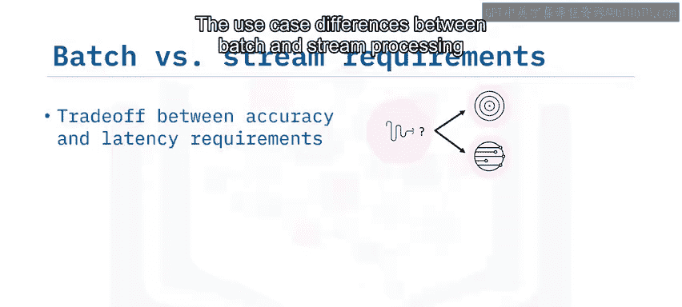

A Lambda architecture is a hybrid architecture designed for handling big data Lambda architectures combine batch and streaming data pipeline methods historical data is delivered in batches to the batch layer and real time data is streamed to a speed layer these two layers are then integrated in the serving layer。

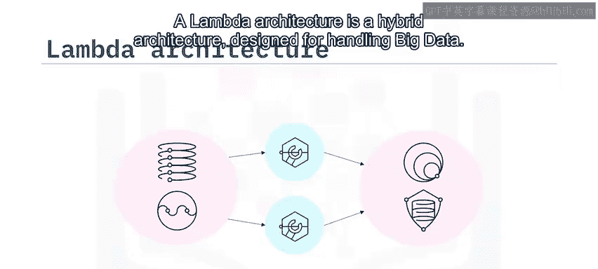

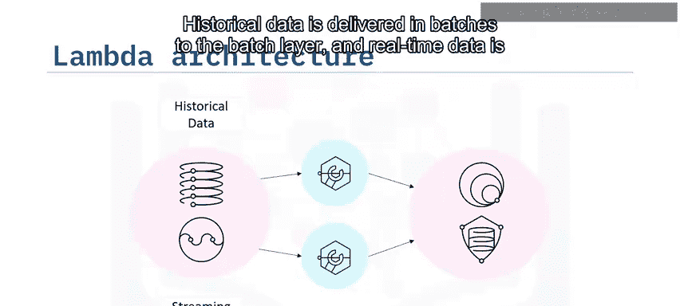

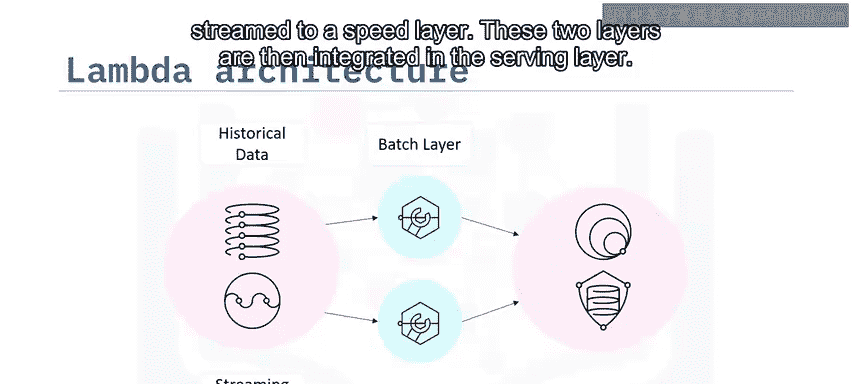

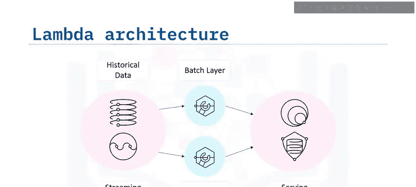

The data stream is used to fill in the latency gap caused by the processing in the batchche layer Lambda can be used in cases where access to earlier data is required。

 but speed is also important a downside to this approach is the complexity involved in the design you usually choose a Lada architecture when you are aiming for accuracy and speed。

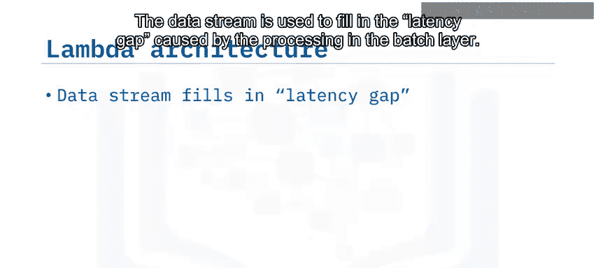

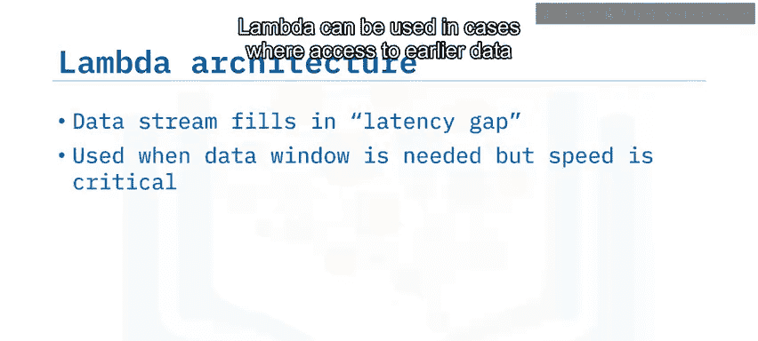

Example use cases for batch data pipelines include periodic data backups and transaction history loading。

 processing of customer orders and billing， data modeling on slowly varying data。

 meant to long range sales forecasting and weather forecasting。

 analysis of historical data and diagnostic medical image processing。

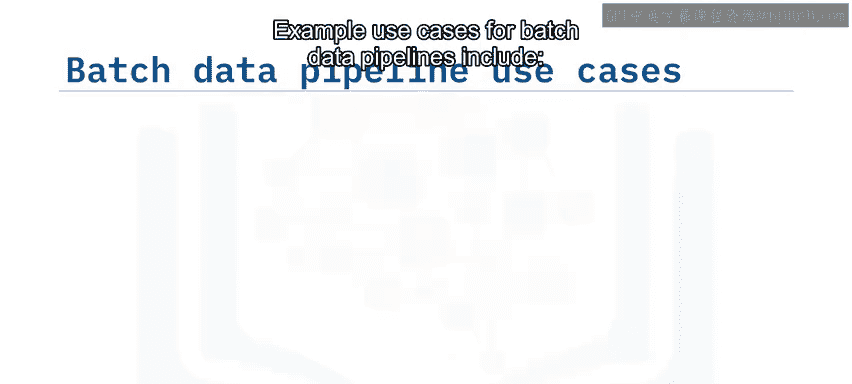

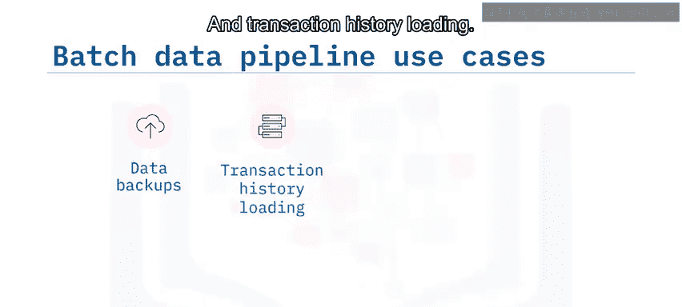

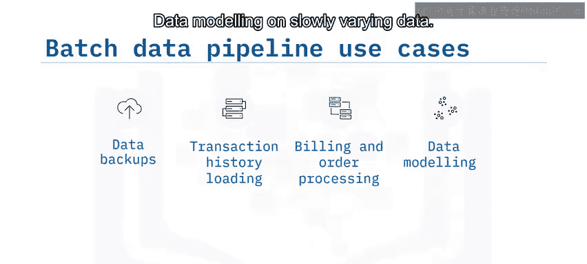

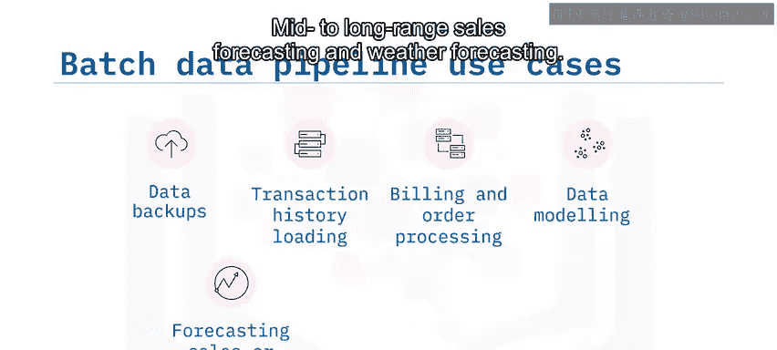

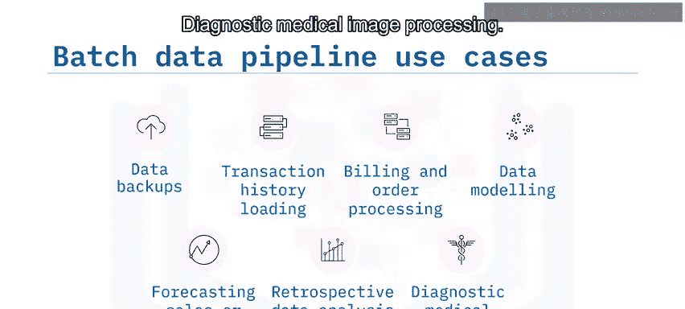

Use cases for streaming data pipelines are on the rise and include cases such as watching movies and listening to music or podcasts。

 social media feeds and sentiment analysis， fraud detection。

 user behavior analysis and targeted advertising， stock market trading， realtime product pricing。

 and recommender systems。

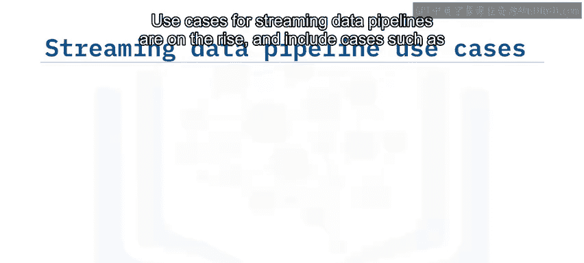

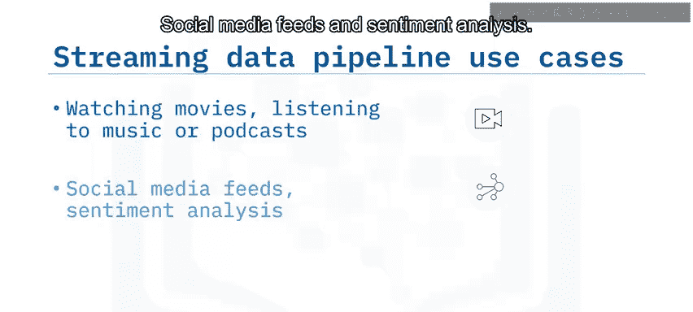

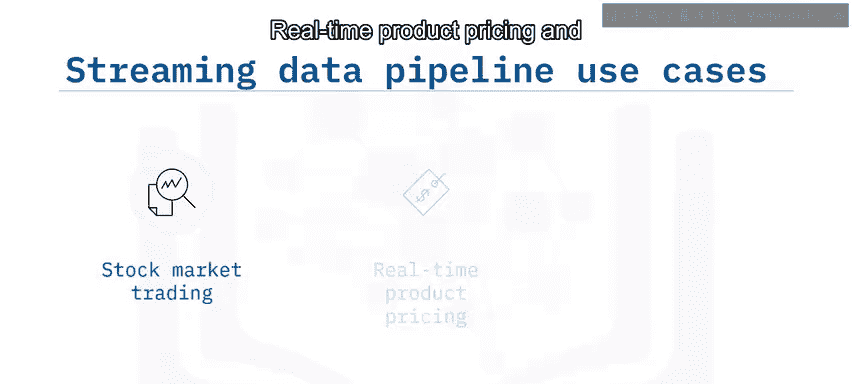

In this video， you learned that batch pipelines extract and operate on batches of data batch processing is used when accuracy is critical or there is no need for the most recent data streaming data pipelines ingest data packets one by one in rapid succession streaming pipelines are used when the most current data is needed。

 Micro batchch processing can be used to simulate real-time data streaming。

 and Lambda architecture can be used in cases where access to earlier data is required。

 but speed is also important。

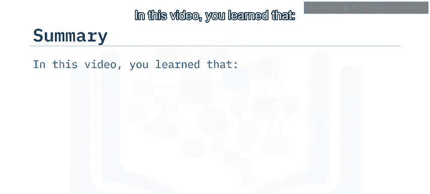

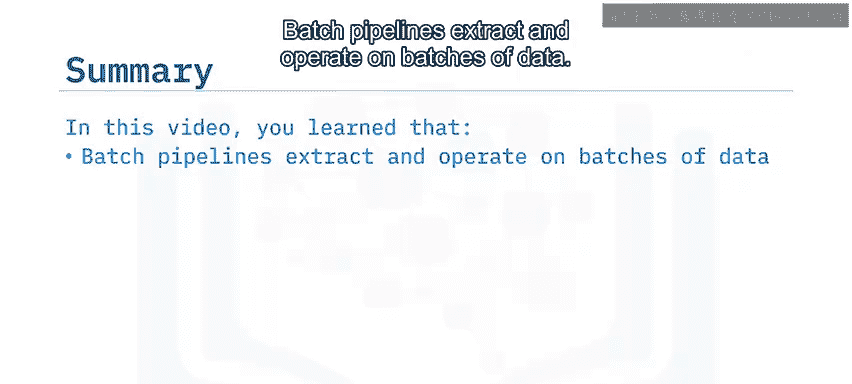

。

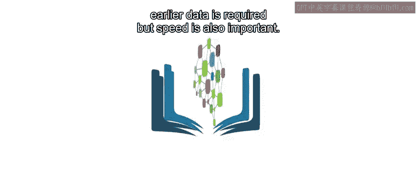