# IBM数据工程专业证书课程8：《使用Shell、Airflow和Kafka的ETL和数据管道课程（IBM）》｜etl-and-data-pipelines - P13：12_apache airflow 概述.zh_en - GPT中英字幕课程资源 - BV1Q94y1r7YG

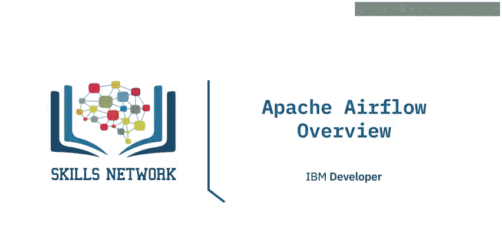

Welcome to Apache Airflow Over After watching this video。

 you will be able to recognize Apache Airflow as a platform to programmatically author。

 schedule and monitor workflows， list the main features and principles of Apache airflow and list common use cases for Apache airflow。

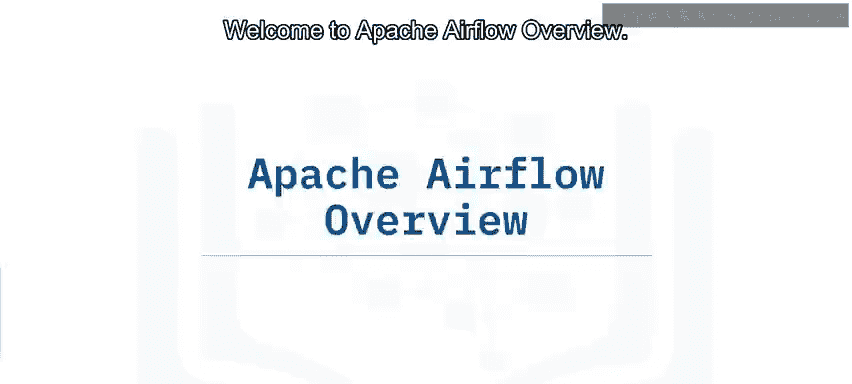

Apache Airflow is a great open source workflow orchestration tool that is supported by an active community it is a platform that lets you build and run workflows such as batch data pipelines with Apache airflow。

 a workflow is represented as a DAG a directed acyclic graph and contains individual pieces of work called tasks arranged with dependencies and note that unlike big data tools such as Apache Kafka。

 Apache Stor， Apache Spark or Flink， Apache airflow is not a data streaming solution it is primarily a workflow manager。

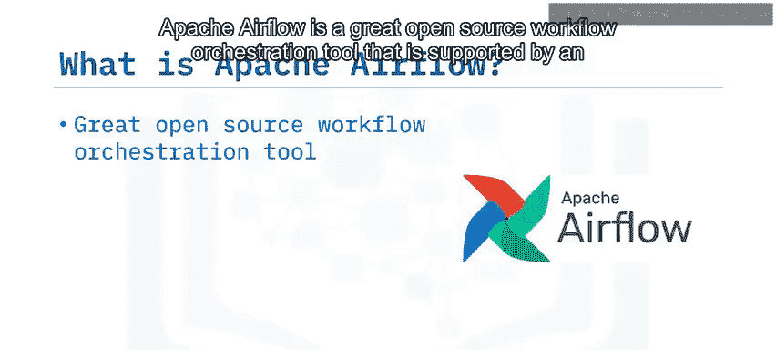

Let's take a look at a simplified overview of Apache Airflow's basic components Airflow comes with a builtin scheduler which handles the triggering of all scheduled workflows The scheduler is responsible for submitting individual tasks from each scheduled workflow to the executor The executor handles the running of these tasks by assigning them to workers which then run the tasks The web server serves airflow's powerful interactive user interface from this UI you can inspect trigger and debug any of your DAs and the individual tasks The DAG directory contains all of your DAg files。

 ready to be accessed by the scheduler， the executor and each of its employed workers Finally。

 Airflow hosts a metadata database which is used by the Schr executor and the web server to store the state of each dag and its tasks。

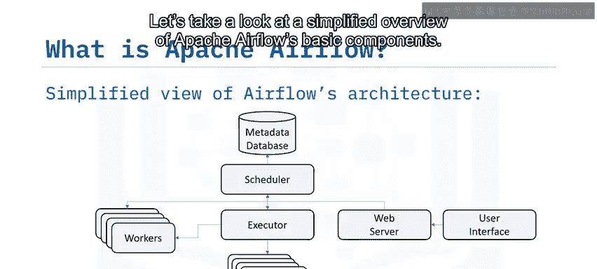

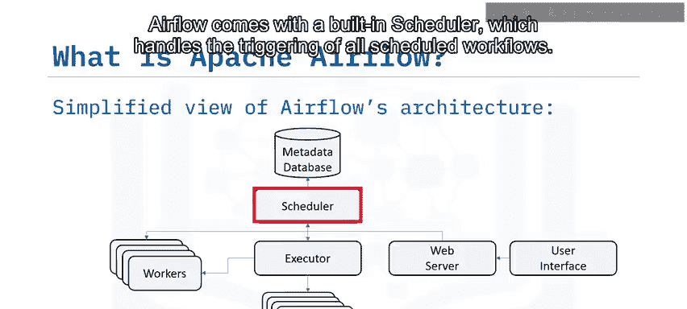

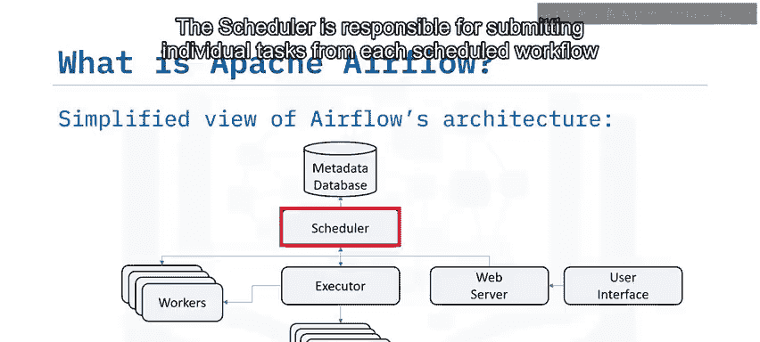

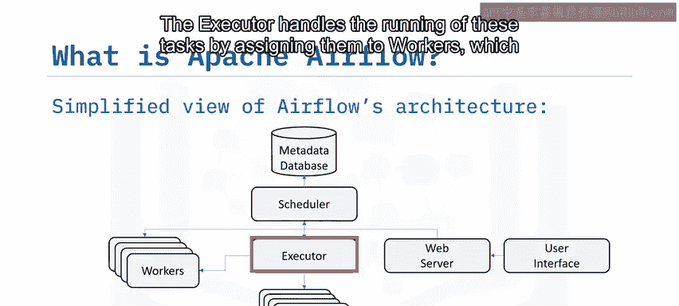

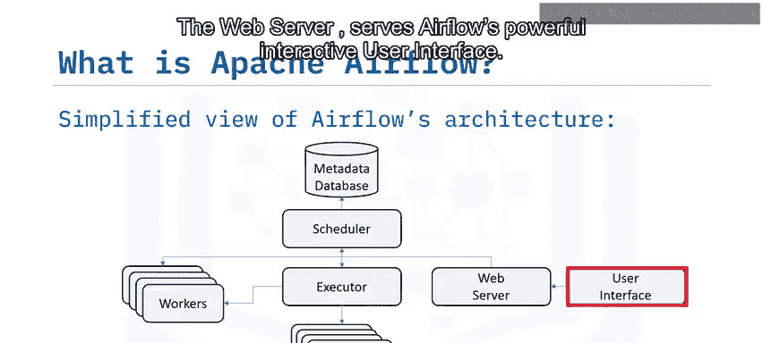

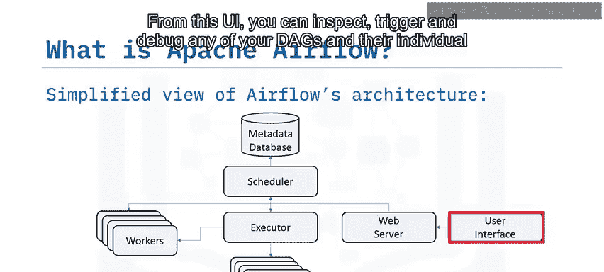

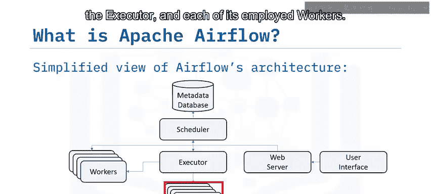

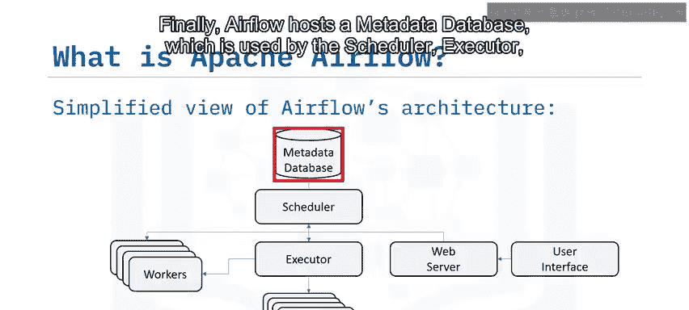

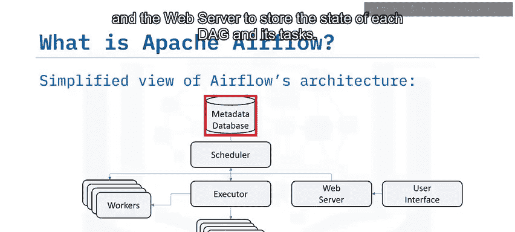

A dag specifies the dependencies between tasks and the order in which to execute them。

 The tasks themselves describe what to do In this example， Dg， the tasks include data ingestion。

 Data analysis， saving the data， generating reports and triggering other systems such as reporting any errors by email。

 Let's have a look at the lifecycle of a task state。 In this diagram。

 you can see how Apache airflow might assign states to a task during its lifecycle。 No status。

 The task has not yet been queued for execution Sch。

 the scheduler has determined that the task dependencies are met and has scheduled it to run removed for some reason。

 the task has vanished from the daAg since the run started。 upstream failed。

 an upstream task has failed。 queued。 the task has been assigned to the executor and is waiting for a worker to become available。

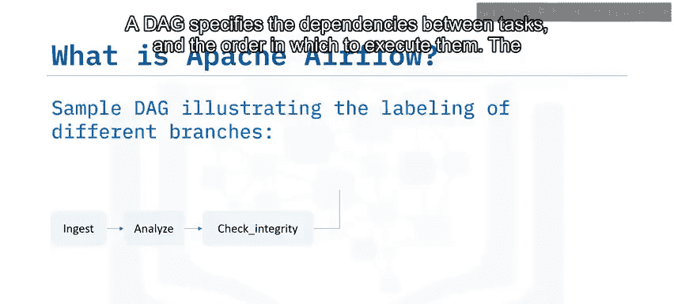

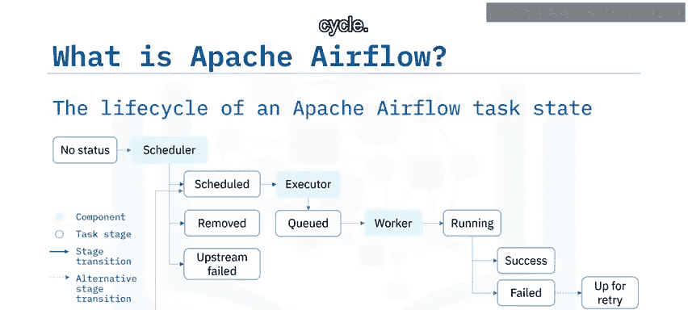

Running， the task is being run by a worker Su。 The task is finished running without errors， failed。

 The task had an error during execution and failed to run and up for retry。 the task failed。

 but has retry attempts left and will be rescheduled。Ideally。

 a task should flow through the scheduler from no status to scheduled。

 to queued to running and finally to success。Now let's have a look at the five main features and benefits of Apache airflow。

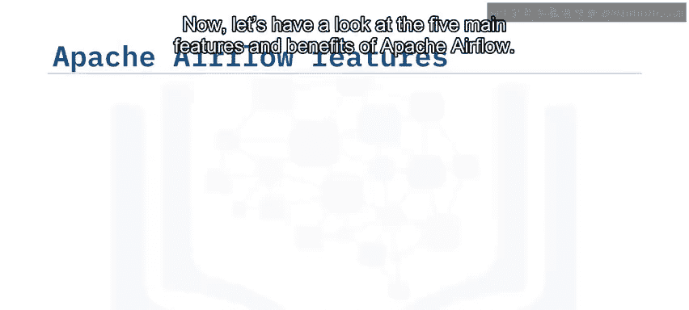

Pure Python create your workflows using standard Python This allows you to maintain full flexibility when building your data pipelines。

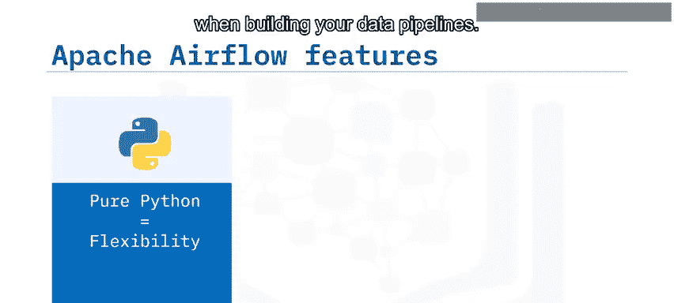

Useful UI， monitor， schedule and manage your workflows via a sophisticated web app offering you full insight into the status of your tasks Inegration Apache Airflow provides many plug and play integrations such as IBM Cloudant that are ready to execute your tasks。

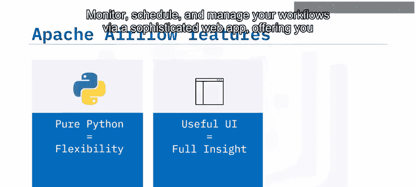

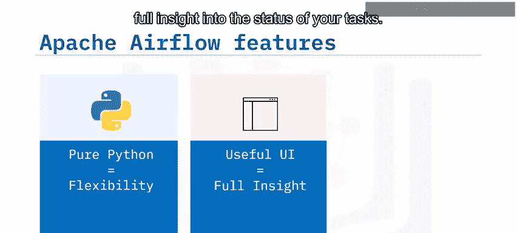

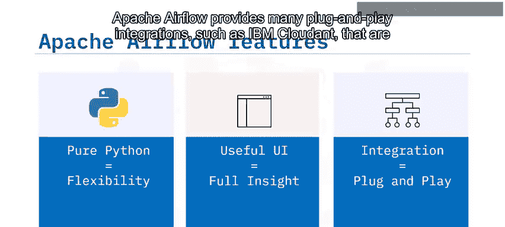

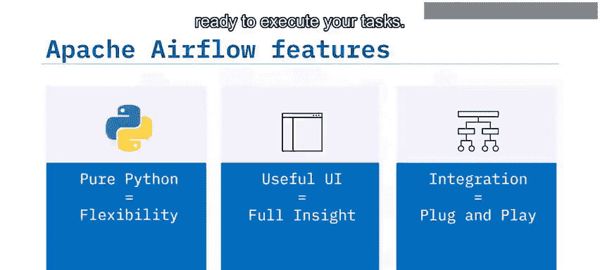

Easy to use anyone with Python knowledgeled can deploy a workflow Airflow does not limit the scope of your pipelines。

 and finally， the open source feature whenever you want to share your improvement。

 you can do this by opening a pull request Airflow has many active users who are sharing their experiences in the Apache airflow community。

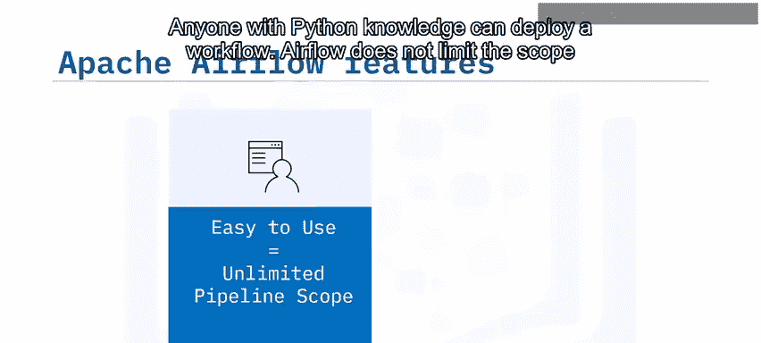

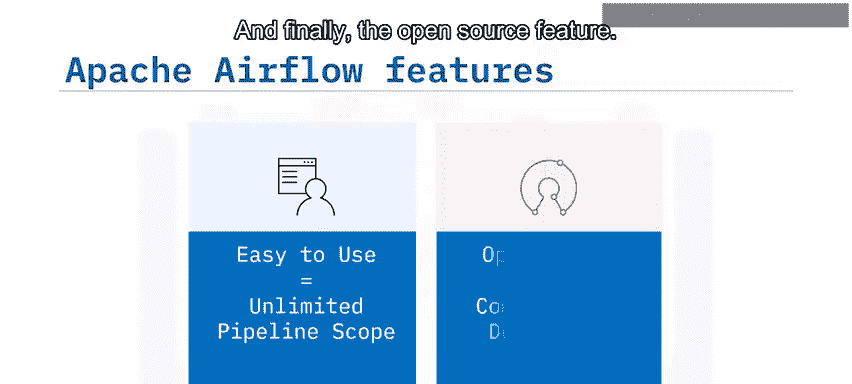

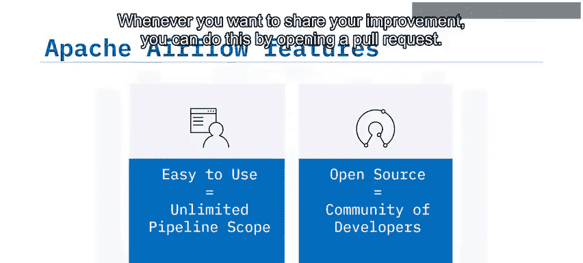

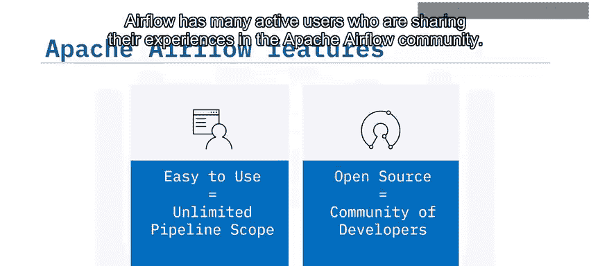

Apache airflow pipelines are built on four main principles。 They are scalable。

 Airflow has a modular architecture and uses a message queue to orchestrate an arbitrary number of workers It is ready to scale to infinity Dy airflow pipelines are defined in Python and allow dynamic pipeline generation。

 Thus your pipelines can contain multiple simultaneous tasks extensible you can easily define your own operators and extend libraries to suit your environment and lean airflow pipelines are lean and explicit Parameterization is built into its core using the powerful ginja templating engine。

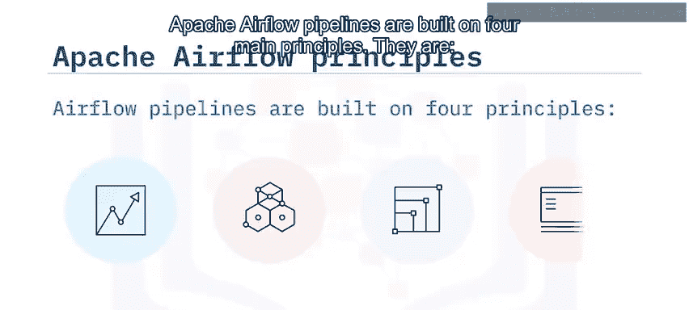

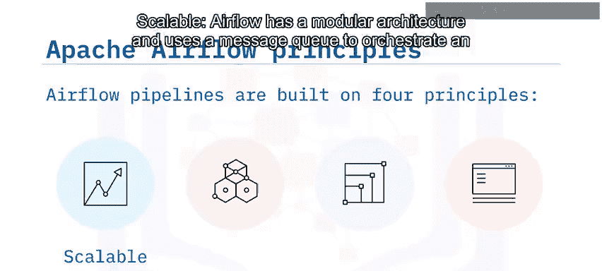

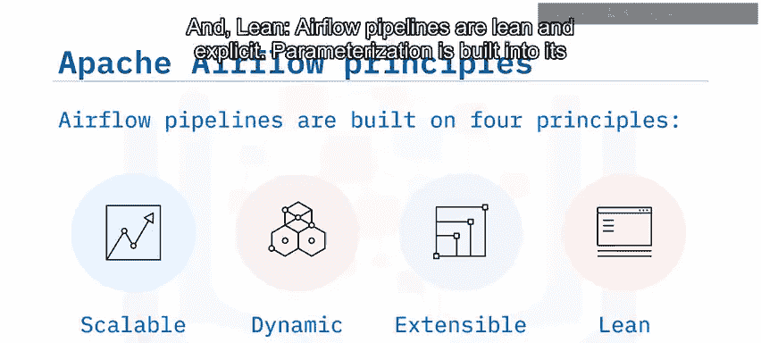

Apache Airflow has supported many companies in reaching their goals， for example。

 Sft used airflow for defining and organizing machine learning pipeline dependencies SeniorLink increased the visibility of their batch processes and decoupled them Xperity deployed airflow as an enterprise scheduling tool and one football used airflow to orchestrate SQL transformations in their data warehouses and to send daily analytics emails。

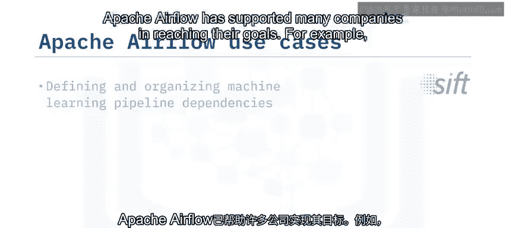

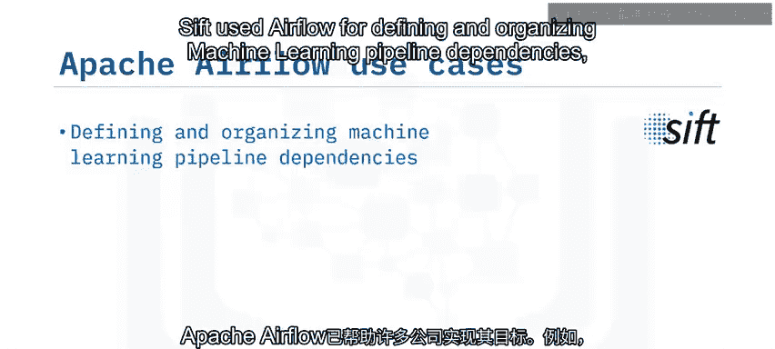

In this video you learned that Apache Airflow is a platform to programmatically author。

 schedule and monitor workflows the five main features of airflow are its use of Python its intuitive and useful user interface。

 extensive plug and play integrations， ease of use and the fact that it is open source you also learn that Apache airflow is scalable。

 dynamic， extensible and lean and finally defining and organizing machine learning pipeline dependencies with Apache airflow is one of the common use cases。

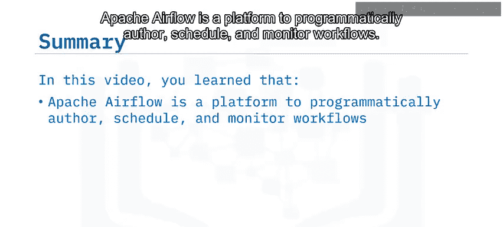