# IBM数据工程专业证书课程8：《使用Shell、Airflow和Kafka的ETL和数据管道课程（IBM）》｜etl-and-data-pipelines - P15：14_apache airflow ui.zh_en - GPT中英字幕课程资源 - BV1Q94y1r7YG

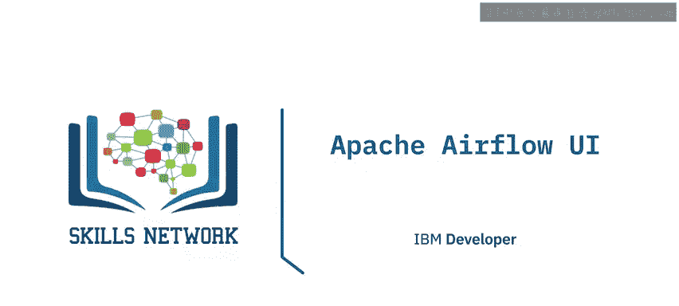

Welcome to Apache Airflow UI After watching this video。

 you will be able to identify current daAgs in your environment。

 list different ways to visualize a specific Dg， review the code that defines your DAg。

 analyze the duration of each task in your Dg over multiple runs。

 and select context metadata for any task instance。

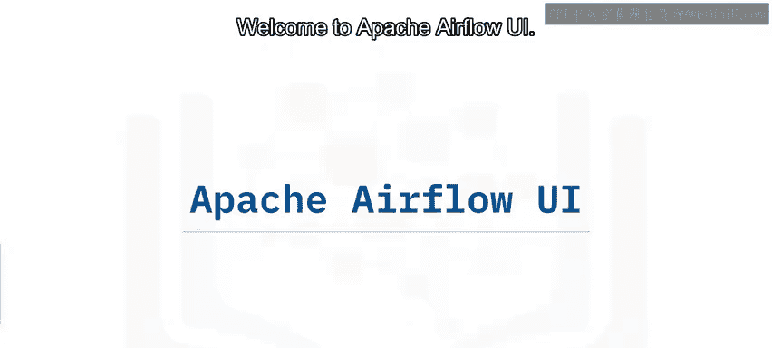

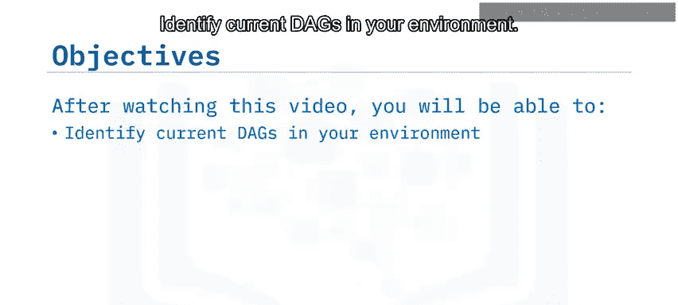

Here's what the landing page for the Apache airflow user interface looks like in your browser it defaults to the DAs view。

 which is a table containing data about each dag in your environment Each row displays interactive information about a dag in your environment such as each DAg's name it run schedule in this case in the Chron tabab format The DAgs owner this one is a built-in example from airflow The status of the tasks from the current or most recent Dg run The status of all previous Dg runs plus a collection of quick links to drill down into more information related to the DAG on the far left you can drill down to access more interactive details and in the next column you can toggle to pause a dag all of the daAs here are currently not running。

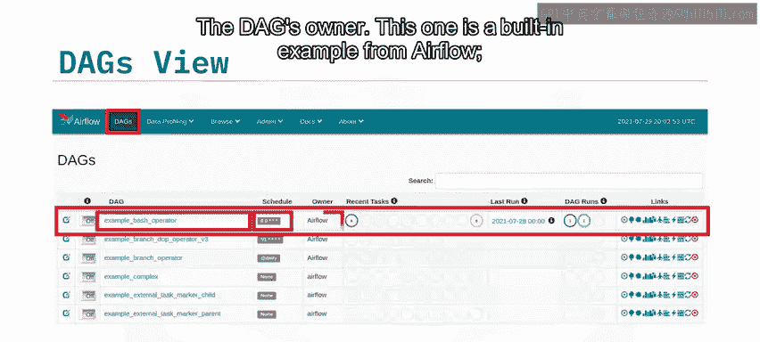

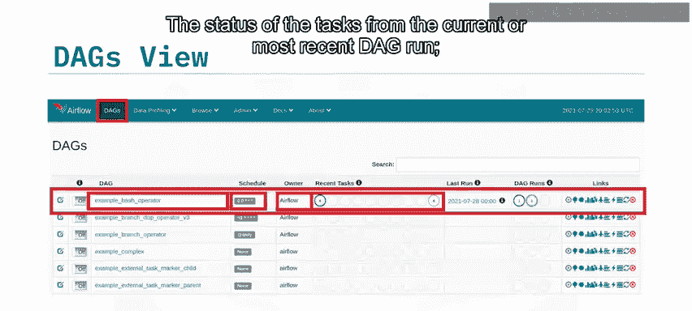

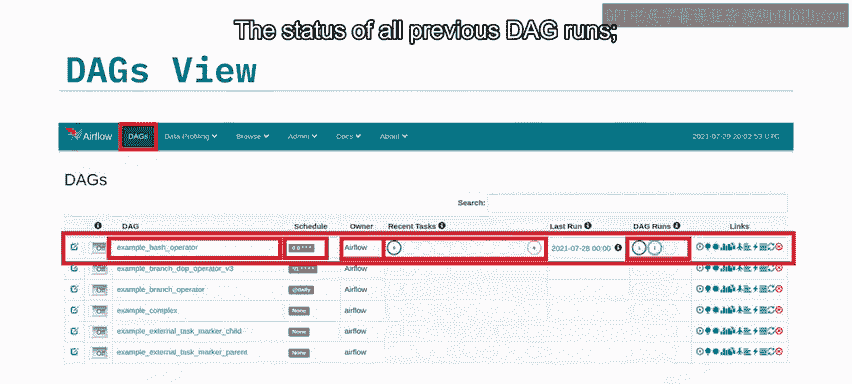

You can visualize dags in several ways as follows Start by clicking on the name of the Dg you want to visualize this tagg called simpleimple example happens to be running in production as you can see here by the on button。

Your DAg's tree View opens by default when you click on its name。

 it shows a timeline of the status of your DAg and its tasks for each run。

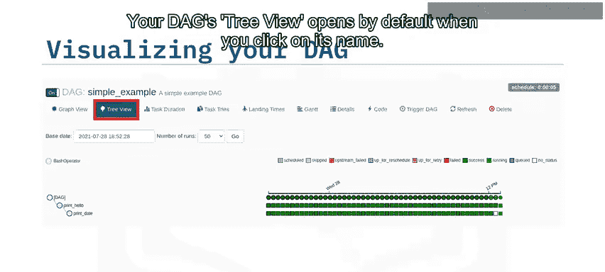

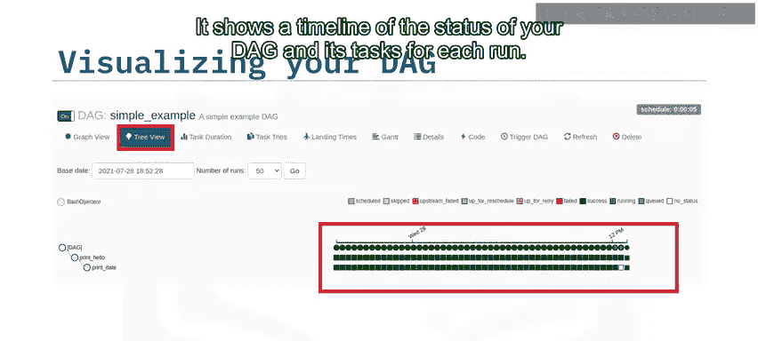

Here you can select the base state and the number of runs to display Each status is color coded according to the legend displayed here。

 you can also hover your mouse pointer over any task in the timeline to view more information about it。

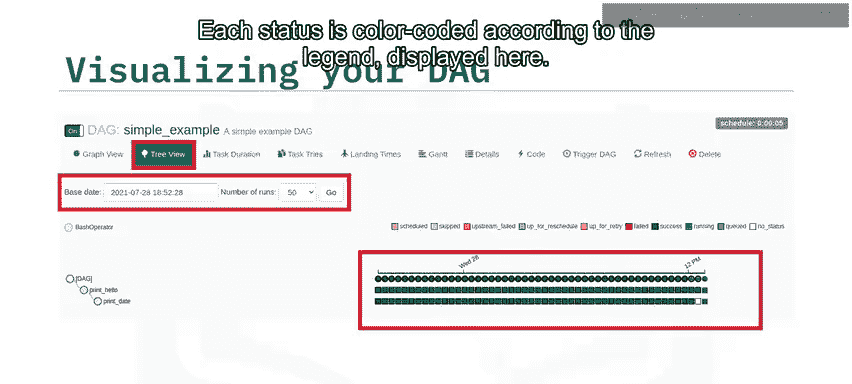

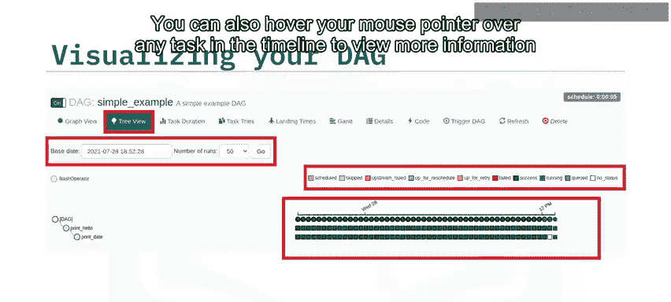

Here's another Dg this time displayed in graphraph view at the bottom of the screen。

 you can see your DAg's tasks and dependencies Each task is color coded by its operator type according to this legend here you can filter your view by toggling these status option buttons。

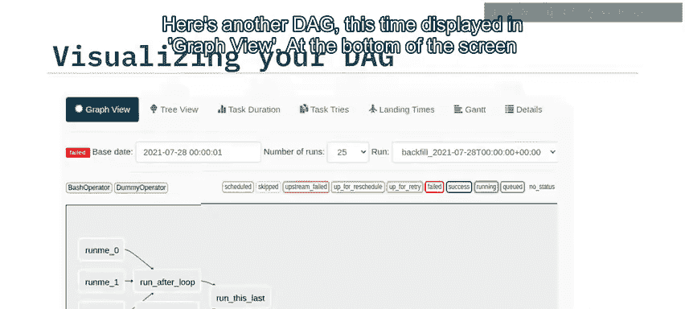

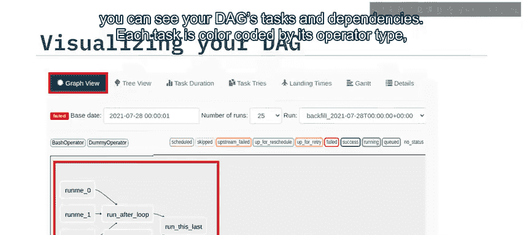

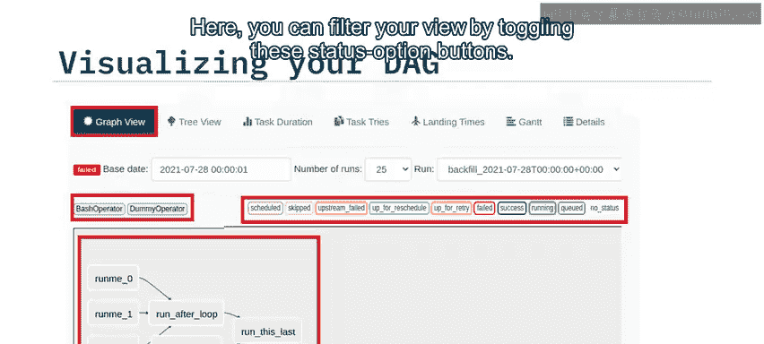

The task instance context menu can be accessed from any of these kinds of views that is views that display task instances for your tag This menu allows you。

 for example， to drill down on a selected task instance to view and edit many details about it or to view the log file for your task。

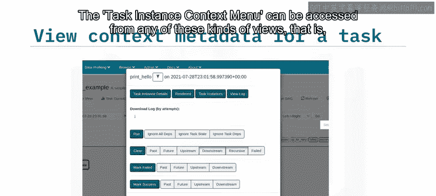

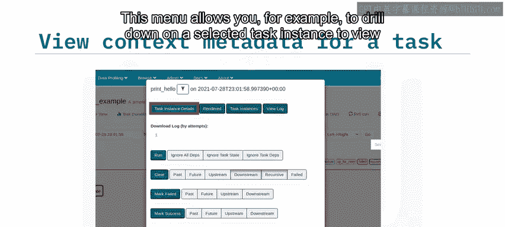

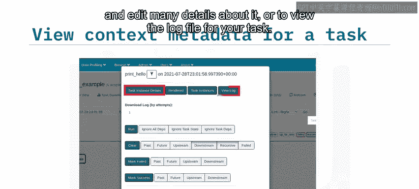

By clicking on the code button， you can also view the complete Python source code that defines your DAG here we see the building blocks of your DAG。

 for example， the library imports and the individual task definitions which invoke bash operators in this case。

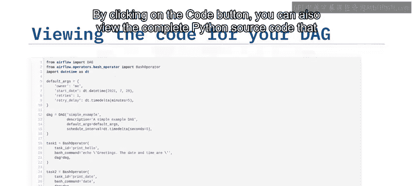

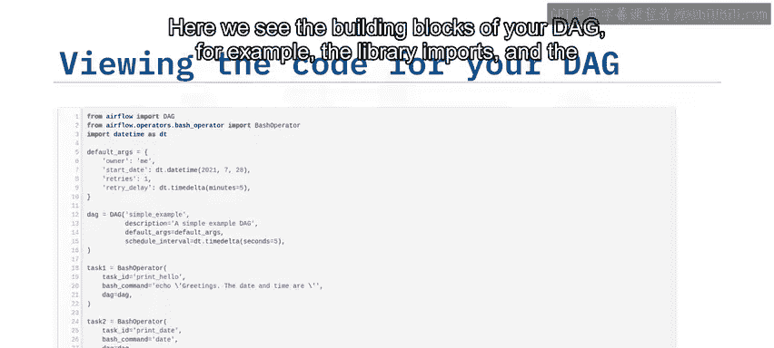

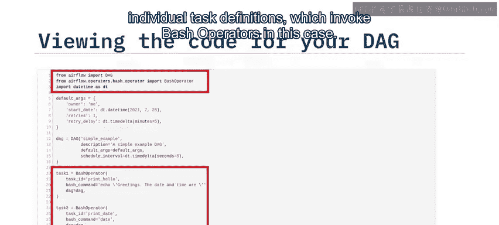

By clicking on task duration， you can view a timeline chart of your DAg's task durations to see how they have been performing here you can toggle the tasks that you wish to highlight the last and runs for in this video you learned that Apache airflow has a rich UI that simplifies working with data pipelines you can visualize your DAg in several informative ways。

 including both graph and tree mode you can also review the Python code that originally defined your DAg you can analyze the duration of each task in your DAg over multiple runs and finally you can select context metadata for any task instance。

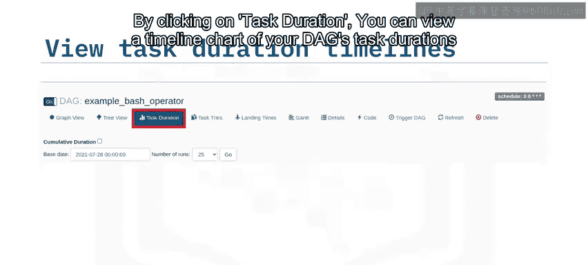

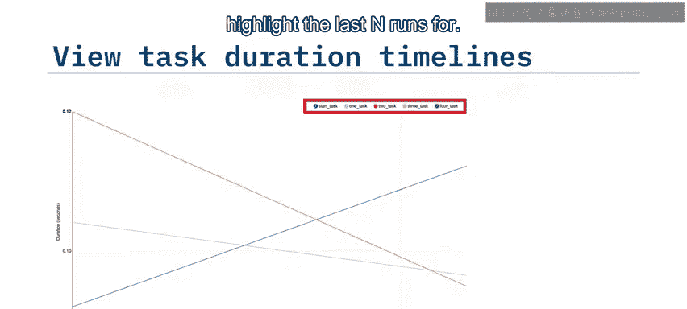

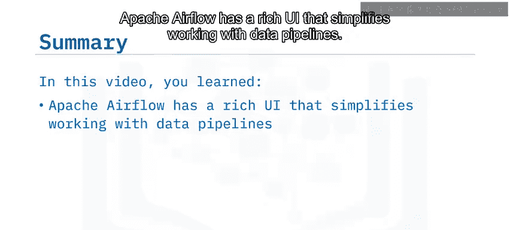

