# IBM数据工程专业证书课程8：《使用Shell、Airflow和Kafka的ETL和数据管道课程（IBM）》｜etl-and-data-pipelines - P17：16_airflow 监控和日志记录.zh_en - GPT中英字幕课程资源 - BV1Q94y1r7YG

Welcome to airflow logging and Moning After watching this video。

 you will be able to use logging capabilities to monitor the status and diagnose problems with DAG runs and explain accessing emitted metrics such as counters。

 gauges and timers。The logging capability is required for developers to monitor the status of tasks in DAG runs and to diagnose and debug issues By default airflow logs are saved to local file systems as log files this makes it convenient for developers to quickly review the log files。

 especially in a development environment for airflow production deployments。

 the log files can also be sent to Cloud storage such as IBM Cloud。

 AWS or Azure for remote accessing。The log files can also be sent to search engines and dashboards for further retrieval and analysis。

Airflow recommends using Elasticse and Splunk， which are two popular document database and search engines to index。

 search and analyze log files。

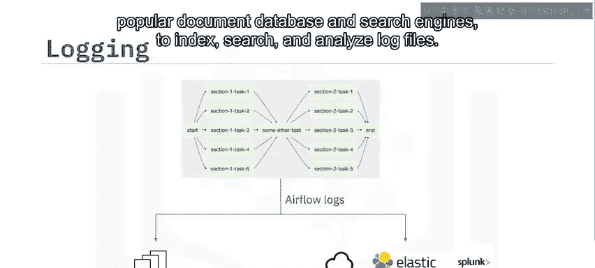

By default， log files are organized by DAG IDs and T IDs。

 and you can find a specific log file for a task execution using the following Path convention。

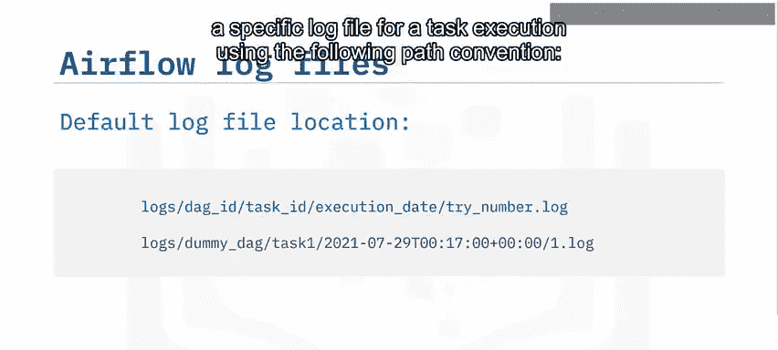

Logs sDAg_ ID/ taskask_ ID/ execution underscore date/try underscore number。log For example。

 suppose you want to find the log for the first execution try of task one in a dummy Dg at a specific time you can go to the folder log/ dummy_Dg/ taskask1/ execution underscore date/1。

 log， and if you click the first log file you can check a lot of useful information such as the running command。

 command results， task results and so on。

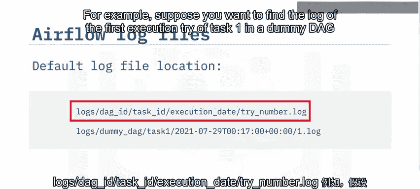

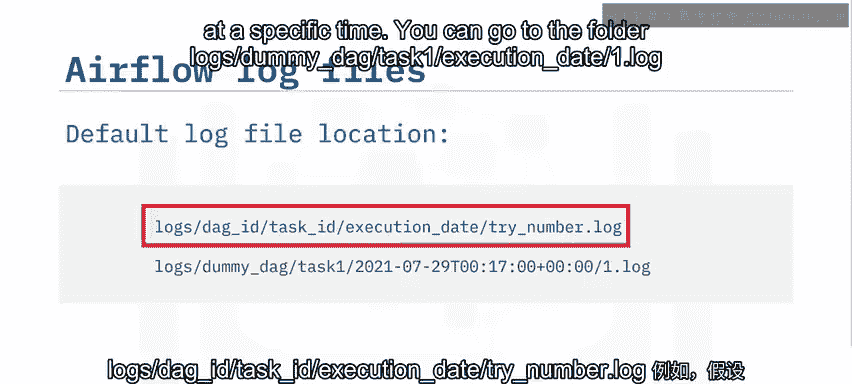

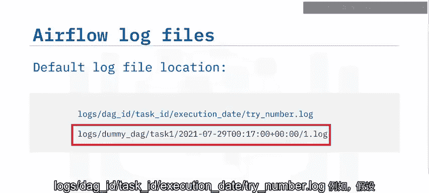

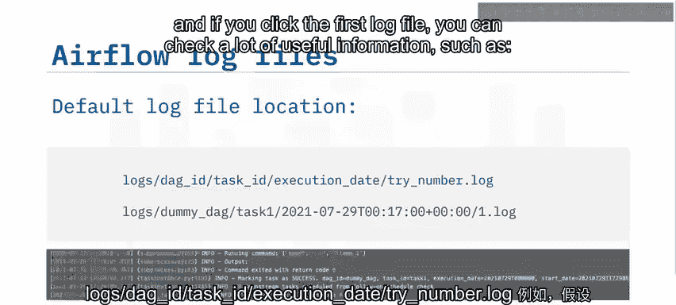

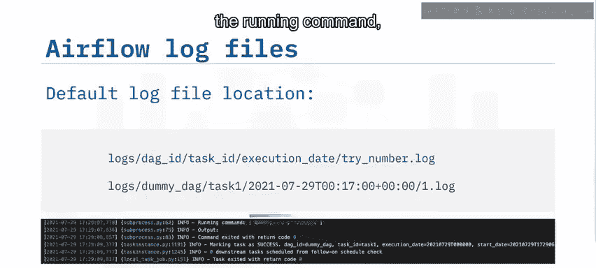

You can also quickly review the task events via UI provided by the Airflow web server。

 you can search events with fields like DAG ID， Task ID。

 and execution date and quickly get an overview of the specific DAGs and tasks you're looking for。

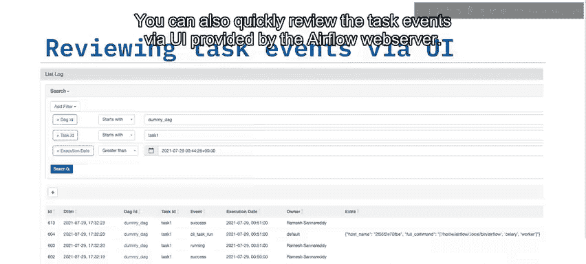

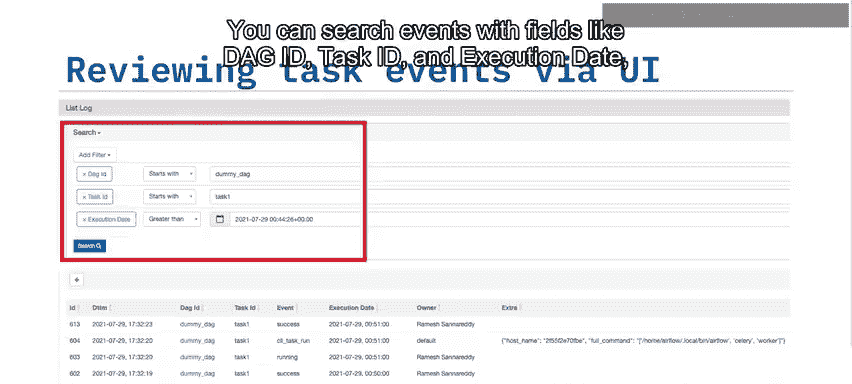

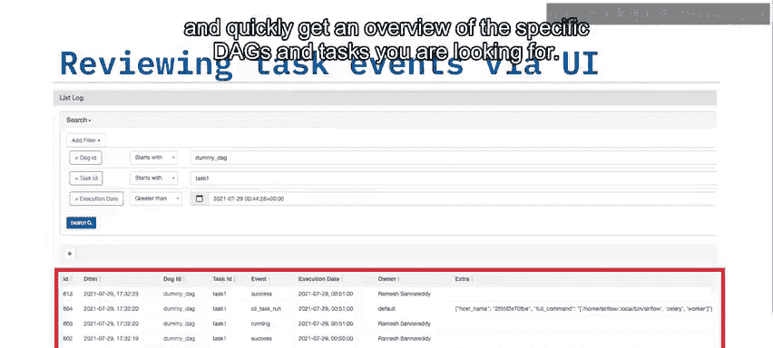

Airflow produces three different types of metrics for checking and monitoring components health These are counters。

 gauges and timers counters are metrics that will always be increasing。

 such as the total counts of successful or failed tasks gauges are metrics that may fluctuate for example。

 the number of currently running tasks or dag bag sizes timers are metrics related to time duration for instance。

 the time to finish a task or the time for a task to reach a success or failed state。

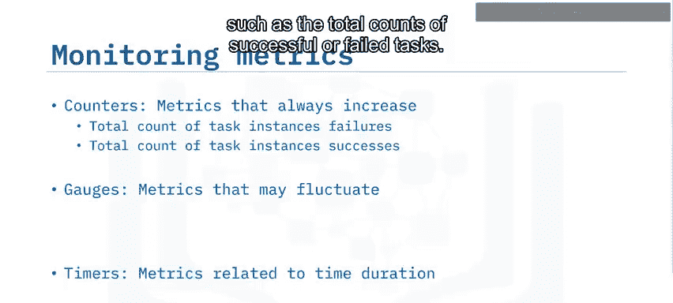

Similar to logs， the metrics produced in airflow production deployments should be sent and analyzed by dedicated repositories and tools Airflow recommends using Stats D。

 which is a network demon that can gather metrics from airflow and send them to a dedicated metrics monitoring system for metrics monitoring and analysis airflow recommends using Prometheus。

 which is a popular metrics monitoring and analysis system Prometheus can also aggregate and visualize metrics in a dashboard for more interactive visual analytics。

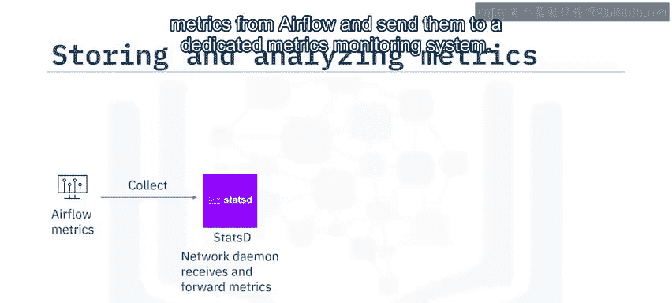

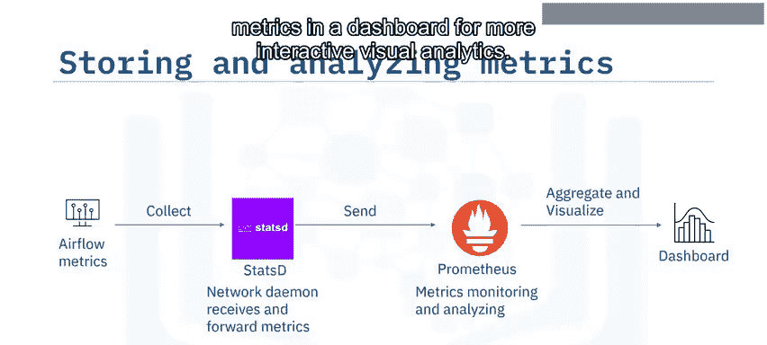

In this video， you learned that you can save airflow logs into local file systems and save them to cloud storage。

 search engines and log analyzers Airflow recommends sending production deployment logs to be analyzed by Elasticse or Splunk with airflows UI you can view DAGs and task events easily you also learn that the three types of airflow metrics or counters。

 gauges and timers and finally， airflow recommends that you send production deployment metrics for analysis by Prometheus via Stats D。

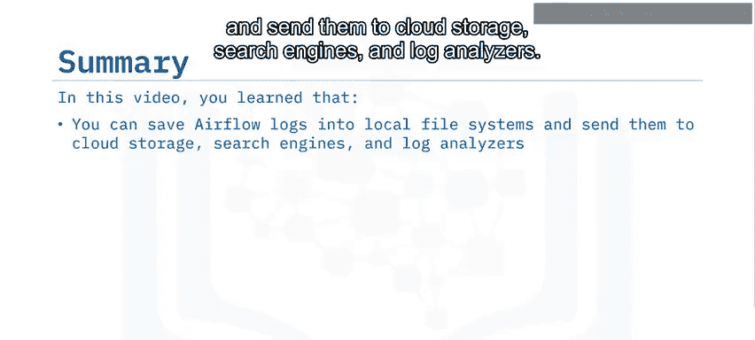

