# IBM数据工程专业证书课程8：《使用Shell、Airflow和Kafka的ETL和数据管道课程（IBM）》｜etl-and-data-pipelines - P18：17_分布式事件流平台组件.zh_en - GPT中英字幕课程资源 - BV1Q94y1r7YG

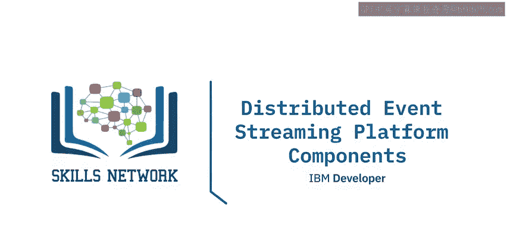

Welcome to Dis event streaming platform components After watching this video。

 you will be able to describe what an event is， list the common event formats。

 describe what an event stream platform or ESP is， list the main components of an ESP。

 and list the popular ESPs。

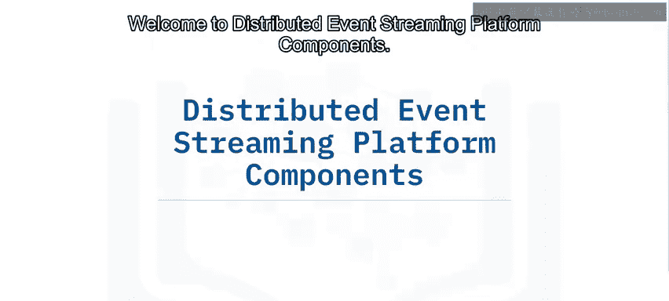

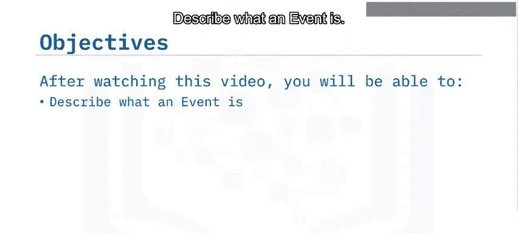

An event normally means something worth noticing is happening in the context of event streaming。

 an event is a type of data which describes the entity's observable state updates over time。

 for example， the GPS coordinates of a moving car， the temperature of a room。

 blood pressure measurements of a patient， or RAM usage of a running application。

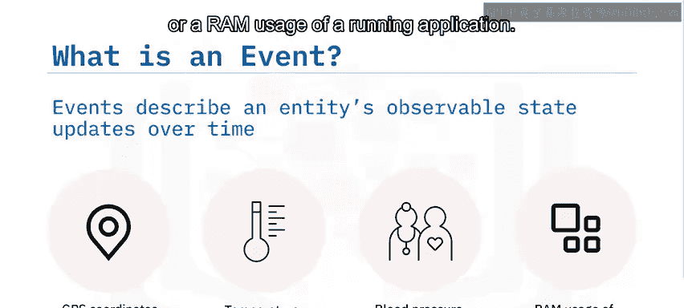

An event as a special type of data has different formats。

 Let's have a look at the three most common formats it can be as a primitive type such as a plain text number or date。

 or an event may be in key value format， and its value can be a primitive data type。

 or a complex data type like list tuled J XML or even bytes， for example。

 the coordinates tuple of a car with car ID1。

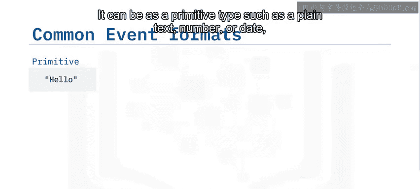

Also， very often an event can be associated with a timestamp to make it time sensitive。

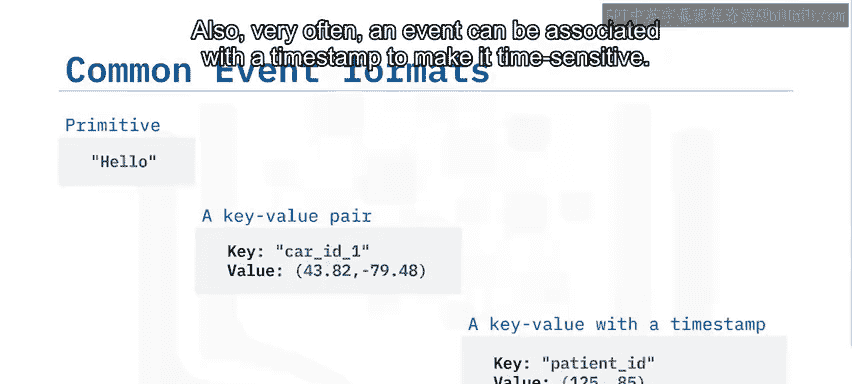

Next， we have a closer look at event streaming， Suppose we have one event source such as a group of sensors。

 a monitoring device， a database or a running application。

 This event source may continuously generate a large event volume at a short time interval or nearly real time。

 Those real time events need to be properly transported to an event destination such as a file system。

 another external database or an application， the continuous event transportation between an event source and an event destination is called event streaming。

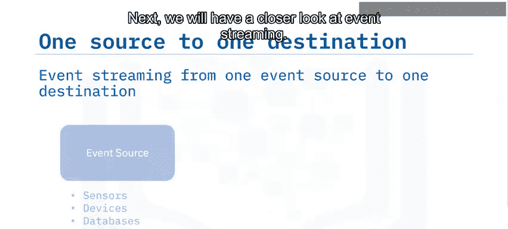

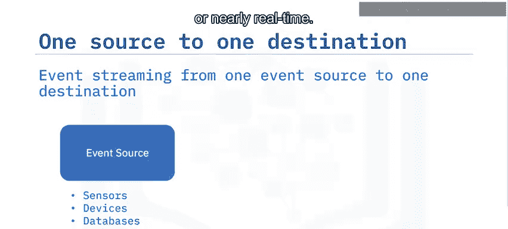

After all that you have learned about ETL so far， you may think that to implement such an ETL process between one event source to one event destination should be straightforward。

 however， what if we have multiple different event sources and destinations？In a real world scenario。

 event streaming can be really complicated with multiple distributed event sources and destinations。

 as data transfer pipelines may be based on different communication protocols such as FTP。

 file transferfer Pro， HTTP， hyperpertext Transfer Pro， JDBC， Java Data connectivity， SCP。

 securere copy， and so on。An event destination can also be an event source simultaneously。

 for example， one application could receive an event stream and process it。

 then transport the processed results as an event stream to another destination to overcome such a challenge of handling different event sources and destinations。

 we will need to employ the event stream platform or ESP。

An ESP acts as a middle layer among various event sources and destinations and provides a unified interface for handling event based ETL As such。

 all event sources only need to send events to an ESP instead of sending them to the individual event destination on the other side。

 event destinations only need to subscribe to an ESP and just consume the event sent from the ESP instead of the individual event source。

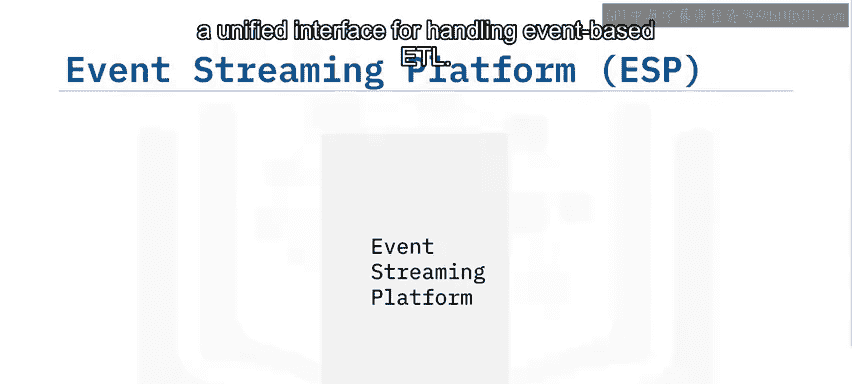

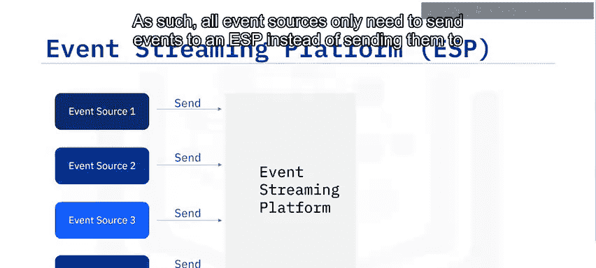

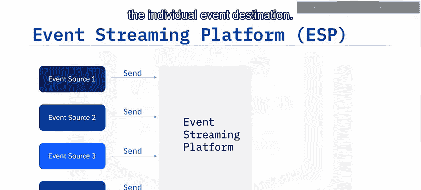

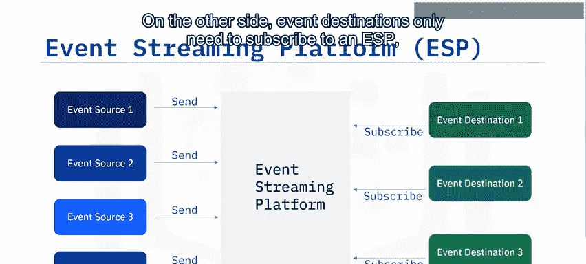

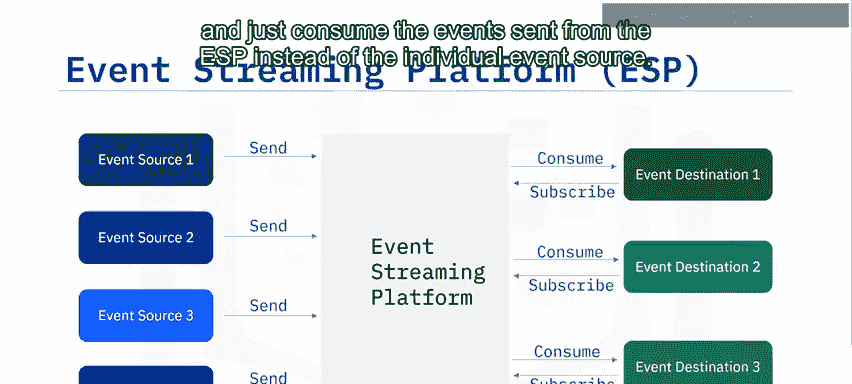

Different ESPs may have different architectures and components here we show you some common components included in most ESP systems。

 The first and foremost component is the event broker。

 which is designed to receive and consume events since it is the core component of an ESP。

 we will explain it in more detail in the next slide。

 The second common component of an ESP is event storage。

 which is used for storing events being received from event sources。 According。

 event destinations do not need to synchronize with event sources。

 and stored events can be retrieved at will。 The third common component is the analytic and query engine。

 which is used for querying and analyzing the stored events。

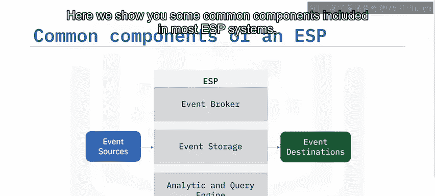

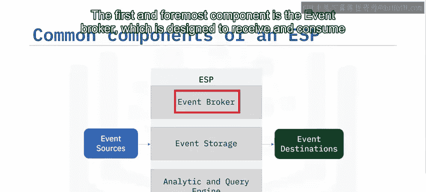

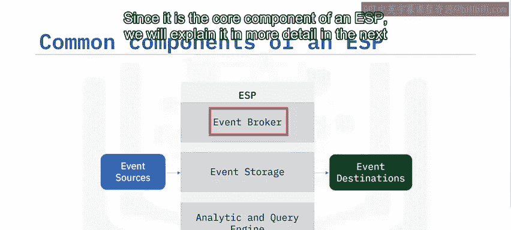

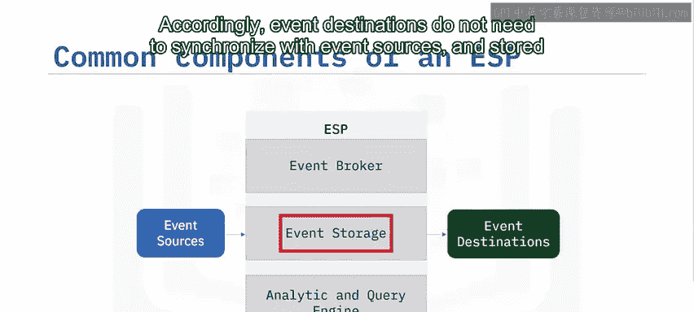

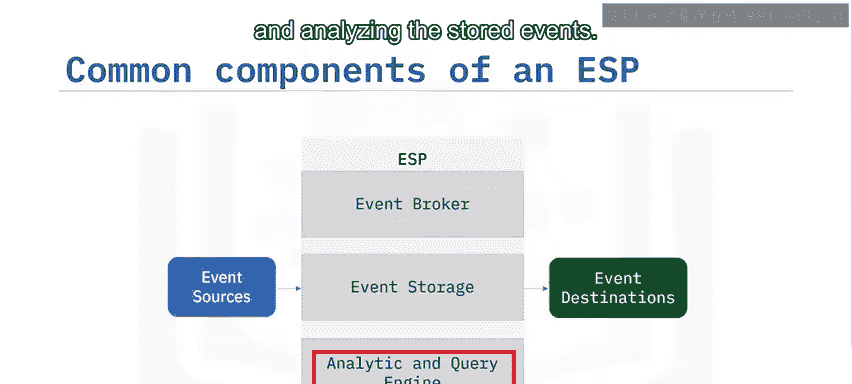

Let's have a look at the event broker， which is the core component of an ESP。

 It normally contains three subcompons， ingeter， processor and consumption The ingter is designed to efficiently receive events from various event sources。

 The processor performs operations on data such as serializing and desializing。

 compressing and decompressing encryption and decryption and so on。

 The consumption component retrieves events from event storage and efficiently distributes them to subscribed event destinations。

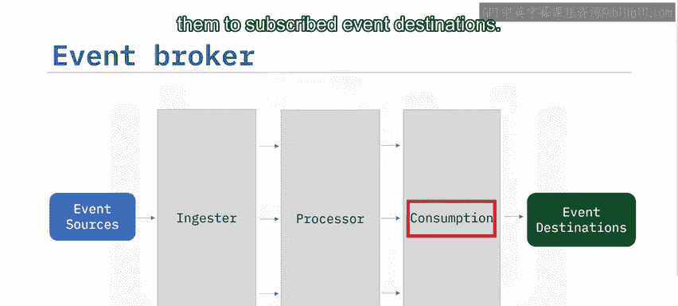

There are many ESP solutions， including Apache Kafka， Amazon kinesis， Apache Flink， Apache Spark。

 Apache Storm， and more such as logg staash in Elastic stack and so on each has its unique features and application scenarios Among these ESPs Apache Kafka is probably the most popular one。

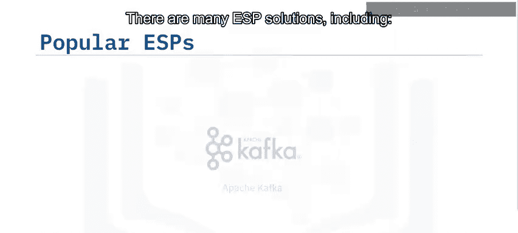

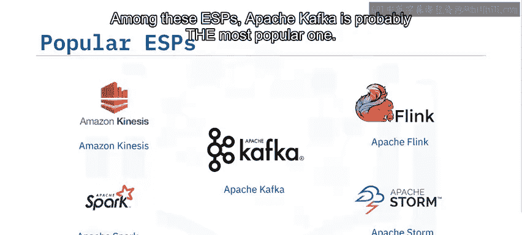

In this video， you learned that an event stream represents entity status updates over time Common event formats include primitive data types。

 key value and key value with a timestamp， and ESP is needed especially when there are multiple event sources and destinations the main components of an ESP or event broker。

 event storage， analytic and query engine Apache Kafka is the most popular open source ESP。

 and finally， popular ESPs include Apache Kafka， Amazon Kinesis， Apache Flink， Apache Spark。

 Apache St and more。

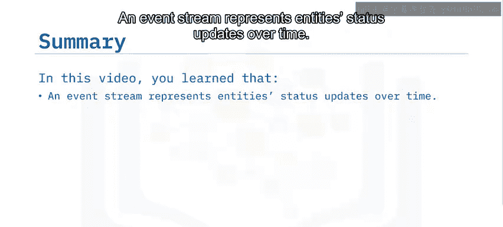

