# IBM数据工程专业证书课程8：《使用Shell、Airflow和Kafka的ETL和数据管道课程（IBM）》｜etl-and-data-pipelines - P1：0_course intro video.zh_en - GPT中英字幕课程资源 - BV1Q94y1r7YG

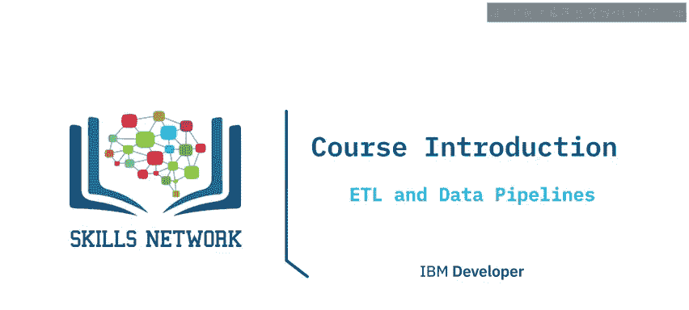

Welcome to this course on ETL and data pipelines with Shell Airflow and Kafka。

 This course is ideal for aspiring big data engineers， machine learning engineers。

 data warehousing specialists as well as developers In this course。

 you will master various ETL and data pipeline tools and techniques。 You will utilize bash scripts。

 as well as cutting edge open source tools such as Apache airflow and Apache Kafka to build data pipelines for processing and moving data between various systems in a data platform。

 You will practice what you learn through handson labs in each module。

 as well as demonstrate your newly acquired skills in a real worldor inspired final project。😊。

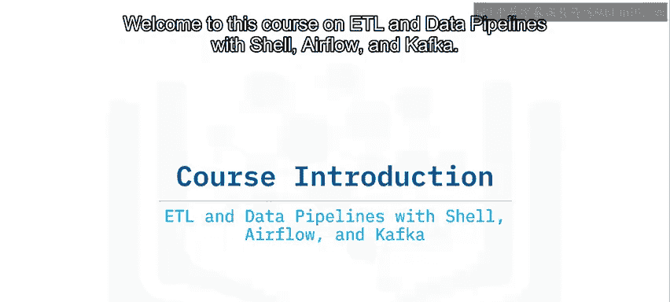

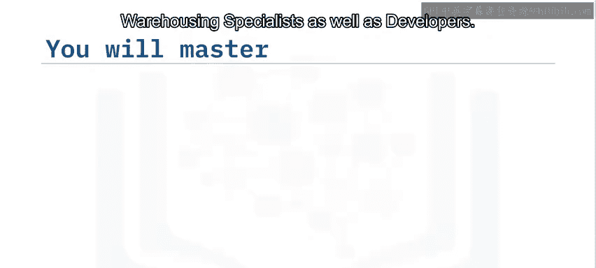

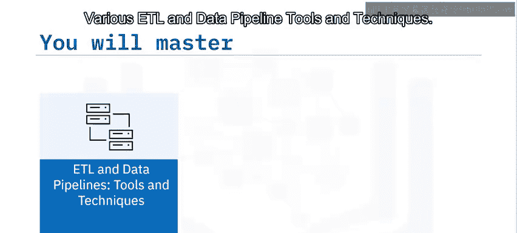

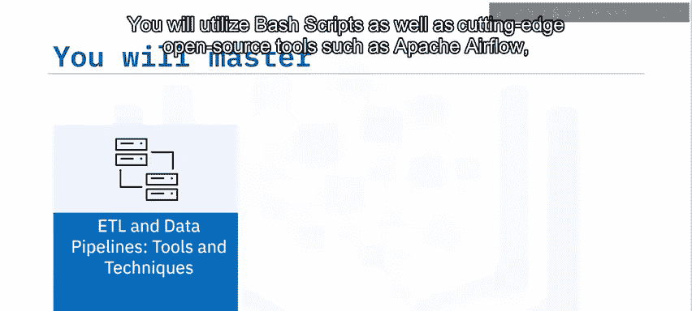

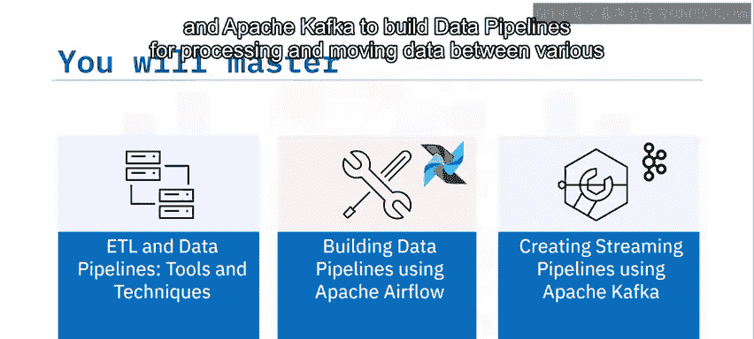

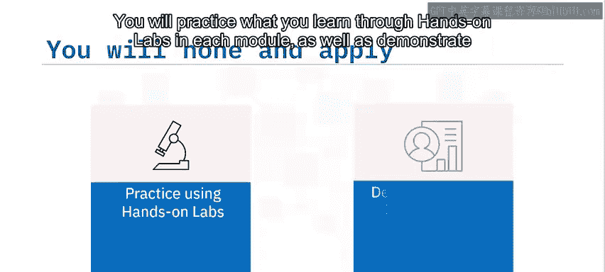

This course has four instructors， Yanlo， Jeff Grosman， Sabrina Spilner and Rammesh Santi。

 Yanlo PhD is a data scientist and developer at IBM Canada。

 He has been building innovative AI and cognitive applications in various areas such as mining software repositories。

 personalized health management， wireless networks and digital banking。

 Janon received his PhD in machine learning from the University of Western Ontario。

 Jeff Grosman PhD has a background in pure Maematics， geophysical signal and image processing。

 medical imaging and data science and engineering。 He is a founder of 617 data solutions Inc and serves as a subject matter expert at skill Up technologies。

 developing data related educational content and volunteers with Camdia Digital form as associate member Alberta。

 Canada。 Sabrina Spner is a senior instructional designer and content developer with skill Up technologies。

 She special。

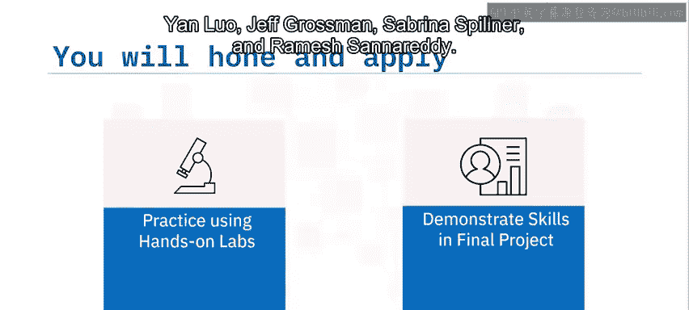

learningFor the past 18 years， Sabrina has been a pathfinder。

 adapting new approaches and technologies to create innovative learning solutions。

 She has worked with Orbis So， the E， the University of Cambridge， KPMG UK and KPMG Lower Gulf。

And Rammesh Sanreti holds a bachelor's degree in information systems from the Bla Institute of Technology Piolai。

 He has two and a half decades of experience in information technology， infrastructure management。

 Data administration， information integration and automation。

 He worked for companies such as Integraph， GenPAact， HCL and Microsoft。

 Currently he is a freelancer and pursues his passion for teaching。 He teaches data science。

 machine learning， programming and databases。In this course。

 you will explore the fundamental principles and techniques behind ETL and ELT processes In module1。

 data processing techniques you will learn to describe what an ETL pipeline is。

 describe why ELT is an emergent trend， De the trending shift from ETL to ELT list examples of raw data sources。

 name data loading techniques and differentiate batch loading from stream loading you will also explore how to construct a basic ETL data pipeline from scratch using batch shell scripting and explore use cases for the two main paradigms within data pipeline engineering batch and streaming data pipelines In module 2 ETL and data pipelines tools and techniques you will learn to De how shell scripting can be used to implement an ETL pipeline De what a data pipeline is describe data pipeline solutions for mitigating dataflow bottlenecks。

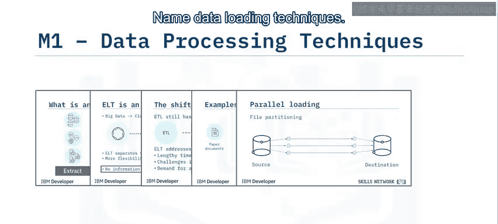

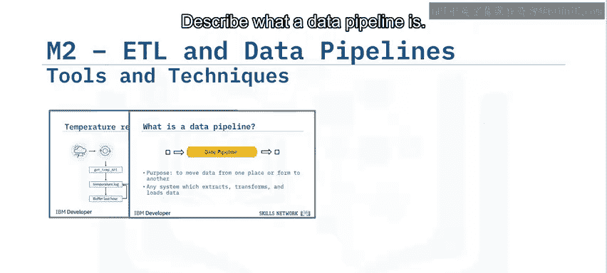

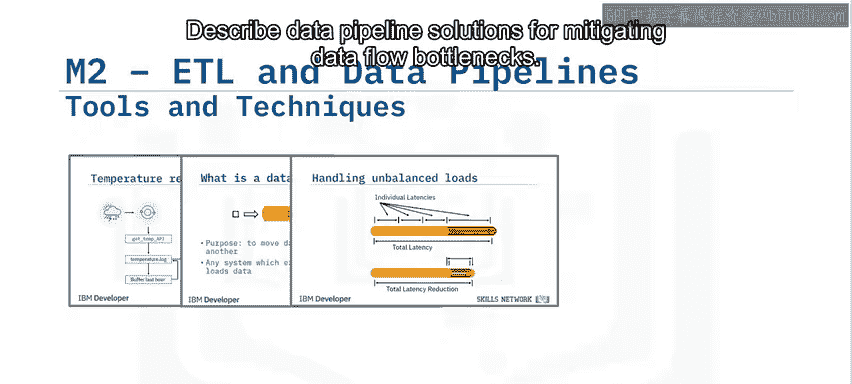

Between batch and streaming data pipelines and discuss data pipeline technologies。

 You will also further cement this knowledge by exploring and applying a popular open source data pipeline tool named Kafka。

In module 3， building data pipelines using airflow。

 you will learn to list the main principles of Apache airflow interpret airflow pipelines as Python scripts to define airflow dag objects list key advantages of defining workflows as code identify current daAgs in your environment and set up dependencies amongst tasks and use logging capabilities to monitor the task status and diagnose problems with DAg runs In module 4。

 building streaming pipelines using Kafka you will learn to list the main components of an ESP recognize Apache Kafka as an event streaming platform De an end to end event streaming pipeline example and describe what the Kafka Sts API is and finally。

 you can test your handson knowledge in module 5 final project your assignments will be to complete a project to create an ETL pipeline using an airflow dag and build a streaming ETL pipeline。

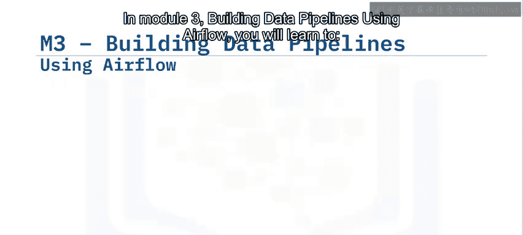

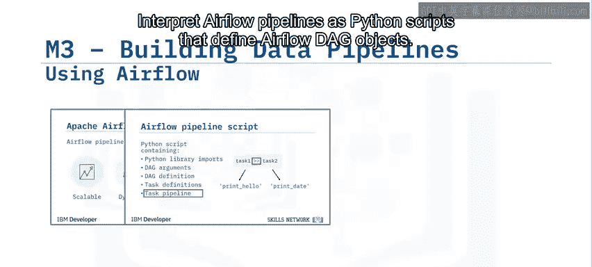

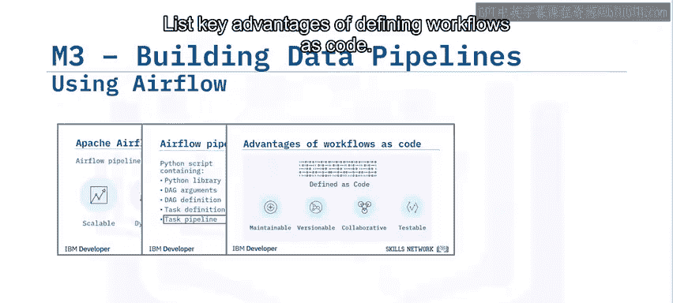

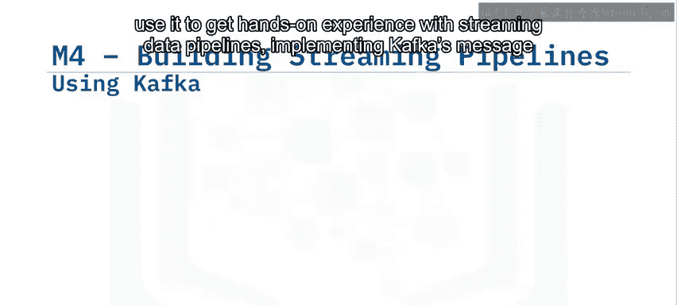

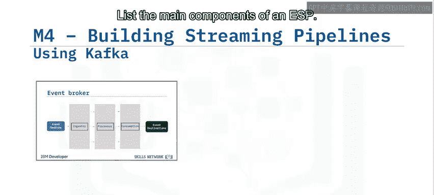

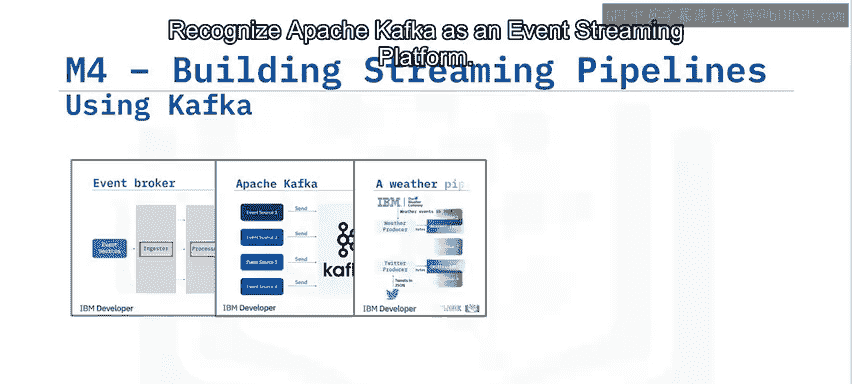

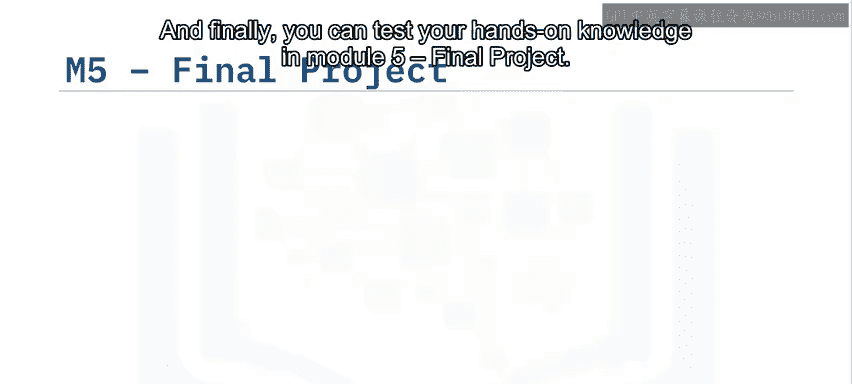

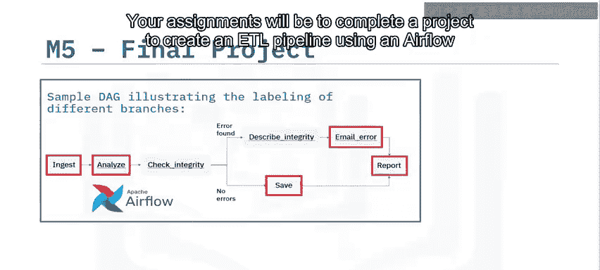

Using Kafka to get the most from this course， watch every video and check your learning by taking all quizzes。

 use the discussion forums to connect with your peers and the teaching assistants。

 and most importantly， make sure you complete the handson labs to practice your new skills and demonstrate your abilities。

 congratulations on beginning the next step on this exciting journey and good luck。

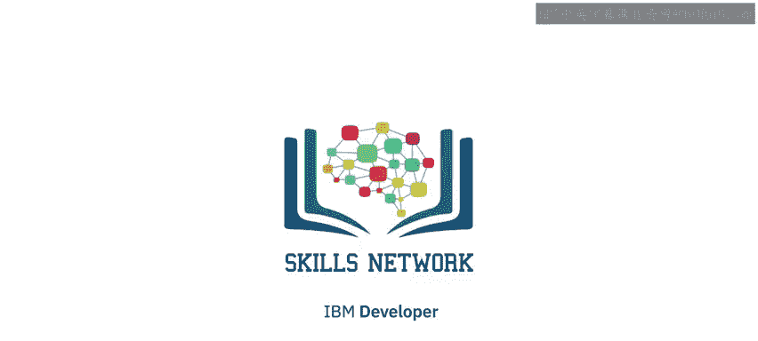