# IBM数据工程专业证书课程8：《使用Shell、Airflow和Kafka的ETL和数据管道课程（IBM）》｜etl-and-data-pipelines - P2：1_etl 基础知识.zh_en - GPT中英字幕课程资源 - BV1Q94y1r7YG

Welcome to ETL fundamentalamentals After watching this video you will be able to describe what an ETL process is describe what data extraction means。

 describe what data transformation means describe what data loading means and list use cases for ETL processes what is an ETL process ETL stands for extract transform and load ETL is an automated data pipeline engineering methodology whereby data is acquired and prepared for subsequent use in an analytics environment such as a data warehouse or datamart ETL refers to the process of curating data from multiple sources。

 conforming it to a unified data format or structure and then loading the transform data into its new environment the extraction process obtains or reads the data from one or more sources the transformation process wrangles the data into a format that is suitable for。

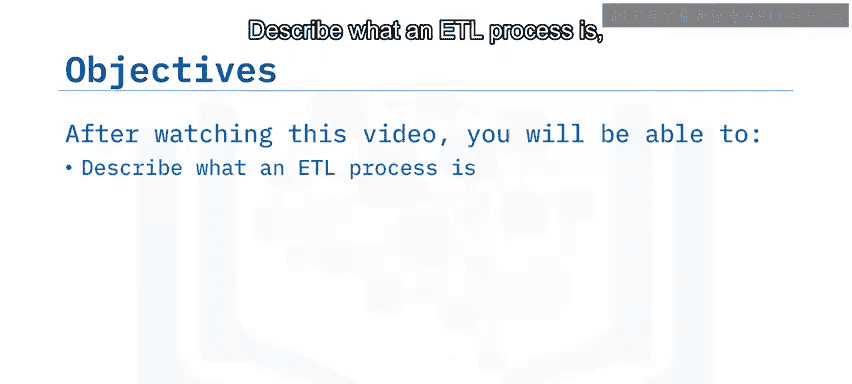

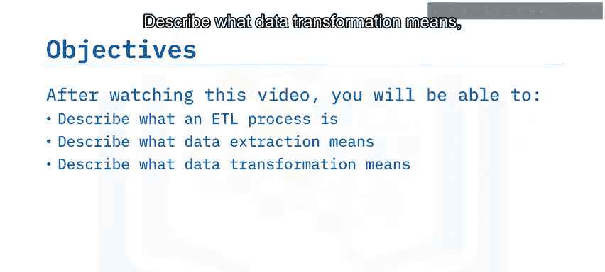

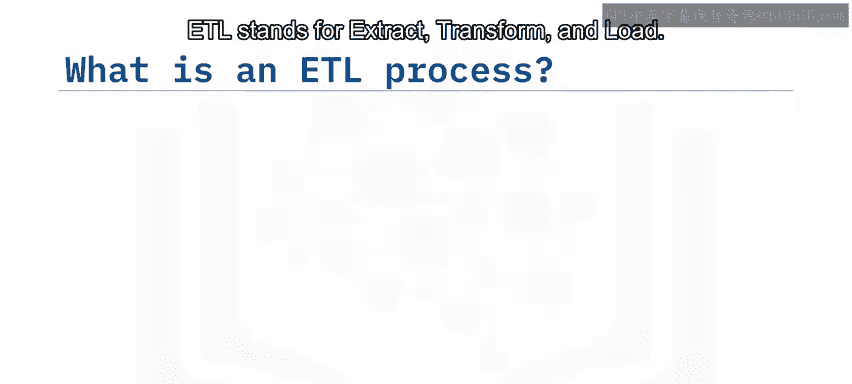

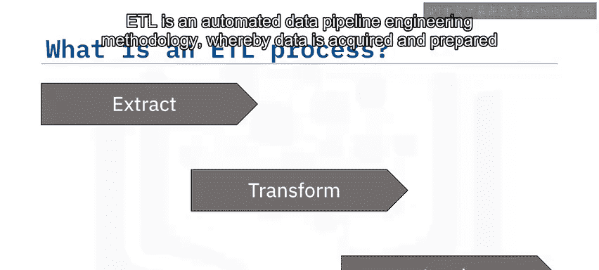

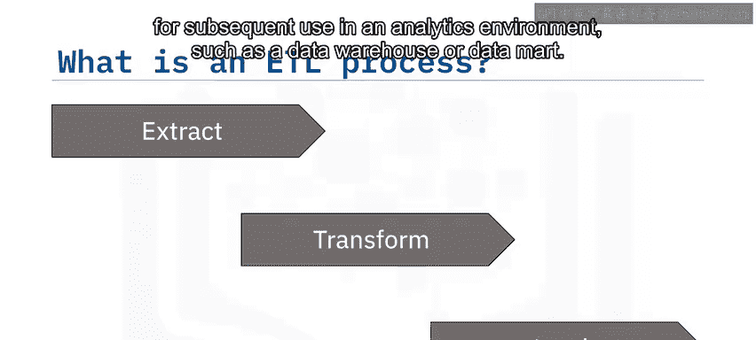

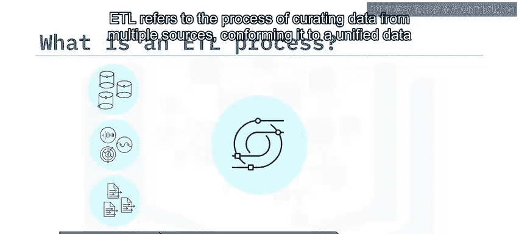

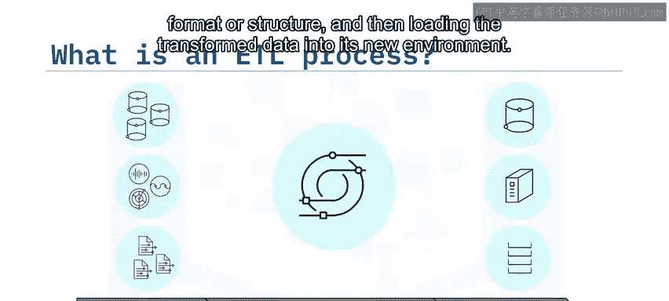

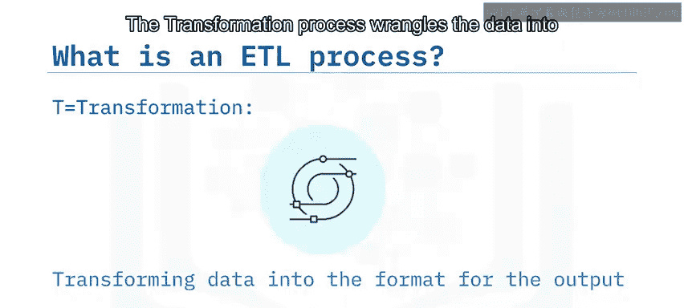

Destination and its intended use The final loading process takes the transform data and loads it into its new environment。

 ready for visualization， exploration， further transformation and modeling the curated data may also be utilized to support automation and decision making What is extraction to extract data is to configure access to it and read it into an applicationNormally。

 this is an automated process some common methods include web scraping where data is extracted from web pages using applications such as Python or R to parse the underlying HTML code and using APIs to programmatically connect to data and query it the source data may be relatively static such as a data archive in which case the extraction step would be a stage within a batch process On the other hand。

 the data could be streaming live and from many locations examples include。

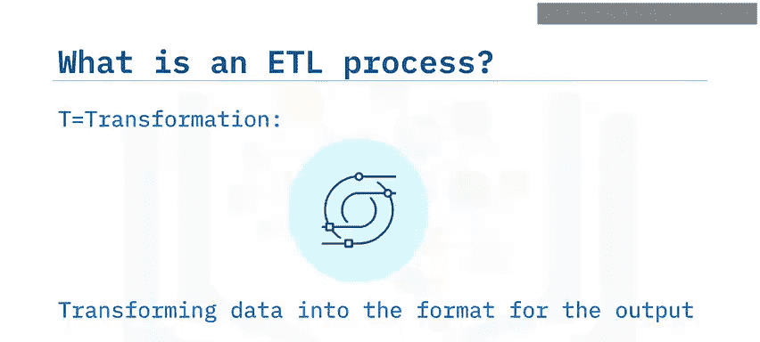

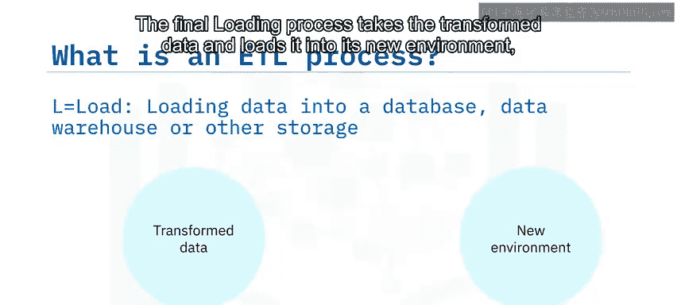

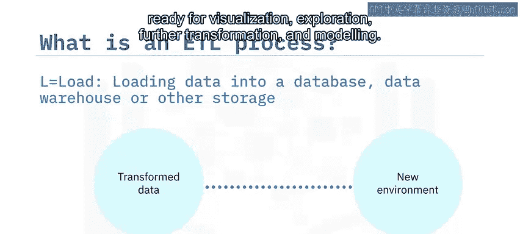

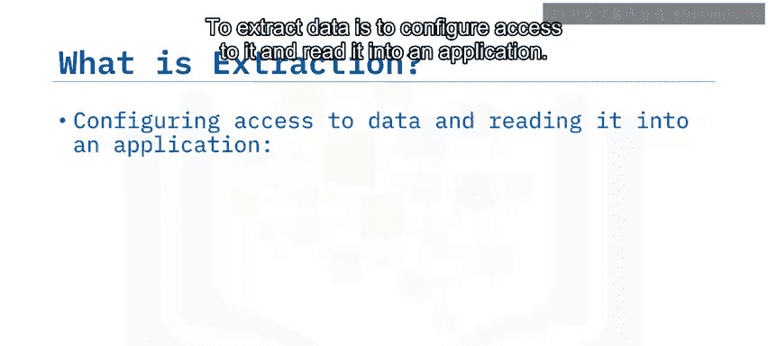

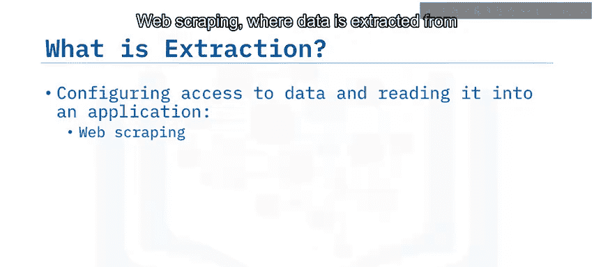

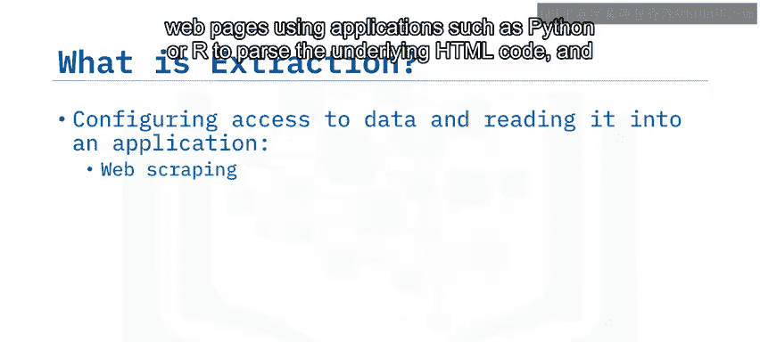

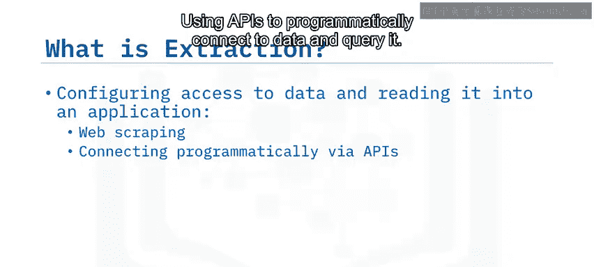

Weather station data， social networking feeds and Io devices What is data transformation Data transformation also known as data wrangling means processing data to make it conform to the requirements of both the target system and the intended use case for the curated data Trans can include any of the following kinds of processes cleaning。

 fixing errors or missing values， filtering， selecting only what is needed Join disparate data sources merging related data。

 feature engineering such as creating Kpis for dashboards or machine learning and formatting and data typing。

 making the data compatible with its destination What is data loading generally this just means writing data to some new destination environment typical destinations include databases。

 data warehouses and data mars the key goal of data loading is to make the data readily available for。

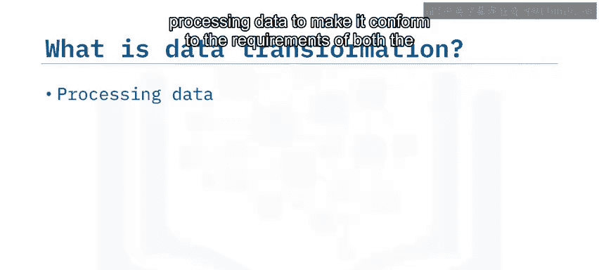

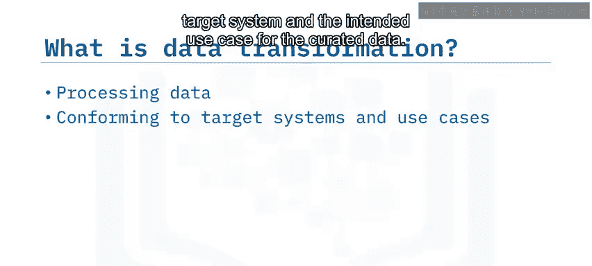

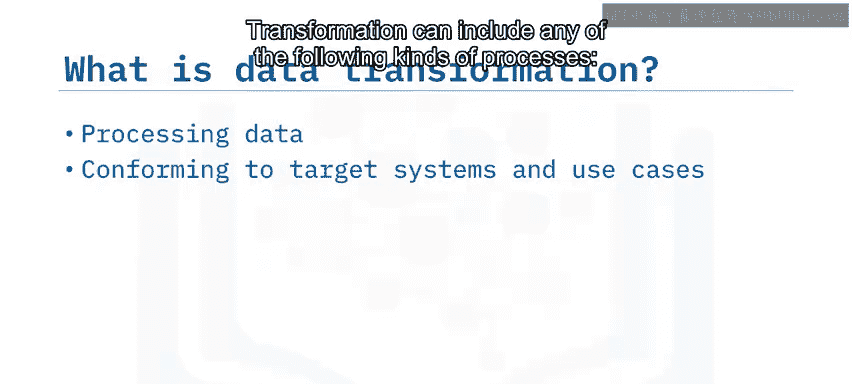

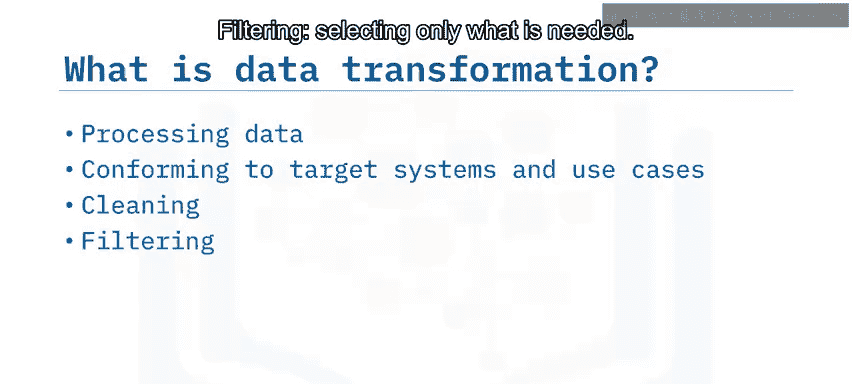

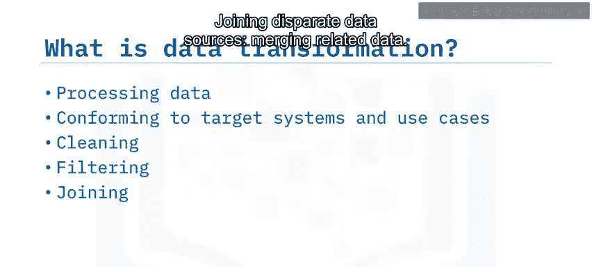

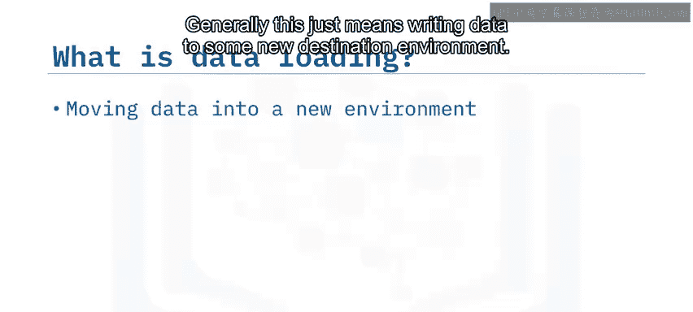

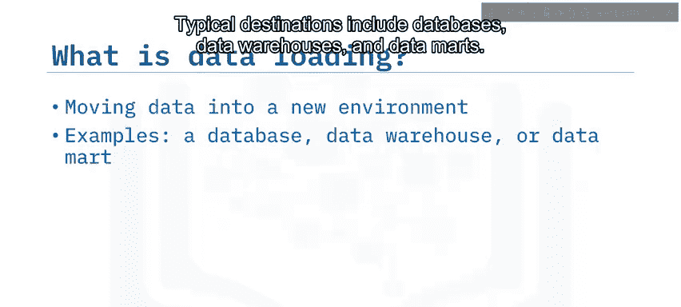

Ingestion by analytics applications so that end users can gain value from it applications include dashboards。

 reports and advanced analytics such as forecasting and classification There are many use cases for ETL pipelines a very large amount of information is either already recorded or being generated but is not yet captured or accessible as a digital file Ex include paper documents。

 photos and illustrations and analog audio and videotapes Diitizing analog data includes extraction by some form of scanning analog to digital transformation and finally。

 storage into a repository online transaction processing or OLTP systems do not save historical data According。

 ETL processes capture the transaction history and prepare it for subsequent analysis in an online analytical processing or OLAP。

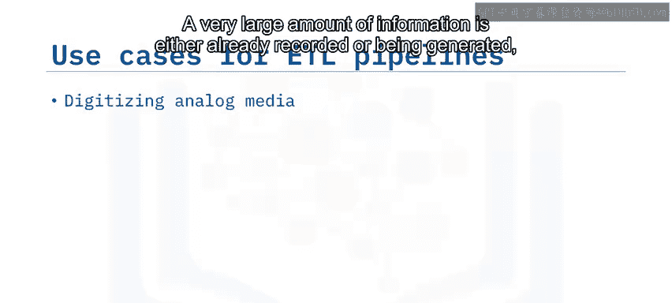

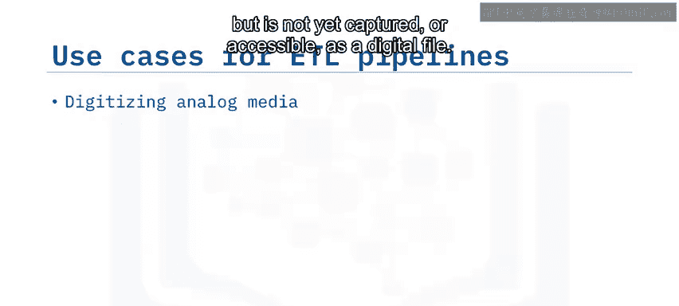

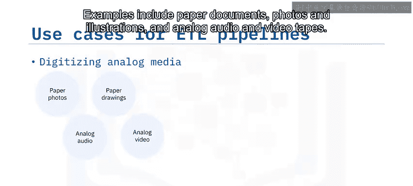

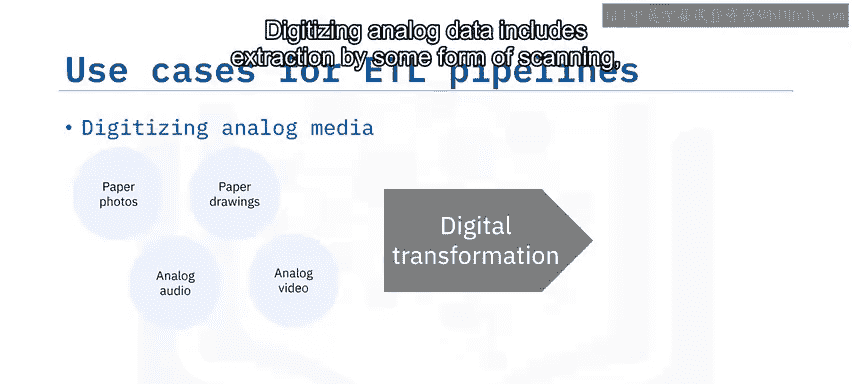

Other use cases include engineering features or KPIs from data sources as preparation for ingestion by dashboards used by operations。

 sales and marketing， customers and executives and training and deploying machine learning models for prediction and augmented decision making In this video you learned that ETL extract transform。

 load is an acronym for an automated data pipeline engineering methodology。

 whereby data is acquired and prepared for subsequent use in an analytics environment such as a data warehouse or datamart the extraction process obtains the data from one or more sources the transformation process wrangles the data into a format that is suitable for its destination and its intended use the final loading process takes the transform data and loads it into its new environment ready for visualization。

 exploration further transformation and。

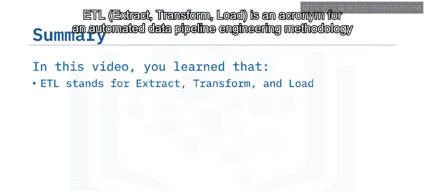

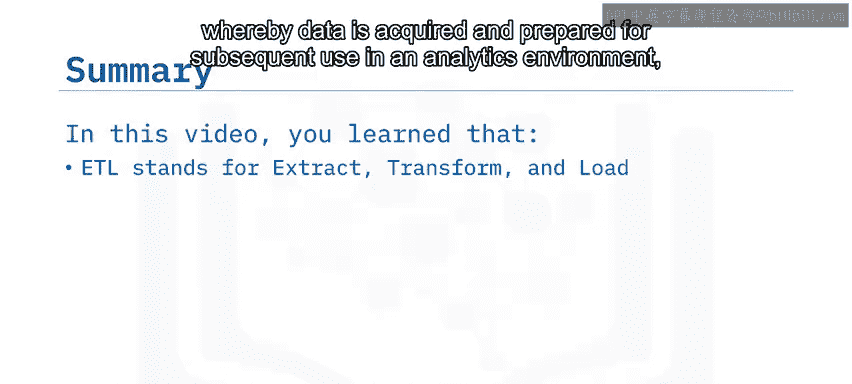

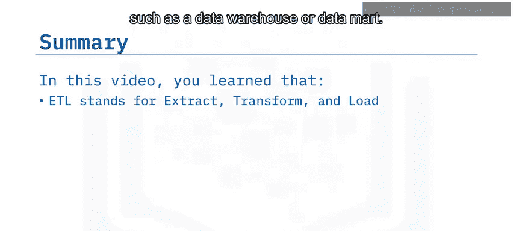

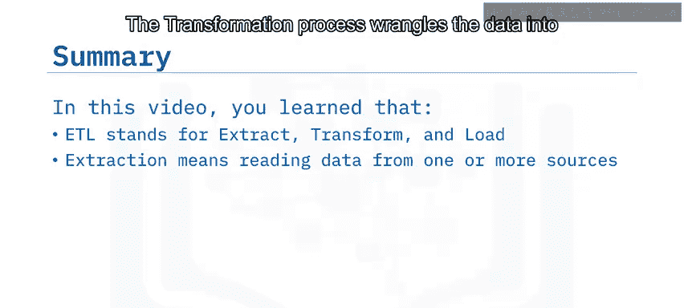

odeingAnd finally， ETL is used for curating data and making it accessible to end users， for example。

 training and deploying machine learning models for prediction and augmented decision making。

