# IBM数据工程专业证书课程8：《使用Shell、Airflow和Kafka的ETL和数据管道课程（IBM）》｜etl-and-data-pipelines - P3：2_elt 基础知识.zh_en - GPT中英字幕课程资源 - BV1Q94y1r7YG

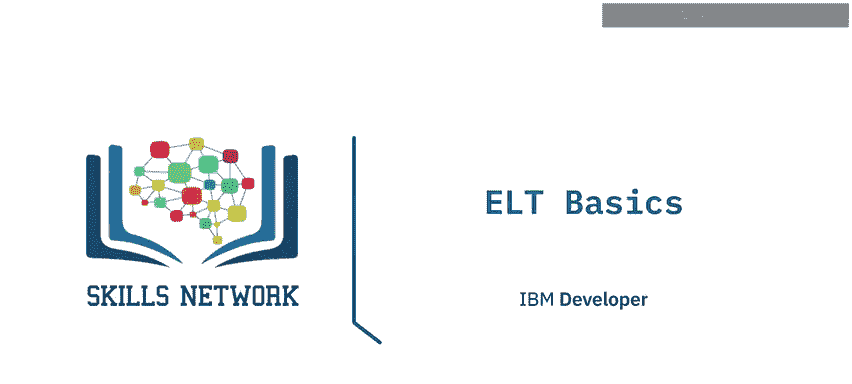

Welcome to ELT Bass After watching this video， you will be able to describe what an ELT process is。

 list use cases for ELT processes， and describe why ELT is an emergent trend。

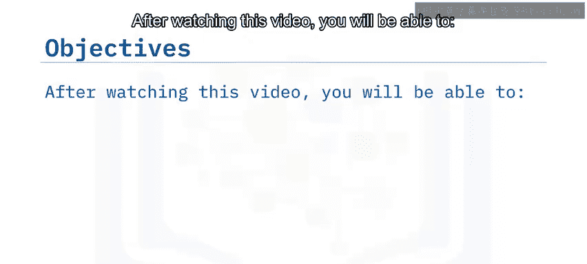

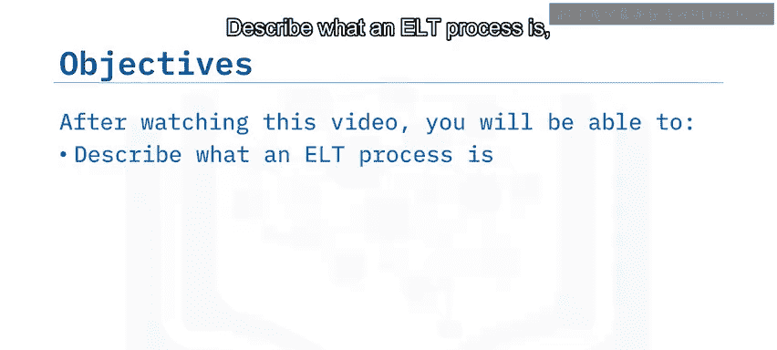

What is an ELT process， ELT stands for extract， load and Transform。

 ELT is an acronym for a specific automated data pipeline engineering methodology。

 ELT is similar to ETL in that similar stages are involved。

 but the odor in which they are performed is different。

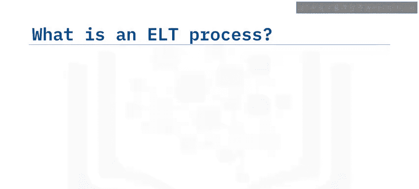

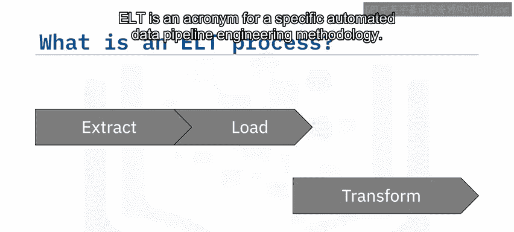

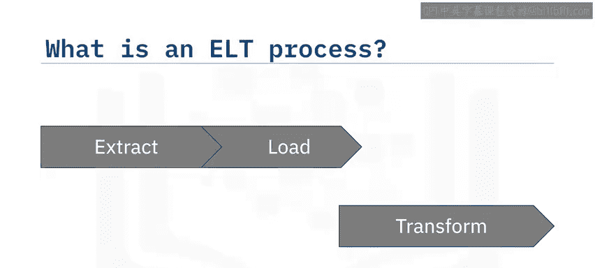

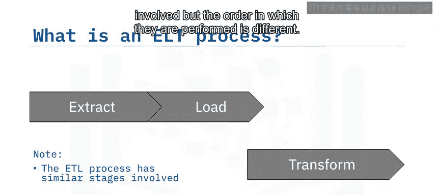

For ELT processes， data is acquired and directly loaded as is into its destination environment from its new home。

 usually a sophisticated analytics platform such as a data lake。

 it can be transformed on demand and however users' wish like ETL。

 the first stage in the ELT process is extraction the extraction process obtains the data from all sources and reads the data often in an asynchronous fashion into an application。

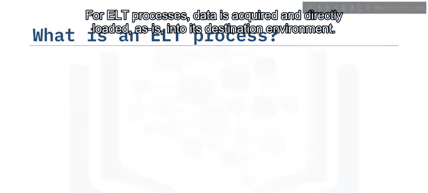

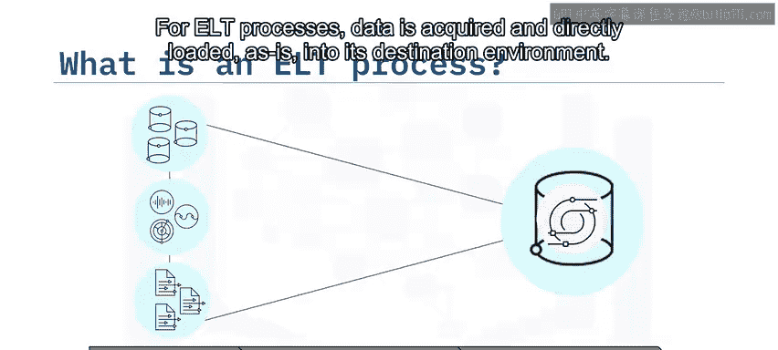

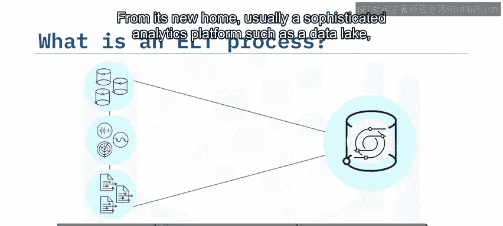

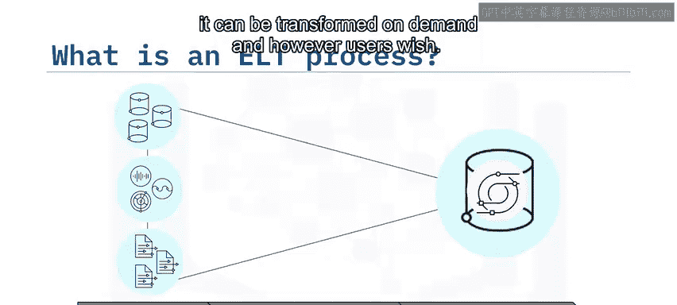

The loading process takes the raw data as is and loads it into its new environment where modern analytics tools can then be used directly The transformation process for ELT is much more dynamic than it is for conventional ETL modern analytics tools in the destination environment enable interactive on-deman exploration and visualization of your data。

 including advanced analytics such as modeling and prediction Use cases for ELT processes typically fall within the high performance computing and big data realms cases include dealing with the massive swings and scale that come with implementing big data products calculating realtime analytics on straining big data and bringing together data sources that are highly distributed around the globe In terms of speed。

 moving data is usually more of a bottleneck than processing it。

 so the less you move it the better therefore。

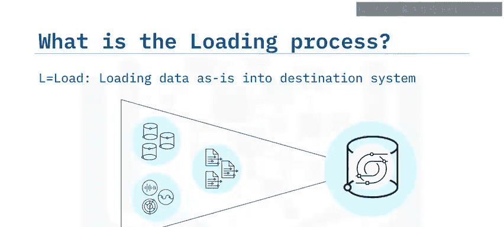

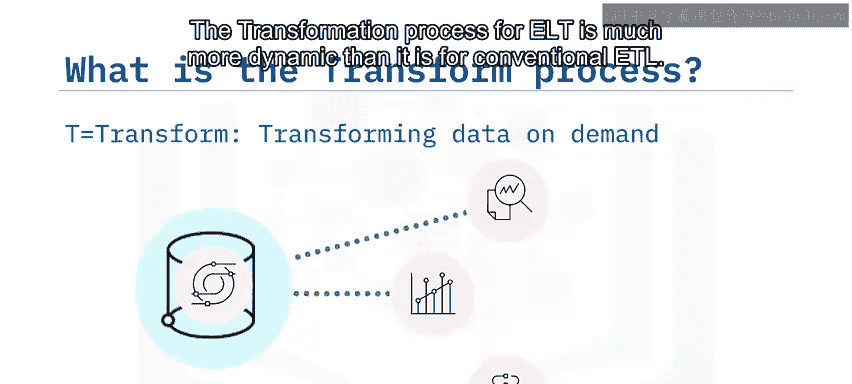

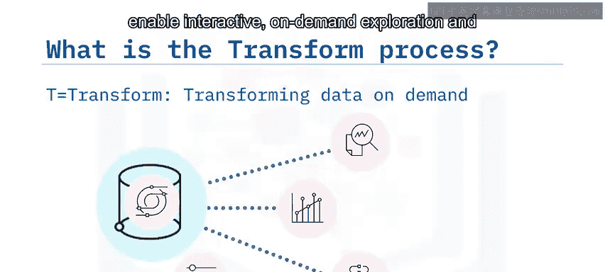

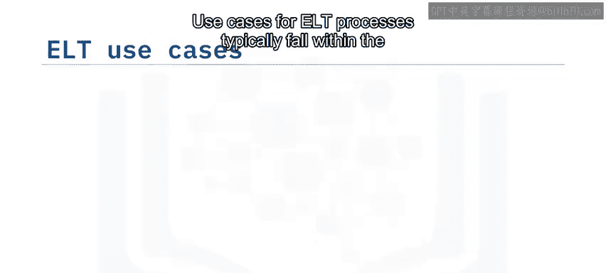

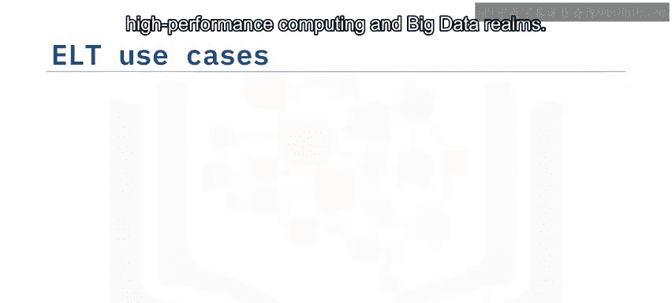

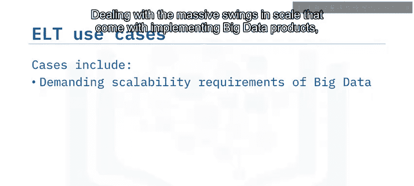

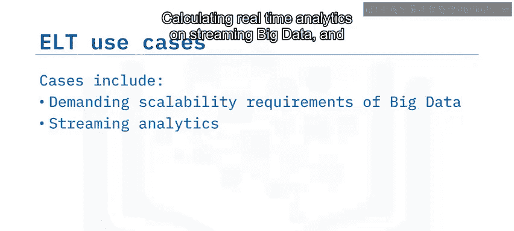

Te may be your best bet when you want flexibility in building a suite of data products from the same sources。

Why is ELT emerging。 Firstly， cloud computing solutions are evolving at tremendous rates due to the demands of big data。

 They can easily handle huge amounts of asynchronous data。

 which can be highly distributed around the world。

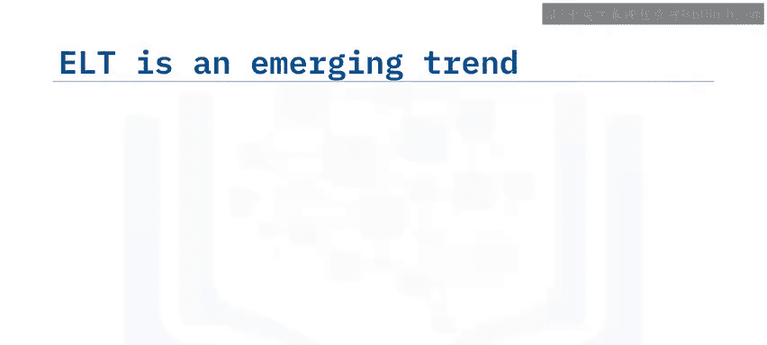

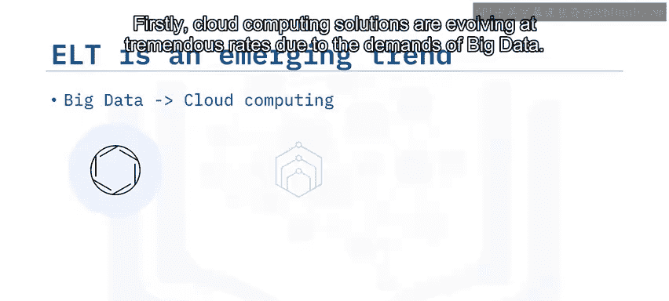

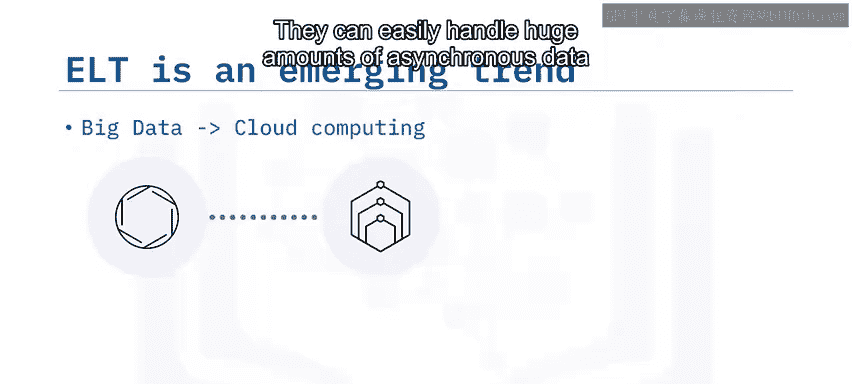

Cloud computing resources are practically unlimited and they can scale on demand。

 Unlike traditional on- premises hardware， you only pay for the computing resources you use。

 you do not have to worry about underutilizing resources that is overspending on equipment with ELT。

 you can have a clean separation between moving data and processing data。 Of course。

 cloud computing is equally prepared to handle the most challenging cases for either of these two tasks There may be many reasons to transform your data and just as many ways to do it。

 Thus ELT is a flexible option that enables a variety of applications from the same source of data。

 because you are working with a replica of the source data， there is no information loss。

 Many kinds of transformations can lead to information loss。

 and if these happens somewhere upstream in the pipeline。

 it may be a long time before you can have a change request。

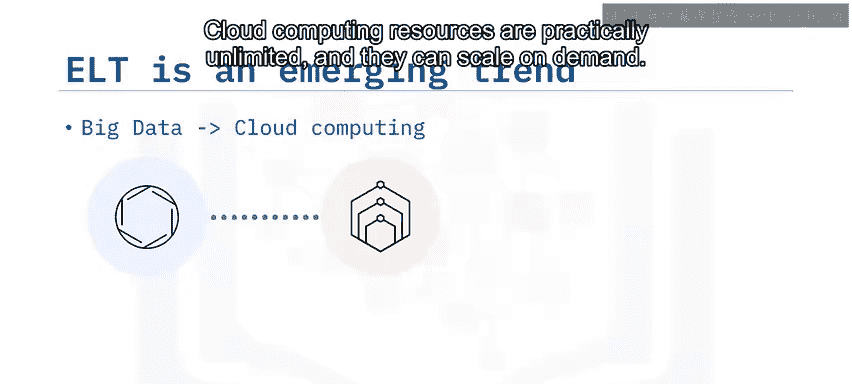

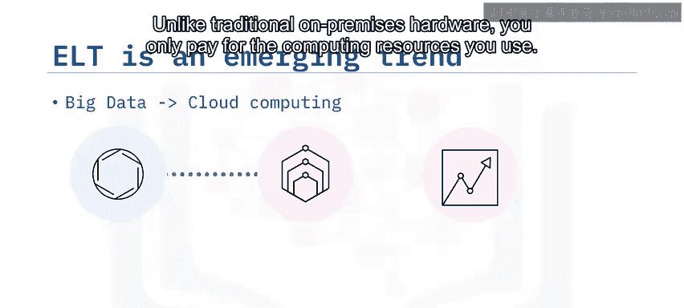

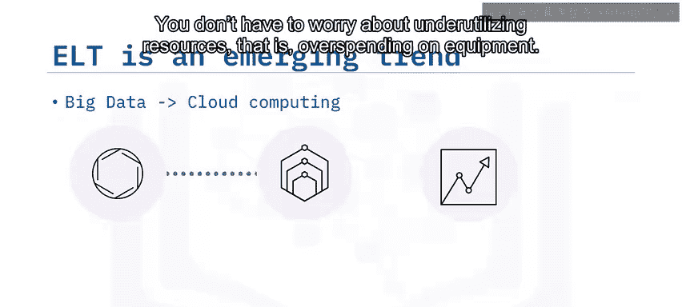

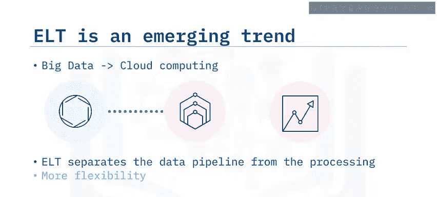

Worse yet， the information may be forever lost if the raw data is not stored。In this video。

 you learned that ELT processes are used for cases where flexibility。

 speed and scalability are important； Cloud based analytics platforms are ideally suited for handling big data and ELT processes in a cost efficientic manner。

 and ELT is an emerging trend mainly because cloud platformform technologies are enabling it。

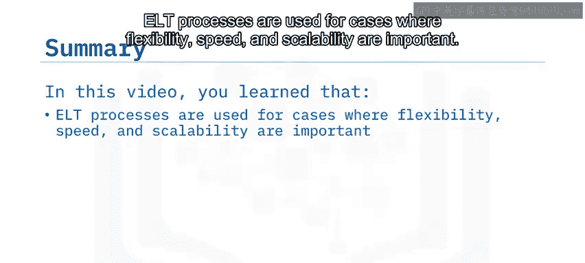